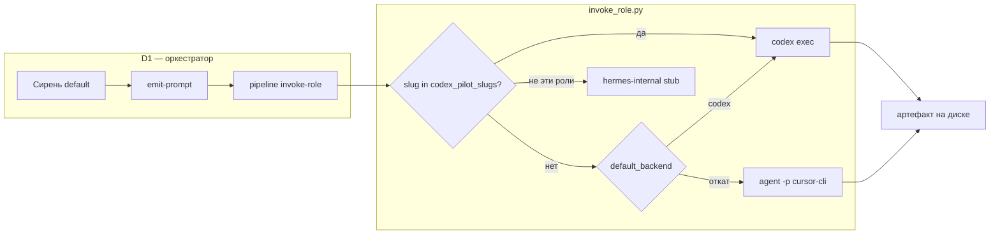

# DevWorkflow — мастер-ТЗ машины разработки без канбана

**Текущий пакет — Б56 (утверждённое ТЗ формата межфазовых пакетов).** Повторная `REV:tz APPROVE` (раунд 2, 02.11.2026) закрыла R1/R2; `TZ:finalize` сохраняет согласованный корпус и версию. Б55 утверждён ранее и сохраняется без переписывания своего корпуса/AC; current/target нового пакета — Б56. Ни новый формат, ни его проверки этим текстом не объявляются реализованными.

**Предыдущий пакет — Б55.** `current`: существующий DevWorkflow на файловом состоянии; подтверждённый режим на снимке разбора — `workflow-only`. `target`: одна задача на весь процесс изменения Hermes/USERTOOLS, FIFO и продолжение без сообщения Саши. Фактическая готовность механизмов проверяется отдельно; текст ТЗ не является runtime evidence.

Это **инфраструктурный план**, не USERTOOL и не правка ядра Hermes. Исходный переход от канбана описан в Б1–Б54 и сохранён как история решений. Изменения порядка — Б55.1; новый контракт передачи контекста — Б56 после его реализации и включения. Неизменённые контракты продолжают действовать.

Кейс текущего слага в `_state.json` — `DEV`; архитектор его не меняет. Рецепт, ревизия, реализация и испытания исполняются отдельными фазами существующего DevWorkflow.

---

## Карта документа — как связаны блоки

Читать сверху вниз. При проверке ревизором — по этой таблице: каждый блок либо опирается на предыдущие, либо отдаёт контракт следующим.

| Блок | О чём | Опирается на | Отдаёт дальше |
|---|---|---|---|
| **Б0** | Как читать, имена, границы | — | словарь для всего ТЗ |
| **Б1** | Решения Саши 13.10; **Б1.8** риски 14.10; **Б1.9** продукт 14.10 | закрытый бриф, сводка A–E | обязательные нормы Б3–Б36 |
| **Б2** | Почему канбан отказали | факты 26.09–13.10, A1–C15 | мотив вердикта Б3, закрытие ошибок Б29 |
| **Б3** | Вердикт и три слоя | Б1, Б2 | архитектура Б8–Б16 |
| **Б4** | Развилки архитектора Q-Archi-01..06 | Б1 вопрос 3–4, риски 14.10, Блок E | контракт Python vs скилл (Б7), invoke (Б13), слои хранения (Б12), handoff (Б13.4), продукт (Б13.5) |
| **Б5** | Что сохранить из канбана | Б1 вопрос 2 | слой статусов Б11, бэклог Б28 |
| **Б6** | Канон внутри скилла; G1 ещё drift выжимки; **v0.4.1:** G6 таблица исчерпывающая (RS:collect / MIG:block-k / SK:preflight); **v0.5.0:** модели ролей = Codex (Б45), G6 «invoke-роль не звать» | GLOSSARY 0.2.15, Б1 вопрос 1, Б12, Б45 | рецепты Б18–Б27 |
| **Б7** | Карта «код / скилл» (T3) | Б3, Б4 | границы Б8, Б9 |
| **Б8** | Файлы `pipeline/`; **v0.6.1:** `cmd_set_case` pop `state_sha256` после `set_case` | Б7, T1, T4, Б47 | CLI Б16, инварианты Б17; AC-117 |
| **Б9** | Структура скилла; процедура REV в `SKILL.md`; MUST-read в `references/context.md`; docs комплекта (README, onboarding, cases-guide, config.example) | Б1, Б6, Б7, Б12, Б13.5, Б16.1 | установка Б13.3, продукт Б13.5, миграция Б31 |
| **Б10** | Очередь и состояние (T1); ключ выжимки в `_state.json`; **v0.4.5:** occupancy ≠ CLI-mutex; abort сжигает имя; **v0.4.6:** живой invoke с `pid=None` ≠ leftover, второй поезд поверх запрещён; **v0.4.8:** окно pre-invoke (`awaiting_invoke`) + `recover_counts` + journal `recover`; **v0.4.9:** occupancy `complete-phase`/`next`/`invoke` пока жив wrapper этого слага; **v0.6.1:** рабочий dict после `set_case` без stored sha | Б3, Б8, Б12, Б40, Б41, Б43, Б44, Б47 | complete-phase Б16, журнал T5, reuse compress Б18.4; AC-058/059/063/071/076/078/117 |
| **Б11** | Формат статуса (T2); **v0.4.5:** running только при живом PID; **v0.4.6:** leftover `--check` не включает окно post-invoke | Б5 слой 2, Б40, Б41 | CLI `status`, HITL; AC-060/062/063 |
| **Б12** | Точечный контекст: три слоя хранения, доктрина двух источников, MUST-read, ключ выжимки; **v0.6.0:** MUST-read TZ/REV = секции (не весь master по умолчанию) | Б1 вопрос 3, Б4 Q-Archi-02/04/05, Б46 П.2 | emit-prompt в Б18–Б27; G1 в Б6.5; AC-097…099 |
| **Б13** | Переносимость и `invoke_role` (T4); **Б13.3** установка; **Б13.4** handoff слага; **Б13.5** продукт/платформа; **v0.4.2:** post-invoke проверка канонического имени артефакта; **v0.4.5:** PID-probe ≠ sirene без pid; **v0.4.6:** pid до spawn; окно post-invoke; запрет пайпа stdout; **v0.4.8:** model на `invoke_prepare`; канон артефакта расширен (TZ:patch / diagnose / RS / MIG); пустой JSON `result` ≠ proof; **v0.4.9:** `session_id` из JSON агента; конец хода ≠ notify; **v0.5.0:** default backend = `codex exec` (Б45); cursor-cli = откат; **v0.6.2:** трёхзначный control-flow `classify_provider_fatal` (успешный JSON ≠ JSON-ошибка ≠ не-JSON) | Б1.4, Б1.9, Q-Archi-03/04/06, Б40, Б41, Б43, Б44, Б45, Б48 | конфиг Б14, комплект поставки, AC-025/040/042/047/060/061/062/064/073/075/076/077/081/082/119/120 |
| **Б14** | Единый конфиг; **v0.3.2:** `orchestration.mode` / `orchestration.pilot_slugs`; **v0.5.0:** `invoke.default_backend: codex`, effort/LIGHT/escalate в `roles.*` (Б45) | eco-config §10, Блок F, Б45 | ключи YAML, запрет `.env`, dual-path |
| **Б15** | Хранение ТЗ и архивация | TZ-storage-system, инвентарь | `TZ:finalize`, DECOMM |
| **Б16** | Цикл оркестратора; **Б16.1** согласование архитектор↔ревизор (REV сверяет выжимку с master); **v0.4.2:** канон `REV-tz.md`/`REV-plan.md`, `rev_verdict()` только блок «## Вердикт»; **Б16.4 v0.4.5:** occupancy leftover + PID-probe sirene; **Б16.5 v0.4.6:** слепота PID invoke + второй поезд; **Б16.6 v0.4.8:** action `RECOVER` + тот же ход recover/warn/next; **Б16.7 v0.4.9:** граница хода = journal/канон/ps, не notify Cursor; doorbell-спека; **v0.6.0:** fingerprint без `canon_mtime` при живом pid; `queue=<n>` | Б3, Б6.4, Б8, Б10, Б12, Б40, Б41, Б43, Б44, Б46 | complete-phase/next всех кейсов; протокол REV для Б9, Б18; AC-037/047/058/060/061…064/071…079/109 |
| **Б17** | Обязательные поля между фазами (в т.ч. extract_sha256 в context-used); **v0.6.0:** auto-гейт = воркер без LLM (улики без изменений) | Б6, Б10, Б12, Б16, Б46 П.4 | чеклисты Б18–Б27, preflight; AC-104…106 |
| **Б18** | Кейс CHANGE — полный цикл; норматив compress/reuse | Б6, Б12, Б16, Б16.1, Б17 | эталон для Б19–Б27 |
| **Б19–Б27** | Остальные 9 кейсов | Б18 как эталон | отличия рецепта и артефактов |
| **Б28** | Бэклог идей | Б5 слой 2 | статус triage |
| **Б29** | Закрытие ошибок A1–C15; **v0.4.5:** A3 PID-probe не равен «sirene без pid»; **v0.4.6:** A3 не равен «живой invoke с незаписанным pid» | Б2, question1, Б40, Б41 | риски в AC; AC-060/061/063 |
| **Б30** | Перенос истории канбана (T5) | Б1 В1 | W4, журнал |
| **Б31** | Миграция W0–W4 и откат; **v0.4.5:** abort сжигает каноническое имя пилота (`eco-config-w4`) | Б1 В2, вопрос 5, Б40 | AC миграции; AC-059 |
| **Б32** | Ошибки инструмента → ErrorBus | Б1 вопрос 2 | `--tool dev_workflow` |
| **Б33** | Что НЕ делать (поведение машины); SQL не SoT/не кэш/не транспорт; обход скилла и PMO-подмена запрещены; **v0.4.5:** п.39–41 occupancy leftover / abort канона / dead-pid на sirene; **v0.4.6:** п.42–45 слепота PID invoke / второй поезд / post-invoke dead-pid / пайп stdout; **v0.4.8:** п.46–50 recoverable INTERRUPTED ждать Сашу / крон-reaper как recover / второй recover-pass / json.dump recover / complete без model; **v0.4.9:** п.51–55 notify как конец хода / complete поверх живого wrapper / канон dwka_guard / замена pid / крон doorbell без глагола; **v0.6.0:** п.63–65 лимиты ходов фазы не ядром / auto-close без патча gateway / SQL telemetry ro допустим; **v0.6.1:** п.66–67 `from_dict` без pop после `set_case` / ослабление `from_dict` или sha в recipe; **v0.6.2:** п.68–69 сливать None успешного JSON с не-JSON / лечить ложный fatal через recoverable или выкидывание паттерна; **v0.7.0:** п.70 сырой SQL write / обход `SessionDB.end_session`; п.71 лимиты ходов в `warn_after` / `agent.max_turns`; **v0.7.3:** п.72 не фильтровать штатный `session_reset` по mode; п.73 принимать failed/non-JSON provider output как audit evidence/detail | Б3 вердикт, Б12, Б13.4, Б13.5, Б40, Б41, Б43, Б44, Б46, Б47, Б48, Б49, Б50, Б51, Б52 | неприемлемость |
| **Б34** | Критерии приёмки AC пакета W1 (+ AC-036…042 класс S); **v0.4.2:** AC-047 канон имени + парсинг вердикта; **v0.4.5:** AC-058…060 класс S; **v0.4.6:** AC-061…064 класс S; **v0.4.7:** AC-065…070; **v0.4.8:** AC-071…075 класс S; **v0.4.9:** AC-076…079 класс S; **v0.5.0:** AC-080…093 (Codex); **v0.6.0:** AC-094…116 (`llm-cost-optimization`; O: ставь кроны / удаляй); **v0.6.1:** AC-117…118 (`pipeline-set-case-crisis-sha-bug`); **v0.6.2:** AC-119…120 (`ktalk-tmo-fatal-classifier`); **v0.7.0:** AC-108/113 валят GATE:done слага `hard-stop-…`; AC-121 O `ставь кроны` watcher; **v0.7.3:** AC-122…128 (`llmanomalyscan-shlet-lozhnyy-critical-session-mo`); **v0.7.4:** AC-129…137 (`suzit-cursor-cli-do-transport-owner-ubrat-recove`, boundary-only); **v0.7.5:** AC-P1…P6 (`hermes-bugfix-cursor-boundary`, explicit-only gateway Remote-SSH trigger); **v0.7.6:** COD-C1…C10 (`codex-canonicalize`, owner workspace / mirror live, exact target and helper exclusion) | все блоки, I1, Б12, Б13.4, Б13.5, Б16.1, Б40, Б41, Б43, Б44, Б45, Б46, Б47, Б48, Б49, Б50, Б51, Б52, Б53 | GATE:done этого слага = конец его SKILL-CHANGE хвоста; AC-017/018 не здесь |
| **Б35** | Контракты экосистемы (contracts-standard.md); **v0.3.2:** входные `orchestration.mode` / `pilot_slugs` | Б10, Б12, Б14, Б32 | SoT = `_state.json`; `extract.md` производный; migrate_vN своей схемы; dual-path-ключи только через эту таблицу |
| **Б36** | Что показать Саше | Q-Archi-01..06, DRY-отклонение, продукт Б13.5, **v0.4.0:** Q-Archi-07/08 | не блокирует TZ:finalize |
| **Б37** | Пакет `devworkflow-task-slug`: файрвол ролей, поезд сам, `suggest-slug`, G6, контроль Саши, изоляция origin; **v0.4.2:** Python-контроль канона артефакта и вердикта (норма 4) | Б6.4, Б7, Б11, Б16, Б21, факт сбоя 14.10, FINDING-PyContr-2 | AC-044…051; GATE:done этого слага |
| **Б40** | Пакет `eco-config-w4-zavis-v-tz-stabilize-doing-bez-pid`: occupancy-дедлок «первый next + брошенный sirene-doing»; abort сжигает каноническое имя пилота; PID-probe ≠ sirene без pid | инцидент 14.10 w4, `_fix_plan_20261017.md`, Б10, Б11, Б13.2, Б16.4, Б18.4–5, Б29 A3, Б31 | AC-058…060 класс S; GATE:done этого BUGFIX |
| **Б41** | Пакет `sravnit-skills-vs-tree-docs-zavis-v-rs-collect-d`: leftover sirene ≠ живой invoke с незаписанным pid; `invoke_role` пишет pid до spawn; `cmd_next` не бьёт окно post-invoke; пайп `head`/`tail` на stdout invoke-role запрещён | инцидент 18.10 RESEARCH `RS:collect`, `_fix_plan_20261018.md`, Б10, Б11, Б13.2, Б16.5, Б29 A3 | AC-061…064 класс S; GATE:done этого BUGFIX; корпус Б40/AC-058…060 не откатывать |
| **Б42** | Пакет `dev-workflow-cursor-cli`: invoke_role FATAL_PATTERNS сужен (JSON-структурный, без голых timeout/credits/billing — только ошибки без легитимного завершения); `--source_kind`→`--source-kind`; **v0.6.2 развитие control-flow — Б48** | инцидент 15.10 ErrorBus 1832/1834, `_fix_plan_20261015.md`, Б13.2, Б29 A1–A2, Б32, Б48 | AC-065…070 класс S; GATE:done этого BUGFIX; AC-119…120 развивают, не откатывают |
| **Б43** | Пакет `dev-workflow-avtovosstanovlenie`: автовосстановление recoverable-сбоев (dead-pid / G6 wrong-role / empty result / rc=0 без complete / model=None) + warn Саше класс S; без reaper/крона/авто-ретрая | инциденты 19.10 (ktalk + этот слаг), правило Саши 19.10, cursor-cli-resilience 1/5, Б10, Б13.2, Б16 | AC-071…075 класс S; GATE:done этого SKILL-CHANGE; корпуса Б40–Б42 не откатывать |
| **Б44** | Пакет `pochinka-payplayna-dev-workflow-konets-hoda-po-k`: конец хода ≠ notify Cursor; occupancy `complete`/`next`/`invoke` пока жив wrapper; `session_id` писать; recover one-shot оставить; страж-doorbell по `ставь кроны` (крон в этом поезде не ставим); AC-061 pid=wrapper не трогать | RS:analyze 19.10 APPROVE `intent-arhitektor-pochemu-teryaem-pidy`, collect §8, Б1.2, Б10, Б13.2, Б16.5–6, Б33 п.47, Б40–Б43 | AC-076…079 класс S; GATE:done этого CHANGE; корпуса Б40–Б43 / AC-058…075 не откатывать |
| **Б45** | Пакет `migrate-dev-roles-cursor-to-codex`: штатный бэкенд ролей = Codex exec; таблица моделей Саши; починка `run_codex`; sandbox; skip-git; auth; пилот; откат на cursor-cli | решение Саши 20.10, Q-Archi-03, Б6.4, Б13.2, Б14, факт `codex run --cwd` / 401 token_expired | AC-080…093; GATE:done этого CHANGE; корпуса Б40–Б44 / AC-058…079 не откатывать |
| **Б46** | Пакет `llm-cost-optimization`: экономия ключа tutu; П.1–П.8; MUST-read TZ/REV = секции; doorbell fingerprint без `canon_mtime` при живом pid + `queue=<n>`; auto-GATE без LLM; operator-hold `ставь кроны` / `удаляй` | аудит 20.10 $12.49/24ч, корпус TZ:patch, REV:tz APPROVE, Б12.3, Б16.7, Б17.4, Б33, Б44.4 / AC-079 | AC-094…116; GATE:done этого CHANGE (holds O); корпуса Б40–Б45 / AC-058…093 не откатывать; код П.1 — отдельная цепочка; код П.5.б / П.7.4 — Б49 |
| **Б47** | Пакет `pipeline-set-case-crisis-sha-bug`: `cmd_set_case` после `set_case` сбрасывает `state_sha256` (`d.pop`) перед `from_dict`; `from_dict`/`set_case` не ослаблять; LIGHT = `cli.py` + `test_set_case_light.py` | инцидент `set-case` CRISIS mismatch, `_fix_plan_setcase.md`, Б6.1, Б8, Б10, Б20, Б22 | AC-117…118 класс S; GATE:done этого BUGFIX-LIGHT; корпуса Б40–Б46 / AC-058…116 не откатывать |
| **Б48** | Пакет `ktalk-tmo-fatal-classifier`: трёхзначный control-flow `classify_provider_fatal` (успешный JSON / JSON-ошибка / не-JSON); envelope клиента выигрывает у цитат в `result`; паттерн `request timed out` не выкидывать | инцидент ErrorBus #1850/#1852/#1855, `_fix_plan_20261021.md`, Б13.2, Б29 A1, Б42 | AC-119…120 класс S; GATE:done этого BUGFIX-LIGHT; корпуса Б40–Б47 / AC-058…118 не откатывать |
| **Б49** | Пакет `hard-stop-limity-hodov-fazy-p-5-auto-close-teleg`: overlay лимитов ходов фазы в `invoke_role` (П.5.б); no_agent-watcher auto-close telegram ≥80 api fail-closed через `SessionDB.end_session` (П.7.4); канон валидного handoff-summary; крон watcher — класс O | ErrorBus #1838, `_fix_plan_20261021.md`, Б46 П.5.б / П.7.4, Б33 п.63–65 | AC-108/113 валят GATE:done **этого** слага; AC-121 O `ставь кроны`; корпуса Б40–Б48 / AC-058…120 не откатывать |
| **Б50** | Пакет `llmanomalyscan-shlet-lozhnyy-critical-session-mo`: фильтр штатного `session_reset` по mode; fail-closed compact JSON-контракт Codex; ErrorBus detail только из успешного структурированного аудита | ErrorBus #1861, `_fix_plan_20261024.md`, Б12, Б13.2, Б29 A1–A2, Б33 п.72–73, Б49 | AC-122…128 класс S; GATE:done этого BUGFIX-LIGHT; корпуса Б40–Б49 / AC-058…AC-121 не откатывать |
| **Б51** | Пакет `suzit-cursor-cli-do-transport-owner-ubrat-recove`: cursor-cli как explicit transport/rollback owner; boundary-only правка description в двух зеркалах; body/references и recovery-routing не переписываются | RS-analyze.md v6, TZ-patch.md v2, Б27, Б45.5, Б50 | AC-129…137 класс S; GATE:done этого SKILL-CHANGE хвоста; REV OFF; корпуса Б40–Б50 / AC-058…128 не откатывать |
| **Б52** | Пакет `hermes-bugfix-cursor-boundary`: explicit-only аварийный trigger после gateway update — конкретная ImportError/SchemaError/KeyError/ModuleNotFoundError + ручная Remote-SSH journalctl/systemctl процедура с rollback SHA, restart или smoke-test; обычный BUGFIX → dev-workflow, standalone code fix → codex | TZ-patch.md, SK-preflight.md, Б27, Б33, Б45.5, Б51 | AC-P1…P6 класс S; GATE:done этого SKILL-CHANGE хвоста; compress skip, REV OFF; usage 19, процедура не архивируется, корпуса Б40–Б51 не откатывать |
| **Б53** | Пакет `codex-canonicalize`: канонизация расходящихся копий Codex; workspace — единственный владелец, live — зеркало; одноразовый live→workspace импорт принятого содержимого, затем workspace→live; target 23 320 B / SHA-256 `c19c3f0516f3858be2f94c38678640d5bb6791cf13a4d1ffefaa6ba4e2abfae9`; helper `avail_check.sh` исключён | TZ-patch.md, REV-tz.md, SK-preflight.md, Б27, Б33 п.56–59, Б45.5, Б52 | COD-C1…C10 класс S; GATE:done этого SKILL-CHANGE хвоста; compress skip, REV:tz APPROVE; usage 21, cron/manifest/profile/master baseline не меняются, корпуса Б40–Б52 не откатывать |
| **Б54** | Граница хода и доставка результата; существующий пакет исправлений | Б43–Б49, диагноз 30.10 | AC-PW-01…12; готовность реализации проверить перед reuse |
| **Б55** | Текущий пакет перепроектирования: одна задача, FIFO, 24/7, ожидание, три регламента повторов, чистка, пилот; явные замены прежних норм | Ответы Саши Q-1…Q-15/Q-8-addendum, RS-collect/RS-analyze, история октября | AC-RP-01…19; тяжёлая техника только triage; границы текущего хода Б0.3 |
| **Б56** | Новый формат пакетов: JSON-конверт, render, ссылки/hash, входы/выходы, G1/G2, совместимость и rollout | Б12, Б17, Б35, одобренная idea Б55.12 п.3 | AC-PKT-01…14; TZ:finalize после REV:tz APPROVE, реализация по отдельному плану; границы Б0.3 |
| **Что НЕ трогать** | Свод запретов диска/кода (не поведение); **v0.3.2:** исключение W2-баннера в чужих `SKILL.md`; **v0.4.0:** баннер +2–4 строки файрвола; **v0.4.1:** коридор 12–19; тело по-прежнему не трогать; PFS/`task_slug` — второй поезд; **v0.5.0:** исключение allowlist скиллов Б45.5 (тела таблиц моделей/вызова, не баннер dual-path); **v0.6.0:** `dwka_guard` hold `удаляй`; `jobs.json` hold `ставь кроны`; **v0.6.1:** `from_dict` жёсткий; `set_case` без sha; чужие `_state.json` PFS-слагов; **v0.6.2:** список `FATAL_PATTERNS` / таймауты `agent -p` / REV / страж п.47 / I1; **v0.7.0:** `warn_after` / ядро / сырой SQL write / `session.py` / `hermes-session-reset-policy` тело; **v0.7.3:** mode-aware reset, fail-closed audit и detail validator Б50; **v0.7.4:** body/references/routing/recovery и baseline двух зеркал cursor-cli не переписываются, Б51 boundary-only; **v0.7.5:** explicit-only trigger hermes-bugfix-cursor, body/usage/cron/manifest/profile и gateway baseline не переписываются, Б52; **v0.7.6:** `codex-canonicalize` — body/reference, helper `avail_check.sh`, usage/cron/manifest/profile/master baseline не переписываются, изменяемая surface ровно два `codex/SKILL.md`, Б53 | Б13.1, Б13.5, Б27, Б31.2, Б33, Б37, Б45, Б45.5, Б46, Б47, Б48, Б49, Б50, Б51, Б52, Б53 | чеклист Шаг 4 tz-workflow |
| **Связи с экосистемой** | Кто с кем (не поля) | Б14, Б32, манифест | отдельно от Б35 |
| **Открытые вопросы** | Явный h2 (пусто / «нет») | Б36, AC-018 на W4 | чеклист Шаг 4 |

Связь «эталон»: **Б18 (CHANGE)** — единственная глава с полным пофазовым циклом. Главы Б19–Б27 не копируют его, а ссылаются и описывают **только отличия** (рецепт, уникальные входы/выходы, иные гейты). Это **осознанное DRY-отклонение** от буквального «полный цикл per-case» закрытого брифа — обоснование в Б36.

---

## Б0. Как читать это ТЗ

### Б0.1 Имена (латиница, одно живое имя)

| Что | Имя | Где живёт |
|---|---|---|
| Инструмент / папка ТЗ | `DevWorkflow` | `TZ/DevWorkflow/DevWorkflow_TZ.md` |
| Активный скилл | `dev-workflow` | `~/hermes-workspace/skills/devops/dev-workflow/` (симлинк в `~/.hermes/skills/`) |
| Python-инварианты | `pipeline/` | `~/WorkVault/Registries/pipeline/` |
| Состояние одной задачи | слаг | `~/WorkVault/Hermes-Backlog/dev/<slug>/` |
| Ключ единого конфига | `dev_workflow` | `EcosystemConfig.yaml` → `tools.dev_workflow` |

Слово «оркестратор» — **роль** (Сирень в профиле `default`), не второй скилл. Скилл один: `dev-workflow`. Имя `dev-orchestrator` из вердикта RS — то же самое; в файлах канон = `dev-workflow`.

«Граф» в старом каноне = **рецепт** в `_state.json` (упорядоченный список фаз). «Карточка» = **одна фаза** этого рецепта, запись в `phases{}`. Живой `kanban.db` в новой машине **не участвует**.

Нормализация обязана попасть в vault-канон: задача **W0** этого пакета — правка `TZ/GLOSSARY.md` §0.1 (текст: «Граф = `recipe[]` в `_state.json` при машине DevWorkflow; карточка — исторический синоним фазы»). Делает `TZ:finalize` **или** `ORCH:shared-state` слага `rs-refuse-kanban` (evidence AC-033 ссылает путь GLOSSARY). Не откладывать на чужой слаг: иначе `TZ:finalize` / `ORCH:shared-state` этого пакета «забудет» секцию. Содержание канона (§2 кейсы, §5 фазы, классы AC) **не** переписывать ради отказа от канбана — только §0.1 + аддитив глагола `rollback-to-kanban` в закрытый словарь §3 (Б6.3, Б31.2).

### Б0.2 Минимум терминов

| Слово | Простыми словами |
|---|---|
| Кейс | Тип работы (доработка, баг, исследование…). Закрытый список из 10. |
| Фаза | Один шаг (`TZ:patch`, `HF:impl`, `GATE:done`…). |
| Рецепт | Список фаз по порядку для выбранного кейса. |
| Гейт | Фаза-проверка: либо машина проходит сама после улики, либо поезд ждёт Сашу. |
| HITL | Остановка, пока Саша не сделает действие (класс O) или не снимет кризис (класс C). Показ текста Саше (класс S) поезд **не** останавливает. |
| SoT | Источник правды. Для хода задачи — файл `_state.json`, не память чата и не `kanban.db`. Для смысла ТЗ — master-файл `TZ/<Tool>/<Tool>_TZ.md` на диске. Выжимка — индекс, не SoT. SQL нигде не SoT. |
| Выжимка | Файл `dev/<slug>/extract.md`: имена, CLI, лимиты, «не трогать». Живёт, пока совпадает ключ актуальности. Между слагами не шарится. |
| Ключ выжимки | `extract_key` = `tz_path` + `tz_version` + `tz_mtime` + hash промпта компрессора. Совпало — reuse внутри слага; drift — пересжать. |
| Точечный контекст | В следующую фазу: digest графа + канон кейса + выжимка 3–5 КБ (или части 1/N) + абсолютные пути к полным файлам. Тела master-ТЗ в промпт не вклеивать. |

### Б0.3 Границы этой записи (TZ-WRITE)

Текущий ход — `TZ:finalize` пакета `b55-12-3-novyy-format-mezhfazovyh-paketov-backlo` по одобренной idea Б55.12 п.3 после повторной `REV:tz APPROVE` (раунд 2, 02.11.2026). R1/R2 первого REQUEST-CHANGES закрыты ревизором; требования Б56 и версия во frontmatter сохраняются без изменения смысла, статус текста — approved. Новая сущность формата согласована Сашей 02.11.2026 согласно входу поезда; исходный маркер **[NEW-ENTITY, требует согласования Саши]** и область разрешения явно сохранены в Б56. Утверждённые Б55.1…55.14 и AC-RP-01…19 сохраняются, исторические запреты Б55 относятся к его собственному объёму; исключение для нового отдельного поезда — только формат Б56.

Разрешены master, строка `MAIN_TZ_INVENTORY.md` под lock инвентаря, канон `dev/<slug>/TZ-finalize.md`, восстановимый snapshot/diff и документные evidence своего слага. `TZ-patch.md`, текущая и архивная ревизии сохраняются. Snapshot до финализации: `/home/tkachenkoav/WorkVault/Hermes-Backlog/dev/b55-12-3-novyy-format-mezhfazovyh-paketov-backlo/backup/tz-finalize-20261102-182437/documents.tgz`.

На этом ходу не менять боевой код/JSON Schema runtime, скиллы, конфиг, glossary, манифест/digest, личные инструкции, extract, очередь/state/journal и process state. Не вызывать next/complete-phase/recover/invoke-role, не мониторить собственный wrapper; внешний оркестратор принимает результат после выхода роли. Новый формат, тесты и включение относятся к последующим фазам. Бюджеты и глобальный mutex из Б55.12 п.1–2 не входят; новые сервисы/БД/каналы/cron не разрешены. Пауза B3/B4/w3/w4 сохраняется.

### Б0.4 Связь с живыми документами

| Документ | Роль после этого ТЗ |
|---|---|
| `TZ/GLOSSARY.md` | До W4 — зеркало канона в vault. Операционная копия переезжает **внутрь** скилла (Б6, Б9). Внешний файл не обязателен, чтобы начать работу. |
| `DevKanbanPipeline_TZ.md` | История и описание **старой** машины. Runtime superseded этим ТЗ. Файл не удалять до W4. |
| `_TZ-WORKFLOW-RULES.md` | Правила хранения ТЗ. DevWorkflow им следует, не подменяет. |
| `EcosystemIntegration_TZ.md` §10 | Образец единого конфига. DevWorkflow стартует сразу `unified_only`. |
| `sasha-tz-dialog-20261013.md` | Сводка требований Саши (блоки A–E). Нормы 14.10: риски — Б1.8; продукт/платформа — Б1.9, Б13.5. |
| `architect_sql_answer-20261013.md` | Обоснование Q-Archi-04 (файлы, не SQL). |
| `architect_compress_answer-20261013.md` | Обоснование Q-Archi-05 (выжимка = индекс). |

---

## Что НЕ трогать

Для текущего пакета действуют адресные границы Б56.10; Б55.14/55.8–55.10 сохраняют область предыдущего пакета. На текущем ходе записи — только документы Б0.3. Исторические allowlist ниже относятся к своим пакетам.

Свод запретов **на диске и в чужом коде**. Это не Б33 (неприемлемое *поведение* машины: минутный цикл, heartbeat, авто-ретрай, канбан-клон). Ниже — указатель; нормы не копировать, читать якоря.

| Объект | Запрет | Якорь |
|---|---|---|
| `~/hermes-agent` и ядро Hermes | ноль патчей; ноль хуков systemd на `hermes update` | Б13.1, Б33 п.8/15 |
| `kanban_db.py`, `kanban_db_notify.py`, `kanban_tools.py`, любой `kanban_*` | не патчить; не импортировать в `pipeline/` и в скилл | Б13.1, `reuse_first`, Б33 п.8 |
| `TZ/GLOSSARY.md` содержание канона (кейсы, фазы, гейты, классы AC) | не переписывать ради отказа от канбана; W0 `rs-refuse-kanban` трогает **только** §0.1 (граф=рецепт, карточка=фаза) + аддитив глагола в словарь §3. **v0.4.0 пакет `devworkflow-task-slug`:** аддитив §3 колонка «Не делает» оркестратора (не предлагает слаги / технические варианты / не подменяет архитектора) — на `TZ:finalize` / `ORCH:shared-state` этого слага (AC-051). Кейсы §2, фазы §5, классы S/O/C — не трогать | Б6, Б31.2, Б37, AC-051 |
| `TZ/DevKanbanPipeline/DevKanbanPipeline_TZ.md` | текст корпуса не править до DECOMM канбана; W0 — пометка superseded-runtime в шапке, не перепись | Б15, Б31.2 |
| Ядро gateway (`gateway/session.py` и родственное) | не патчить; не рестартовать из этого плана | Б0.3, Б33 п.21 |
| `~/.hermes/kanban.db` | не rm; не делать SoT новой машины | Б30, Б31.1 |
| `jobs.json` / кроны | не создавать без «ставь кроны»; **v0.6.0:** hold `ставь кроны` на (1) doorbell tick 1 мин no_agent; (2) алерт кэша П.1; (3) flip `pfs_batch`. **v0.7.0:** (4) watcher `tg_session_auto_close` 15–30 мин no_agent (Б49, AC-121). Этот поезд **не** пишет `jobs.json` | Б33 п.22/55, Б44, Б46, Б49, AC-096/110/111/121 |
| `~/.hermes/scripts/dwka_guard.sh` | не канонизировать; не копировать в `pipeline/` как SoT стража; не механизм recover. **v0.6.0:** судьба — operator-hold `удаляй` (AC-114/115); не `rm` до глагола | Б33 п.47/53, Б43.2, Б44, Б46 П.8 |
| `EcosystemManifest.json` / `entities.json` / per-tool `.env` / секреты в YAML | исполнитель не пишет; per-tool `.env` запрещён | Б14, Б33 п.14 |
| sqlite / SQL как SoT, кэш выжимок или транспорт контекста | не заводить; `kanban.db` — только read-only архив после W4. **v0.6.0:** П.1 читает `state.db` **ro telemetry**, не кладёт выжимки в SQL (дух п.25; Б33 п.65). **v0.7.0:** П.7.4 читает `sessions`/`messages` `mode=ro`; запись закрытия — только `SessionDB.end_session`, не сырой SQL (Б33 п.70, Б49) | Б12, Б13.4, Б33 п.6/25/65/70, Б46 П.1, Б49 |
| `USERTOOLS/DevWorkflow/` | не заводить: это продукт процесса, не USERTOOL | Б13.5, Б14 |
| профильные USERTOOLS (встречи, протоколы, контакты, Confluence) | не патчить «ради онбординга» DevWorkflow; не подменять комплектом | Б13.5, Б33 п.31 |
| `hermes-feature/SKILL.md`, `tz-workflow/SKILL.md` (чужие скиллы) | **исключение W2, не локальный форк:** только баннер dual-path **сверху**. Тело процедуры, блоки 0–8, триггеры, `references/` — не трогать. **v0.3.2:** 10–15 строк allowlist (AC-043). **v0.4.0:** те же два файла, **аддитив +2–4 строки файрвола** («не предлагай слаги / технические варианты; стоп, отдай `dev-workflow`»). **v0.4.1:** коридор длины баннера **12–19** непустых строк = (10–15) + (2–4); round-up до 20 запрещён (иначе pytest AC-050 п.1 false-pass на 20-строчный баннер). **v0.5.0 пакет `migrate-dev-roles-cursor-to-codex`:** **второе исключение — allowlist Б45.5.** В тех же двух файлах (и в `cursor-cli`, `cursor-task-context`, `codex`, `dev-workflow`, `deep-mine-project`) **разрешено** заменить таблицу ролей/моделей и паттерн вызова `agent -p` → `invoke_role` / Codex exec. Баннер dual-path **не** расширять и не сносить. Тело процедуры кейсов/блоков 0–8 / файрвол оркестратора — не переписывать ради «раз уж открыли файл». Откат штата = YAML `default_backend: cursor-cli` + git checkout allowlist. Скиллы **вне** Б45.5 (в т.ч. leftover `agent -p` в чужих SKILL.md) — **не этот поезд** | Б13.5, Б31 W2, Б37, Б45.5, AC-043, AC-050, AC-086 |
| `TZ/ProtocolFromSummary/ProtocolFromSummary_TZ.md`, код PFS, picker §29, `entities.<slug>.task_slug` | **второй поезд.** Баг «задачам встречи не проставляется `task_slug`» (встреча «Кирилл 1-1 2026-10-14», канбан `pfs-task-slug-regress`) — **заказчик-пример**, не владелец слага `devworkflow-task-slug`. Чинить PFS в этом TZ-WRITE **запрещено** | Б0.3, Б37 |
| `pipeline_state.from_dict`, `pipeline_recipe.set_case`; чужие `dev/*/ _state.json` | **v0.6.1:** не ослаблять сверку sha с диска; не класть пересчёт sha в recipe. Не править `_state.json` слагов `pfs-slug-1on1-iz-konteksta-vstrechi` и `pfs-slagi-zadach-v-1on1-meetingah`. Фикс `set-case` — только `cmd_set_case` pop (Б47) | Б8, Б33 п.66–67, Б47 |
| `invoke_role.FATAL_PATTERNS` (список), таймауты `agent -p`, REV (`rev_verdict` / канон `REV-tz.md`), страж Б33 п.47 / doorbell AC-079, I1/MVP (10 кейсов) | **v0.6.2:** не сокращать паттерны «чтобы цитата не била»; не менять таймауты клиента; не трогать REV-нормы и страж; не лечить ложный fatal, делая `provider_fatal` recoverable. Фикс = control-flow `_fatal_reason` (Б48) | Б13.2, Б33 п.11/47/68–69, Б42, Б44, Б48 |
| `tool_loop_guardrails.warn_after` / `hard_stop_after`; `agent.max_turns`; `goals.max_turns`; `delegation.max_iterations` | **v0.7.0:** не переименовывать и не подставлять GATE/TZ/HF. Флаг `hard_stop_enabled: true` уже в config.yaml — не менять (AC-107). Лимиты ходов фазы = overlay `invoke_role` `turn_count`, не ядро (Б49, Б33 п.63/71) | Б46 П.5.а, Б49 |
| `gateway/session.py`; сырой SQL write в `state.db`; `hermes-session-reset-policy` тело; схемы `state.db`/`events.db` | **v0.7.0:** не патчить session.py / ядро; не `UPDATE sessions` строкой SQL; не форк hook рядом с plugin П.7.3. Close = `SessionDB.end_session(id, "api_limit_80")`. Схемы не менять. **v0.7.3:** ErrorBus #1861 не закрывать ручным SQL/DELETE/UPDATE; SQL-детектор остаётся `mode=ro` | Б13.1, Б33 п.8/21/64/65/70/73, Б46 П.7.3–4, Б49, Б50 |

---

## Б1. Решения Саши (13.10.2026) — обязательные нормы

Источник: `dev/rs-refuse-kanban/brief-closed-sasha-20261013.md`. Дополняет и **частично переопределяет** вводную Outbox.

### Б1.1 Периметр единого скилла (вопрос 1 — вариант 3)

Один переносимый скилл вбирает:

1. Ядро процесса: содержание `hermes-feature` + `tz-workflow`.
2. Справочники: `cursor-cli`, `cursor-task-context`, механика канбана **без живой оркестрации**.
3. Канон кейсов / фаз / AC / гейтов — **внутри скилла**.

Канбан как оркестрация исключается. Используемая функциональность сохраняется (Б5).

### Б1.2 Что сохранить из канбана (вопрос 2)

- **Слой 1** (ведение работы): статусы фаз, переход «фаза готова → следующая», гейты, остановка на Сашу. **Без** наказания паузы: нет heartbeat, слотов, reaper, block_loop, возраста от `started_at`.
- **Слой 2** (отчётность): только минимум «что в бэклоге / в работе / выполнено», **по запросу**, не регулярный отчёт.
- **Слой 3** (управление воркерами): **не своё**. Роли — через вызов исполнителя (`invoke_role`). Живость процесса — пассивно (проверка PID на `status`/`next`). Без reaper и авто-рестарта.
- Ошибки **инструмента** — в ErrorBus, топик `:11112`.
- Инструмент лёгкий: проще искать ошибки в нём самом, чем в диспетчере канбана.

### Б1.3 Кто двигает фазы (вопрос 3)

Основная модель Hermes (Сирень) — **сама оркестратор**, как до канбана: ведёт фазы, вызывает субагентов, принимает результат, передаёт дальше.

Python — **помощь**, не диспетчер: файловое состояние, рецепт, статусы, журнал. Чтобы Сирень не держала всё в памяти и не теряла прогресс при обрыве.

**Ключ:** точечная передача контекста между фазами **сохраняется** (ценность emit-prompt: граф системы + сжатие + актуальная спецификация 3–5 КБ). Уходит тирания диспетчера, не точечность.

### Б1.4 Переносимость (вопрос 4)

- Установка на **другой** Hermes (реальный перенос, не только «чистые папки здесь»): инструмент — Б13.3; живой слаг — файловый bundle Б13.4, не SQL.
- Слой вызова роли **не привязан** к Cursor CLI: внешний `cursor-cli`, внешний `codex`, **или** прямая внутренняя модель Hermes.
- Все настройки — в **едином** конфиге по опыту `EcosystemConfig.yaml`. Per-tool `.env` запрещён.
- **Усиление 14.10 (Блок E, Б1.9):** переносимость = **продукт/платформа процесса** для компании, не только «поставить бинари на другой хост». Комплект, онбординг, канон качества — Б13.5.

### Б1.5 Судьба старых скиллов (вопрос 5)

Старые `hermes-feature` / `tz-workflow` / канбан-набор архивируются (git `hermes-workspace` + `_Archives`) и убираются из активного набора. Единый `dev-workflow` — единственный активный процесс.

**Откат на канбан и старые скиллы рабочий на всех этапах W0–W4.** Канбан не выключать и не удалять до полностью утверждённого плана (W4). БД не `rm`. Новый код аддитивный, ядро без правок. Пилот сначала на одном слаге (W2).

### Б1.6 Перенос истории (В1) и живые графы (В2)

- Каждая карточка канбана (~200) → читаемое досье `dev/<slug>/journal.md`. SQLite — read-only архив в `_Archives`.
- `DEV/kanban-stalled-train-age` (running) — **заморозить, не реализовывать**. Diagnose — улика этому переходу.
- `eco-config-w3` / `eco-config-w4` — первые пассажиры нового пайплайна; канбан-карточки этих слагов **не промоутить**.

### Б1.7 Требования к форме этого ТЗ (выполнены структурой)

Человеко-читаемые блоки; по каждому кейсу — глава; все поля между гейтами явны; структура файлов и скилла явна; опыт eco-config и хранения ТЗ учтён. Буквальный «полный цикл входов/выходов в каждой главе Б19–Б27» закрыт паттерном «эталон Б18 + diff» (DRY, Б36) плюс краткие таблицы уникальных фаз.

### Б1.8 Риски Саши 14.10 — обязательные нормы (патч v0.3.0)

Источник: `dev/rs-refuse-kanban/sasha-tz-dialog-20261013.md` блок D + разборы `architect_sql_answer-20261013.md` и `architect_compress_answer-20261013.md`. Не пересматривает Б1.1–Б1.7, уточняет машину.

1. **Надёжность много-ролевой работы.** Python держит ход на диске (`_state.json` + журнал), перед каждой ролью собирает один и тот же пакет (`emit-prompt`). Роли не помнят прошлый вызов: смысл живёт в файлах.
2. **Хранение и поиск.** SoT — файлы. Поиск: `rg` + `pipeline status` + пути в пакете. SQL в runtime новой машины нет.
3. **Гипотеза SQL.** Отклонена (Q-Archi-04, Б12, Б13.4, Б33 п.25). «Единый вид в рамках одной доработки» = каталог `dev/<slug>/`, не таблица.
4. **Смысл компрессии.** Выжимка = индекс; master-ТЗ на диске = смысл; конфликт → диск (Q-Archi-05, Б12). Полную мысль в 5 КБ не передаём.

### Б1.9 Переносимость как продукт (Блок E, 14.10)

Источник: `dev/rs-refuse-kanban/sasha-tz-dialog-20261013.md` блок E (п.26–29). Усиливает Б1.4, не отменяет Б13.3 и Б13.4.

Саша: скилл + сопутствующие Python-скрипты передать **в компанию**; на этом основании **любой специалист** (в том числе не-разработчик) проводит разработку по проверенному отлаженному скиллу — единое высокое качество, строгий стандартный план для **всех** частных доработок. «Один раз отладить — потом повсеместно использовать.»

Это **не** повтор «установки на другой Hermes». Целевая аудитория шире, чем «другой экземпляр Hermes у нас»: упакованный канон качества процесса. Норматив комплекта — Б13.5; смоук передачи — AC-042.

Периметр остаётся DevWorkflow (разработка и задачи по 10 кейсам). Не подмена профильных инструментов (встречи, протоколы, контакты, Confluence).

---

## Б2. Почему отказались от канбана

Период фактов: 26.09.2026 – 13.10.2026. Полная факт-база ошибок — Б29 и `question1_errors_baseline.md`.

Это **категория**, не набор багов. Общая очередь (claim / heartbeat / reaper / block_loop / stalled-train) исполняет рецепт инженерии как линейный алгоритм с редкими паузами на человека. Доска **наказывает легитимную паузу**: свежий запуск с живым heartbeat душился через ~90 секунд → `block_loop_detected` → triage.

Чинить сторожа (`_route_block`, stalled-train, `BLOCK_RECURRENCE_LIMIT`) = лечить симптомы чужого рантайма. Через месяц всплывёт следующее.

Дополнительно за месяц: транспортный фатал маппится в чистый exit 0 (`protocol_violation` и быстрые ретраи); исчерпание 90 ходов агента читается как timeout; диспетчер владеет PID и убивает воркера при своём рестарте; HITL «ждёт Сашу» копится как recurrences; preflight красный из-за оборванных рёбер графа, а не из-за приёмки; CLI `block/complete --reason` не работает.

**Вывод в ТЗ:** канбан как оркестрацию не чинить, не клонировать, не гибридить с живым `kanban.db`.

---

## Б3. Вердикт и три слоя

Полный отказ от канбана как оркестрации.

Не чинить ядро Hermes. Не делать канбан-клон (те же колонки, тот же sqlite, тот же тик). Не гибрид «Сирень + живой `kanban.db`».

Замена — **три слоя**:

```
┌─────────────────────────────────────────────────────────────┐
│ 1. Скилл `dev-workflow`                                     │
│    Процедура: выбрать кейс со Сашей, pipeline init/next,    │
│    вызвать роль на фазу, HITL в Telegram, notify в origin.  │
│    Содержание фаз = бывшие tz-workflow + hermes-feature.    │
│    Канон кейсов/фаз/гейтов — внутри скилла.                 │
└──────────────────────────┬──────────────────────────────────┘
                           │ команды CLI, чтение состояния
┌──────────────────────────▼──────────────────────────────────┐
│ 2. Python `Registries/pipeline/`                            │
│    Детерминированные инварианты: рецепт, preflight,         │
│    git-доказательство, operator-hold, probe, статус,        │
│    сборка точечного контекста. Exit 0/1, без «мнения».      │
└──────────────────────────┬──────────────────────────────────┘
                           │ читает/пишет атомарно
┌──────────────────────────▼──────────────────────────────────┐
│ 3. Файлы `dev/<slug>/`                                      │
│    SoT = `_state.json`. Журнал, список AC, отчёт AC.        │
│    Индекс очереди вычисляемый, не sqlite.                   │
└─────────────────────────────────────────────────────────────┘
```

Канон (кейсы, фазы, AC, гейты) **не** пересматривается — меняется машина исполнения.

Три слоя — это же **комплект поставки** в компанию (Б13.5): скилл ведёт процесс, Python держит инварианты, файлы — SoT. Не три разрозненных репозитория «как получится у специалиста».

---

## Б4. Развилки архитектора (показать Саше, в ТЗ уже решены)

Шесть вопросов оставлены архитектору (три из брифа 13.10 + два из рисков 14.10 + один из Блока E 14.10). Ниже — решения, заложенные в это ТЗ. Саше показать сводкой (Б36); смена решения = `TZ:patch`, не молчаливая правка кода.

### Q-Archi-01 — субагенты «как есть» или нужен Python-слой?

**Решение: оба, с жёсткой границей.** Оркестрация — Сирень по скиллу (выбор кейса, вызов роли, разговор с Сашей). Python — не второй оркестратор и не минутный цикл, а **интерфейс агента к компьютеру** (практика SWE-agent ACI + 12-Factor: своё течение процесса у агента, твёрдые инструменты с exit 0/1).

Почему не «только субагенты»: обрыв сессии Сирени тогда снова = потеря прогресса; рецепт кейса снова в промпте; complete без улики снова возможен. Именно это канбан пытался закрыть очередью — и сломал паузу.

Почему не «только Python-диспетчер»: это канбан-клон. Запрещено вердиктом.

### Q-Archi-02 — как безопасно помочь Сирени Python-ом и не потерять контекст?

**Решение: файловый SoT + точечный пакет + запрет complete без улики.**

1. Состояние фазы живёт на диске (`_state.json` + append-only журнал), не в контексте модели.
2. Перед вызовом роли Python собирает пакет (Б12): граф системы (digest) + канон кейса из скилла + выжимка актуального ТЗ 3–5 КБ **плюс абсолютные пути**. Выжимка — индекс, не замена master. Полные документы — «прочитай сам», не вклеивать.
3. После возврата роли `complete-phase` принимается **только** с `--reason` и `--evidence`. Нет улики — фаза не закрыта (закрывает A1 protocol_violation).
4. Секреты в пакет не класть. Конфиг — YAML; секреты — shared `.env` (как eco-config).
5. Нет авто-ретрая и нет цикла «раз в минуту смотри state».
6. Выжимку переиспользовать внутри слага только по ключу актуальности; SQL для этого не нужен.

### Q-Archi-03 — провайдер-агностичный вызов роли?

**Решение: один адаптер `invoke_role` с тремя бэкендами** (Б13). Конфиг выбирает бэкенд. Жёсткая привязка к Cursor CLI в скилле запрещена.

**v0.5.0 (пакет `migrate-dev-roles-cursor-to-codex`, смена решения = этот `TZ:patch`):** на **этом** контуре default = `codex` (`codex exec`, Б45). `cursor-cli` остаётся вторым бэкендом **для отката**, не штат. `hermes-internal` без изменений (координатор/компрессор — родная Hermes, не этот адаптер). На другом Hermes по-прежнему выбирается YAML, не правка `SKILL.md`.

### Q-Archi-04 — класть ли контекст / ТЗ / выжимки в SQL?

**Решение: нет. Файловый путь подтверждён.** SQL не SoT, не кэш выжимок и не транспорт между машинами. Гипотеза смешивает три задачи; «единый вид одной доработки» уже есть — каталог `dev/<slug>/`. Обоснование и контракт слоёв — Б12; handoff живого слага — Б13.4; запрет — Б33 п.25.

### Q-Archi-05 — как удержать смысл при сжатии 80 КБ → 5 КБ?

**Решение: не передавать полную мысль в 5 КБ.** Выжимка — индекс имён и лимитов; смысл — master-ТЗ на диске; emit-prompt кладёт оба; конфликт → диск. Связка: MUST-read по фазе, ключ актуальности, покрытие имён до complete compress, часть 1/N вместо молчаливой обрезки, REV сверяет выжимку с master. Норма — Б12 / Б18.4.

### Q-Archi-06 — переносимость как установка или как продукт?

**Решение: продукт / платформа процесса (Б13.5), поверх Б13.3 и Б13.4.**

Б13.3 остаётся чеклистом **установки** на другой Hermes. Б13.4 — **обмен живым слагом**. Блок E требует третьего слоя: комплект поставки (скилл + `pipeline/` + шаблон конфига + docs), единый стандарт всех частных доработок, онбординг специалиста без обязанности быть разработчиком.

Не делать: ключ USERTOOL в `USERTOOLS/DevWorkflow/`; второй скилл «для не-разработчиков»; корпоративный PMO своими модулями встреч/протоколов/контактов. Человек даёт постановку и принимает AC; скилл ведёт процесс внутри 10 кейсов. Смоук передачи — AC-042.

---

## Б5. Что сохраняем из канбана / что выкидываем

### Сохранить (слой 1 + минимум слоя 2)

| Функция канбана | Как живёт в DevWorkflow |
|---|---|
| Статус фазы | `phases.<PHASE>.status` в `_state.json` |
| «Родитель готов → следующая» | `pipeline next` читает рецепт; следующая = первая не-done |
| Гейты auto | функция после улики (AC показан, план есть, preflight 0) |
| Гейты never-auto | `status=waiting_operator`, notify Саше, поезд стоит |
| HITL «ждёт Сашу» | поле `status=waiting_operator`, не regex по тексту |
| Обзор бэклог/в работе/готово | `pipeline status` **по запросу** |
| Бэклог идей | кейс IDEA в том же `dev/`, статус как triage-inbox (Б28) |
| Origin-топик | `origin.chat_id` / `origin.thread_id` в состоянии |
| Точечный контекст | emit-prompt / context-bundle на файлах, не на `kanban.db` |

### Выкинуть (механика, которая наказывала паузу)

Минутный диспатч, claim_lock, heartbeat, reaper, `max_in_progress`, `block_loop_detected`, возраст от `started_at`, auto-promote детей через ядро, статусы `ready`/`running`/`blocked`/`triage` **как колонки очереди ядра**, живой `kanban.db` как SoT, `kanban_create`/`kanban_complete` в скиллах, D1 «модель карточки» (модели карточки больше нет).

D1/D2 снимается: есть только вызов роли `invoke_role --model …`. Путаница «модель карточки vs модель внутри» уходит вместе с карточкой.

---

## Б6. Канон внутри скилла

Внешний `TZ/GLOSSARY.md` после W0 **не обязателен**, чтобы Сирень начала кейс: копия канона лежит в `dev-workflow/references/canon.md`. Vault-файл до W4 остаётся зеркалом (удобство Obsidian и REV); сверка зеркала — `pipeline status --check`.

### Б6.1 Закрытый список кейсов (без изменений)

| Кейс | Код | Что это | Сборка блоков |
|---|---|---|---|
| DEV | DEV | новый инструмент | бриф полный → закрытие брифа → запись ТЗ (new) → взять в работу → [сжатие] → план-код-хвост полный |
| CHANGE | CHG | доработка существующего | бриф короткий → закрытие брифа → запись ТЗ (full) → взять в работу → [сжатие] → план-код-хвост полный |
| CHANGE-LIGHT | CHG-L | доработка ≤3 файлов кода+тест+SKILL, секция ТЗ, без новых сущностей/cron/.env | бриф короткий → закрытие брифа → запись ТЗ (light) → взять в работу → короткий хвост |
| BUGFIX | BUG | баг | диагноз → бриф-дельта → запись ТЗ (patch) → взять в работу → план-код-хвост полный |
| BUGFIX-LIGHT | BUG-L | лёгкий баг ≤3 файлов; LIGHT **после** ревью диагноза | диагноз → запись ТЗ (patch) → взять в работу → короткий хвост |
| RESEARCH | RS | анализ без кода | бриф-рамка → сбор → анализ → [ревью отчёта] → готово |
| MIGRATION | MIG | миграция | бриф короткий → закрытие брифа → запись ТЗ (freeze) → взять в работу → план миграции → блоки с приёмкой Саши |
| DECOMM | DEC | удаление | бриф-подтверждение → инвентарь → гейт «удаляй» → бэкап → удаление |
| SKILL-DEV | SK | новый скилл | как DEV, workspace = skills, ревью вкл., ORCH restore |
| SKILL-CHANGE | SK | правка/удаление скилла | преflight размера → дальше CHANGE или DECOMM |

Новый тип работы = новая строка в этой таблице **и** согласование Саши. Архитектор кейс не выбирает и фазы не укорачивает.

Семейство (DEV / CHANGE / BUGFIX / …) фиксируют **по таблице триггеров** (`references/cases-guide.md` / Б37): «баг / не работает / почини» → **BUGFIX сразу**, без меню вариантов. Вопрос Саше про кейс — **только** если два семейства равноправны (DEV vs CHANGE, когда неизвестно, жив ли инструмент). Форма вопроса — одно закрытое «это доработка X или новый инструмент?», **не** нумерованный список слагов и **не** технические развилки. LIGHT — сужение **того же** семейства после известного объёма (BUGFIX — после `GATE:diagnose-review`; CHANGE — после оценки на `TZ:patch`). Сужение = **одна функция** `pipeline set-case` (переписать рецепт в `_state.json`). **v0.6.1 / отладка set-case:** `cmd_set_case` после `set_case` (мутация dict) **обязан** сбросить `state_sha256` (`d.pop`) перед `from_dict` — иначе `CRISIS: state_sha256 mismatch`. Shared `set_case` sha не считает; `from_dict` с диска не ослаблять (Б8, Б10, Б47, AC-117). Второго create-батча карточек нет — поэтому обрыв `children=[]` исчезает. Архитектор кейс не выбирает (G5).

### Б6.2 Фазы (имена без изменений)

Префиксы: `BRF:` (бриф в Telegram, **не** фаза рецепта на диске), `GATE:`, `TZ:`, `HF:`, `ORCH:`, `REV:`, `BUG:`, `RS:`, `MIG:`, `DEC:`, `SK:`, плюс `IDEA:` для бэклога.

Бриф (`BRF:intake` …) живёт в чате Сирени, в `_state.json` не кладётся как исполняемая фаза. После закрытия брифа Сирень делает `pipeline init`.

### Б6.3 Гейты (без изменений набора)

**Always auto** после улики: `GATE:take-into-work` (показан список AC), `GATE:plan-approve` (есть план архитектора), `GATE:done` (preflight exit 0, включая снятые operator-hold и пустые вопросы), `GATE:diagnose-review` (есть `_fix_plan_*.md` или непустое тело диагноза).

**Never auto:** `GATE:go`, `GATE:block-accept`.

Показ AC ≠ ожидание (класс S). Выполнение действия Саши ≠ показ (класс O блокирует `GATE:done`). Кризис (класс C) — поезд стоит.

Словарь operator-глаголов не расширять без `TZ:patch` этого ТЗ: `поднимай` · `ставь кроны` · `удаляй` · `answer:Q-n` · `rollback-to-kanban`.

`rollback-to-kanban` добавлен этим `TZ:patch` (v0.2.0): dual-path волн W2–W3 — вернуть слаг на канбан, не выключая доску. Разговорная «катись канбаном» = тот же глагол, **в словарь не входит**. Снятие hold: `pipeline operator-done --verb rollback-to-kanban --evidence`. W0 зеркала: аддитив той же строки в `GLOSSARY.md` §3 (не пересмотр остальных глаголов; Б0.1, Б31.2).

### Б6.4 Роли (содержание ролей без изменений; модели — v0.5.0 Codex)

Содержание колонок «Делает / Не делает» **не** пересматривается. Меняется только D2: бэкенд + slug модели этого контура (Б45). Координатор (sirene-фазы G6) и компрессор **не** переезжают на Codex.

| Роль | Кто | Бэкенд (этот контур, v0.5.0) | Модель / effort | Делает | Не делает |
|---|---|---|---|---|---|
| Оркестратор | Сирень | Hermes default | `deepseek-v4-flash-0731` (как сейчас) | бриф (факты, не решения), `init`/`next`, HITL по закрытому словарю, ORCH, показ статуса | **не** пишет ТЗ и код; **не** предлагает слаги (`dev/<slug>/` и `entities.task_slug`); **не** даёт технические варианты/решения; **не** подменяет архитектора (Б37, AC-044); **не** на Codex |
| Архитектор | вызов роли | Codex exec | `gpt-6.1-sol`, effort `high`; толстый TZ/IAC (`TZ:patch` / `TZ:finalize` / `HF:plan`) — `xhigh` | ТЗ, план+IAC, диагноз, риски, вопросы Саше (`Q-n`); предположения слагов **по ТЗ инструмента** | не выбирает кейс, не skip фаз, **не** финальный боевой код, **не** ведёт `HF:test` |
| Архитектор, эскалация | вызов роли, тот же `--role architect` | Codex exec | `gpt-6-astra`, effort `high` (**форсировать**; default модели = low). Триггер — Б45.3 | то же, что архитектор | не отдельная G6-роль; не штат |
| Ревизор | вызов роли | Codex exec | `gpt-6-astra`, effort `high`; толстый master (`REV:tz` / `REV:plan` на DEV/CHANGE полном) — `xhigh`. Medium **не** штат; pesky CHANGE-LIGHT допустим | слабые места ТЗ/плана; прожарка; вердикт APPROVE / REQUEST-CHANGES | не ход процесса; не пишет ТЗ и код |
| Исполнитель | вызов роли | Codex exec | `gpt-5.6-terra`, effort `medium`; многофайл / live test (`HF:test` не-LIGHT) — `high` | код и прогон тестов **только по плану архитектора**; мелкие локальные отклонения (опечатка, import) допустимы | не ТЗ, не план; глобальное отклонение / неясно → **возврат архитектору**, не выдумывать |
| Исполнитель LIGHT | вызов `--role executor` на кейсе CHANGE-LIGHT / BUGFIX-LIGHT | Codex exec **только** при backend `codex` | `gpt-6-luna`, effort `high` (`roles.executor_light`) | то же, что исполнитель, на ≤3 файлах | не новая G6-роль; при backend `cursor-cli` LIGHT = `roles_cursor.executor` (Б45.3) |
| Компрессор | Сирень | Hermes default | `deepseek-v4-flash-0731` (как сейчас) | выжимка-индекс 3–5 КБ (или части 1/N); файл пишет Python после валидации | без Codex и без Cursor; не SoT смысла |
| Координатор | Сирень (sirene-фазы G6) | Hermes default | `deepseek-v4-flash-0731` (как сейчас) | бэкап, инвентарь, операторка на фазах оркестратора | **не** на Codex; устаревшая строка GLOSSARY «координатор = Cursor composer-2.5» снимается на `TZ:finalize` / `ORCH` (AC-083) |

`gpt-6-terra` через ChatGPT-аккаунт **не поддерживается** (проверено API) → в allowlist **не** включать; исполнитель = `gpt-5.6-terra`.

Один `invoke_role` = одна модель = одна роль. На другом Hermes модели берутся из конфига `tools.dev_workflow.roles`. Fallback `composer-2.5` в `invoke_role._resolve_model_backend` **снять** на `HF:impl` (иначе YAML-дыра вернёт Cursor-модель).

Ревизор в новом движке — **та же роль**, не канбан-карточка: вызов `invoke_role --role reviewer`, протокол APPROVE / REQUEST-CHANGES — **Б16.1**. Содержание роли (слабые места ТЗ/плана; не ход процесса) не меняется.

Глаголы HITL Саши — закрытый словарь **Б6.3** (включая `rollback-to-kanban`, v0.2.0). Оркестратор принимает только эти глаголы; новый глагол = `TZ:patch`.

### Б6.5 Guard-ы G1–G6 (перенос без канбан-карточки; G6 = v0.4.0)

| Guard | Когда | Fail если |
|---|---|---|
| G1 | emit-prompt / next | фаза не из рецепта слага; drift version/mtime ТЗ; hash выжимки не от текущей `tz_version` (`extract_of_tz_version` / `extract_sha256`); после `HF:impl` git-proof уже красный — не стартовать `HF:test` / `HF:docs-handoff` |
| G2 | complete-phase TZ/HF/BUG/REV | нет маркера `context-used:` |
| G3 | `GATE:done` и старт `HF:test` | пути из `HF:impl.changed_files` внутри git-worktree не закоммичены |
| G4 | init (create) и `GATE:done` | рецепт не полон по кейсу |
| G5 | любой TZ/HF/BUG воркер | архитектор/исполнитель меняет кейс или skip обязательных фаз |
| G6 | `init` / emit-prompt / invoke_role / complete-phase (любая фаза из `recipe[]`, не сужение TZ\|HF\|BUG\|REV) | `--role` не совпадает с таблицей фаза→роль ниже; `slug_source` на init отсутствует или не ∈ {`suggest-cli`,`sasha-verbatim`,`reuse`}; complete фазы с `actor=sirene` там, где роль = architect/reviewer/executor; stdout `suggest-slug` отдан Саше как нумерованный список |

Инвариант раннего закрытия корня: слаг → `done` **только** когда `GATE:done` = done. `abort` не удаляет папку.

Таблица G6 **фаза → роль** (код, не промпт):

| Фазы | `--role` |
|---|---|
| `TZ:patch`, `TZ:finalize`, `HF:plan`, `BUG:diagnose`, `RS:collect`, `RS:analyze`, `MIG:plan`, `MIG:block-k`, `DEC:inventory`, `IDEA:analyze` | `architect` |
| `REV:tz`, `REV:plan`, `REV:report` | `reviewer` |
| `HF:impl`, `HF:test`, `DEC:exec` | `executor` |
| `TZ:compress`, `HF:compress` | `compressor` |
| `TZ:stabilize`, `SK:preflight`, `HF:backup`, `HF:docs-handoff`, `ORCH:shared-state`, гейты | оркестратор (Сирень); invoke-роль не звать |

Таблица **исчерпывающая** для фаз, которые попадают в `recipe[]` десяти кейсов (Б18–Б27). Нет строки = G6 fail (не «фаза не в таблице → не проверять»). `pipeline recipe-add` (`MIG:block-k` и динамические блоки) наследует роль строки `MIG:block-k` = `architect`; иной `--role` на блоке — только будущий `TZ:patch` этой таблицы, не ad-hoc оркестратора.

Нормы покрытия v0.4.1 (закрытие пробела REV:tz REQUEST-CHANGES на v0.4.0): `RS:collect` — architect, read-only как `BUG:diagnose`; `SK:preflight` — оркестратор, механический `wc -c` как `TZ:stabilize`; `MIG:block-k` — дефолт architect (контент блока не invents роль).

Несовпадение → emit-prompt / invoke_role / complete-phase **exit 1**, state не менять (кроме journal `g6_role_mismatch`).

### Б6.6 Запрет склейки фаз

`HF:impl` ≠ `HF:test` — разные вызовы роли. Блок не схлопывается в один промпт. One-pass как «один `agent -p` на весь хвост» запрещён. Auto-гейт ≠ skip фазы: фаза в рецепте есть и помечается done после улики.

---

## Б7. Карта «код vs скилл» (T3, мировые практики)

Источники практик (не ставить чужие репозитории, только принципы): 12-Factor Agents; SWE-agent ACI; spec-driven + TDD как исполняемый AC; опыт Cursor / Codex / Aider (файл-промпт, workspace, запрет `--continue` как «последняя сессия каталога»).

### Кодом (exit 0/1, атомарно) — `pipeline/`

- границы фаз и рецепт кейса (G4);
- gating AC / operator-hold / open-questions;
- git-proof (G3);
- синк очереди (flock, atomic rename, rebuild index);
- формат stdout статуса;
- probe боевого python (`probe_battle_venv` на `HF:test`);
- `accepted` / complete-phase только после reason+evidence;
- идемпотентность слага;
- детект мёртвого PID → `interrupted`;
- детект billing / 90-90 в обёртке `invoke_role`;
- sanity `pipeline status --check`;
- ключ актуальности выжимки (`extract_key`) и покрытие священных имён master vs `extract.md` перед complete `TZ:compress` / `HF:compress`;
- **v0.4.0:** G6 (фаза→роль, `slug_source`); CLI `suggest-slug` (детерминированный kebab, один кандидат, не список Саше).
- **v0.4.2:** после `invoke_role` — проверка канонического basename артефакта фазы; `rev_verdict()` парсит только блок `## Вердикт` и/или поле `verdict=` (не весь файл).
- **v0.4.6:** `invoke_role` пишет `st.pid` / `phases[phase].pid` **до** spawn; `cmd_next` не маппит окно post-invoke (`role` проставлен, pid обёртки мёртв) в `dead pid`.
- **v0.4.8:** `pipeline recover` (write_state, не spawn); `awaiting_invoke` на pre-invoke окне; `phases[phase].model` на `invoke_prepare`; канон артефакта для `TZ:patch` / `BUG:diagnose` / `RS:*` / `MIG:plan`; `recover_counts` в state; `next` action `RECOVER`.
- **v0.4.9:** occupancy-gate `complete-phase` / `next` / повторный `invoke-role`, пока `invoke_wrapper_alive(slug)`; парсинг `session_id` из JSON агента; CLI `pipeline doorbell` (0-токенный fingerprint очереди, не recover). Pid обёртки `os.getpid()` (AC-061) **не** менять.

### Скиллом (промпт / диалог) — `dev-workflow`

- текст ТЗ, диагноз, ревью, код;
- вопросы Саше **после** формулировки архитектором (`Q-n`, по одному, с вариантами **архитектора**);
- HITL-формулировки по закрытому словарю глаголов;
- когда звать `pipeline next`;
- онбординг специалиста (в т.ч. не-разработчика): постановка и приёмка AC, без чтения `pipeline/*.py`.

Скилл оркестратора **не** предлагает слаги и технические варианты (Б37). Выбор кейса — таблица триггеров, не меню.

Скилл **не** будит сам себя по таймеру. Python **не** пишет ТЗ и не выбирает кейс. Частная доработка **мимо** скилла («каждый по-своему») запрещена (Б13.5, Б33 п.30).

---

## Б8. Структура файлов инструмента (`pipeline/`)

Код **не** в `USERTOOLS/` и **не** в `hermes-agent`. Путь канона:

```
~/WorkVault/Registries/pipeline/
├── README.md                      # как вызывать; не дублирует ТЗ; часть комплекта Б13.5
├── __init__.py
├── cli.py                         # единая точка: pipeline <cmd>
├── pipeline_state.py              # _state.json, flock, atomic, sha256
├── pipeline_queue.py              # queue.json rebuild из glob
├── pipeline_log.py                # queue.log.jsonl append-only
├── pipeline_recipe.py             # 10 кейсов → список фаз; set-case
├── pipeline_gates.py              # auto/never-auto, operator-hold
├── pipeline_preflight.py          # перенос gate_done_preflight на файлы
├── pipeline_gitproof.py           # G3 по changed_files HF:impl
├── pipeline_context.py            # emit-prompt / check (бывший context_bundle)
├── pipeline_status.py             # T2 layout
├── pipeline_notify.py             # origin-топик; не ErrorBus
├── pipeline_errorbus.py           # обёртка report_error --tool dev_workflow
├── invoke_role.py                 # адаптер бэкендов (Б13)
├── paths.py                       # пути только из EcosystemConfig
├── probe.py                       # хук HF:test → probe_battle_venv
├── migrate_kanban_history.py      # T5, только W4
└── tests/                         # pytest на фикстуре файлового дерева
    ├── fixtures/
    └── test_*.py
```

Существующие скрипты **переносятся**, не пишутся с нуля:

| Сейчас | Станет | Что выкинуть | Что оставить |
|---|---|---|---|
| `Registries/pipeline_gate_done_preflight.py` (~1450 строк) | `pipeline_preflight.py` | чтение `kanban.db`, `graph_broken_ok`, auto-pass как маркер карточки | mandatory_phases, operator_holds, AC-report, git_proof, collapse session_id |
| `Registries/pipeline_context_bundle.py` | `pipeline_context.py` | `--card` / sqlite / id карточки | тройка digest+канон+ТЗ, G1 version/mtime **и** hash выжимки, G2 `context-used:` с `extract_sha256`, запрет `--force`, MUST-read фазы, покрытие имён |
| `Registries/pipeline_hf_plan_diskfact.py` | внутри preflight / gitproof | привязка к card_id | факт плана на диске |
| `probe_battle_venv.py` (eco-config) | вызов из `probe.py` на `HF:test` | — | тот же probe |

Три адаптера (T4), каждый — один файл, без импортов `kanban_*`:

| Файл | Зачем |
|---|---|
| `invoke_role.py` | вызов роли (cursor-cli / codex / hermes-internal) |
| `pipeline_notify.py` | сообщение в origin-топик графа |
| `paths.py` | все пути из `EcosystemConfig.yaml` (`tools.dev_workflow` + `shared`) |

CLI (человеко-читаемые глаголы):

```
pipeline init --case CHANGE --slug <slug> --title <text> --origin-chat <id> --origin-thread <id> [--slug-source suggest-cli|sasha-verbatim|reuse]
pipeline suggest-slug --title <text> [--kind train]
pipeline next --slug <slug>
pipeline complete-phase --slug <slug> --phase <PHASE> --reason <text> --evidence <text>
pipeline hold --slug <slug> --verb <operator-verb> --reason <text>
pipeline operator-done --slug <slug> --verb <verb> --evidence <text>
pipeline emit-prompt --slug <slug> --phase <PHASE> --out <path>
pipeline check --slug <slug> --phase <PHASE>
pipeline status [--slug <slug>] [--check]
pipeline set-case --slug <slug> --case CHANGE-LIGHT
pipeline interrupt --slug <slug> --reason <text>
pipeline abort --slug <slug> --reason <text>     # не rm
pipeline recover --slug <slug> --reason <text> --evidence <text> [--class dead-pid|wrong-role|empty-result|rc0-no-complete|model-none]
pipeline doorbell [--slug <slug>]                # v0.4.9: 0-токенный fingerprint очереди; не next, не recover
pipeline repair [--slug <slug>]
pipeline journal --slug <slug>                   # печать journal.md хвоста
```

Контракт CLI: `complete-phase` / `hold` / `interrupt` / `abort` / `recover` **требуют** `--reason`. `complete-phase`, `operator-done` и `recover` **требуют** `--evidence`. Нет флага — exit 2 (ошибка вызова), состояние не менять. Это закрывает дыру «`--reason` не поддерживается» (C12). `recover` **не** spawn роли и **не** `next` (Б16.6, AC-071).

**v0.6.1 `cmd_set_case`.** После `read_state` → `to_dict()` → `pipeline_recipe.set_case(d, case)` рабочий dict уже **не** совпадает с stored sha (sha считали по телу до сужения; recipe sha не трогает). Перед `from_dict` / `write_state` — `d.pop("state_sha256", None)`. Пустой stored → пересчёт без CRISIS. Не чинить `from_dict` (проверка с диска жёсткая). Не класть пересчёт sha в `set_case` (слой recipe = LIGHT-сужение recipe/phases, не целостность диска). Диск валиден через `write_state` → `to_dict()`. `repair` очередь, не sha: на этом CRISIS бесполезен. Отладка `set-case` mismatch — эта склейка в `cli.py`, не shared-ядро (Б47, AC-117).

**v0.4.0 `suggest-slug`.** Детерминированный kebab из `--title` (транслит, lowercase, max 48, уникальность vs `DEV_STATE_ROOT/*/`). Stdout JSON: один `slug`, `source=suggest-cli`, `collision` bool. **Не** возвращает список кандидатов человеку. `--kind` в этом пакете только `train` (`dev/<slug>/`). Kind `task` / `entities.task_slug` **запрещён** (второй поезд PFS). `init` пишет `slug_source`: default `suggest-cli` (если `--slug` опущен — Python сам кладёт выход `suggest-slug`); `sasha-verbatim` — слаг **дословно** из фразы Саши, не из меню Сирени; `reuse` — каталог уже есть. Иной источник / нумерованный список слагов в origin от оркестратора → G6.

Корень `~/WorkVault/Registries/pipeline_*.py` после W1 — тонкие обёртки-алиасы (или удаление после пилота), чтобы старые скиллы на W0–W2 не падали. На W4 алиасы убираются вместе с откатом-стопом старых скиллов.

---

## Б9. Структура единого скилла `dev-workflow`

Канон на диске (git `hermes-workspace`), в профили — симлинк через `restore-all-skills.sh` (как сейчас).

```
~/hermes-workspace/skills/devops/dev-workflow/
├── README.md                         # Б13.5: что это, как стартовать, куда смотреть
├── SKILL.md                          # процедура оркестратора + маршрутизатор кейсов
├── references/
│   ├── canon.md                      # GLOSSARY внутри: кейсы, фазы, гейты, роли, AC
│   ├── cases/
│   │   ├── CHANGE.md                 # полный цикл (зеркало Б18)
│   │   ├── DEV.md
│   │   ├── CHANGE-LIGHT.md
│   │   ├── BUGFIX.md
│   │   ├── BUGFIX-LIGHT.md
│   │   ├── RESEARCH.md
│   │   ├── MIGRATION.md
│   │   ├── DECOMM.md
│   │   ├── SKILL-DEV.md
│   │   └── SKILL-CHANGE.md
│   ├── phases/
│   │   ├── TZ-WRITE.md               # stabilize/compress/patch/finalize
│   │   ├── PLAN-IMPL-TAIL.md
│   │   └── DX.md
│   ├── invoke.md                     # как звать роль (бэкенд-агностик)
│   ├── cursor-cli-notes.md           # справочник бэкенда cursor-cli (не единственный путь)
│   ├── context.md                    # точечный контекст, доктрина двух источников, MUST-read по фазе, запрет обхода emit-prompt
│   ├── cursor-task-context.md        # справочник сборки контекста (бывший скилл cursor-task-context)
│   ├── kanban-mechanics.md           # слой 1 + минимум слоя 2, без живого диспатча
│   ├── rollback.md                   # откат на канбан W0–W4
│   ├── install.md                    # Б13.3: установка на другом Hermes
│   ├── handoff.md                    # Б13.4: перенос живого слага на другой хост
│   ├── onboarding.md                 # Б13.5: роль специалиста (не-разработчик)
│   ├── cases-guide.md                # Б13.5: какой кейс когда (не 10 глав ТЗ)
│   └── config.example.yaml           # Б13.5 + Б14: шаблон tools.dev_workflow без чужих путей
└── scripts/                          # только тонкие обёртки к Registries/pipeline/cli.py
    └── pipeline.sh
```

`SKILL.md` — вход: триггеры «разработай / доработай / почини / напиши ТЗ / исследуй». Дальше — таблица маршрута на кейс, затем «вызови `pipeline init` / `next`». Содержание фаз — в `references/`, не копипаста трёх скиллов в один простынёй файл.

Процедура `SKILL.md` **обязана** вести цикл согласования архитектор↔ревизор (Б16.1): после `TZ:patch` / `HF:plan` звать `invoke_role --role reviewer`; на `REQUEST-CHANGES` не `complete-phase` REV и не переход к finalize/impl; вернуть архитектору; повторный REV до `APPROVE`. Отдельного скилла ревизора нет — роль из `references/canon.md` + `invoke.md`.

**v0.4.0:** `SKILL.md` обязан содержать файрвол Б16.2 / Б37 (не предлагай слаги и технические варианты; баг → факты → `init` → архитектор). `references/canon.md` зеркалит таблицу ролей Б6.4 и G6. `references/cases-guide.md`: строка «выбор Саша + оркестратор» читается как таблица триггеров, не меню.

Старые скиллы после W4 **не** в `skills/` активного набора. До W4 они живут: либо на месте (двойной путь), либо уже в `_Archives` + git, с рабочим переключателем отката (Б31).

Триггеры и ядро процесса **не теряются**: разделы hermes-feature (блоки 0–4, 6В диагноз, 8 исследование, backup, ORCH) и tz-workflow (бриф в TG, TZ-WRITE, инвентарь) переезжают в `references/phases/` и `cases/`. Справочники `cursor-cli` и `cursor-task-context` — в `references/`, не отдельными активными скиллами после W4.

`references/context.md` — норматив для роли: доктрина двух источников (Б12.2) и таблица MUST-read (Б12.3). Текст оттуда **класть в пакет** emit-prompt, не надеяться, что роль «сама знает».

Комплект поставки (Б13.5) читает принимающий с `README.md` + `onboarding.md` + `install.md` + `cases-guide.md`, не с мастер-ТЗ и не с исходников `pipeline/`. `config.example.yaml` — те же ключи Б14, пути-плейсхолдеры, не литералы этого хоста.

---

## Б10. Очередь и состояние (T1)

Корень состояния: `DEV_STATE_ROOT` из конфига. На этом контуре default:

`~/WorkVault/Hermes-Backlog/dev/`

```
dev/
├── .queue.lock                 # flock exclusive на любую запись
├── queue.json                  # ВЫЧИСЛЯЕМЫЙ индекс, не SoT, не sqlite
├── queue.log.jsonl             # append-only журнал мутаций очереди
└── <slug>/
    ├── _state.json             # SoT членства и хода
    ├── journal.md              # человеко-читаемая история
    ├── extract.md              # выжимка этой доработки (индекс, не SoT ТЗ)
    ├── AC-list.md              # список приёмки (GATE:take-into-work)
    ├── AC-report.md            # отчёт приёмки (GATE:done)
    └── origin.json             # дубль origin для notify без парса state
```

**Членство в очереди** = наличие `dev/<slug>/_state.json`. Индекс всегда можно пересобрать: `glob */_state.json`. `queue.json` кэширует обзор для `status`; колонка отчёта **не хранится** — считается из `status`.

Дедуп: имя каталога = слаг. Повторный `init` того же слага — идемпотентен, если статус не `done`/`aborted`; иначе exit 1 «слаг занят».

Синхронизация записи:

1. Взять `.queue.lock` (flock).
2. Прочитать `_state.json`, сверить `state_sha256`.
3. Записать во временный файл в том же каталоге.
4. `os.replace` (atomic rename).
5. Дописать строку в `queue.log.jsonl` и в `journal.md`.
6. Пересобрать `queue.json` из glob.
7. Отпустить lock.

Расхождение glob vs index:

| Ситуация | Класс | Действие |
|---|---|---|
| Папка есть, в индексе нет | repair | добавить в индекс, journal event `repair_reindex` |
| В индексе есть, папки нет | **CRISIS** | не молчать: ErrorBus critical + `status=blocked` синтетической записи нельзя (папки нет) → строка CRISIS в `status --check`, Саше в origin если известен. Восстановление из `_Archives` / git, не из воздуха |
| sha256 не сходится | CRISIS | не писать поверх; journal `hash_mismatch`; ErrorBus. **v0.6.1:** это улика **с диска**. Рабочий dict после `set_case` — не диск: `cmd_set_case` сбрасывает stored sha (`d.pop`) до `from_dict`, иначе ложный CRISIS на штатном сужении (Б8, Б47) |

`abort` переводит `status=aborted`, папку **не** удаляет. Удаление — только DECOMM с гейтом Саши. Повторный `init` того же слага после `aborted`/`done` — exit 1 «слаг занят»: **имя слага сгорело**. Канонические имена пилота Б31 (`eco-config-w3`, `eco-config-w4`) снимать с occupancy **через `interrupt`**, не `abort` (Б40, AC-059). Смоук-abort одноразового слага (`install-smoke`, Б13.3 п.6) — штатен.

**Владение единственным потоком — Б55.2.** Прежняя конвенция освобождения воркера при смене `in_phase` заменена правилом владения задачей до её завершения/явной отмены. Межслагового mutex CLI в основном объёме нет; вводить его — только отдельная idea Б55.12. Защита живого invoke того же слага ниже сохраняется.


**Occupancy invoke (v0.4.6, Б41, AC-063; v0.4.9 расширение Б44 / AC-076/078).** Leftover sirene Б40 **не** равен живому invoke с `pid=None` в state (дыра: `invoke_role` не писал pid — AC-061). После `invoke_prepare` на architect/reviewer/executor/compressor: сначала `pid_alive` по полю pid **или** `ps`/`pgrep` на `pipeline.cli invoke-role --slug <этот>`. Пока обёртка жива — **не** `interrupt` / **не** `next` этого слага (не стартовать следующую фазу, не `st.pid=None`) / **не** второй `init`+`invoke-role` / **не** `complete-phase` (AC-063 расширить: complete тоже ждёт конца wrapper). Второй поезд поверх живого invoke — нарушение occupancy (инциденты 18.10 и 19.10 false-early). Notify Cursor «completed» сессии-запускателя **не** снимает occupancy.

**Окно pre-invoke (v0.4.8, Б43, AC-071).** `next`→WORK на invoke-фазе ставит `doing` + `awaiting_invoke=true`, `pid=None` **штатен** до `invoke_prepare` (как `pid=None` на sirene). В том же ходе оркестратор обязан `emit-prompt` + `invoke_role`. `cmd_next` на `awaiting_invoke=true` + `pid is None` → **WORK**, не `interrupt reason=dead pid`. `invoke_prepare` снимает `awaiting_invoke`. Брошенное окно (как leftover sirene) — `--check` красный; recover один раз (не крон).

### Б10.1 Эскиз `_state.json`

```json
{
  "schema": "devworkflow-state/1.0",
  "slug": "eco-config-w3",
  "title": "eco-config волна 3",
  "case": "CHANGE",
  "status": "idle",
  "phase": null,
  "recipe": ["TZ:stabilize", "TZ:compress", "TZ:patch", "REV:tz", "TZ:finalize",
             "GATE:take-into-work", "HF:plan", "REV:plan", "GATE:plan-approve",
             "HF:backup", "HF:impl", "HF:test", "HF:docs-handoff",
             "ORCH:shared-state", "GATE:done"],
  "pid": null,
  "last_progress_at": "2026-10-13T12:00:00+03:00",
  "phases": {},
  "operator_holds": [],
  "open_questions": [],
  "tz_path": "/home/tkachenkoav/WorkVault/Hermes-Backlog/TZ/EcosystemIntegration/EcosystemIntegration_TZ.md",
  "tz_version": "0.7.0",
  "tz_mtime": "2026-10-13T12:00:00+03:00",
  "extract_path": "extract.md",
  "extract_chars": null,
  "extract_key": null,
  "extract_sha256": null,
  "extract_of_tz_version": null,
  "origin": {"chat_id": "-1004300127777", "thread_id": "6", "chat_type": "group"},
  "slug_source": "suggest-cli",
  "recover_counts": {},
  "state_sha256": "<hex>"
}
```

`status` слага (строка отчёта = **слаг**, не каждая фаза):

| Значение | Смысл |
|---|---|
| `idle` | рецепт есть, сейчас никто не работает (бывш. ready) |
| `in_phase` | идёт фаза (occupancy воркера по конвенции скилла). Живой PID **обязателен** для invoke-ролей (architect/reviewer/executor/compressor). Для sirene-фаз G6 (`TZ:stabilize`, `SK:preflight`, `HF:backup`, `HF:docs-handoff`, `ORCH:shared-state`, гейты) `pid=None` **штатен** |
| `interrupted` | PID мёртв у invoke-роли или вызов роли оборван **или** явный `pipeline interrupt`; **без** reaper и авто-рестарта. `pid=None` на sirene-фазе **сам по себе** не interrupted. **v0.4.8:** `pid=None` + `awaiting_invoke=true` (окно pre-invoke после `next`→WORK, ещё нет `invoke_prepare`) **сам по себе** не interrupted. Recoverable-класс (Б16.6) после interrupt — не WAIT_SASHA: Сирень в том же ходе `recover` + warn origin + `next` |
| `waiting_operator` | ждёт Сашу (HITL / класс O / never-auto гейт) |
| `blocked` | технический блок (зависимость, CRISIS, preflight fail не-HITL) |
| `done` | `GATE:done` пройден |
| `aborted` | остановлен, папка на месте |

Поля выжимки (после первого успешного `TZ:compress` / `HF:compress` — required; до него — `null`):

| Поле | Смысл |
|---|---|
| `extract_path` | путь относительно слага, канон `extract.md` |
| `extract_chars` | длина текста выжимки (всех частей 1/N суммарно) |
| `extract_key` | `tz_path` + `tz_version` + `tz_mtime` + `sha256(промпт компрессора)` — ключ reuse |
| `extract_sha256` | hash файла(ов) выжимки |
| `extract_of_tz_version` | `tz_version` master, от которой сжато |

Skip compress **запрещён**, пока эти поля `null` или ключ не совпал (Б12.4, Б18.4).

Поля слага **v0.4.0** (аддитив схемы `devworkflow-state/1.0`, без bump):

| Поле | Смысл |
|---|---|
| `slug_source` | `suggest-cli` \| `sasha-verbatim` \| `reuse`; required с `init` этого пакета |
| `phases.<PHASE>.role` | фактическая роль invoke (`architect`/`reviewer`/`executor`/`compressor`/`sirene`); G6 сверяет с таблицей |
| `recover_counts` | **v0.4.8** аддитив схемы 1.0, без bump: `{ "<PHASE>": { "<class>": int } }`; счётчик `pipeline recover` на (фаза, класс). ≥1 → второй recover той же пары запрещён (AC-071) |
| `phases.<PHASE>.awaiting_invoke` | **v0.4.8:** `true` в окне pre-invoke после `next`→WORK на invoke-роли; снимает `invoke_prepare` |
| `phases.<PHASE>.model` | **v0.4.8:** slug модели, записанный на `invoke_prepare` (из `--model` или `tools.dev_workflow.roles.<role>.model`). Для architect/reviewer/executor на complete **не** `None` (AC-075). compressor/sirene: родная Hermes или явная строка, не молчаливый `None` у Cursor-роли |

`phases.<PHASE>` минимум:

```json
{
  "status": "todo|doing|done|failed",
  "started_at": null,
  "ended_at": null,
  "pid": null,
  "session_id": null,
  "backend": null,
  "model": null,
  "changed_files": [],
  "context_used": false,
  "role": null,
  "awaiting_invoke": false,
  "reason": null,
  "evidence": null,
  "proof": null
}
```

### Б10.2 Обязательные поля журнала (`journal.md` и jsonl)

Каждое событие:

| Поле | Обязательно |
|---|---|
| `ts` (ISO с поясом) | да |
| `slug` | да |
| `phase` | да, кроме init/abort корня |
| `event` | да: `init` / `start` / `complete` / `interrupt` / `hold` / `operator_done` / `abort` / `repair` / `set_case` / `crisis` / `suggest_slug` / `g6_role_mismatch` / `recover` / `canonical_artifact_fail` |
| `actor` | да: `sirene` / `architect` / `reviewer` / `executor` / `operator` / `pipeline` |
| `reason` | да на complete/hold/interrupt/abort/recover |
| `evidence` | да на complete, operator_done и recover |
| `session_id` | да, если был `invoke_role` |
| `pid` | да, если был процесс |
| `state_sha256_before` / `_after` | да на мутации state |

Без обязательного поля Python **не** считает событие записанным (exit 1). Это закрывает «история, в которой нельзя разобраться».

---

## Б11. Формат статуса (T2)

**Актуальное представление — Б55.6.** Приведённый ниже layout перехода от канбана сохранён как историческая справка. Его колонки и «закрыто сегодня» заменены Б55; контракты проверок PID/источников применяются с учётом Б55.4/55.6.

`pipeline status` печатает **тот же layout**, что текущий `kanban_status_report.py`, чтобы на переходный период глаз не ломался.

Заголовок на W0–W3: `КАНБАН-СТАТУС` (явная пометка «переходный»). На W4, после выключения диспатча, заголовок сменить на `DEVWORKFLOW-СТАТУС` той же вёрсткой.

Строка-сводка:

`Блокеров: N | ready: N | scheduled(подвисшие): N | running: N | todo: N | triage: N`

Маппинг (внутреннее → колонка отчёта):

| Колонка отчёта (как привык Саша) | Внутренний status |
|---|---|
| blocked / «Блокеров» | `waiting_operator` **или** `blocked` |
| scheduled (подвисшие) | `interrupted` (без reaper); **v0.4.5:** также `in_phase` без живого PID (включая `pid is None`) — **без** мутации state |
| ready | `idle` |
| running | `in_phase` **и** PID жив |
| todo | слаги в `idle` без стартованной первой фазы / IDEA не разобранная |
| triage | IDEA-бэклог (Б28) |
| done | `done` («Закрыто сегодня» — по `ended_at` календарного дня) |

HITL-секция 🟡: **только** `status=waiting_operator` (поле, не regex). Корень рассинхрона «отчёт blocked, HITL пуст» устраняется.

**v0.4.0 контроль Саши (AC-048).** В `--slug` и в сводке очереди **явно** видно:

| Поле отчёта | Откуда |
|---|---|
| стадия | `phase` + `phases.<PHASE>.status` |
| кто делает | `phases.<PHASE>.role` (архитектор / ревизор / исполнитель / Сирень) |
| ход Саши | `waiting_operator` + `operator_holds[].verb` **или** «нет, поезд идёт» |
| модель | **v0.4.8 AC-075:** `phases.<PHASE>.model` (slug или «hermes-native»); пусто у architect/reviewer/executor после `invoke_prepare` — fail |

Без этих трёх строк layout `--slug` — fail AC-048 (pytest на фикстуре status). Расширение не ломает колонки T2 переходного периода. **v0.4.8:** четвёртая строка «модель» обязательна на `--slug` после `invoke_prepare` invoke-роли (AC-075); до prepare допустим «ещё не вызвана».

Отчёт **по запросу** (фраза Саши / `pipeline status`). Регулярный крон отчёта **не** ставится («если всё работает — отчётность почти не нужна»).

`pipeline status --check`: sanity контура (T4). Exit 1, если апдейт Hermes задел контур: нет `pipeline/` , нет скилла, drift канон-скилл vs vault GLOSSARY, glob vs index, нечитаемый YAML конфиг, импорт `kanban_*` в `pipeline/` (запрещён). **v0.4.5 (A3 дописать, AC-060):** leftover **sirene** = `in_phase` + `doing` + `pid is None` на фазе G6 sirene → exit 1 / строка аномалии. **Без** авто-interrupt (нет скрытого тика). **v0.4.6 (AC-063, не переписывает AC-060):** leftover **invoke** = `in_phase` + `doing` + (`pid is None` **или** не `pid_alive`) + `role is None`. После AC-061 живой invoke = running (pid жив) — `--check` его **не** флажит leftover. Окно post-invoke (`role` проставлен, pid обёртки мёртв, фаза `doing`) — **не** leftover: колонка scheduled допустима, `--check` не exit 1 по этому окну, `next` → WORK (AC-062). **v0.4.8:** окно pre-invoke (`awaiting_invoke=true`, pid None) — **не** leftover того же хода (`next`→WORK); брошенное окно (как leftover sirene) → `--check` красный, без авто-interrupt, recover один раз (AC-071). Сирень видит красный check → `complete-phase` (работа фазы) **или** `recover` (recoverable) **или** явный `interrupt` (П.0) **после** `ps`/`pid_alive`, не «завис → init BUGFIX». Не systemd-хук — процедура скилла после `hermes update`.

---

## Б12. Точечная передача контекста между фазами

Ценность, которую канбан дал и которую **нельзя потерять**:

1. **Граф системы** — digest манифеста (что есть в экосистеме).
2. **Сжатие** — выжимка ТЗ 3–5 КБ как **индекс** текущей доработки (не глобальный бессмертный кэш).
3. **Актуальная спецификация** — master-ТЗ с диска (version/mtime), не память чата.

Мы **не** передаём полную мысль в 5 КБ. Мы передаём полный указатель мысли (имена, лимиты, пути, version) и оставляем мысль в файле.

Адресное развитие транспорта — Б56: после его включения пакет получает JSON-конверт и проверяемый render. Доктрина, обязательные чтения, extract_key/покрытие имён и запрет SQL ниже сохраняются.

### Б12.1 Три слоя: SoT / выжимка / транспорт

Гипотеза «положить контекст в SQL» смешивает три задачи. Слои разделены; SQL ни в одном не участвует.

| Слой | Что | Где живёт | Что запрещено |
|---|---|---|---|
| **(а) SoT** | смысл ТЗ и ход слага | master `TZ/<Tool>/<Tool>_TZ.md`; `_state.json`; `journal.md` | вторая копия тела в БД; SQL как владелец |
| **(б) Выжимка** | индекс имён/лимитов этой доработки | `dev/<slug>/extract.md` + поля ключа в `_state.json` | глобальный кэш «на все слага и все машины»; sqlite-таблица `extracts` |
| **(в) Транспорт** | доставка правильного пакета роли / на другой хост | `emit-prompt` → `/tmp/task.md` (эфемерный); handoff = каталог слага (Б13.4) | возить `/tmp/task.md` как уникальный blob; общий sqlite/NFS-БД |

`queue.json` — перестраиваемый индекс очереди, не SoT и не кэш выжимок. Поиск: агент не ищет — пакет кладёт `emit-prompt`. Человек выжимку не читает и не утверждает; читает машина. Саша видит HITL и AC.

**Формула кэша (вместо «без кэша навсегда»):** глобального бессмертного кэша выжимок **нет**. Per-slug `extract.md` **живёт**, пока совпадает `extract_key` (`tz_path` + `tz_version` + `tz_mtime` + hash промпта компрессора). Это memoization одной доработки, не SoT. Overlay компрессора «не сохранять экстракт в файл» значит: **агент** файл не пишет и не шарит между слагами; **Python** пишет `extract.md` после валидации, с привязкой к `tz_version`.

### Б12.2 Доктрина двух источников

| Источник | Роль | При конфликте |
|---|---|---|
| Выжимка `extract.md` | индекс: имена, CLI, лимиты, связи, «не трогать», `[NEW-ENTITY]` | проигрывает |
| Master-ТЗ на диске | SoT смысла | **побеждает** |

Пакет = digest графа + канон кейса + выжимка 3–5 КБ (или части 1/N) **плюс абсолютные пути** к digest / канону / master-ТЗ. Тела целиком **не** вклеивать: вклейка режется окном модели (молчаливая обрезка середины). Выжимка — топливо следующих ролей, **не замена** master-ТЗ. В пакет класть явную строку: «выжимка ≠ SoT; конфликт → диск».

Маркер `[NEW-ENTITY, требует согласования Саши]` — норма пакета DevWorkflow (не только EcosystemIntegration §8.2). Компрессор не заменяет его общими словами; роль, увидев маркер, обязана открыть master.

### Б12.3 MUST-read по фазам

Норматив для `references/context.md` и для текста emit-prompt. «Прочитай сам» без таблицы — намёк; ниже — обязанность.

| Фаза | Роль обязана открыть полный файл | Выжимки достаточно как индекса |
|---|---|---|
| `TZ:patch` / `TZ:finalize` / `REV:tz` | **не** весь master по умолчанию (v0.6.0, Б46 П.2). Обязательные секции: frontmatter + Б0.3 (границы хода); «Что НЕ трогать»; Б33; Б34 сводка AC (таблица); секция **текущего** пакета (последний БNN) + changelog **последние 3** записи. Полный файл — если роль **пишет или судит** норму вне этого набора, есть `[NEW-ENTITY]`, выжимка расходится с путём, или путь короче 5 КБ | как индекс; формулировки норм — с диска открытых секций |
| `HF:plan` | минимум секция AC + «не трогать» + контракты | ориентация; формулировки AC — с диска |
| `HF:impl` | план + IAC (`path` / `verify`); полное ТЗ — при расхождении IAC с выжимкой или при запретах | да, если IAC покрывает AC |
| `HF:test` | IAC.verify, не пересказ ТЗ | да |
| `REV:plan` | план + IAC + запреты master «не трогать» | нет как замены покрытия |
| `BUG:diagnose` | факты на диске (логи, код); ТЗ — при контракте бага | да как карта |
| **Всегда** | если выжимка и путь расходятся; путь короче 5 КБ «не влезло»; есть `[NEW-ENTITY]`; роль собирается обобщить имя | нет |

Чтение **без обрезки внутри выбранных секций** (блоками offset, не «пропусти середину секции»). Если роль открывает полный файл (исключения строки TZ/REV или другие фазы таблицы) — без обрезки файла. Доктрина двух источников (Б12.2) **не** отменяется: конфликт → диск. Священные имена Б12.6 компрессор по-прежнему не выбрасывает. Инструкция «без обрезки» в промпте не техническая; скилл обязан сказать роли: читать блоками, не опускать секции «не трогать» / AC / контракты / границы хода.

G2 доказывает, что `emit-prompt` **вызвали**, не что LLM **прочитала** файлы. Понимание ловят артефакт (IAC, REV по диску) и MUST-read, не маркер.

### Б12.4 Ключ актуальности и reuse выжимки

Ключ: `extract_key = tz_path + tz_version + tz_mtime + sha256(промпт компрессора)` (промпт = ядро `core-compressor-prompt.md` + overlay `tz-compressor-prompt.md`, канонические пути `Registries/`).

| Ситуация | Действие |
|---|---|
| Ключ совпал, файл `extract.md` на месте, `extract_sha256` сходится | оркестратор **не** зовёт компрессор; кладёт ту же выжимку в пакет |
| Drift G1 (version/mtime ТЗ) или hash выжимки не от текущей `tz_version` | только пересжать; старую выжимку не считать SoT; skip `HF:compress` запрещён |
| Другой слаг того же живого ТЗ | **не шарить** выжимку по умолчанию (чужой слаг мог писать секции) |
| Skip compress «оркестратор считает свежим» | запрещён; только совпадение version **и** hash |

`/tmp/task.md` — эфемерный выход emit-prompt, не хранилище. На другой машине пакет **пересобирается** из тех же входов, а не возится как blob.

### Б12.5 Сборка пакета и маркеры

Оркестратор **перед** каждым `invoke_role` на фазу инструмента (`BUG:diagnose` / TZ-WRITE / HF / REV):

```
pipeline emit-prompt --slug <slug> --phase <PHASE> --out /tmp/task.md
# только exit 0:
invoke_role --prompt-file /tmp/task.md --role architect --workspace <ABS>
```

`/tmp/task.md` — **только** выход emit-prompt. Обход (`--force`, «я и так знаю») запрещён.

Пакет содержит: доктрину двух источников; таблицу MUST-read этой фазы; абсолютные пути digest / канон скилла (`references/canon.md`) / master-ТЗ; выжимку (или части 1/N). Имена в пакете — **слаг и фаза рецепта**, не id карточки канбана (карта `card_id` → `(slug, phase)` — только мигратор T5, не runtime). Extras роли допустимы (`REV:tz` несёт вводную и бриф); SoT-пути должны совпадать у архитектора, ревизора и исполнителя на одной `tz_version`.

После успешного emit-prompt в `phases.<PHASE>` пишется `context_used=true` и маркер в journal:

`context-used: slug=… phase=… tz_version=… tz_mtime=… extract_sha256=… extract_of_tz_version=… emitted_at=…`

`complete-phase` без этого маркера на TZ/HF/BUG/REV → exit 1 (G2). Нет `extract_sha256` / `extract_of_tz_version` на фазах, которым нужна выжимка → тот же fail (после первого compress слага).

G1 красный, если hash выжимки не от текущей `tz_version` (поле `extract_of_tz_version` ≠ `tz_version` диска, либо `extract_sha256` не сходится с файлом).

`pipeline check --slug --phase` перед complete: тот же смысл, что старый `check --card`, плюс сверка ключа выжимки.

### Б12.6 Политика компрессии (выброс, 1/N, покрытие имён)

Контракт на промпты `Registries/core-compressor-prompt.md` + `tz-compressor-prompt.md` (тело промптов — не в этом ТЗ; W1 выравнивает «файл / не файл» и 1/N). Семь секций выхода без изменения: Назначение / Сущности / API·CLI / Связи / Конфиг / Ограничения / Источник.

**Священно (нельзя выкинуть молча):** имена сущностей, пути, CLI / флаги / exit codes, лимиты, ENV, cron, AC-номера, «не трогать», `[NEW-ENTITY]`. Имена — дословно.

**Выбрасывается:** changelog, повтор таблиц, мотивация «почему отказались», если она не норма.

**Не влезло священное в 5 КБ** → `## Часть k/N`, полный инвентарь имён в **каждой** части, без укорачивания священного. Молчаливая обрезка («укороти как получится») **запрещена**.

В конце каждой части — эхо инвентаря (список имён) для машинной сверки.

**Автопроверка покрытия (Python / `rg`, не мнение модели)** перед `complete-phase` `TZ:compress` / `HF:compress`: идентификаторы священного класса из master есть в `extract.md` (всех частей). Не покрыто → complete запрещён, exit 1, фаза не done. Самопроверка компрессора в промпте остаётся, но **не** заменяет эту сверку.

Компрессор = родная модель Hermes, без tools (прецедент Trisigma: журнал процесса вместо экстракта). Python пишет `extract.md` **после** валидации.

---

## Б13. Переносимость и вызов роли (T4 + вопрос 4 + Блок E)

Три разных слоя, не смешивать: **Б13.3** — поставить инструмент на другой Hermes; **Б13.4** — передать живой слаг; **Б13.5** — упаковать процесс как продукт/платформу для компании.

### Б13.1 Ноль кода в ядре

Запрещено: правки `~/hermes-agent`, импорт `kanban_*` в `pipeline/` и в скилле, хуки systemd на `hermes update`. После обновления Hermes: процедура скилла «прогони `pipeline status --check`». Exit 1 = контур задет, не молчать.

Устойчивость: скилл в `hermes-workspace` (свой git), код в `WorkVault/Registries/pipeline/` (вне tarball агента), пути из YAML.

### Б13.2 Адаптер `invoke_role`

```
invoke_role \
  --role architect|reviewer|executor|compressor \
  --prompt-file /tmp/task.md \
  --workspace <ABS_DIR> \
  [--model <slug>] \
  [--resume <session_id>] \
  [--backend cursor-cli|codex|hermes-internal]
```

Default `--backend` и модели ролей — из `EcosystemConfig.yaml`. Жёсткой привязки к Cursor **или** к бинарю `codex` в `SKILL.md` нет: скилл зовёт `invoke_role`, не `agent -p` и не `codex exec` в обход адаптера.

| Бэкенд | Как | Когда |
|---|---|---|
| `codex` | `codex exec -C <ABS> -m <id> -c model_reasoning_effort='"<effort>"' --skip-git-repo-check --json --sandbox danger-full-access` + тело `--prompt-file` как operand exec (не `codex run`, не `--cwd`, не `--full-auto`). Канон флагов — Б45.2 | **default этого контура (v0.5.0)** |
| `cursor-cli` | `agent -p "$(cat prompt)" -f --model … --workspace … --output-format json` | **откат** (YAML `default_backend: cursor-cli` + старые модели); не штат |
| `hermes-internal` | прямая внутренняя модель Hermes (`call_llm` / `hermes chat -m`), без внешнего бинаря | компрессор/служебное; не роли architect/reviewer/executor этого контура |

Диск сейчас: `run_codex()` = `[bin, "run", "--cwd", workspace, prompt_file]` — **дефект**, чинить на `HF:impl` (AC-081). `--continue` cursor-cli по-прежнему запрещён. `--resume` — только явный `session_id` фазы; для Codex — нативный resume **если** CLI это умеет, иначе correction-pass AC-073 = чистый вызов. Параллель: не пересекать `--workspace` / `-C` двух живых PID.

Обёртка **обязана** распознать и **не** маппить в clean-exit 0:

| Сигнал | Действие |
|---|---|
| HTTP 5xx / timeout / нет API key / billing / payment / credits | rc ≠ 0, `interrupt`, reason=`provider_fatal:…`, ErrorBus, **без** авто-ретрая |
| `Iteration budget exhausted` / `(90/90)` / max_turns | rc ≠ 0, `interrupt`, reason=`budget_exhausted:90-90`, ErrorBus, без авто-ретрая |
| Процесс умер, PID не жив (**invoke-роль**) и `role is None` | на следующем `next`/`status`: `interrupted`, без reaper и без spawn. AC-008 / AC-060 п.2 |
| `pid is None` на **sirene-фазе** G6 | **не** этот сигнал. `next_action` / `cmd_next` → `WORK` (оркестратор доделывает), не `interrupt` `reason=dead pid`. AC-060 |
| `pid is None` на **invoke-роли** после `invoke_prepare`, но `ps` показывает `pipeline.cli invoke-role --slug <этот>` | **не** leftover и **не** AC-008. Не `interrupt` / не `next` / не второй `init`. Дыра записи pid — AC-061; поведение оркестратора — AC-063 |
| Мёртвый pid обёртки + `role` проставлен, фаза ещё `doing` | окно **post-invoke**: `cmd_next` → `WORK` (оркестратор `complete-phase`), не `interrupt reason=dead pid`. AC-062 |
| `| head` / `| tail` / иной отсекатель на stdout `invoke-role` | **запрещён**. SIGPIPE убивает python до конца роли; агент-сирота; state остаётся `doing`. AC-064 |
| rc=0, но фаза не вернула **канонический** артефакт (не то имя файла) | `invoke_role` **exit ≠ 0**, hint с каноническим basename; `complete-phase` запрещён; state не менять (кроме journal). Не полагаться на оркестратора «не вызвать complete» |
| rc=0, JSON `subtype=success`, поле `result` пусто **или** усечено thinking-строками, канонический файл **не** обновлён | тот же fail, что «нет канона». Ориентир — файл на диске, не длина `result` (cursor-cli-resilience питфолл 1/5). Пустой/короткий `result` при записанном каноне = **норма**, не сбой. AC-073 |
| `awaiting_invoke=true` + `pid is None` (после `next`→WORK, до `invoke_prepare`) | **не** этот сигнал dead-pid. `cmd_next` → `WORK`. AC-071 |
| G6 `--role` ≠ таблица, state не менялся (кроме journal `g6_role_mismatch`) | **не** interrupt. Оркестратор в том же ходе зовёт `invoke_role` с ролью из таблицы (первый правильный вызов, не ретрай чужой). AC-072 |

**Запись PID (v0.4.6, AC-061).** `cmd_invoke_role` на том же `write_state`, что `invoke_prepare` (**до** `run_cursor_cli` / spawn адаптера): `st.pid = os.getpid()` и `phases[phase].pid` того же процесса обёртки CLI. Пока обёртка жива — `pid_alive` истинен. Не ждать rc адаптера, чтобы заполнить pid. **v0.4.9:** SoT pid **не** менять на агента / pgid / session_id (ломает окно до spawn и/или post-invoke AC-062 / occupancy-дедлок сироты). Код `invoke_role.py` ~254–256 не переписывать.

**Запись `session_id` (v0.4.9, AC-077; v0.5.0 Codex, AC-089).** Поле `phases[phase].session_id` в схеме есть (`_empty_phase`). После rc=0 (и на correction-invoke AC-073) адаптер **обязан** распарсить JSON stdout бэкенда и записать поле на том же `write_state`, что `role` (~331–344). Cursor: `--output-format json` (объект / NDJSON / последний объект с `session_id` или `sessionId`). Codex: `--json` (event stream; взять id сессии из канонического поля событий Codex, не выдумывать ключ). `--resume` correction-pass берёт это поле, когда wrapper уже мёртв. Пустой parse → оставить `null`, не fail успеха канона. `session_id` **не** SoT живости и **не** замена pid. AC-061 pid=wrapper **не** переписывать.

**Запись model / снятие awaiting_invoke (v0.4.8, AC-075; backend-aware — Б45.3).** На том же `write_state` `invoke_prepare`: `phases[phase].model` = единый resolved-результат backend-aware resolver Б45.3 — **та же модель, которая передаётся адаптеру и в его argv** (не `None` для architect/reviewer/executor); `phases[phase].backend` = выбранный backend; `awaiting_invoke=false`. Сначала выбрать backend, затем модель: предусмотренный явный override `--model` имеет приоритет; без override для `cursor-cli` брать `tools.dev_workflow.roles_cursor.<role>.model` (executor в т.ч. LIGHT), для `codex` + LIGHT executor — `tools.dev_workflow.roles.executor_light.model`, для прочих Codex-вызовов — соответствующий `tools.dev_workflow.roles.<role>.model`. Не читать общий `roles.<role>` повторно при записи: resolver, argv и поле фазы используют один результат. Поле `role` на prepare **не** писать: маркер post-invoke AC-062 остаётся «`role` после rc=0». Иначе true-crash выглядит как успешный выход.

**Окно pre-invoke (v0.4.8, AC-071).** Симметрично post-invoke AC-062, но **до** spawn: `next` на invoke-фазу → `doing` + `awaiting_invoke=true` + `pid=None` → `WORK`. Ложный `INTERRUPTED dead pid` в этом окне — дефект (инцидент 19.10: `next` TZ:patch сразу после compress, роль ещё не запущена). В том же ходе: emit-prompt + invoke_role. Брошенное окно = leftover, recover один раз.

**Окно post-invoke (v0.4.6, AC-062).** После rc=0 адаптера процесс обёртки уже мёртв, `phases[phase].role` записан, фаза ещё `doing` (оркестратор ещё не `complete-phase`). `cmd_next` на этом окне → `WORK`, не `interrupt reason=dead pid`. Правило: invoke-фаза + `doing` + `role` проставлен → WORK. Мёртвый pid + `role is None` → interrupt (реальный обрыв, AC-008). Фикстура AC-060 п.2 (мёртвый числовой pid invoke) **остаётся** для `role is None`.

**Пайп stdout (v0.4.6, AC-064).** `invoke-role` не запускать через `| head` / `| tail` / любой отсекатель stdout. Оркестратор зовёт `invoke-role` **в фоне** без пайпа (Б16, SKILL). Смоук `| tail -5` / `| head -20` на живом invoke — дефект того же класса.

**Канонические имена артефактов роли (v0.4.2, AC-047, FINDING-PyContr-2).** После успешного процесса роли `invoke_role` **обязан** проверить, что роль записала файл с каноническим basename в `dev/<slug>/`. Не-каноническое имя (пример живого цикла: `REV-tz-2.md` вместо `REV-tz.md`) = fail с подсказкой «пиши в `<canonical>`, не в `<actual>`». Исторические копии (`REV-tz-1-REQUEST.md`) гейт **не** читает и не считает текущим вердиктом.

| Фаза | Канонический basename | Не-канон (fail invoke_role) |
|---|---|---|
| `REV:tz` | `REV-tz.md` | `REV-tz-2.md`, `REV-tz-1.md`, любой другой `REV-tz*.md` как *единственный* новый файл |
| `REV:plan` | `REV-plan.md` | `REV-plan-2.md` и аналоги |
| `TZ:compress` / `HF:compress` | `extract.md` (плюс `extract-k.md` при 1/N) | единственный выход с другим именем |
| `HF:plan` | `HF-plan.md` | `HF-plan-2.md` и аналоги |
| `TZ:patch` | `TZ-patch.md` | единственный выход с другим именем; master-ТЗ на диске **обязан** быть записан этим же ходом (SoT), `TZ-patch.md` — канон слага для гейта |
| `BUG:diagnose` | `_fix_plan_YYYYMMDD.md` | пустой journal-body без плана |
| `RS:collect` | `RS-collect.md` | иное имя как единственный выход |
| `RS:analyze` | `RS-analyze.md` | иное имя как единственный выход |
| `MIG:plan` | `MIG-plan.md` | иное имя как единственный выход |

Критерий «роль записала»: канонический файл существует **и** его mtime ≥ `started_at` этой фазы (или sha256 сменился относительно снимка до spawn). Если новый файл появился только под не-каноническим именем, а канон не обновлён — fail.

**Пустой JSON `result` (v0.4.8, AC-073, cursor-cli-resilience питфолл 1/5).** `subtype=success` + пустой или thinking-усечённый `result` **не** proof. Proof = канонический файл. Если канона нет при rc=0 → `invoke_role` exit ≠ 0 (как строка «нет канона»). Корректирующий проход **ровно один** на (slug, phase, class=`empty-result`): тот же `--resume <session_id>` если есть, иначе чистый вызов; в промпт явно «запиши полный результат в `<abs canonical>`, в stdout 3–5 строк резюме»; перед повтором `recover` (сброс pid через `write_state`, не `json.dump`). Второй пустой канон → `interrupted`, action больше не `RECOVER`. Фазы вне таблицы (HF:impl / HF:test / sirene) этим гейтом не закрываются: impl — `changed_files` / G3; test — IAC.verify.

Авто-ретрай **запрещён** (закрывает streak protocol_violation). Повтор — только фраза Саши или сознательный `pipeline next` Сирени после разбора. **v0.4.8:** один `recover` + один re-invoke той же фазы того же класса — это **коррекция**, не авто-ретрай provider_fatal (AC-009 / Б33 п.11 остаются). Provider_fatal / 90-90 / billing по-прежнему interrupt **без** recover.

**Классификатор provider-fatal, control-flow (v0.6.2, Б48).** `_json_error_reason` на валидном JSON без ошибки (`is_error=false` / нет `type=="error"`) возвращает `None`. Этот `None` **нельзя** сливать с «это не JSON»: иначе `FATAL_PATTERNS.search` по stdout+stderr матчит цитату плана/ТЗ/кода внутри `result` (живой: `Request timed out` при rc=0 → ложный `provider_fatal`, `role` не пишется, ErrorBus #1850/#1852/#1855). Трёхзначный разбор:

| Вывод | Действие |
|---|---|
| (а) валидный JSON, `is_error=false` **или** поля ошибки нет | **не** provider-fatal при любом тексте в `result`; `FATAL_PATTERNS` по телу `result` **не** гонять |
| (б) валидный JSON, `is_error=true` **или** `type=="error"` | provider-fatal (envelope клиента **выигрывает** у любых цитат в том же blob) |
| (в) не-JSON | fallback на строгие сигнатуры: только реальное сообщение клиента/парсера (`Request timed out` в выводе процесса, не в теле результата роли) |

Список `FATAL_PATTERNS` **не** сокращать (паттерн `request timed out` остаётся для (б)/(в)). Таймауты `agent -p` **не** менять. `provider_fatal` остаётся ∈ `NON_RECOVERABLE_FAIL`. AC-119 / AC-120.

### Б13.3 Установка на другом Hermes

Чеклист `references/install.md` (норматив):

1. Git checkout `hermes-workspace` (скилл `dev-workflow`) + `restore-all-skills.sh`.
2. Скопировать `Registries/pipeline/` (или тот же WorkVault).
3. Вписать `tools.dev_workflow` в `EcosystemConfig.yaml` + schema (пути **этого** хоста).
4. Секреты бэкендов — в shared `.env` (`CURSOR_API_KEY` / ключ Codex / ключ tutu), не в YAML.
5. `pipeline status --check` → exit 0.
6. Пилот: `pipeline init --case RESEARCH --slug install-smoke` → одна фаза → `abort` (папка остаётся).

Не требуется: ядро с канбаном, `dispatch_in_gateway`, USERTOOL-пакет.

Комплект поставки как продукт (docs, онбординг не-разработчика, канон качества) — **Б13.5**. Этот чеклист — только установка скилла и `pipeline/`.

### Б13.4 Handoff живого слага на другой Hermes

Б13.3 — **установка инструмента**. Здесь — **обмен артефактами одной доработки**, чтобы архитектор/ревизор на другом хосте получили тот же пакет. SQL эту дыру не закрывает. Продуктовая упаковка процесса для любого специалиста компании — **Б13.5**, не этот подраздел.

Единица обмена = **файловый bundle** (каталог / tarball / git tree / синхрон WorkVault), не строка БД. Практики: CI artifacts, rsync, rclone. WorkVault уже шина между ВМ и Cursor на ноутбуке (TZ-storage-system: vault синхронизируется). Markdown/JSON по ownCloud/rclone едут штатно. SQLite по синхронизируемой папке — антипаттерн (WAL, lock, conflict); общий Postgres — тяжёлый и ломает переносимость.

**Один хост, много агентов (текущий контур).** Шины нет: все роли читают один диск. Оркестратор: `emit-prompt` → `invoke_role --prompt-file`. Архитектор и ревизор не ищут контекст.

**Другой Hermes / другой диск.** Состав bundle:

| Обязательно в bundle | Не возить |
|---|---|
| `dev/<slug>/` целиком: `_state.json`, `extract.md` (и части 1/N), `journal.md`, AC, REV, план, `origin.json` | `/tmp/task.md` |
| master-ТЗ по `tz_path` (или он уже в синхроне WorkVault) | литералы `/home/tkachenkoav/...` как «истина путей» |
| скилл + `pipeline/` — **по Б13.3**, не внутри слага | живой `kanban.db`, общий sqlite |

На приёме:

1. Переписать абсолютные пути через `EcosystemConfig.yaml` **этого** хоста (`paths.py`, `DEV_STATE_ROOT`, `TZ_ROOT`).
2. `pipeline check` / G1 на принятом слаге.
3. Если `extract_key` совпал и файл на месте — опереться; иначе `TZ:compress` / `HF:compress` заново.
4. **Single-writer:** слаг активен на **одной** машине. `flock` межмашинно не работает. Явно: здесь `idle`, там `in_phase`. Общий sqlite этот риск не снимает (хуже: тихая порча файла БД). Запрет общего sqlite/NFS-БД как транспорта.

Git уместен для скилла и (по желанию) для vault ТЗ. Runtime `_state.json` в git не обязателен: его возит sync WorkVault или tarball.

Чеклист — `references/handoff.md`. Смоук — AC-040.

### Б13.5 Переносимость как продукт / платформа для компании (Блок E)

Б13.3 — **установка** на другой Hermes. Б13.4 — **handoff одного слага**. Здесь — **зачем упаковывать**: скилл + Python не «наш локальный набор скриптов», а проверенный процесс, который можно передать в компанию. Один раз отладить — дальше все частные доработки идут по нему.

Цель Саши (14.10, Блок E): любой специалист (в том числе не-разработчик) проводит разработку по одному отлаженному скиллу → единое высокое качество, строгий стандартный план для всех частных доработок.

Это **продукт процесса** (umbrella-комплект), не ключ USERTOOL в `tools{}` продуктов и не папка `USERTOOLS/DevWorkflow/` (Б14).

#### Комплект поставки (umbrella)

Единица передачи в компанию — **не** один `SKILL.md`, а комплект:

| Часть | Где | Зачем принимающему |
|---|---|---|
| Скилл `dev-workflow` | `hermes-workspace/skills/devops/dev-workflow/` | процедура: постановка → кейс → фазы → HITL |
| `pipeline/` | `Registries/pipeline/` | инварианты, CLI, `status --check` |
| Шаблон конфига | `references/config.example.yaml` (ключи Б14) | вписать пути **этого** хоста, выбрать backend |
| README | корень скилла + `pipeline/README.md` | что это, как стартовать, куда смотреть |
| Онбординг не-разработчика | `references/onboarding.md` | роль человека: постановка + приёмка AC; скилл ведёт остальное |
| Гид по кейсам | `references/cases-guide.md` | какой кейс когда; не читать 10 глав ТЗ |
| Чеклист установки | `references/install.md` (Б13.3) | разворот на чистом контуре |
| Смоук после установки | `pipeline status --check` + пилот `init` (Б13.3 п.5–6) | «живёт» без знания внутренностей |
| Handoff слага | `references/handoff.md` (Б13.4) | если передают живую доработку, не пустой контур |

Не входит в комплект: ядро `hermes-agent`, `kanban.db`, секреты, чужие `_state.json` без процедуры Б13.4, профильные USERTOOLS (встречи, протоколы, контакты).

#### Уровень качества / стандарт

- Все частные доработки — **только** через `dev-workflow`. «Каждый по-своему» (свой чеклист в чате, обход фаз, ручной вызов модели мимо `invoke_role`) — неприемлемо (Б33 п.30).
- Гарантия результата = закрытый список AC кейса (классы S/O/C), не «модель написала код».
- Одинаковые входы/выходы между фазами (Б17, эталон Б18). На чужом контуре тот же рецепт, те же гейты, те же поля. Главы Б19–Б27 не копируют эталон: отличия кейса — там, стандарт процесса — здесь и в Б18.
- Канон внутри скилла (Б6): не зависит от того, кто сидит за Telegram.

#### Не-разработчик

Специалист **не обязан** быть разработчиком и не обязан читать `pipeline/*.py` или это мастер-ТЗ.

Человек даёт постановку (фраза-триггер, ответы брифа, HITL класса O) и принимает AC (класс S видит; класс O закрывает evidence). Скилл ведёт: выбор кейса со специалистом, фазы, вызов ролей, журнал, гейты. Задачи, встречи и протоколы — **входы постановки разработки** (origin, бриф, HITL), не новые модули этого комплекта.

Оговорка периметра: это **DevWorkflow** — разработка и задачи по канону 10 кейсов. Не подмена профильных инструментов (планировщик встреч, ProtocolFromSummary, реестр сущностей, ConfluenceSync и т.п.). Если специалисту нужна только встреча или только протокол — зовут свой скилл, не этот.

#### Онбординг и воспроизводимость

После передачи комплекта принимающий:

1. Идёт по `onboarding.md` + `install.md` (Б13.3), не по мастер-ТЗ и не по исходникам Python.
2. Заполняет `tools.dev_workflow` из шаблона (Б14). Литералов чужого хоста в коде нет: только `paths.py` ← YAML **этого** контура.
3. Выбирает backend (Б13.2): `cursor-cli` / `codex` / `hermes-internal` — без правки `SKILL.md`.
4. Смоук: `pipeline status --check` → exit 0. Та же проверка после `hermes update` (Б13.1).
5. Пилот одной фазы (Б13.3 п.6) по `cases-guide.md`. Неуспех смоука = комплект не принят, не «разберёмся по ходу».

Версия комплекта = версия этого ТЗ + git скилла + поле `schema` в `_state.json`. Стабильность: один отлаженный скилл на всех контурах; правка процесса — `TZ:patch` / кейс SKILL-CHANGE, не локальный форк процедуры.

Боевая фикстура: чужой `DEV_STATE_ROOT` (Б13.3 / Б13.4) + docs комплекта. Смоук приёмки — AC-042.

---

## Б14. Единый конфиг (опыт eco-config)

DevWorkflow — **новый** контур: сразу `unified_only`, без dual-read, без `USERTOOLS/<Tool>/config.overlay.yaml`, без своего `.env`.

Ключ **не** заводится как продукт в `USERTOOLS/`. Ключ **заводится** в YAML (пути и бэкенды — несекретные):

```yaml
# EcosystemConfig.yaml — эскиз, значения-пример этого контура
tools:
  dev_workflow:
    enabled: true
    DEV_STATE_ROOT: /home/tkachenkoav/WorkVault/Hermes-Backlog/dev
    TZ_ROOT: /home/tkachenkoav/WorkVault/Hermes-Backlog/TZ
    PIPELINE_ROOT: /home/tkachenkoav/WorkVault/Registries/pipeline
    SKILL_ROOT: /home/tkachenkoav/hermes-workspace/skills/devops/dev-workflow
    DIGEST_PATH: /home/tkachenkoav/WorkVault/Registries/EcosystemManifest.digest.md
    invoke:
      default_backend: codex          # v0.5.0 штат; откат = cursor-cli
      backends:
        cursor-cli: { bin: agent }    # откат, не удалять
        codex: { bin: codex }
        hermes-internal: { via: call_llm }
    roles:
      architect:
        model: gpt-6.1-sol
        effort: high
        effort_thick: xhigh
        escalate_model: gpt-6-astra
        escalate_effort: high
      reviewer:
        model: gpt-6-astra
        effort: high
        effort_thick: xhigh
      executor:
        model: gpt-5.6-terra
        effort: medium
        effort_multifile: high
      executor_light:
        model: gpt-6-luna
        effort: high
      compressor: { model: null }   # родная модель Hermes; не Codex
    notify:
      default_chat_id: "-1004300127777"
    errorbus:
      tool_name: dev_workflow
      thread_id: "11112"
    orchestration:
      mode: kanban-primary          # enum: kanban-primary | dual-path | workflow-only
      pilot_slugs: []               # W1=[]; W2+: allowlist слагов dual-path
```

Поля `orchestration.*` — **входной контракт Б35** (v0.3.2), не аддитив плана в обход таблицы. Добавлять ключи dual-path только через `TZ:patch` Б14+Б35.

| Ключ | Тип | Обязательность | Значения | Волна |
|---|---|---|---|---|
| `orchestration.mode` | enum | required | `kanban-primary` \| `dual-path` \| `workflow-only` | W1: `kanban-primary`; W2–W3: `dual-path`; W4 / голый install: `workflow-only` |
| `orchestration.pilot_slugs` | list[str] | required | список слагов; пустой = не перехватывать | W1: `[]`; W2+: allowlist (`eco-config-w3`, …) |

Нет ключа YAML / неизвестный `mode` → `paths.py` exit 1, не fallback. `pilot_slugs` вне allowlist **не** init на `pipeline/`.

Секреты (`*TOKEN*`, `*API_KEY*`) в YAML запрещены схемой eco-config — соблюдать.

Манифест: как `DevKanbanPipeline` — `infra_plan`, не ключ USERTOOL в `tools{}` продукта. `ORCH:shared-state` пишет регистрацию ключа YAML + digest. Новый ключ OverlayConfig «ради pipeline» в `tools{}` продуктов — не заводить.

Литералы `/home/tkachenkoav/...` в Python запрещены: только `paths.py` ← лоадер `usertools_config.py`.

В комплекте поставки (Б13.5) те же ключи живут в `references/config.example.yaml`: значения-плейсхолдеры (`<DEV_STATE_ROOT>`, `<TZ_ROOT>`, …), не пути этого хоста. Принимающий копирует ключ в свой `EcosystemConfig.yaml`.

---

## Б15. Хранение ТЗ и архивация

Канон не меняется (`TZ-storage-system` + `_TZ-WORKFLOW-RULES.md`):

| Что | Куда |
|---|---|
| Живое master-ТЗ | `TZ/<Tool>/<Tool>_TZ.md` (версия только во frontmatter) |
| Доработка | новая датированная секция **в том же файле**, не новый файл |
| Приложение | `TZ/<Tool>/appendix_<тема>_YYYYMMDD.md` |
| Реестр | `TZ/MAIN_TZ_INVENTORY.md` — обновлять после любой структурной записи ТЗ |
| Снапшот перед большой перепиской | `WorkVault_backup/.../<Tool>_TZ_snapshots-YYYYMMDD-HHMM.tgz` |
| Архив ТЗ | только когда **инструмент** снят (DECOMM), в `_archived/` |
| Runtime | **не** в `TZ/<Tool>/` (state — `dev/<slug>/`, код — `pipeline/`) |

Это ТЗ: `TZ/DevWorkflow/DevWorkflow_TZ.md`. Имя папки латиницей утверждено архитектором. Предложение пути `TZ/DevWorkflow/` — из **вводной Outbox**, не прямое решение закрытого брифа (там имя оставлено на усмотрение архитектора). Альтернатива `DevOrchestrator` / скилл `dev-orchestrator` отклонена архитектором: одно живое имя = `DevWorkflow` / `dev-workflow`.

Наработки архивации скиллов (Б31): старые скиллы — git-история `hermes-workspace` + tarball `_Archives/hermes-backup-…` и целевой `…/devworkflow-W4-old-skills-…`. Retention бэкапов конфигов — 2 недели (AGENTS.md); tarball скиллов отката W0–W4 — до явного «удаляй» после стабильной работы, не автотаймер.

Фаза `TZ:finalize` любого кейса: запись/секция master-ТЗ **и** строка инвентаря. Без инвентаря finalize не complete (evidence должен ссылать оба пути).

---

## Б16. Цикл оркестратора (Сирень + Python)

Актуальный порядок приёма, владения очередью и продолжения — **Б55.2–55.4**. Схема ниже описывает переходы внутри одного рецепта; она не освобождает поток для другого слага при ожидании. Сирень не крутит диспетчер по cron.

```
триггер Саши
  → бриф: собрать факты, не решения (BRF, не диск)
  → кейс по таблице триггеров (не меню слагов)
  → GATE:brief-closed
  → pipeline suggest-slug --title …     # один кандидат, не список Саше
  → pipeline init --case --slug --slug-source --origin
  → structural preflight (G4 create: все фазы рецепта ЕСТЬ в recipe[])
  → цикл:
        pipeline next
          AUTO_GATE? → улика есть? complete-phase (reason+evidence) : ждать артефакт
          WAIT_SASHA? → notify origin, status=waiting_operator, СТОП (нет тика)
          WORK? → emit-prompt → invoke_role → (артефакт на диске)
                   → complete-phase --reason --evidence
          DONE? → GATE:done preflight 0 → status=done, отчёт AC в origin
```

`pipeline next` возвращает машинный код (stdout JSON + человеческая строка):

| stdout `action` | Смысл | Что делает Сирень |
|---|---|---|
| `WORK` | следующая фаза содержательная | emit-prompt + invoke_role |
| `AUTO_GATE` | гейт auto, улика уже есть или нужно показать AC | показать/проверить, complete-phase |
| `WAIT_SASHA` | never-auto или класс O | сообщить Саше, остановиться |
| `DONE` | рецепт исчерпан | preflight done, закрыть слаг |
| `INTERRUPTED` | мёртвый PID **invoke-роли** (`role is None`, не pre-invoke) / фатал провайдера / явный `interrupt`; **или** второй сбой того же recoverable-класса | сообщить. Provider_fatal / 90-90 / billing / явный interrupt Саши — **не** рестартить. Recoverable-класс с `recover_counts<1` — не этот action (ниже `RECOVER`). **Не** маппить sirene-фазу с `pid=None`, живой invoke, окно post-invoke, окно pre-invoke |
| `RECOVER` | recoverable-класс (Б16.6) и `recover_counts[phase][class] < 1` | в **том же ходе**: `pipeline recover --reason --evidence --class …` → origin warn (класс S) → `pipeline next`. Не крон, не reaper, не второй поезд |
| `BLOCKED` | preflight/CRISIS | ErrorBus если инструмент; origin если кейс |

Запрещено: цикл «раз в минуту смотри state»; скилл, который сам себя будит; heartbeat-тред.

LIGHT: после улики объёма Сирень вызывает `pipeline set-case --case CHANGE-LIGHT|BUGFIX-LIGHT`. Рецепт переписывается одной функцией; уже done фазы сохраняются; будущие skip-фазы не появляются в recipe (не «пустые auto-pass»). CLI обязан сбросить `state_sha256` после мутации dict (Б8, Б47): иначе `set-case` падает CRISIS и **не** пишет state; `repair` не лечит.

### Б16.1 Согласование архитектор ↔ ревизор в новом движке

Цикл из канбана (`REV:tz` / `REV:plan`: архитектор пишет → ревизор проверяет → при правках возврат архитектору → повтор до APPROVE) **полноценно работает** в `dev-workflow`. Уходит оркестрация канбана, не роль ревизора и не этот протокол.

**Роль.** Ревизор (REV) сохраняется наравне с архитектором (Б6.4). Вызов только `invoke_role --role reviewer` (бэкенд — `tools.dev_workflow.invoke`; модель — `tools.dev_workflow.roles.reviewer`). Текущая модель — из `tools.dev_workflow.roles.reviewer` по Б6.4/Б45; Cursor-модель относится только к откату `roles_cursor.*`. Обход адаптера запрещён (Б13).

**Где в рецепте.** REV обязателен **там же, где в каноне**: CHANGE / DEV / SKILL-DEV и крупные (не-LIGHT) — `REV:tz` и `REV:plan` must. LIGHT (CHANGE-LIGHT, BUGFIX-LIGHT, SKILL-CHANGE ≤3) — опционален; skip только табличный рецепт LIGHT **или** `flag-waived: Sasha`. Молчаливый skip оркестратором запрещён.

**Протокол.**

1. Архитектор пишет артефакт (`TZ:patch` / `HF:plan` / аналог) → `complete-phase` с reason+evidence.
2. `pipeline next` → фаза `REV:*` → emit-prompt → `invoke_role --role reviewer`.
3. Ревизор пишет вердикт **только** в канонический файл `dev/<slug>/REV-tz.md` (или `REV-plan.md`): `APPROVE` | `REQUEST-CHANGES`. Иное имя файла = fail `invoke_role` (Б13.2, AC-047).
4. **APPROVE** → `complete-phase` REV (`evidence: path=… verdict=APPROVE`) → следующая фаза рецепта (`TZ:finalize` / `GATE:plan-approve`). Машина берёт вердикт **только** из блока `## Вердикт` и/или поля `verdict=` (ниже); цитата `REQUEST-CHANGES` в теле APPROVE **не** блокирует.
5. **REQUEST-CHANGES** → `complete-phase` фазы REV **запрещён**. Нефинальная фаза (`TZ:patch` / `HF:plan` / `REV:*`) **не закрывается** по непустому вердикту с правками и **не** auto-promote к finalize/impl. Оркестратор возвращает работу архитектору (фаза архитектора снова `doing`). После доработки — повторный REV по регламенту «Повтор замечания» **Б55.5**; два одинаковых замечания подряд требуют диагноза до третьего круга. Отсутствие канбанного `block_loop` не разрешает бесконечную доработку. Предыдущий `REQUEST-CHANGES` в архивном файле (`REV-tz-1-REQUEST.md`) гейт не читает.

**Согласование ≠ реализация.** `APPROVE` ревизора на ТЗ — не команда писать код. Код — отдельные фазы (`HF:impl` и хвост) после `GATE:take-into-work` / `GATE:plan-approve`. Показ AC ≠ ожидание (класс S).

**Выжимка на REV.** Ревизор судит **драфт ТЗ (и план) по диску**, не пару «выжимка как канон». Норма: ревизор читает master по пути; выжимка — оглавление. Пункт чек-листа `REV:tz`: «выжимка не противоречит и не теряет нормы текущего master» (священный класс Б12.6). APPROVE ТЗ без этой сверки не закрывает риск кривого индекса. `REV:plan` ловит выхолощенный запрет из «не трогать», даже если IAC формально покрыл AC.

Наблюдаемый AC этого цикла в новом движке — **AC-037**. Покрытие имён и drift выжимки — **AC-038…041**. Канон имени файла и парсинг вердикта — **AC-047** (v0.4.2).

**Парсинг вердикта (`rev_verdict()`, v0.4.2).** Читать **только** канонический файл фазы (`REV-tz.md` / `REV-plan.md`). Алгоритм:

1. Вырезать блок от заголовка `## Вердикт` до следующего заголовка `^## ` (или EOF). В этом блоке найти токен `APPROVE` **или** `REQUEST-CHANGES` / `REQUEST CHANGES` (допустим markdown-bold `**…**`). Первое явное значение блока = вердикт.
2. Дополнительно (если п.1 пуст): поле `verdict=APPROVE|REQUEST-CHANGES` в секции `## Evidence` (или в строке evidence).
3. **Запрещено** искать `REQUEST[- ]CHANGES` / `APPROVE` по всему файлу. Цитата в теле («rework после #1 REQUEST-CHANGES») **не** вердикт.
4. Нет ни блока `## Вердикт`, ни `verdict=` → вердикт неизвестен, `complete-phase` REV → exit ≠ 0.
5. П.1 и п.2 оба есть и **расходятся** → exit ≠ 0 (не угадывать). Если п.1 есть — он побеждает согласованный п.2.

Живой дефект 14.10 (`devworkflow-task-slug`): APPROVE в `REV-tz-2.md` + старый REQUEST в `REV-tz.md` → гейт блокировал complete; после ручного `mv` цитата «REQUEST-CHANGES» в теле APPROVE снова блокировала. Оба закрываются этим пунктом + таблицей имён Б13.2. Код — `HF:impl` этого слага.

### Б16.2 Файрвол ролей и вход «баг + слаги» (v0.4.0)

Норматив пакета `devworkflow-task-slug` — **Б37**. Кратко для цикла:

1. Сирень **собирает факты** (что сломалось, пути логов, имя встречи) и **передаёт архитектору** через `init` → emit-prompt → `invoke_role --role architect`. Как канбан раньше заводил `BUG:diagnose`, не спрашивая Сашу выбрать слаги.
2. Сашу **не** просят выбрать слаги, варианты починки, «какой из шести префиксов». Предположение слага поезда — `pipeline suggest-slug`. Предположения `entities.task_slug` — архитектор **второго** поезда по ТЗ PFS, не этот пакет.
3. Профиль default R3 (вопрос с нумерованными вариантами) **на работе DevWorkflow запрещён** для слагов и технических развилок. R3 остаётся для `Q-n` **после** того, как архитектор сформулировал вопрос, и для operator-глаголов.
4. stdout роли **не** копировать в origin. Origin = вход требований + выход отчётности (AC-показан / WAIT_SASHA / DONE / INTERRUPTED). Оркестрация фаз — файлы `dev/<slug>/` + subprocess `invoke_role` (AC-049).
5. `[NEW-ENTITY, требует согласования Саши]` отдельный невидимый Telegram-топик/канал оркестрации — **не заводится** в этом пакете (Q-Archi-08). Файловый слой ≠ эта сущность и не сглаживает маркер.

### Б16.4 Occupancy leftover и PID-probe (v0.4.5)

Норматив пакета `eco-config-w4-zavis-v-tz-stabilize-doing-bez-pid` — **Б40**. Кратко для цикла:

1. **Первый `next`** на sirene-фазу G6 законно ставит `status=in_phase`, `phases[PHASE]=doing`, `pid=None`. Это `WORK` оркестратора, не Cursor.
2. **В том же ходе** — `complete-phase` (есть улика) **или** `interrupt` (работы нет / поезд брошен). Оставить `in_phase` без pid до следующего дня = occupancy-дедлок: скилл считает воркер занятым, idle ждут; CLI чужой `next --slug` не mutex. AC-058.
3. **`cmd_next` = `next_action` для sirene.** `in_phase`+`doing`+`pid is None`+фаза G6 sirene → **не** писать `interrupt reason=dead pid`; вернуть `WORK`. Invoke-роль без живого pid **и** `role is None` **и** нет живого `pipeline.cli invoke-role --slug` → `interrupt` (AC-008). **v0.4.6:** не обобщать этот interrupt на живой invoke с незаписанным pid (Б16.5, AC-063) и на окно post-invoke (AC-062). Дыра 14.10: `next_action()` при `pid is None` уже давал `WORK`; `cmd_next` перебивал в `dead pid`. Корпус этого пункта для **sirene** не меняется.
4. **`status` не equals PID-probe.** Колонка running = `in_phase` **и** PID жив (Б11 уже так). `in_phase` без живого pid → scheduled (подвисшие), state не трогать. `--check` красный на leftover sirene, без авто-interrupt. AC-060. **v0.4.6:** leftover `--check` для invoke — Б11 / AC-063; окно post-invoke не leftover.
5. **Abort ≠ разблокировка канона.** `abort` сжигает имя (Б10). Пилот `eco-config-w4` — второй пассажир после успешного w3 (Б31); overlay волны 4 жив. Occupancy снимать `interrupt`. AC-059.

### Б16.5 Слепота PID invoke и второй поезд (v0.4.6)

Норматив пакета `sravnit-skills-vs-tree-docs-zavis-v-rs-collect-d` — **Б41**. Кратко для цикла:

1. **Leftover sirene ≠ живой invoke.** Б40/AC-058…060 закрывают брошенный sirene-doing. Инцидент 18.10: `RS:collect`=`doing`, `pid=None`, роль **жива** (`pipeline.cli invoke-role` + `agent`). Journal оборван на `invoke_prepare` потому что pid в state не пишется, не потому что процесс умер. Не `interrupt` / не второй BUGFIX-поезд «очередь зависла».
2. **`invoke_role` пишет pid до spawn** (AC-061). Пока обёртка жива — колонка running, `--check` не leftover.
3. **Окно post-invoke** (AC-062): адаптер вышел rc=0, pid обёртки мёртв, `role` проставлен, фаза `doing` → `next` = WORK (complete), не `dead pid`.
4. **Оркестратор:** не `next`/`interrupt`/`complete-phase` по `pid=None` на invoke, пока `ps` показывает `invoke-role --slug <этот>`; не второй `invoke-role` на том же воркере. AC-063, v0.4.9 AC-076/078.
5. **Пайп `head`/`tail` на stdout invoke-role запрещён** (SIGPIPE). AC-064. Не минутный сторож (Б33 п.1/7).

### Б16.6 Автовосстановление recoverable-сбоев (v0.4.8)

Норматив пакета `dev-workflow-avtovosstanovlenie` — **Б43**. Правило Саши 19.10: поезд сломался/встал → **не** ждать Сашу чинить руками; доделать самой и кратко предупредить. Это **не** reaper, **не** минутный крон, **не** авто-ретрай provider_fatal.

**Пять классов** (закрытый список; новый класс = `TZ:patch`):

| Класс `--class` | Детект | Что делает Сирень в том же ходе |
|---|---|---|
| `dead-pid` | invoke-фаза `doing` + pid мёртв/`None` + `role is None` + нет живого `ps invoke-role --slug` + **не** `awaiting_invoke` leftover того же хода | `recover` (write_state `idle`+фаза `todo`, pid/role None) → warn origin → `next` → emit-prompt → invoke G6. AC-071 |
| `wrong-role` | `invoke_role` / emit-prompt / complete exit 1, journal `g6_role_mismatch`; state кроме journal не менялся | **не** `recover` если pid жив. Сразу `invoke_role --role <таблица G6>` (первый правильный вызов) → warn origin. AC-072 |
| `empty-result` | rc=0 (или JSON success) и канонический файл фазы не обновлён | не complete; `recover` + один correction-invoke с файловой доставкой (питфолл 1/5) → warn origin. Канон на диске при коротком `result` = успех, не этот класс. AC-073 |
| `rc0-no-complete` | адаптер rc=0, `role` проставлен, канон есть, фаза ещё `doing` | это окно post-invoke (AC-062): `complete-phase --reason --evidence` в том же ходе, **не** re-invoke. Если complete забыт до leftover — `next`→WORK, complete, warn origin. Нет канона → класс `empty-result`. AC-074 |
| `model-none` | после `invoke_prepare` у architect/reviewer/executor `phases[phase].model is None` | не complete; дописать model на prepare (баг кода) **или** recover + invoke с явным `--model` из YAML. Warn origin. AC-075 |

**Граница vs INTERRUPTED.** `pipeline next` возвращает `RECOVER` + `recover_class=…`, когда класс из таблицы и счётчик `< 1`. Иначе `INTERRUPTED` (второй сбой того же класса; provider_fatal; явный interrupt Саши; HITL). Скилл: на `RECOVER` — не стоп.

**`pipeline recover`.** `write_state` (flock, не `json.dump`): `status=idle`, `pid=None`, текущая фаза `todo`, `awaiting_invoke=false`. Журнал `event=recover` + `reason` + `evidence` + класс. Инкремент `recover_counts`. Не spawn, не `next`. Повтор того же (phase, class) → exit 1, state interrupted.

**Warn Саше — класс S.** Один короткий пост в **существующий** origin: что сломалось, какой класс, что сделано (`recover` / правильная роль / complete), поезд идёт. Не WAIT_SASHA. Не ErrorBus (кейсовое; инструмент-сбой Python — по-прежнему ErrorBus). Не второй `thread_id`. `[NEW-ENTITY, требует согласования Саши]` канал **не** создавать (AC-049 / Q-Archi-08).

**Не покрыто recover (остаётся interrupt без автохода):** billing / 90-90 / provider_fatal (AC-009); явный `interrupt` Саши; never-auto гейт; CRISIS hash_mismatch / пропавшая папка; живой invoke (AC-063 / AC-076).

### Б16.7 Конец хода ≠ notify Cursor (v0.4.9)

Норматив пакета `pochinka-payplayna-dev-workflow-konets-hoda-po-k` — **Б44**. Корень срыва после отказа от канбана: роль зовут **фоном** (`persist_on_release`, nohup — AC-064); Cursor сессии-запускателя шлёт notify «completed», пока обёртка `invoke-role` и агент ещё пишут. Оркестратор в новом ходе делает `next` / `complete-phase` / второй `invoke` поверх живого wrapper. Пять классов Б16.6 — **симптомы** этой лжи, не пять болезней. Идентичность pid не корень. Класс стартовал 14.10.

**Граница хода** после фона `invoke-role` (закрытый список; notify **не** в списке):

1. journal event `invoke_role` этой фазы (пишет адаптер после rc=0, Б13.2), **или**
2. канон фазы на диске: существует и mtime ≥ `phases[phase].started_at` (или sha сменился относительно снимка до spawn), **или**
3. живой `ps`/`pgrep` `invoke-role --slug <этот>` / `pipeline.cli invoke-role --slug <этот>` (`invoke_wrapper_alive`).

Пока п.3 истинен — **не** `pipeline next` (не стартовать следующую фазу, не обнулять pid), **не** второй `invoke-role`, **не** `complete-phase`. CLI enforce: exit 1, state bit-identical, hint `wrapper alive` (AC-076/078). После смерти обёртки — окно post-invoke AC-062 / AC-074: `next`→WORK, `complete-phase` с evidence.

Сирень **не** верит notify сессии, которая сделала nohup. `rc=0` адаптера ≠ фаза закрыта (уже AC-074); notify «completed» ещё слабее: оно приходит **до** rc обёртки.

**Страж-doorbell (спека, не ход recover).** 0-токенный детектор очереди. **v0.6.0 формула сегмента** (mini-TZ AC-079, Б46 П.6.2–3; корпус «0-токен / не recover / не spawn» не откатывать):

```
slug|status|phase|role|pid_alive|wrapper_alive[|canon_mtime=…]
```

- Если `pid_alive=1` **или** `wrapper_alive=1` → поле `canon_mtime` **опустить** (не писать `0` как сентинел смены).
- Если оба 0 → `canon_mtime` включить (детект «канон появился» для post-invoke / complete).
- Нет state: `canon_mtime=0` допустим (нет живого pid).
- Fingerprint **включает** `queue=<n>` (`n` = длина `dev/queue.json`; если файла нет — число `glob */_state.json` со `status` ∉ {`done`,`aborted`}). Tick при том же fp печатает `queue=<n>`, не WAKE, не `next`/`recover`. Смена `n` = смена fp → WAKE. Режим WAKE: `WAKE <fp>` **и** строка `queue=<n>`.

Тот же отпечаток → молчание. Смена `phase` / `pid_alive` / `wrapper_alive` / (`canon_mtime` **только если pid и wrapper мертвы**) / `queue=<n>` → будит Сирень существующим wake/origin; **она одна** делает `pipeline next`. Не `recover`, не spawn, не kill. Не копия `dwka_guard.sh`. Установка в `jobs.json` — только глагол `ставь кроны` (Б33 п.22). Этот цикл оркестратора крон **не** ставит. Если платформа крона каждый интервал зовёт LLM — страж не ставить (проверка `HF:plan`).

---

## Б17. Обязательные поля и артефакты между фазами

Общее для всех кейсов. Кейсовые дополнения — в Б18–Б27.

### Б17.1 На старте слага (`pipeline init`)

Обязательные аргументы: `--case` ∈ 10, `--slug` (латиница kebab), `--title`, `--origin-chat`, `--origin-thread`. **v0.4.0:** `slug_source` ∈ {`suggest-cli`,`sasha-verbatim`,`reuse`} (default `suggest-cli`). Пишутся: `_state.json`, пустые `journal.md` / `AC-list.md` / `AC-report.md`, `origin.json`. Preflight create: `recipe[]` = полный набор кейса. G6: init без `slug_source` → exit 1.

### Б17.2 Перед любой содержательной фазой

| Артефакт | Кто | Куда |
|---|---|---|
| emit-prompt exit 0 | pipeline | `/tmp/task.md` (или путь из конфига) |
| `context-used:` | pipeline + journal | `phases.<PHASE>.context_used`; маркер с `tz_version`, `tz_mtime`, `extract_sha256`, `extract_of_tz_version` |
| freshness ТЗ | pipeline G1 | version/mtime диска = `tz_version` state |
| freshness выжимки | pipeline G1 | `extract_of_tz_version` = текущая `tz_version`; `extract_sha256` сходится с файлом |
| MUST-read фазы | текст пакета | таблица Б12.3 в `references/context.md` |

После включения Б56 к этим входам добавляются snapshot/идентификатор пакета и hash переданного prompt (Б56.2/56.6); это дополнение G2, не доказательство чтения модели и не автоматический complete.

### Б17.3 На `complete-phase`

Обязательны `--reason` и `--evidence`. Evidence — проверяемый указатель: `path=… version=…` или `sha256=…` или `session_id=… rc=0 file=…`. Текстовая отписка «готово» без пути — fail.

Дополнительно для фаз с git: `changed_files` (список abs-путей). Нет списка при кейсе с `HF:impl` → fail, кроме `no-code-change: <reason>` в evidence.

### Б17.4 Auto-гейты: какая улика

| Гейт | Улика (без неё complete запрещён) | Класс Саши |
|---|---|---|
| `GATE:take-into-work` | файл `AC-list.md` непустой **и** notify в origin (`AC-shown:`) | S (поезд идёт) |
| `GATE:plan-approve` | план на диске / в `dev/<slug>/` (`HF:plan` done) | S |
| `GATE:diagnose-review` | `_fix_plan_YYYYMMDD.md` или непустое тело диагноза в journal | S |
| `GATE:done` | preflight 0: фазы done, AC-report доставлен, G3, G2, holds сняты, Q пуст | S, если нет O |

**v0.6.0 (П.4, Б46).** Auto-гейт complete по улике, **воркер без LLM**: `pipeline next` → `AUTO_GATE` → `complete-phase` без `invoke_role` / без `agent -p` / без tutu-сессии. Улики **без изменений**. Дыра канбан-пути (карточка `GATE:*` как LLM-воркер) — `HF:impl` этого поезда только если проверка красная. Auto ≠ skip карточки гейта. Never-auto без изменений.

### Б17.5 Operator-hold (класс O)

На AC в ТЗ пакета: строка `depends: operator:<verb>`. В state: `operator_holds[{verb, status:open, ac}]`. Снятие: `pipeline operator-done --verb --evidence` (ISO + rc/цитата факта). Фраза Саши без факта ≠ done. Preflight done красный, пока open.

### Б17.6 Never-auto

`GATE:go` / `GATE:block-accept`: `waiting_operator` до фразы Саши в origin. Evidence complete = цитата фразы + ts.

### Б17.7 Закрытие слага

Только после `GATE:done` done. Complete корня раньше = дефект (инвариант раннего закрытия). Сторож канбана rule9 **не** переносится; вместо него `pipeline next` / preflight отказывают.

Для слага `rs-refuse-kanban` этот `GATE:done` **финальный** и равен концу W1 (постройка `pipeline/` + скилл: `HF:impl` / `HF:test` / `ORCH:shared-state`). Он **не** ждёт W2–W4. Класс O на выключение канбана (AC-017/018) в пакете этого слага не объявлен — объявление на будущем MIGRATION (Б34). Иначе hold класса O держал бы слаг `waiting_operator` месяцами и противоречил бы Б18.6.

### Б17.8 Workspace фазы (куда звать роль)

Абсолютные пути, не scratch, не «удалится при complete»:

| Фаза | workspace |
|---|---|
| TZ:* / REV:tz / IDEA | `…/Hermes-Backlog/TZ` |
| HF:impl / HF:test USERTOOL | `…/USERTOOLS/<Tool>` |
| патч скилла | `…/hermes-workspace/skills` |
| HF:impl / HF:test этого пакета (`pipeline/` + скилл) | **два дерева, одна фаза, два последовательных `invoke_role`** (роль executor, не две фазы и не склейка impl+test): (1) `…/WorkVault` → `Registries/pipeline/` + YAML/schema + алиасы; (2) `…/hermes-workspace/skills` → `dev-workflow`. Норма AC-report |
| ORCH:shared-state | `…/WorkVault/Registries` |
| BUG:diagnose кросс-канон | `…/Hermes-Backlog/TZ` |

---

## Б18. Кейс CHANGE — полный цикл работы с проблемой

Эталон **полного** пофазового цикла (входы/выходы/поля — Б18.4). Главы Б19–Б27 не копируют этот цикл, а ссылаются сюда и описывают отличия (осознанное DRY, Б36). Здесь — как DevWorkflow ведёт **доработку существующего** (этот самый переход — тоже CHANGE).

### Б18.1 Когда это CHANGE

Саша говорит по смыслу «доработай / напиши ТЗ на доработку / откажись от канбана и сделай новую машину» про **уже существующий** контур. Семейство CHANGE фиксируют Саша и Сирень **на старте**. LIGHT не выбирает архитектор.

### Б18.2 Рецепт на диске после `init`

```
TZ:stabilize → TZ:compress → TZ:patch → REV:tz → TZ:finalize
→ GATE:take-into-work
→ [HF:compress]?          # опционален
→ HF:plan → REV:plan → GATE:plan-approve
→ HF:backup → HF:impl → HF:test → HF:docs-handoff
→ ORCH:shared-state → GATE:done
```

`TZ:stabilize` и `TZ:compress` для CHANGE **обязательны** (полный TZ-WRITE). `HF:compress` — по желанию оркестратора (если ТЗ длинное). Skip REV только явная фраза Саши → `flag-waived: Sasha` в state (Б16.1: на полном CHANGE REV обязателен).

Бриф в Telegram **до** init (не в recipe).

### Б18.3 Поток целиком (лучшая практика)

1. Сирень собирает факты. Кейс — по таблице триггеров. Один вопрос — **только** если два семейства равноправны; **не** меню слагов.
2. Закрывает бриф.
3. `pipeline suggest-slug --title …` → `pipeline init --case --slug --slug-source --origin …`
4. Дальше не держит рецепт в голове: каждый ход = `next` → работа → `complete-phase`.
5. Между фазами — только точечный пакет, не пересказ всего чата.
6. Саше пишет в origin-топик **отчёт** (не stdout роли), не в Monitoring, не в Errors.
7. Ошибки Python/скилла — в ErrorBus; ход кейса — в origin.

### Б18.4 Фазы по шагам: входы, выходы, поля

Ниже каждая фаза: **вход** (что должно уже быть), **работа**, **выход** (без чего complete запрещён), **кто**.

---

#### 0. Бриф в Telegram (до диска)

| | |
|---|---|
| Кто | Сирень собирает факты; **развилки и варианты постановки — архитектор** (после init, в ТЗ/диагнозе), не оркестратор |
| Вход | фраза Саши |
| Выход | закрытый бриф: кейс (из таблицы триггеров), периметр, факты. Файл брифа можно положить в `dev/<slug>/` **после** init как приложение, не вместо state |
| Гейт | `GATE:brief-closed` — Сирень считает бриф закрытым и только тогда `init` |
| Запрет | нумерованный список слагов или технических решений в origin **до** вызова архитектора (G6, AC-044/045) |

Практика: не начинать TZ-WRITE, пока открыты вопросы брифа. Этот пакет: бриф закрыт, init уже законен.

---

#### 1. `pipeline init` (не фаза рецепта, механизм)

| Поле | Обязано |
|---|---|
| case | `CHANGE` |
| slug, title, origin | да |
| recipe[] | полный список Б18.2 |
| status | `idle` |
| journal | событие `init` |

G4 create: все обязательные фазы есть в recipe. Fail → init не завершён, папки-полуфабриката не оставлять без `_state.json` (либо полный init, либо ничего).

---

#### 2. `TZ:stabilize`

| | |
|---|---|
| Кто | Сирень (чтение диска); Cursor-роль не звать (G6). `pid=None` штатен |
| Вход | init; известен инструмент |
| Работа | зафиксировать path master-ТЗ, `version`, `mtime` |
| Выход | `tz_path`, `tz_version` в `_state.json`; journal |
| Evidence | `path=… version=… mtime=…` |
| Запрет leftover (v0.4.5) | после `next` → `WORK` на этой фазе — **в том же ходе** `complete-phase` или `interrupt`. Не оставлять `in_phase`+`doing`+`pid=None` до следующего дня (AC-058). `complete-phase` без улики = A1 |

Для **нового** файла (как этот DevWorkflow) `tz_version` до finalize может быть `null` → stabilize пишет «файла нет, будет создан path=…».

---

#### 3. `TZ:compress`

| | |
|---|---|
| Кто | компрессор (Сирень, родная модель, без tools) |
| Вход | tz_path (или пометка «новый файл»); промпты `Registries/core-compressor-prompt.md` + `tz-compressor-prompt.md` |
| Работа | извлечение фактов по семи секциям; политика выброса Б12.6; если священное не влезает — части `k/N`, не молчаливая обрезка |
| Выход | Python **после** валидации пишет `dev/<slug>/extract.md` (и `extract-k.md` при 1/N); в `_state.json`: `extract_path`, `extract_chars`, `extract_key`, `extract_sha256`, `extract_of_tz_version` |
| Evidence | `path=…/extract.md chars=… sha256=… of_tz_version=… coverage=PASS` |
| Запрет complete | покрытие священных имён master vs extract красное; агент сам записал файл в обход Python; reuse чужого слага |

Норматив reuse (тот же для `HF:compress`):

- внутри слага при совпадении `extract_key` — не звать компрессор;
- после drift G1 — только пересжать;
- между разными слагами одного ТЗ — не шарить выжимку.

Практика: выжимка — индекс, не замена master-ТЗ (Б12.2). Роль всё равно получает пути полных файлов и MUST-read. `[NEW-ENTITY]` сохранять дословно.

Контракт на overlay: фраза «не сохранять экстракт в файл» = агент не пишет и не кэширует между слагами; Python пишет после валидации. W1 выравнивает тексты промптов с этим пунктом.

---

#### 4. `TZ:patch`

| | |
|---|---|
| Кто | архитектор через `invoke_role` |
| Вход | emit-prompt (digest + canon + выжимка + пути master; MUST-read = секции Б12.3, не весь master по умолчанию), закрытый бриф, VERDICT, факт-база ошибок |
| Работа | reuse-first, архитектура, драфт секций ТЗ; **не** реализация; **не** граф канбана |
| Выход | драфт master-ТЗ на диске (ещё можно `status: draft`) |
| Evidence | `path=TZ/…_TZ.md` (файл существует, непустой) |
| Запрет | skip фаз «для скорости»; выбор LIGHT как команды; `kanban_*` |

На этом шаге оркестратор **может** оценить объём ≤3 файлов → `set-case CHANGE-LIGHT` (для `rs-refuse-kanban` и для `devworkflow-task-slug` объём >> 3 файлов, LIGHT не применяется).

---

#### 5. `REV:tz`

Протокол канона — **Б16.1**. Кратко для эталона CHANGE:

| | |
|---|---|
| Кто | ревизор через `invoke_role --role reviewer`; модель из YAML по Б6.4/Б45 |
| Вход | тот же emit-prompt + путь драфта; вводная Outbox + бриф (явно в пакете); MUST-read = секции Б12.3 (не весь master по умолчанию) |
| Работа | слабые места, противоречия канону, дыры AC, пропущенные A1–C15; **сверка выжимки с текущим master** (не противоречит, не теряет нормы священного класса Б12.6) |
| Выход | comment/файл **канон** `dev/<slug>/REV-tz.md` (не `REV-tz-2.md`): APPROVE / REQUEST-CHANGES в блоке `## Вердикт`; в теле — явный пункт «выжимка ↔ master» |
| Evidence | `path=…/REV-tz.md verdict=APPROVE` — **только** при APPROVE; `verdict=` читает гейт, не весь файл |

`REQUEST-CHANGES` → `complete-phase REV:tz` **запрещён**; не auto-promote к `TZ:finalize`; `TZ:patch` снова `doing`. Повторный REV следует регламенту «Повтор замечания» Б55.5. Исторический `block_loop` не возвращается; неустранённое одинаковое замечание не создаёт бесконечного цикла.

`flag-waived: Sasha` заменяет done ревью.

`APPROVE` здесь ≠ команда на код (Б16.1): дальше `TZ:finalize`, не `HF:impl`.

---

#### 6. `TZ:finalize`

| | |
|---|---|
| Кто | архитектор |
| Вход | REV APPROVE или waive; драфт |
| Работа | запись канонического ТЗ + строка `MAIN_TZ_INVENTORY.md` под lock инвентаря |
| Выход | ТЗ на диске, version во frontmatter, инвентарь обновлён |
| Evidence | `path=TZ/DevWorkflow/DevWorkflow_TZ.md version=0.1.0; path=TZ/MAIN_TZ_INVENTORY.md` |
| Сверка | оркестратор проверяет файлы на диске, не self-report модели |

---

#### 7. `GATE:take-into-work`

| | |
|---|---|
| Кто | Сирень + pipeline (auto) |
| Вход | список `AC-###` в секции ТЗ |
| Работа | скопировать список в `AC-list.md`, показать в origin |
| Выход | `AC-shown:` в journal + notify origin |
| Evidence | `AC-shown origin_thread=… file=AC-list.md` |
| Класс | S — **не ждать** фразу «берём в работу» |

Класс O на пакете **не** держит этот гейт: код может ехать; hold сработает на `GATE:done`.

---

#### 8. `HF:compress` (опц.)

Как `TZ:compress`, но с диска **после** finalize (актуальная version). Skip **только** при совпадении полного `extract_key` (`tz_path` + version + mtime + hash промпта) и живом `extract_sha256`. «Оркестратор считает свежим» — не основание. После bump `tz_version` на finalize — пересжать, иначе G1 красный на `HF:plan`.

---

#### 9. `HF:plan`

| | |
|---|---|
| Кто | архитектор |
| Вход | emit-prompt (MUST-read: AC + «не трогать» + контракты с диска), AC-list |
| Работа | план разработки **и** тестирования: таблица `IAC-##` с `path` / `verify` / `depends` / `covers`; выжимка не заменяет формулировки AC |
| Выход | файл плана в `dev/<slug>/HF-plan.md` (или appendix ТЗ) |
| Evidence | `path=… IAC-count=N`; IAC покрывает AC пакета |

Отдельной роли «тестировщик» нет: прогон на `HF:test` делает исполнитель по этой таблице.

---

#### 10. `REV:plan`

Как `REV:tz` (протокол **Б16.1**), объект = план + покрытие IAC. MUST-read: запреты master «не трогать» с диска — ловить выхолощенный запрет, даже если IAC формально покрыл AC. `REQUEST-CHANGES` → `complete-phase REV:plan` запрещён; снова `HF:plan` (`doing`), не skip и не auto-promote к `GATE:plan-approve` / impl. Повторный REV до APPROVE.

---

#### 11. `GATE:plan-approve`

Auto после `HF:plan` done (и REV.plan done или waive). Улика: план на диске. Саша план не согласовывает.

---

#### 12. `HF:backup`

| | |
|---|---|
| Кто | исполнитель / координатор |
| Вход | plan-approve |
| Работа | `~/.hermes/_Archives/hermes-backup-YYYYMMDD-HHMMSS/` |
| Выход | путь бэкапа в state |
| Evidence | `path=…/hermes-backup-…` (каталог существует) |

Практика: бэкап **до** правок скиллов и `pipeline/`. Конфиги — в архив, не «потом».

---

#### 13. `HF:impl`

| | |
|---|---|
| Кто | исполнитель `composer-2.5` (или бэкенд executor) |
| Вход | emit-prompt (MUST-read: план + IAC; полное ТЗ — при расхождении с выжимкой или запретах), план, backup done; **не** пишет манифест/`.env`/`jobs.json` |
| Работа | код `pipeline/` + скилл `dev-workflow` по плану |
| Выход | `changed_files[]` в phase; код на диске |
| Evidence | `changed_files=…` (непустой или `no-code-change`) |
| Запрет | общий state; канбан-ядро; авто-крон |

Практика: **два дерева, одна фаза, два последовательных `invoke_role`** (Б17.8); не склейка impl+test; не пересекать с другим живым PID. Фиксировать в AC-report.

---

#### 14. `HF:test`

| | |
|---|---|
| Кто | тот же исполнитель |
| Вход | **G3 зелёный** иначе emit-prompt exit 1 (не стартовать тест по незакоммиченному коду) |
| Работа | прогон `verify` каждого IAC; probe боевого python (`pipeline probe` / `probe_battle_venv`) |
| Выход | `tests_run` / `tests_passed`; pytest лог |
| Evidence | `pytest passed=… file=… probe=PASS` |

---

#### 15. `HF:docs-handoff`

| | |
|---|---|
| Кто | исполнитель |
| Работа | текст скилла/секции ТЗ **кроме** манифеста; список того, что внести в манифест |
| Выход | metadata для ORCH |
| Evidence | `path=SKILL.md version=…; manifest_touch_list=…` |
| G1 | не стартовать, если G3 красный |

---

#### 16. `ORCH:shared-state`

| | |
|---|---|
| Кто | Сирень |
| Workspace | `Registries` |
| Работа | манифест, digest/render, `restore-all-skills.sh`, ключ YAML `dev_workflow`; **не** jobs.json без «ставь кроны» |
| Выход | `--check-drift` без новых дыр по затронутым ключам |
| Evidence | `render_manifest --check-drift rc=0 keys=dev_workflow` |

---

#### 17. `GATE:done`

Порядок (доставка ≠ проверка):

1. Собрать `AC-report.md`: каждый AC — как проверяли, команда, лог, результат.
2. Показать отчёт в origin.
3. Journal: `AC-delivered: origin …` **и** тело/путь отчёта.
4. `pipeline preflight --mode done --slug …`
5. Exit 0 → `complete-phase GATE:done` → `status=done` слага.
6. Exit ≠ 0 → `blocked` или `waiting_operator` (если open hold), complete запрещён.

Список AC с take-into-work **не** есть отчёт. Голый маркер `AC-delivered:` без хвоста — fail.

### Б18.5 Лучшие практики CHANGE (сводка)

- Не склеивать patch+finalize+impl в один вызов роли.
- Не звать исполнителя до auto take-into-work (улика AC-list).
- Не коммитить vault ТЗ «ради G3» — G3 только git-worktree кода.
- Origin = топик, откуда пришла задача.
- После interrupt **не-recoverable** (provider_fatal / Саша / второй сбой класса) — разбор в чате, не авто-next **этого** слага в цикле (Б18.5). Очередь после interrupt удерживается текущей задачей по Б55.2; запуск следующего idle запрещён до завершения/явной отмены текущей. **v0.4.8:** interrupt/next с `action=RECOVER` — в том же ходе recover+warn+next (Б16.6), не «ждать Сашу».
- Occupancy leftover sirene-doing: `interrupt` или работа фазы, **не** `abort` канонического имени, **не** `complete-phase` без улики, **не** `json.dump` в `_state.json`.

### Б18.6 Артефакты CHANGE на диске к концу

```
dev/<slug>/
  _state.json          status=done, все phases.*.status=done
  journal.md           полная хронология
  AC-list.md           с take-into-work
  AC-report.md         с GATE:done
  extract.md           выжимка этой доработки (индекс; ключ в _state.json)
  HF-plan.md           IAC
  REV-tz.md, REV-plan.md
TZ/<Tool>/<Tool>_TZ.md + MAIN_TZ_INVENTORY.md
код pipeline/ + скилл (после impl)
```

**Этот пакет (`rs-refuse-kanban`).** `GATE:done` слага — после `ORCH:shared-state` хвоста W1 (код `pipeline/` + скилл на диске). Не ждать пилота W2 и выключения канбана W4. AC-017/018 к этому `GATE:done` не привязаны (Б34).

---

## Б19. Кейс DEV — новый инструмент

**Отличие от Б18:** TZ-WRITE режим `new`: `TZ:stabilize` / `TZ:compress` **опциональны** (если попали в recipe — must be done). Бриф полный. Иначе тот же PLAN-IMPL-TAIL.

Рецепт:

```
TZ:patch → REV:tz → TZ:finalize → GATE:take-into-work
→ [TZ:stabilize/compress если в recipe]
→ [HF:compress]? → HF:plan → REV:plan → GATE:plan-approve
→ HF:backup → HF:impl → HF:test → HF:docs-handoff → ORCH → GATE:done
```

Практично: для нового инструмента stabilize пишет `tz_path` будущего файла, version=null до finalize.

Входы/выходы общих фаз = Б18. Уникальные:

| Фаза | Вход | Выход |
|---|---|---|
| `TZ:stabilize` (new) | закрытый бриф, ещё нет файла ТЗ | `tz_path` будущего master-ТЗ, `tz_version=null` до finalize |
| `TZ:patch` (режим `new`) | бриф полный, `MAIN_TZ_INVENTORY` | новый master-ТЗ; таблица reuse-first «что уже есть / почему не закрывает» |
| `TZ:finalize` (new) | драфт ТЗ + REV | файл на диске + строка инвентаря; `tz_version` появляется |

---

## Б20. Кейс CHANGE-LIGHT

Сужение CHANGE после оценки объёма на `TZ:patch` (≤3 файла кода + тест + SKILL.md, аддитивная секция ТЗ, без новых сущностей / cron / `.env` / манифеста).

Рецепт после `set-case`:

```
TZ:patch → TZ:finalize → GATE:take-into-work
→ HF:impl → HF:test → HF:docs-handoff → GATE:done
```

Skip: stabilize, compress, REV:tz (таблично при ≤3 вне shared), HF:plan, backup, ORCH, REV:plan, GATE:plan-approve. IAC LIGHT = 1–3 строки в секции ТЗ, не полный HF:plan.

**Механика:** не второй init. `pipeline set-case` вычёркивает skip-фазы из recipe, сохраняет done.

Входы/выходы оставшихся фаз = Б18 (укороченные). `TZ:finalize` всё равно обновляет инвентарь.

Уникальная механика (не фаза рецепта, а мутация state):

| Шаг | Вход | Выход |
|---|---|---|
| `pipeline set-case --case CHANGE-LIGHT` | recipe CHANGE, оценка ≤3 файла на `TZ:patch` | skip-фазы вычеркнуты из `recipe[]`, статусы `done` сохранены; второго init нет. **v0.6.1:** `cmd_set_case` после `set_case` делает `d.pop("state_sha256", None)` до `from_dict`; rc=0, диск читается, sha файла = `to_dict` (Б8, Б47, AC-117) |

---

## Б21. Кейс BUGFIX

Старт **любого** бага = `init --case BUGFIX` с полным рецептом **сразу** (корень+диагноз+ревью диагноза+хвост). Ретро-корень запрещён. Прямой `invoke_role` на диагноз без init — запрещён.

**Вход «баг + задачи встречи + слаги» (дыра 14.10, AC-045).** Если Саша говорит «баг / не работает» и при этом всплывают слаги задач или встреч — это **всё равно BUGFIX**. Оркестратор **не** предлагает 6 вариантов `task_slug` / `dev/<slug>/`. Слаг поезда — `suggest-slug`. Содержательные префиксы задач — архитектор по ТЗ **того** инструмента (для PFS — второй поезд). Факты (имя встречи, логи, пути) кладутся в пакет `BUG:diagnose`.

Рецепт:

```
BUG:diagnose → GATE:diagnose-review
→ TZ:patch → [REV:tz если >3 файлов] → TZ:finalize
→ GATE:take-into-work
→ HF:plan → REV:plan → GATE:plan-approve
→ HF:backup → HF:impl → HF:test → HF:docs-handoff → ORCH → GATE:done
```

`HF:compress` skip. REV:tz OFF таблично при ≤3 файлах.

#### Уникальные фазы

**`BUG:diagnose`**

| | |
|---|---|
| Кто | архитектор, read-only |
| Выход | `_fix_plan_YYYYMMDD.md` (факты, гипотезы, план починки, оценка LIGHT) |
| Evidence | `path=…/_fix_plan_YYYYMMDD.md` непустой |
| Запрет | писать код «заодно»; объявлять LIGHT как свершившийся skip |

**`GATE:diagnose-review`**

Auto после артефакта плана. HITL Саши нет. После гейта оркестратор может `set-case BUGFIX-LIGHT`.

Остальное = Б18. Preflight done красный, если хвоста нет в recipe (инвариант полного батча): в новой машине это G4 на init, не «оборванные рёбра карточек».

---

## Б22. Кейс BUGFIX-LIGHT

После diagnose-review, если ≤3 файла вне shared-модулей, нет новых сущностей/cron/.env/манифеста.

Рецепт:

```
BUG:diagnose → GATE:diagnose-review
→ TZ:patch → TZ:finalize → GATE:take-into-work
→ HF:impl → HF:test → HF:docs-handoff → GATE:done
```

План = `_fix_plan` (утверждён на diagnose-review). Skip: HF:plan, GATE:plan-approve, backup, ORCH, REV.

`BUG:diagnose` + `GATE:diagnose-review` **всегда** остаются. Уникальные входы/выходы этих двух фаз = Б21. Хвост после `set-case` = Б20. Та же норма sha, что в Б20: после мутации dict — `pop` в `cmd_set_case`, не в `set_case` и не ослабление `from_dict` (Б47).

---

## Б23. Кейс RESEARCH

Нет TZ-WRITE, нет take-into-work, нет PLAN-IMPL-TAIL, нет ORCH.

Рецепт: `RS:collect → RS:analyze → [REV:report] → GATE:done`

| Фаза | Кто (G6) | Выход / evidence |
|---|---|---|
| `RS:collect` | архитектор (read-only, как `BUG:diagnose`) | факты, read-only; `path=research/…` |
| `RS:analyze` | архитектор | отчёт + AC исследования |
| `REV:report` | ревизор | замечания (опц.) |
| `GATE:done` | оркестратор | отчёт в origin; G3 skip (нет impl) |

Этот пакет `rs-refuse-kanban` **уже прошёл** RESEARCH (VERDICT). Настоящая запись — CHANGE поверх него, не второй RS.

---

## Б24. Кейс MIGRATION

Рецепт:

```
TZ-WRITE(freeze) → GATE:take-into-work
→ MIG:plan → GATE:plan-approve → HF:backup
→ (MIG:block-k → GATE:block-accept)* → ORCH → GATE:done
```

`GATE:block-accept` — **never auto**: каждый блок миграции принимает Саша. `MIG:block-k` на init опциональны (добавляются по плану `MIG:plan` через явное расширение recipe функцией `pipeline recipe-add`, не через канбан-детей).

| Фаза | Кто (G6) | Вход | Выход |
|---|---|---|---|
| `MIG:plan` | архитектор | freeze-ТЗ, инвентарь живого канбана | план блоков W4; заводит `open_questions` (`Q-1` = утвердить выключение dispatch); список `MIG:block-k` для `recipe-add` |
| `MIG:block-k` | архитектор (дефолт; `recipe-add` не меняет роль) | пункт плана | артефакт блока (`path=` в evidence) |
| `GATE:block-accept` | оркестратор (HITL Саши, never auto) | артефакт блока | фраза Саши в origin; never auto; без фразы следующий блок не стартует |
| `ORCH:shared-state` | оркестратор | все блоки accepted | digest + YAML; **не** `dispatch_in_gateway: false` до закрытого `Q-1` (AC-018) |

Связь: план миграции **этого** инструмента (W0–W4) сам описывается как CHANGE; когда будем **исполнять** выключение канбана — это **отдельный** слаг MIGRATION (W4). Не смешивать запись ТЗ с exec выключения.

**AC-017 и AC-018** живут в AC-списке **того** MIGRATION-слага и блокируют его `GATE:done` (класс O). В пакет `rs-refuse-kanban` они не входят (Б34).

---

## Б25. Кейс DECOMM

Рецепт: `DEC:inventory → GATE:go → HF:backup → DEC:exec → ORCH → GATE:done`

`GATE:go` never auto, глагол `удаляй`. Откат DevWorkflow на канбан — **не** DECOMM канбана до W4.

| Фаза | Вход | Выход |
|---|---|---|
| `DEC:inventory` | что снимаем | список путей (БД/скиллы/симлинки) в evidence |
| `GATE:go` | inventory | фраза Саши `удаляй` + ts; never auto |
| `DEC:exec` | `GATE:go` done, backup | объекты в `_Archives`; не `rm` без evidence |
| `ORCH:shared-state` | exec done | инвентарь/манифест без снятого инструмента |

---

## Б26. Кейс SKILL-DEV

Как DEV, workspace = `hermes-workspace/skills`, REV default ON, ORCH обязательно делает `restore-all-skills.sh`. Preflight размера: если SKILL.md >15k — compress.

Общие фазы = Б19 / Б18. Уникально:

| Фаза | Вход | Выход |
|---|---|---|
| `HF:impl` (skills) | план, workspace = `hermes-workspace/skills` | скилл в git (не в `~/.hermes/skills` напрямую) |
| `ORCH:shared-state` | скилл закоммичен | `restore-all-skills.sh` rc=0; симлинки профилей; строка инвентаря, если есть ТЗ на скилл |

---

## Б27. Кейс SKILL-CHANGE

`SK:preflight` (`wc -c` >15k → compress) → дальше ветка CHANGE или DECOMM. Ветка фиксируется в state `skill_change_branch=` до init хвоста.

≤3 файла: compress skip, REV OFF (как CHANGE-LIGHT/BUGFIX-LIGHT).

| Фаза | Кто (G6) | Вход | Выход |
|---|---|---|---|
| `SK:preflight` | оркестратор (механический `wc -c`, как `TZ:stabilize`) | путь скилла | `wc -c`; ветка `CHANGE` или `DECOMM` в `skill_change_branch`; compress, если >15k |
| хвост | роли G6 фаз ветки (Б18/Б20 или Б25) | `skill_change_branch` | входы/выходы = Б18/Б20 или Б25 |

---

## Б28. Бэклог идей (минимум слоя 2)

Не DEV-поезд. Саша явно кладёт сырую заметку («в бэклог / разбери идею»).

```
pipeline init --case RESEARCH --slug idea-<slug>   # либо отдельный case-флаг idea=true
status трактуется колонкой triage
IDEA:analyze (архитектор) → заключение в journal
status=waiting_operator  # ждёт Сашу, без эскалации, без block_loop
```

По «разбери / в работу» Сирень **init** обычного DEV/CHANGE с ссылкой `origin.idea_slug`. Автокрон сбора незаконченного (DialogBacklog) — **не** входит.

Отчёт `triage: N` = число слагов с `idea=true` и не-done.

---

## Б29. Закрытие ошибок канбана (A1–C15)

Норматив: новый подход должен закрыть ошибки факт-базы. По каждому пункту — механизм (Python / скилл) или остаточный риск.

| ID | Ошибка | Вердикт | Чем закрывается |
|---|---|---|---|
| A1 | protocol_violation (rc=0 без complete) | **закрывается** | complete только с proof; invoke_role не маппит фатал в 0; нет диспетчера, который ретраит. **v0.4.8:** rc=0 + канон + `doing` → same-turn complete (AC-074), не «успех потому что rc=0». **v0.6.2:** ложный `provider_fatal` на цитате в JSON `result` (rc=0) рвёт запись `role` → interrupt dead pid; закрывается control-flow Б48 / AC-119, не ослаблением non-recoverable |
| A2 | timed_out 90/90 | **закрывается** | детект budget в invoke_role → interrupted + ErrorBus; нет авто-ретрая |
| A3 | crashed pid not alive | **закрывается** | PID-probe на status/next → interrupted **для invoke-роли** при мёртвом pid **и** `role is None`; без reaper. **v0.4.5:** `pid=None` на sirene-фазе G6 ≠ crashed pid; `next` → WORK, не `dead pid`. Колонка running требует живой PID. `--check` флажит leftover sirene без авто-interrupt (AC-058/060). **v0.4.6:** живой invoke с `pid=None` в state ≠ crashed pid (AC-061/063); окно post-invoke (`role` проставлен) ≠ crashed pid (AC-062). **v0.4.8:** окно pre-invoke (`awaiting_invoke`) ≠ crashed pid; true-crash recoverable → `RECOVER` один раз, не ждать Сашу (AC-071) |
| A4 | reclaimed (ручной re-claim) | **закрывается** | нет claim_lock; Сирень продолжает `next` с диска |
| A5 | gave_up (streak) | **закрывается** | нет failure_limit/ретраев диспетчера |
| B6 | block_loop_detected / stalled-train | **закрывается** | нет возраста от started_at, нет rule4, нет минутного тика |
| B7 | HITL AC-009 → triage | **закрывается** | waiting_operator — поле; класс O не recurrences |
| B8 | dependency_wait / оборванный граф | **закрывается** | рецепт в state на init (G4); нет карточных рёбер; LIGHT = set-case |
| B9 | terminal_worker_reaped | **закрывается** | Python не владеет жизнью PID как kill-on-restart диспетчера |
| B10 | specified (выдергивание из triage) | **закрывается** | нет triage-колонки ядра; IDEA отдельно |
| B11 | claim_rejected / hallucination complete / empty result | **закрывается** | нет claim; complete без evidence запрещён; пустой результат ≠ proof |
| C12 | CLI `--reason` / `{var}` / status не видел колонки | **закрывается** | контракт CLI reason/evidence; status из поля status |
| C13 | рассинхрон blocked vs HITL | **закрывается** | HITL = `waiting_operator` |
| C14 | model_override custom / No API key | **закрывается** | нет D1; модель только у invoke_role |
| C15 | `kanban show --json` без events | **закрывается** | journal.md + jsonl + `_state.json`; sqlite канбана не нужен в runtime |

**Итог:** класс ошибок канбана-оркестрации закрывается **категориально** (нет машины, которая их производит). Остаточные риски — уже **нового** инструмента, не канбана:

| Риск | Митигация в ТЗ |
|---|---|
| Сирень предложит слаги/технические варианты вместо `init`→архитектор | G6 + файрвол Б6.4/Б16.2/Б37; AC-044…047; CLI `suggest-slug` один кандидат |
| Сирень забудет `complete-phase` | скилл: после возврата роли **и** после `next`→WORK на sirene — обязательный complete или interrupt **в том же ходе**; next не прыгает через doing (не skip фазы). Occupancy leftover = именованный дефект AC-058, не «подождёт до завтра». **v0.4.8:** post-invoke leftover = `rc0-no-complete` (AC-074); pre-invoke leftover / true-crash = `RECOVER` один раз (AC-071), не ручной 4-кратный interrupt |
| Сирень вызовет не ту роль (G6) | exit 1 + journal; **v0.4.8:** тот же ход — invoke с ролью таблицы, не стоп поезда (AC-072) |
| Cursor вернёт пустой JSON `result` | канон файла (AC-047/073); один correction-pass с файловой доставкой; не complete по rc=0 |
| Сирень склеит фазы | G4 + запрет в скилле; preflight |
| emit-prompt соберёт не тот слаг | G1: phase ∈ recipe этого слага |
| git-proof обманут списком не тех файлов | changed_files пишет исполнитель, G3 проверяет worktree |
| CRISIS «папка исчезла» | ErrorBus critical; abort≠rm; бэкапы |
| бэкенд invoke молча rc=0 на биллинге | обязательный парсер сигналов в invoke_role (AC) |
| минутный «сторож» приедет контрабандой | Б33 запрет; AC на отсутствие cron dispatch |
| выжимка устарела, поезд едет по ней | G1 + `extract_key`; запрет reuse между слагами; AC-038/039 |
| роль поверила индексу и не открыла master | MUST-read Б12.3; REV по диску; остаточный риск лени модели ≠ 0 |
| потолок 5 КБ vs жирное ТЗ | часть 1/N, запрет молчаливой обрезки; покрытие имён; AC-041 |
| «без кэша навсегда» vs `extract.md` на диске | формула Б12.1: нет глобального кэша; per-slug живёт по ключу |
| абсолютные пути ломаются на другом хосте | `paths.py` ← YAML; handoff Б13.4; AC-040 |
| две машины пишут один слаг | single-writer Б13.4; общий sqlite запрещён |
| соблазн очереди/кэша в sqlite «для скорости» | Б10 индекс вычисляемый; Б33 п.6/25 |
| дрейф промптов компрессора (Eco / ядро / DevWorkflow) | контракт Б18.4; W1 выравнивает overlay «файл / не файл» |

Не закрывается «тем же кодом канбана» — и не должно: чинить ядро запрещено.

`DEV/kanban-stalled-train-age` не реализовывать: ошибка B6 закрывается снятием сторожа, не фиксом возраста.

---

## Б30. Перенос истории канбана (T5)

Объём ~200 карточек. Красиво и читаемо, «чтобы разобраться что когда делали».

**W4 (не раньше утверждённого плана), скрипт `migrate_kanban_history.py`:**

1. Read-only обход `kanban.db`.
2. Группировка по корню `DEV/<slug>` / `IDEA/<slug>`.
3. Для каждого слага: создать (если нет) `dev/<slug>/journal.md` секция `## История канбана (импорт YYYY-MM-DD)`:
   - title карточек;
   - статусы/фазы по времени;
   - ключевые комментарии;
   - events (complete/block/reclaim);
   - session_id;
   - приёмки (AC, принятые инструменты).
4. Общий обзор `dev/_imported-kanban-index.md`: хронология «что когда делали».
5. SQLite скопировать в `~/.hermes/_Archives/kanban-db-YYYYMMDD.sqlite` (и/или WorkVault_backup). **Не rm** оригинал, пока Саша не сказал «удаляй» на DECOMM канбана.
6. Идемпотентность: повторный импорт не дублирует секцию (якорь даты).

Пилот W2 **не** требует полного T5. T5 — критерий W4.

---

## Б31. Миграция W0–W4 и откат

Канбан **не выключать** до конца W4 (утверждённый план + реплика Саши на выключение диспатча).

| Волна | Что | Канбан | Откат |
|---|---|---|---|
| **W0** | Канон-текст: скилл-черновик references/canon (граф=рецепт); DKP пометить superseded-runtime; **не** удалять старые скиллы | живой, dispatch on | git checkout скиллов |
| **W1** | Python `pipeline/` + тесты на фикстуре; перенос preflight/emit-prompt на файлы; notify; **не** кормить боевые слага | живой | не вызывать pipeline в бою |
| **W2** | Пилот **один** слаг: `eco-config-w3` (или продолжение приёмки w2 одним слагом). Канбан этого слага: `dispatch-paused`, карточки не промоутить. **Баннер dual-path** в `hermes-feature/SKILL.md` и `tz-workflow/SKILL.md` (исключение «Что НЕ трогать»): v0.3.2 — 10–15 строк allowlist (AC-043); **v0.4.0 — +2–4 строки файрвола; v0.4.1 — коридор 12–19** = (10–15)+(2–4), без round-up до 20 (AC-050). Тело процедуры не переписывать | живой для остальных | слаг вернуть в канбан comment `dispatch-resume` + off-board audit; **баннер снять:** `git checkout` двух `SKILL.md` |
| **W3** | Остальные кейсы по одному; статус-репорт по запросу; кроны отчёта **не** ставить (только по «ставь кроны», и не минутный dispatch) | живой запасной | dual-path: `operator:rollback-to-kanban` (Сирень по `references/rollback.md`; разговорная «катись канбаном» = этот глагол, в словарь не входит) |
| **W4** | Перестать create на доске; T5 импорт истории; SQLite в _Archives; `dispatch_in_gateway: false` **только после** явного согласования Саши; старые скиллы из активного набора → git + `_Archives` | выключен по плану | tarball старых скиллов + включить dispatch + вернуть симлинки |

`eco-config-w4` — второй пассажир после успешного w3. Имя **канонично** в этом абзаце: `abort` его сжигает (повторный `init` того же слага → exit 1, папка остаётся). Occupancy leftover на w4 снимать `pipeline interrupt`, не abort и не `complete-phase` без `tz_path`/`tz_version` (A1). Содержание волны 4 (вырез fallback, triage в импорте канбана) **живо** в карточке/журнале; сгоревшее имя = потеря пассажира Б31. Возобновление w4 — только после `GATE:done` w3 (или явной фразы Саши, что пилот больше не ждут), через `write_state` (`idle` + `TZ:stabilize=todo`), не `json.dump`. AC-059.

Заморозить: `DEV/kanban-stalled-train-age`.

### Б31.1 Откат — приоритетная процедура (как DECOMM)

На **каждой** волне документ `dev-workflow/references/rollback.md`:

1. Не rm `kanban.db`.
2. Не rm `_state.json` пилота.
3. Вернуть симлинки `tz-workflow` / `hermes-feature` / kanban-* из git tag / `_Archives`.
4. `restore-all-skills.sh`.
5. Dispatch: вернуть прежнее значение config (W4 only менял его).
6. `pipeline status --check` может быть красным — это норма отката; ErrorBus info «rollback».
7. **W2/W3 баннер dual-path:** если откатываем dual-path целиком (`pilot_slugs=[]` / `mode=kanban-primary`) — `git checkout` `hermes-feature/SKILL.md` и `tz-workflow/SKILL.md` (снять только баннер). Откат одного слага из allowlist баннер **не** снимает.

Двойной откат W2: пилотный слаг снимается с pipeline без влияния на чужие канбан-графы.

### Б31.2 Судьба DKP и GLOSSARY

- До W4 оба файла vault живы.
- W0: в шапке DKP — «runtime superseded DevWorkflow_TZ.md; текст сохранён как история».
- W0: **обязанность `TZ:finalize` / `ORCH:shared-state` этого пакета** — создать/обновить `TZ/GLOSSARY.md` §0.1: «Граф = `recipe[]` в `_state.json` при машине DevWorkflow; канбан-карточка — исторический синоним фазы». Не забыть: evidence AC-033 ссылает путь GLOSSARY (Б0.1). Тем же W0 — аддитив `rollback-to-kanban` в закрытый словарь §3 (Б6.3).
- Канон **содержания** (кейсы §2, фазы §5, классы AC) не переписывать ради отказа от канбана.

---

## Б32. Ошибки инструмента → ErrorBus

Кейсовые сообщения (HITL, AC-список, «фаза прервана, жду тебя») — **origin-топик**, `pipeline_notify.py`.

Технические сбои DevWorkflow (падение CLI, hash mismatch, CRISIS пропавшей папки, billing, 90-90, YAML parse, probe fail контура) — **ErrorBus** `:11112`, `--tool dev_workflow`, `source_kind=usertool|skill`.

Не дублировать кейсовый notify в Errors. Не слать ErrorBus в Monitoring `:7`.

Обёртка: `pipeline_errorbus.py` → существующий `report_error.sh`. Новых кронов ErrorBus не ставить.

---

## Б33. Что НЕ делать (неприемлемость)

1. Цикл «раз в минуту смотри state».
2. Heartbeat / reaper / claim_lock / max_in_progress.
3. Статусы ready/running/blocked/triage **ядра канбана** как очередь.
4. Auto-promote детей ядром.
5. Возраст от `started_at` как сигнал «задуши».
6. Второй sqlite «на всякий случай».
7. Скилл, который сам себя будит без фразы Саши / без `next`.
8. Чинить ядро `hermes-agent` / `kanban_db*`.
9. Канбан-клон (те же колонки, тот же тик).
10. Гибрид с **живым** `kanban.db` как SoT.
11. Авто-ретрай invoke_role.
12. `complete-phase` без reason+evidence.
13. `abort` = `rm -rf dev/<slug>`.
14. Per-tool `.env` у DevWorkflow.
15. Код в ядре «чтобы пережило hermes update».
16. Реализаця в фазе записи этого ТЗ.
17. Промоут канбан-карточек `eco-config-w3/w4`.
18. Реализация `kanban-stalled-train-age`.
19. Склейка `HF:impl`+`HF:test` в один вызов.
20. Архитектор выбирает кейс / LIGHT / skip фаз.
21. Gateway restart из этого плана.
22. Кроны без «ставь кроны».
23. `--force` на emit-prompt.
24. `--continue` у cursor-cli в пайплайне.
25. **SQL не SoT, не кэш выжимок, не транспорт контекста.** Ни sqlite-таблица `extracts`, ни общий sqlite/NFS-БД между машинами, ни гибрид «файлы SoT + sqlite индекс/кэш». `kanban.db` — только read-only архив после W4 (Б30). `queue.json` уже индекс.
26. Считать выжимку SoT смысла; вклеивать полное master-ТЗ в промпт «чтобы не потерять мысль».
27. Молчаливая обрезка выжимки (укоротить священное, чтобы влезть в 5 КБ) вместо части 1/N.
28. Шарить `extract.md` между разными слагами одного ТЗ; skip compress «на глаз» без совпадения `extract_key`.
29. Два writer'а одного живого слага на разных хостах.
30. Обходить скилл: «каждый специалист ведёт доработку по-своему» (свой чеклист в чате, обход фаз, вызов модели мимо `invoke_role`).
31. Выдавать комплект DevWorkflow как замену профильных инструментов (MeetingScheduler, ProtocolFromSummary, EntityRegistry, ConfluenceSync, …). Периметр — разработка/задачи по 10 кейсам; встречи и протоколы — входы постановки, не новый PMO.
32. Оркестратор предлагает Саше слаги (`dev/<slug>/` или `entities.task_slug`) нумерованным списком / «выбери вариант» вместо `suggest-slug` + `init` → архитектор.
33. Оркестратор даёт технические решения, как чинить, какой кейс из меню «на всякий случай», когда таблица триггеров однозначна.
34. Копировать stdout роли в origin-топик Саши; вести оркестрацию фаз перепиской в пользовательском топике.
35. Заводить `[NEW-ENTITY]` Telegram-топик/канал оркестрации без реплики Саши; сглаживать маркер словами «просто origin».
36. Патчить тело `hermes-feature` / `tz-workflow` «чтобы прописать роли в трёх скиллах»; чинить PFS `task_slug` в пакете `devworkflow-task-slug`.
37. *(номер занят пакетом `v-dev-workflow-zakrepit-avtomaticheskuyu-ochered` v0.4.4; корпус на текущем диске отсутствует — Б40.5.)*
38. *(номер занят тем же пакетом v0.4.4; см. п.37.)*
39. Оставлять `in_phase`+`doing`+`pid=None` на sirene-фазе G6 до следующего дня / до чужого поезда (occupancy-дедлок).
40. Снимать occupancy канонического пилота Б31 (`eco-config-w3` / `eco-config-w4`) через `abort`.
41. Маппить `pid=None` на sirene-фазе в `interrupt reason=dead pid`; считать PID-probe равным «sirene без pid».
42. Считать живой invoke с `pid=None` в state leftover sirene / occupancy-дедлоком Б40 и заводить второй `init` / `invoke-role` поверх живого процесса.
43. `next` / `interrupt` по `pid=None` на invoke-роли, пока `ps` показывает `pipeline.cli invoke-role --slug <этот>`.
44. `cmd_next` → `interrupt reason=dead pid` в окне post-invoke (`role` проставлен, обёртка уже вышла, фаза `doing`).
45. Запускать `invoke-role` через `| head` / `| tail` / иной отсекатель stdout (SIGPIPE → сирота агента, state `doing` без pid).
46. Считать recoverable `INTERRUPTED` (пять классов Б16.6) WAIT_SASHA / ждать Сашу чинить руками / «сообщить и не рестартить» как для provider_fatal.
47. Минутный крон / страж / skill-сам-себя-будит как механизм автовосстановления (в т.ч. «dwka_guard» / orchestrator-cron на слаг). Recover = ход Сирени на `action=RECOVER` / возврат роли / фраза Саши, не тик.
48. Второй `pipeline recover` той же пары (slug, phase, class), unbounded re-invoke «пока не получится» и автоматический сброс ограничения по «доделай». Регламент и диагноз — Б55.5.
49. Recover / сброс pid через `json.dump` / `Path.write_text` в `_state.json` (ломает `state_sha256`). Только `write_state`.
50. `complete-phase` architect/reviewer/executor при `phases[phase].model is None` после `invoke_prepare`.
51. Считать notify Cursor `persist_on_release` / «completed» сессии-запускателя концом хода роли (ложная граница хода).
52. `next` / `complete-phase` / второй `invoke-role` пока жива обёртка `invoke-role --slug <этот>` (`invoke_wrapper_alive`).
53. Канонизировать `~/.hermes/scripts/dwka_guard.sh` как механизм автовосстановления / стража очереди (имя файла явно; дух п.47).
54. Заменить SoT `st.pid` / `phases[phase].pid` обёртки на pid агента, pgid или `session_id`.
55. Ставить крон doorbell / стража без глагола `ставь кроны`; doorbell, который каждый интервал зовёт LLM (это не (а) change-detector).
56. Звать `codex run` / `--cwd` вместо канона `codex exec -C` (Б45.2, AC-081).
57. Передавать `--full-auto` / `--yolo` в Codex (флаг снят / опасен; sandbox = `--sandbox danger-full-access`, Б45.2).
58. Опускать `--skip-git-repo-check` на вызове роли (Backlog / USERTOOLS / vault ТЗ — не git; AC-085).
59. Оставлять default sandbox read-only на вызове из gateway (роль не запишет файлы; AC-084).
60. Переносить координатора или компрессор на Codex (Б6.4, AC-083).
61. Включать `gpt-6-terra` в allowlist / YAML (недоступен через ChatGPT-аккаунт; исполнитель = `gpt-5.6-terra`; AC-091).
62. Удалять бэкенд `cursor-cli` из адаптера / `backends{}` «раз штат Codex» (ломает откат AC-088).
63. Лимиты ходов фазы (GATE≤4 / TZ·REV≤20 / HF≤25) класть в ядро `hermes-agent`. Overlay воркера канбана / `invoke_role` (max turns на фазу) — отдельная TZ→HF П.5.б, не этот пакет как код ядра (Б46).
64. Патчить `gateway/session.py` / ядро ради auto-close telegram по 80 api. Цепочка П.7.4 — вне ядра, fail-closed без summary (Б46).
65. Класть выжимки / ход DevWorkflow в SQL; **писать** в `state.db`. **Допустимо:** SQL telemetry read-only (`~/.hermes/state.db` `mode=ro`) для алерта промаха кэша П.1 — не SoT, не кэш выжимок, не транспорт (дух п.25, Б46 П.1). **v0.7.0:** запись в `sessions` для П.7.4 — только публичный `SessionDB.end_session(id, "api_limit_80")` (тот же API, что `cli_close` / plugin `session_reset`); сырой SQL write по-прежнему запрещён (п.70, Б49).
66. Кормить `from_dict` рабочим dict после `set_case` **с живым** `state_sha256` от тела до сужения (ложный `CRISIS: state_sha256 mismatch`). Перед `from_dict` — `d.pop("state_sha256", None)` в `cmd_set_case` (Б8, Б47, AC-117).
67. Ослаблять `from_dict` (`verify=False`, мягкая сверка) или пересчитывать sha внутри `set_case` / слоя recipe, «чтобы set-case прошёл». Проверка с диска остаётся жёсткой; целостность на запись — `write_state` → `to_dict()`. `repair` не замена pop.
68. Сливать `None` успешного JSON (`is_error=false` / нет error-поля) с «это не JSON» и гонять `FATAL_PATTERNS` по телу `result` (ложный provider-fatal на цитате плана/ТЗ/кода; ErrorBus #1850/#1852/#1855). Б13.2, Б48, AC-119.
69. Лечить ложный provider-fatal, делая его recoverable / авто-ретраем, или выкидывая паттерн `request timed out` из `FATAL_PATTERNS`. Паттерн остаётся для не-JSON и JSON-envelope ошибки. `provider_fatal` ∈ `NON_RECOVERABLE_FAIL` (дух п.11). Б42 корпус не откатывать.
70. Сырой SQL write в `state.db` (`UPDATE sessions …` и аналоги) из watcher П.7.4; импорт/патч `gateway/session.py`; `SessionStore.reset_session` в обход публичного `hermes_state_sessions.SessionDB.end_session`. Закрытие telegram ≥80 api — только `end_session(id, "api_limit_80")` (Б49, дух п.64/65).
71. Класть лимиты ходов фазы (GATE≤4 / TZ·REV·прочие invoke≤20 / HF≤25) в `tool_loop_guardrails.warn_after` / `hard_stop_after` или в `agent.max_turns` / `goals.max_turns` / `delegation.max_iterations` / несуществующий `--max-turns` Cursor CLI. Overlay — `invoke_role` поле `phases[phase].turn_count` (Б49, дух п.63). Не путать с ядровым 90-90 (AC-009).
72. Считать завершённую с `end_reason='session_reset'` сессию монстром/bloat при `session_reset.mode ∈ {idle,daily,both}`. Фильтр детектора обязан учитывать режим; при `mode=none` reset не подавляется. Не менять окно/пороги вместо фильтра.
73. Смешивать stdout/stderr provider с опубликованным отчётом, принимать plain/failed/non-JSON Codex output за успешный audit или передавать raw `ActionRequiredError` в ErrorBus detail. Detail допускается только из валидного compact JSON `subtype=success`, `is_error=false`, строковый `result`; provider failure не является SQL evidence.

---

## Б34. Критерии приёмки

Класс по умолчанию **S** (показ ≠ ожидание). Класс O — только со строкой `depends: operator:<verb>`.

I1 на пакете: `current` = канбан-машина DKP 0.4.4; `target` = этот документ. **v0.6.0 пакет `llm-cost-optimization`:** I1 — Б46. **v0.6.1 пакет `pipeline-set-case-crisis-sha-bug`:** I1 — Б47. **v0.6.2 пакет `ktalk-tmo-fatal-classifier`:** I1 — Б48. **v0.7.0 пакет `hard-stop-limity-hodov-fazy-p-5-auto-close-teleg`:** I1 — Б49. **v0.7.3 пакет `llmanomalyscan-shlet-lozhnyy-critical-session-mo`:** I1 — Б50. **v0.7.4 пакет `suzit-cursor-cli-do-transport-owner-ubrat-recove`:** I1 — Б51. **v0.7.5 пакет `hermes-bugfix-cursor-boundary`:** I1 — Б52.

### Сводка AC

| AC | Класс | Коротко | Блок |
|---|---|---|---|
| AC-001 | S | Три слоя на диске; ноль кода в hermes-agent; ноль импортов kanban_* в pipeline/ | Б3, Б8, T4 |
| AC-002 | S | SoT = `_state.json`; queue.json пересобирается из glob | Б10 T1 |
| AC-003 | S | flock + atomic rename + append journal; abort не rm | Б10 |
| AC-004 | S | glob vs index: repair / CRISIS + ErrorBus; state_sha256 | Б10 |
| AC-005 | S | `pipeline status` layout как сейчас; HITL = waiting_operator | Б11 T2 |
| AC-006 | S | CHANGE: полный recipe Б18.2, skip только табличный или flag-waived | Б18 |
| AC-007 | S | complete-phase без --reason/--evidence → exit 2, state не меняется | Б8, Б17 |
| AC-008 | S | мёртвый PID → interrupted, без reaper и авто-spawn. **v0.4.8:** классификация interrupt остаётся; ход Сирени на recoverable — AC-071 (`RECOVER`), не этот AC | Б13, Б16, Б43 |
| AC-009 | S | billing / 90-90 → interrupted + ErrorBus, без авто-ретрая | Б13, Б29 A1–A2 |
| AC-010 | S | нет минутного цикла, нет heartbeat/claim/max_in_progress в коде pipeline | Б33 |
| AC-011 | S | G3: changed_files HF:impl в git-worktree закоммичены до HF:test и GATE:done | Б6.5, Б18 |
| AC-012 | S | emit-prompt обязателен; нет --force; пакет 3–5 КБ/часть + пути + доктрина двух источников; G2 context-used с extract_sha256 | Б12 |
| AC-013 | S | invoke_role: три бэкенда; скилл не вызывает `agent -p` в обход адаптера | Б13 |
| AC-014 | S | конфиг только EcosystemConfig `tools.dev_workflow`; нет per-tool .env | Б14 |
| AC-015 | S | ошибки инструмента в ErrorBus :11112; кейс — origin | Б32 |
| AC-016 | S | T5: journal.md на слаг + sqlite в _Archives, не rm (наблюдаем на W4; класс S, не hold этого слага) | Б30 |
| AC-019 | S | старые скиллы в git/_Archives до/на W4; активный набор после W4 = dev-workflow | Б9, Б31 |
| AC-020 | S | `pipeline status --check` exit 1 если контур задет (нет скилла/pipeline/импорт kanban) | T4 Б11 |
| AC-021 | S | LIGHT = set-case одна функция; второго create-батча нет | Б6.1 |
| AC-022 | S | status=done слага только после GATE:done done | Б17.7 |
| AC-023 | S | S/O/C; operator-done требует evidence; open Q валит preflight | Б6.3 |
| AC-024 | S | IDEA-бэклог в колонке triage, без эскалации | Б28 |
| AC-025 | S | install.md: чистый `status --check` на конфиге другого корня (фикстура путей) | Б13.3 |
| AC-026 | S | CLI: reason обязателен на complete/hold/interrupt/abort; **v0.4.8:** также на `recover`; evidence — на complete/operator-done/`recover` | Б8, Б43 |
| AC-027 | S | journal: все поля Б10.2; неполная запись → exit 1 | Б10 |
| AC-028 | S | тесты/чеклист A1–C15: нет механизма, производящего эти outcomes | Б29 |
| AC-029 | S | stalled-train-age не реализован; eco-config-w3 не промоутится канбаном | Б1.6 |
| AC-030 | S | HF:test зовёт probe боевого python | Б8, Б18 |
| AC-031 | S | preflight перенесён: нет kanban.db, есть mandatory_phases/holds/AC-report/git_proof | Б8 |
| AC-032 | S | имена фаз/кейсов = канон Б6; запрещённые синонимы GLOSSARY §7 соблюдены в скилле | Б6 |
| AC-033 | S | TZ:finalize пакета обновил MAIN_TZ_INVENTORY **и** создал/обновил `GLOSSARY.md` §0.1 (граф=recipe, карточка=фаза); если §0.1 делает ORCH:shared-state — evidence ссылает оба пути | Б15, Б0.1, Б31.2 |
| AC-034 | S | pytest pipeline на файловой фикстуре (не живой kanban.db) зелёный | W1 |
| AC-035 | S | заголовок статуса «КАНБАН-СТАТУС» до W4, смена на W4 | Б11 |
| AC-036 | S | пилот `eco-config-w3` прошёл весь цикл на `pipeline/` без обращения к `kanban.db`; `journal.md`/`queue.json` корректны; `status --check` чист | Б31 W2 |
| AC-037 | S | цикл архитектор↔ревизор в новом движке (Б16.1): REQUEST-CHANGES не complete REV и не auto-promote к finalize; вердикт вернулся архитектору; повторный APPROVE; смена фазы без потери `_state.json` | Б16.1, Б18, W1/W2 |
| AC-038 | S | reuse `extract.md` внутри слага при том же `extract_key` без повторного compress; между слагами файл не подхватывается | Б12.4, Б18.4 |
| AC-039 | S | после bump `tz_version` / mtime emit-prompt не берёт старую выжимку; G1 красный, если `extract_sha256` не от текущей version | Б6.5, Б12.5 |
| AC-040 | S | handoff-фикстура чужого `DEV_STATE_ROOT`: bundle без sqlite, перепись путей из YAML, `pipeline check` / G1 на приёме; `/tmp/task.md` не в bundle | Б13.4 |
| AC-041 | S | complete `TZ:compress` / `HF:compress` запрещён при непокрытых священных именах master vs extract; часть 1/N вместо молчаливой обрезки | Б12.6, Б18.4 |
| AC-042 | S | комплект поставки (скилл + pipeline + шаблон конфига + docs) разворачивается на чистом контуре по onboarding/install; пилотный смоук без знания внутренностей | Б13.5, Б13.3, Б13.4 |
| AC-043 | S | W2-баннер dual-path **10–15 строк** в `hermes-feature/SKILL.md` и `tz-workflow/SKILL.md`; тело процедуры не переписано; pytest контракта на W1; живой патч на W2; откат = `git checkout` двух файлов | Б31 W2, Б13.5 исключение |
| AC-044 | S | Файрвол ролей: Сирень не пишет ТЗ/код, не предлагает слаги и технические варианты; архитектор — ТЗ/план/диагноз, не боевой код и не `HF:test`; ревизор — только проверка; исполнитель — только план, неясно → возврат архитектору | Б6.4, Б16.2, Б37 |
| AC-045 | S | Вход «баг + слаги»: `init --case BUGFIX` сразу; в origin нет нумерованного меню слагов/решений от оркестратора до `invoke_role` architect | Б21, Б16.2, Б37 |
| AC-046 | S | `pipeline suggest-slug` возвращает **один** kebab; `init` пишет `slug_source`; kind `task`/`entities.task_slug` в этом CLI запрещён | Б8, Б10.1, Б37 |
| AC-047 | S | G6: фаза→роль в коде; таблица Б6.5 исчерпывающая для recipe 10 кейсов (в т.ч. `RS:collect`/`MIG:block-k`/`SK:preflight`); нет строки = fail; complete TZ:patch/HF:plan/BUG:diagnose/`RS:collect`/`MIG:block-k` с actor≠architect → exit 1; complete `SK:preflight` с Cursor-ролью → exit 1; emit-prompt/invoke_role с чужой ролью → exit 1. **v0.4.2:** канонический basename артефакта после `invoke_role` (иначе fail+hint); `rev_verdict()` только `## Вердикт` / `verdict=`, не весь файл | Б6.5, Б13.2, Б16.1, Б16.2, Б37 |
| AC-048 | S | `pipeline status --slug` показывает стадию, кто делает, ход Саши | Б11, Б37 |
| AC-049 | S | Origin = вход требований + выход отчётности; stdout роли в origin не копируется; оркестрация = файлы + subprocess. `[NEW-ENTITY]` канал не создаётся | Б16.2, Б32, Б37 |
| AC-050 | S | Dual-path: баннер чужих SKILL.md +2–4 строки файрвола (коридор **12–19** = (10–15)+(2–4), без round-up до 20); тело процедуры не переписано; pytest фикстуры; откат `git checkout` | Б31 W2, «Что НЕ трогать», Б37 |
| AC-051 | S | `TZ:finalize` / `ORCH:shared-state` этого слага: аддитив GLOSSARY §3 «Не делает» оркестратора (не слаги, не технические варианты). Кейсы/фазы/классы AC не переписаны | Б37, Б31.2 |
| AC-058 | S | Occupancy-дедлок: после `next`→WORK на sirene-фазе G6 — в том же ходе `complete-phase` или `interrupt`; leftover `in_phase`+`doing`+`pid=None` — дефект; CLI чужой слаг не mutex | Б10, Б16.4, Б18.4, Б40 |
| AC-059 | S | `abort` сжигает каноническое имя пилота Б31 (`eco-config-w4`); повторный `init` того же слага → exit 1; occupancy снимать `interrupt`; папка на месте | Б10, Б31, Б40 |
| AC-060 | S | PID-probe ≠ «sirene без pid»: `cmd_next`=`next_action` для sirene+`pid=None` → WORK, не `dead pid`; invoke-роль без живого pid **и** `role is None` → interrupt (AC-008); колонка running требует живой PID; `--check` флажит leftover **sirene** без авто-interrupt. **v0.4.6:** смысл sirene не переписывать; живой invoke / окно post-invoke — AC-061…063 | Б11, Б13.2, Б16.4, Б29 A3, Б40, Б41 |
| AC-061 | S | `invoke_role` записывает `st.pid` и `phases[phase].pid` на `write_state` `invoke_prepare` **до** spawn адаптера (`os.getpid()` обёртки). После `invoke_prepare` (stub backend) `read_state().pid` = pid CLI и `pid_alive` | Б13.2, Б16.5, Б41 |
| AC-062 | S | Окно post-invoke: invoke-фаза + `doing` + `role` проставлен + pid обёртки мёртв → `cmd_next` = `WORK`, не `interrupt reason=dead pid`. Мёртвый pid + `role is None` → INTERRUPTED (AC-008 / AC-060 п.2 остаётся) | Б13.2, Б16.5, Б41 |
| AC-063 | S | Leftover sirene ≠ живой invoke с незаписанным pid. Оркестратор не заводит второй поезд и не `next`/`interrupt` по `pid=None`, пока `ps` показывает `pipeline.cli invoke-role --slug <этот>`. `--check` leftover invoke только при `role is None`; живой pid после AC-061 = running. **v0.4.9:** CLI-gate `complete-phase` тоже ждёт конца wrapper — AC-076/078, корпус этого AC не откатывать | Б10, Б11, Б16.5, Б41, Б44 |
| AC-064 | S | `invoke-role` не запускать через `| head` / `| tail` / отсекатель stdout (SIGPIPE). Скилл / процедура: фон без пайпа. Фикстура/чеклист: в `SKILL.md` и в этом ТЗ запрет явный | Б13.2, Б16.5, Б33 п.45, Б41 |
| AC-065 | S | Классификатор fatal структурно-осознанный: JSON `--output-format json` парсится как JSON (`is_error`/`type=="error"` → fatal); не-JSON — fallback на строгие сигнатуры провайдера, **без** голых `timeout`/`credits`/`billing`/`payment`; «выполнил, но в тексте есть бытовая лексика» → НЕ fatal. Юнит: `{"result":"timeout 120-300s"}` → False; `{"is_error":true}` / `iteration 90/90` / `http 503` → True. **v0.6.2:** валидный JSON `is_error=false`/без error-поля → НЕ fatal при любом тексте в `result` (цитата `Request timed out` ≠ сбой провайдера). Трёхзначный control-flow и envelope-приоритет — Б48 / AC-119 (корпус 0.4.7 не откатывать) | Б13.2, Б29 A1–A2, Б42, Б48 |
| AC-066 | S | `classify_provider_fatal` НЕ трактует любой `rc != 0` как провайдер-fatal: коды-киллы терминала (124/137/свои) = «вызов не завершён» (retry), не ErrorBus critical; fatal фиксируется после короткого retry с тем же evidence | Б13.2, Б29 A1–A2, Б42 |
| AC-067 | S | ErrorBus флаг согласован: `pipeline_errorbus` шлёт `--source-kind` (дефис), не `--source_kind`; событие несёт `--exit-code`/`--stage`/`--cmdline`/`--log-path`/`--llm-model`/`--detail`. Фикстура: событие содержит rc/role/слаг/причину, не пустые поля | Б32, Б42 |
| AC-068 | S | fatal-ветка `invoke_role` зовёт `report(..., detail=<why>, exit_code=rc, stage=phase, cmdline=<redacted>, llm_model=model)`; причина строка («provider-fatal: rc=3 json is_error=true» / «rc=124 terminal-kill») — событие самодиагностируемо | Б13.2, Б32, Б42 |
| AC-069 | S | Severity/нотификация ErrorBus амортизированы по смыслу, не на каждый инкремент 24ч-окна дедупа; посторонний `test` 1833 закрыт/resolved. Живой прогон слаг-паритета (П.7): вывод с `timeout`/`credits` в тексте роли → статус собран, без ErrorBus; искусственный `http 503`/`iteration 90/90` → fatal с полным detail | Б32, Б29, Б42 |
| AC-070 | S | Юнит-тесты `classify_provider_fatal`/`refuse_clean_exit_on_fatal`: «выполнил, но текст содержит timeout/credits/billing» → False; `is_error:true` / `iteration 90/90` / `http 503` → True; флаг ErrorBus `--source-kind` корректно парсится (не `--source_kind`). **v0.6.2:** юнит `{"result":"…Request timed out…","is_error":false}` → False (дырка корпуса 0.4.7). Envelope `is_error=true` / не-JSON `Request timed out` → True. Б48 / AC-120 | Б13.2, Б32, Б42, Б48 |
| AC-071 | S | Pre-invoke (`awaiting_invoke`+`pid=None`) ≠ dead-pid (`next`→WORK). True-crash invoke (мёртвый pid, `role is None`, нет live ps) → `action=RECOVER` при счётчике 0: `pipeline recover` (write_state, не spawn) + origin warn класс S + `next` в том же ходе. Второй тот же класс → INTERRUPTED. Нет крон/reaper/авто-spawn | Б10, Б13.2, Б16.6, Б43 |
| AC-072 | S | G6 mismatch: exit 1 + journal `g6_role_mismatch`, state кроме journal не менять (корпус AC-047). Оркестратор в том же ходе зовёт `invoke_role` с ролью таблицы G6 (первый правильный вызов) + warn origin. Не interrupt, не второй поезд | Б6.5, Б16.6, Б43 |
| AC-073 | S | Пустой/усечённый JSON `result` при rc=0 не proof. Канон расширен: `TZ-patch.md`, `_fix_plan_YYYYMMDD.md`, `RS-collect.md` / `RS-analyze.md`, `MIG-plan.md` (+ старые REV/extract/HF-plan). Нет канона → invoke_role ≠ 0; один correction-pass с файловой доставкой. Канон на диске + короткий `result` = успех | Б13.2, Б16.6, Б43 |
| AC-074 | S | rc=0 ≠ фаза закрыта. Канон есть + `role` проставлен + `doing` → same-turn `complete-phase` (окно AC-062), не re-invoke. Канона нет → AC-073. `complete-phase` без evidence по-прежнему exit 2 | Б13.2, Б16.6, Б17.3, Б43 |
| AC-075 | S | `invoke_prepare` пишет `phases[phase].model` (resolved `--model` / YAML roles) и `backend`; `complete-phase` architect/reviewer/executor при `model is None` → exit ≠ 0. `status --slug` показывает модель после prepare | Б10.1, Б11, Б13.2, Б43 |
| AC-076 | S | Конец хода после фона `invoke-role` = journal `invoke_role` **или** канон (mtime ≥ started_at) **или** живой `ps invoke-role --slug`. Notify Cursor сессии-запускателя **не** датчик. Пока wrapper жив — не `next` новой фазы, не второй invoke, не `complete-phase` | Б10, Б13.2, Б16.7, Б44 |
| AC-077 | S | `invoke_role` после rc=0 / correction пишет `phases[phase].session_id` из JSON агента. `--resume` AC-073 берёт поле, когда wrapper мёртв. Не SoT pid (AC-061 не переписывать) | Б13.2, Б16.6, Б44 |
| AC-078 | S | Occupancy CLI: `complete-phase` / `next` (старт новой invoke-фазы / `st.pid=None`) / повторный `invoke-role` / `recover` → exit 1, пока `invoke_wrapper_alive(slug)`. Обнуление pid на `next` новой фазы (cli.py:83–85) остаётся для pre-invoke, **не** поверх живого предыдущего wrapper | Б10, Б16.5, Б16.7, Б44 |
| AC-079 | S | Doorbell: 0-токенный `pipeline doorbell` считает fingerprint очереди; тот же отпечаток → молчание; смена → wake Сирень (существующий канал), она одна `pipeline next`. Не копия `dwka_guard.sh`. Не recover/spawn/kill. `jobs.json` в этом поезде не пишется; GATE:done **не** ждёт крона | Б16.7, Б33 п.22/47/55, Б44 |
| AC-080 | O `depends: operator:answer:Q-2` | Codex auth жив: smoke `codex exec` этого контура **не** 401 `token_expired`; `~/.codex/auth.json` обновлён (device-auth). Без evidence — бой `HF:impl` ролей Codex не стартовать | Б45.1 |
| AC-081 | S | `run_codex` собирает `codex exec -C <ABS> -m <id> -c model_reasoning_effort='"<effort>"' --skip-git-repo-check --json --sandbox danger-full-access` + operand = тело prompt-file. Нет `run`, нет `--cwd`, нет `--full-auto`. Юнит: argv фикстуры | Б13.2, Б45.2, Б33 п.56–57 |
| AC-082 | S | На `ORCH:shared-state` **после** зелёного пилота HF:test (Б45.6): `invoke.default_backend: codex`; `invoke.codex_pilot_slugs: []`; `roles.*` = таблица Б6.4; `roles_cursor.*` заполнены таблицей отката Cursor (architect/reviewer/executor, без LIGHT-ключа); `cursor-cli` в `backends{}`. До этого хода `default_backend` может оставаться `cursor-cli`. Fallback `composer-2.5` в `_resolve_model_backend` снят | Б14, Б45.3, Б45.6 |
| AC-083 | S | Б6.4 / `canon.md` / GLOSSARY §3: D2 = Codex-slug; координатор и компрессор = `deepseek-v4-flash-0731`, без Codex. Строка «координатор = Cursor composer-2.5» снята | Б6.4, Б45.4 |
| AC-084 | S | Вызов из gateway несёт `--sandbox danger-full-access`. Смоук: роль **записывает** канонический файл (read-only sandbox → fail) | Б45.2, Б33 п.59 |
| AC-085 | S | Каждый `codex exec` роли несёт `--skip-git-repo-check`. Смоук на workspace без `.git` (TZ / USERTOOLS) → rc не «not a git repo» | Б45.2, Б33 п.58 |
| AC-086 | S | Allowlist скиллов Б45.5: таблицы моделей и паттерн вызова приведены к Codex / `invoke_role`. Баннер dual-path не снесён. Скиллы вне allowlist не патчились | Б45.5 |
| AC-087 | S | Пилот на `HF:test` **до** общего flip: при `default_backend: cursor-cli` и pilot-prep (Б45.6) invoke **этого** слага → journal `backend=codex`, модели из `roles.*`; контрольный invoke **другого** слага (не ∈ `codex_pilot_slugs`) → `backend=cursor-cli`, модели из `roles_cursor.*`. После успешного пилота на `ORCH:shared-state` проверить боевой YAML (AC-082/IAC-12), затем новым invoke непилотного слага подтвердить journal `backend=codex` через `default_backend`, не через pilot-список (IAC-09b); evidence перед `GATE:done`. Post-flip проверки не условие зелёного `HF:test`/пилота IAC-09a. Вариант «следующий CHANGE» **не** закрывает AC-087/GATE:done **этого** слага | Б45.6, Б45.8, Б45.10 |
| AC-088 | S | Откат (чеклист Б45.7): YAML `default_backend: cursor-cli`; `roles_cursor.*` = cursor-grok / claude-sonnet / composer; `invoke_role` на **architect, reviewer, executor** (обычный и LIGHT-кейс) зовёт `agent -p` с моделями `roles_cursor.*` (LIGHT **не** читает `executor_light` / Codex-slug). `roles.*` Codex может остаться в файле, но resolver при `cursor-cli` **не** использует. Для каждой проверки модель в argv `--model` = `phases[phase].model` уже на `invoke_prepare`; предусмотренный явный override одинаково отражён в argv и поле фазы. Адаптер `run_cursor_cli` на месте. Не `rm` бэкенда | Б13.2, Б45.7, Б33 п.62 |
| AC-089 | S | `parse_agent_session_id` (или сосед) принимает Codex `--json` stream; `phases[phase].session_id` пишется. AC-061 pid=wrapper не менять | Б13.2, Б45.2 |
| AC-090 | S | Разрешение backend-aware (Б45.3): backend `codex` + кейс LIGHT + `--role executor` → `roles.executor_light` (`gpt-6-luna`, effort high). Backend `codex` + не-LIGHT → `roles.executor` (`gpt-5.6-terra`). Backend `cursor-cli` (в т.ч. LIGHT) → **только** `roles_cursor.executor` (`composer-2.5`); `executor_light` не читается. На обеих ветках, включая Codex LIGHT и предусмотренный явный override, модель в argv (`-m` Codex / `--model` Cursor) = `phases[phase].model` на `invoke_prepare`; для Codex architect/reviewer тот же инвариант с соответствующим `roles.<role>`. Ревизор medium не штат (pesky CHANGE-LIGHT допустим) | Б6.4, Б13.2, Б45.3, Б45.7 |
| AC-091 | S | `rg gpt-6-terra` по `pipeline/` + YAML `tools.dev_workflow.roles` + allowlist скиллов Б45.5 — пусто (кроме явного запрета в этом ТЗ) | Б45.3, Б33 п.61 |
| AC-092 | S | Скилл `dev-workflow` не вызывает `agent -p` и не вызывает `codex exec` в обход `invoke_role`. Три бэкенда адаптера на месте (AC-013 не откатывать) | Б13.2, Б45.5 |
| AC-093 | S | Codex auth/provider fatal **структурно** (Б45.2, корпус AC-119/120): True только при (а) событии ошибки в разобранном Codex `--json` JSONL (`is_error`/`type=="error"`/код клиента с 401 или `token_expired` в поле ошибки, не в `result` успешного события), либо (б) не-JSON stderr/stdout с сигнатурой отказа клиента (строгий fallback). Цитата `HTTP 401` / `token_expired` **внутри** содержательного текста успешного события → False. При смешанном потоке приоритет у **любого** структурного события ошибки. Реальный отказ → rc≠0, ErrorBus, **без** авто-ретрая (корпус AC-009). Не clean-exit 0 | Б13.2, Б45.1, Б45.2, Б48 |
| AC-094 | S | П.1 скрипт `mode=ro`; фикстура ratio<0.50 + api=10 + cost=0.50 → одно ErrorBus; иначе тишина. *Не валит GATE:done этого поезда* | Б46 П.1 |
| AC-095 | S | Повтор того же `id` в окне 24ч → второе событие нет. *Не валит GATE:done этого поезда* | Б46 П.1 |
| AC-096 | O `depends: operator:ставь кроны` | `jobs.json` цепочки П.1 не появляется до `operator-done: ставь кроны` | Б46 П.1 |
| AC-097 | S | `rg` в `references/context.md`: для `TZ:patch` нет «всегда master-ТЗ» как единственной обязанности; есть перечень секций П.2 | Б12.3, Б46 П.2 |
| AC-098 | S | Пакет `emit-prompt` на фикстуре TZ:patch содержит перечень секций П.2 | Б12.3, Б46 П.2 |
| AC-099 | S | Смоук: архитектор в журнале фазы открыл секции, не обязан логировать полный 380 КБ файл | Б12.3, Б46 П.2 |
| AC-100 | S | После HF: `rg orchestrator_enabled ~/.hermes/config.yaml` → `false` | Б46 П.3.3 |
| AC-101 | S | Исторический AC отменён Q-8; текущая проверка круглосуточности — AC-RP-07 | Б55.4 |
| AC-102 | S | `pytest` `test_http_429_fatal` / `http 503` зелёные; нет нового модуля retry | Б46 П.3.4 |
| AC-103 | S | `git -C ~/hermes-agent diff` по П.3 пуст | Б46 П.3 |
| AC-104 | S | Pytest: `next` на фазе из `AUTO_GATES` при улике → `complete-phase`, `invoke_role` не звался | Б17.4, Б46 П.4 |
| AC-105 | S | Живой канбан: GATE auto в journal без `session_id` tutu и без usage>0 | Б46 П.4 |
| AC-106 | S | Если проверка зелёная с первого раза — impl-дифф по гейтам пуст | Б46 П.4 |
| AC-107 | S | `rg hard_stop_enabled ~/.hermes/config.yaml` → `true`; ключи `exact_failure` на месте | Б46 П.5.а |
| AC-108 | S | Цепочка П.5.б: HF 26-й ход / GATE 5-й / TZ 21-й → interrupt `budget_exhausted:phase-turns`, backend не spawn. **v0.6.0:** не валит GATE:done `llm-cost-optimization`. **v0.7.0:** валит GATE:done слага `hard-stop-limity-hodov-fazy-p-5-auto-close-teleg` (Б49) | Б33 п.63/71, Б46 П.5.б, Б49 |
| AC-109 | S | Pytest doorbell: тот же fp; живой pid+mtime канона → fp тот же; смерть pid+mtime → fp другой; tick `queue=<n>` без WAKE/next/recover; смена n → fp другой; нет копии `dwka_guard.sh` | Б16.7, Б44.4, Б46 П.6 |
| AC-110 | O `depends: operator:ставь кроны` | `jobs.json` vs baseline пуст до `operator-done: ставь кроны` | Б46 П.6 |
| AC-111 | O `depends: operator:ставь кроны` | После глагола: `pfs_batch.no_agent==true` и `script` непустой; `pfs_notify` bit-identical | Б46 П.6.4 |
| AC-112 | S | `threshold: 0.3`, `hygiene_hard_message_limit: 180`; плагин `hermes-session-reset-policy` 0.3.0; `idle_minutes: 180` | Б46 П.7 |
| AC-113 | S | Цепочка П.7.4: 80 api без валидного handoff-summary → сессия жива + 1× ErrorBus; с валидным summary → `SessionDB.end_session(id, "api_limit_80")`; `git hermes-agent` пуст. **v0.6.0:** не валит GATE:done `llm-cost-optimization`. **v0.7.0:** валит GATE:done слага `hard-stop-limity-hodov-fazy-p-5-auto-close-teleg` (Б49) | Б33 п.64/65/70, Б46 П.7.4, Б49 |
| AC-114 | S | AC-list пакета содержит operator-hold `удаляй` на `dwka_guard.sh` | Б46 П.8 |
| AC-115 | O `depends: operator:удаляй` | После `operator-done: удаляй` + evidence: файла нет, `rg dwka_guard` в `jobs.json` пуст | Б46 П.8 |
| AC-116 | S | `pipeline doorbell` / tick не импортирует и не exec `dwka_guard.sh` | Б46 П.8 |
| AC-117 | S | `cmd_set_case`: после `set_case(d, case)` — `d.pop("state_sha256", None)` до `from_dict`/`write_state`. CLI `set-case` rc=0, stderr без `CRISIS: state_sha256 mismatch`; повтор на тот же LIGHT тоже 0; диск: `from_dict` не `SystemExit`, `read_state` ок, `case`/`recipe` сужены, sha файла = `to_dict`. `from_dict` и `set_case` без правок смысла | Б8, Б10, Б20, Б22, Б33 п.66–67, Б47 |
| AC-118 | S | `pytest pipeline/tests/test_set_case_light.py`: (1) CLI round-trip как оператор; (2) unit: после `set_case` dict с живым старым sha → `from_dict` CRISIS; после `pop` — ок. Живые `_state.json` чужих слагов не трогать | Б8, Б47 |
| AC-119 | S | Трёхзначный control-flow `_fatal_reason` / `classify_provider_fatal`: (а) валидный JSON `is_error=false`/без error-поля → не provider-fatal, `FATAL_PATTERNS` по `result` не гонять; (б) валидный JSON `is_error=true`/`type=="error"` → fatal, envelope выигрывает у цитат; (в) не-JSON → fallback на строгие сигнатуры (сообщение клиента/парсера). Список `FATAL_PATTERNS` не сокращать; `provider_fatal` non-recoverable | Б13.2, Б33 п.68–69, Б42, Б48 |
| AC-120 | S | `pytest pipeline/tests/test_invoke_fatal.py`: JSON `{"result":"…Request timed out…","is_error":false}` и тот же result без `is_error` → `classify` False, `_fatal_reason` None, `refuse_clean_exit` False; `{"is_error":true,"error":"Request timed out"}` / `{"type":"error",…}` → True (json-ветка); не-JSON `"Request timed out"` → True (pattern); бытовое `"timeout 120-300s"` JSON и plain → False (регресс AC-065). Существующие AC-065/066/070 не ломать. Прирост файлов: `invoke_role.py` + `test_invoke_fatal.py` | Б13.2, Б42, Б48 |
| AC-121 | O `depends: operator:ставь кроны` | `jobs.json` watcher `tg_session_auto_close` vs baseline пуст до `operator-done: ставь кроны`. Интервал 15–30 мин, `no_agent`, не каждую минуту. Пока hold open — GATE:done этого слага красный | Б33 п.22/55, Б49 |
| AC-122 | S | При `session_reset.mode=both` штатные `end_reason=session_reset` выше порогов не дают monster/bloat/report; mode `none` сохраняет чувствительность | Б12, Б50, Б33 п.72 |
| AC-123 | S | SQL только `mode=ro`, окно 604800 секунд и пороги `>500/>1000/>5M`; NULL/иные `end_reason` остаются видимыми | Б50, Б33 п.25/65/72 |
| AC-124 | S | Каждый запуск scan оставляет compact JSON; plain/failed/усечённый/rc≠0/нет финального `agent_message` не success и не raw stderr | Б50, Б33 п.73 |
| AC-125 | S | ErrorBus detail принимает только успешный structured report; raw provider failure не записывается | Б13.2, Б32, Б50, Б33 п.73 |
| AC-126 | S | FPR grep-защиты, MSG_MONSTER/MSG_BLOAT и auto-resolve не регрессируют; SQL monster с failed audit получает нейтральный detail | Б29 A1–A2, Б32, Б50 |
| AC-127 | S | После исправленного прогона id 1861 закрывается существующим `error_bus_cli.py resolve`; ручной SQL/DELETE/UPDATE отсутствует | Б50, Б33 п.65/73 |
| AC-128 | S | `hermes-agent`, gateway/session.py, jobs.json, config.yaml, state.db/events.db schema не изменены; HF:impl и HF:test раздельны | Б0.3, «Что НЕ трогать», Б50 |
| AC-129 | S | На `HF:impl` изменяются ровно два абсолютных пути `devops/cursor-cli/SKILL.md`: workspace и live; другие скиллы, references и runtime-поверхности не входят в diff | Б27, Б45.5, Б51 |
| AC-130 | S | После boundary-правки workspace и live `cursor-cli/SKILL.md` byte-identical; обе копии сохраняют одинаковые frontmatter и body | Б45.5, Б51 |
| AC-131 | S | `description` явно ограничивает trigger explicit Cursor CLI transport: install/auth, `agent -p`, envelope/JSONL, encoding/truncation, `--resume`, provider/network transport и transport fallback; Codex назван штатным backend, Cursor CLI — backend отката | Б45.5, Б51 |
| AC-132 | S | Меняется только frontmatter `description`/trigger boundary; body каждого `SKILL.md` byte-for-byte прежнее, `references/cursor-audit.md`, `cursor-cli-patterns.md`, `gateway-restart-inside.md` без diff | Б45.5, «Что НЕ трогать», Б51 |
| AC-133 | S | Boundary не переносит case/phase/AC routing, `complete-phase`/`invoke_role`, recovery-классификацию или recovery; DevWorkflow остаётся владельцем этих предикатов, standalone Codex — `codex` | Б13.2, Б43, Б45.5, Б51 |
| AC-134 | S | Cron `065592301723` сохраняет `skills=["hermes-feature", "cursor-cli"]`; `jobs.json` не меняется | Б33 п.22, Б45.5, Б51 |
| AC-135 | S | `.usage.json` сохраняет буквально `cursor-cli=552`, `cursor-cli-resilience=33`, `devops/cursor-cli=2`; история не сбрасывается и не переименовывается; dangling profile symlink не появляется | Б45.5, Б51 |
| AC-136 | S | `EcosystemManifest.json` не получает `tools.cursor_cli` и другие записи; соседние routing references и profile state не меняются | Б14, Б45.5, «Что НЕ трогать», Б51 |
| AC-137 | S | Пакет остаётся двухфайловым `SKILL-CHANGE` change branch: `compress` skip по Б27, `REV:tz` OFF; `TZ:finalize` пишет только master/inventory/evidence, а правка скиллов остаётся `HF:impl` | Б27, Б51 |
| AC-P1 | S | Explicit-only trigger: gateway-after-update + конкретная ошибка + ручная Remote-SSH процедура; без одного элемента не матчится | Б52.1 |
| AC-P2 | S | Общие «баг/ошибка/почини» не матчятся; маршруты обычного BUGFIX и standalone code fix явны | Б52.1 |
| AC-P3 | S | На HF:impl ровно два абсолютных зеркала; workspace/live byte-identical | Б52.2 |
| AC-P4 | S | Меняется только frontmatter `description`; body и references без diff | Б52.2 |
| AC-P5 | S | Usage `hermes-bugfix-cursor=19`, cron/manifest/profile/external baseline и отсутствие архивации сохранены | Б52.2 |
| AC-P6 | S | Двухфайловый SKILL-CHANGE, `TZ:compress` skip, `REV:tz` OFF, TZ:patch без боевых файлов | Б52.3 |
| AC-RP-01 | S | Сверка ответов Саши и ревизия; полная проверка — Б55.13 | Б55 |
| AC-RP-02 | S | Матрица всего месяца; полная проверка — Б55.13 | Б55 |
| AC-RP-03 | S | Приём готового запроса и idea проверяемым оркестратором; полная проверка — Б55.13 | Б55 |
| AC-RP-04 | S | Одна задача и FIFO; полная проверка — Б55.13 | Б55 |
| AC-RP-05 | S | Блокер удерживает очередь; полная проверка — Б55.13 | Б55 |
| AC-RP-06 | S | Событийное продолжение и страховка; полная проверка — Б55.13 | Б55 |
| AC-RP-07 | S | 24/7, лимит и возобновление; полная проверка — Б55.13 | Б55 |
| AC-RP-08 | S | Обрыв и duplicate completion; полная проверка — Б55.13 | Б55 |
| AC-RP-09 | S | Техническое восстановление; полная проверка — Б55.13 | Б55 |
| AC-RP-10 | S | Повтор замечания и пересмотр требований; полная проверка — Б55.13 | Б55 |
| AC-RP-11 | S | Статусы, done и архив 48 часов; полная проверка — Б55.13 | Б55 |
| AC-RP-12 | S | Устаревание и честный runtime verdict; полная проверка — Б55.13 | Б55 |
| AC-RP-13 | S | Загрузка процедуры на пилоте и после restore, владельцы правил; полная проверка — Б55.13 | Б55 |
| AC-RP-14 | S | Удаление дублей и сохранение предметных проверок; полная проверка — Б55.13 | Б55 |
| AC-RP-15 | S | План/тесты/docs, освобождение wrapper и restore; полная проверка — Б55.13 | Б55 |
| AC-RP-16 | S | P1…P5 исполняет изменённая процедура оркестратора; полная проверка — Б55.13 | Б55 |
| AC-RP-17 | S | Измерения до/после; полная проверка — Б55.13 | Б55 |
| AC-RP-18 | S | Тяжёлая техника только triage; полная проверка — Б55.13 | Б55 |
| AC-RP-19 | S | Границы, паузы и переход; полная проверка — Б55.13 | Б55 |

**Область `GATE:done` текущего пакета Б55:** все AC-RP-01…19 обязательны после собственного хвоста. Новые implementation/pilot AC не объявляются закрытыми на записи ТЗ; тяжёлые idea Б55.12 не являются реализационными зависимостями.

**Область `GATE:done` этого пакета (`rs-refuse-kanban`, CHANGE).** Финальный и равен концу **W1** (постройка `pipeline/` + скилл: `HF:impl` / `HF:test` / `ORCH:shared-state`). Согласовано с Б17.7 и Б18.6. Волны W2–W4 — отдельные хода, не один долгий `in_phase`. В таблице выше нет класса O: этот слаг не остаётся `waiting_operator` до W4.

AC-016 / AC-019 / AC-035 — класс S про поздние волны: показ в AC-list, не hold; на момент W1 `GATE:done` в AC-report допустима ссылка `W4 pending`. AC-036 — класс S, evidence на пилотном слаге W2; на W1 допустима ссылка `W2 pending`. AC-037 — класс S: инвариант state-машины закрывается pytest-фикстурой W1; живой прогон на пилоте W2 (если ревизор запросил правки) — доп. evidence, на W1 допустима ссылка `W2 pending` только для живого слага. AC-038…041 — класс S, закрываются pytest-фикстурой W1 (ключ выжимки, drift G1, handoff без sqlite, покрытие имён). AC-042 — класс S: комплект поставки на чистом контуре (фикстура чужого `DEV_STATE_ROOT` + docs Б13.5); на W1 — pytest/чеклист по шагам `onboarding.md`/`install.md` (публичный CLI, без вызова внутренних python-API); живой чужой Hermes — показ W2+ (на W1 допустима ссылка `W2 pending`, как у AC-036). AC-043 — класс S: pytest контракта баннера на W1; живой патч двух чужих `SKILL.md` — W2; на W1 `GATE:done` допустима ссылка `W2 pending` (как у AC-036).

**Область `GATE:done` пакета `devworkflow-task-slug` (этот CHANGE, v0.4.2).** Финальный после хвоста **этого** слага (`HF:impl` / `HF:test` / `ORCH:shared-state` правок `dev-workflow` + `pipeline/` под AC-044…051, включая AC-047 v0.4.2). Не ждёт второй поезд PFS `task_slug`. Не ждёт создание `[NEW-ENTITY]` Telegram-канала (Q-Archi-08, показ Б36). Не держит `rs-refuse-kanban`. AC-044…051 — класс S; pytest на W1 этого слага; живой dual-path баннер AC-050 — как AC-043 (`W2 pending` допустим, если пилот ещё не ставит баннер).

**Область `GATE:done` пакета `eco-config-w4-zavis-v-tz-stabilize-doing-bez-pid` (BUGFIX, v0.4.5).** Финальный после хвоста **этого** слага: `HF:impl` / `HF:test` правок `cli.py` `cmd_next` + `pipeline_status._column_for` + `--check` leftover + тесты PID/status; `HF:docs-handoff` абзац скилла «после next→WORK на sirene — в том же ходе complete или interrupt». Не ждёт `GATE:done` w3 и возобновление пассажира w4 (П.6 плана фикса — другой ход). Не откатывает `dispatch_in_gateway` / `kanban-decommission`. AC-058…060 — класс S. Номера AC-052…057 заняты пакетами v0.4.3/v0.4.4 (корпус на текущем диске отсутствует — Б40.5, показ).

**Область `GATE:done` пакета `sravnit-skills-vs-tree-docs-zavis-v-rs-collect-d` (BUGFIX, v0.4.6).** Финальный после хвоста **этого** слага: `HF:impl` / `HF:test` правок `invoke_role.py` (`st.pid` до spawn) + ветка `cli.py` `cmd_next` (окно post-invoke vs dead pid) + `--check` leftover invoke (`role is None`) + тесты PID invoke; `HF:docs-handoff` абзац скилла: `pid=None` на invoke после `invoke_prepare` → сначала `ps`/`pid_alive`, не «завис → init BUGFIX»; запрет `| head`/`| tail` на `invoke-role`. Не трогает живой RESEARCH-слаг `sravnit-skills-vs-tree-docs-dlya-navigatsii-agen` (П.0). Не откатывает Б40 / AC-058…060. AC-061…064 — класс S.

**Область `GATE:done` пакета `dev-workflow-cursor-cli` (BUGFIX-LIGHT, v0.4.7).** Финальный после хвоста **этого** слага: `HF:impl` / `HF:test` правок `invoke_role.py` (FATAL_PATTERNS структурно-осознанный, `rc != 0` разведён по классам, fatal-ветка с `detail`) + `pipeline_errorbus.py` (`--source_kind`→`--source-kind` + проброс `--exit-code`/`--stage`/`--cmdline`/`--log-path`/`--llm-model`/`--detail`) + юнит-тесты классификатора/флага; `HF:docs-handoff` абзац скилла про сужение FATAL_PATTERNS (П.6). Не трогает пакеты Б40 / Б41 (чужие поезда sravnit/w4). Не откатывает `dispatch_in_gateway` / `kanban-decommission`. AC-065…070 — класс S.

**Область `GATE:done` пакета `dev-workflow-avtovosstanovlenie` (SKILL-CHANGE, v0.4.8).** Финальный после хвоста **этого** слага: `HF:impl` / `HF:test` правок `cli.py` (`cmd_next` action `RECOVER` / окно pre-invoke / `pipeline recover`) + `invoke_role.py` (model на prepare, канон TZ-patch/diagnose/RS/MIG) + `pipeline_gates.py` / `pipeline_status.py` + тесты пяти классов; `HF:docs-handoff` абзац скилла: INTERRUPTED recoverable → recover+warn+next в том же ходе, не «сообщить и не рестартить»; запрет крон-reaper. Не ставит кроны. Не откатывает Б40–Б42. AC-071…075 — класс S.

**Область `GATE:done` пакета `pochinka-payplayna-dev-workflow-konets-hoda-po-k` (CHANGE, v0.4.9).** Финальный после хвоста **этого** слага: `HF:impl` / `HF:test` **раздельно** правок `cli.py` (occupancy complete/next/invoke) + `invoke_role.py` (`session_id` из JSON; pid 254–256 без правок) + `pipeline_gates.py` + `pipeline doorbell` + pytest turn-end; `HF:docs-handoff` абзац скилла: граница хода = journal/канон/ps, не notify Cursor. Не ставит кроны (AC-079 код детектора, не `jobs.json`). Не откатывает Б40–Б43 / AC-058…075 / AC-061. Не канонизирует `dwka_guard.sh`. Не заменяет pid на агента. `[NEW-ENTITY]` канала стража нет. AC-076…079 — класс S. GATE:done **не** класс O на `ставь кроны`.

**Область `GATE:done` пакета `migrate-dev-roles-cursor-to-codex` (CHANGE, v0.5.0; нормы пилота/отката v0.7.1).** Финальный после хвоста **этого** слага по Б18.2: `HF:impl` → `HF:test` (pilot-prep ORCH + пилот с изоляцией) → `HF:docs-handoff` → `ORCH:shared-state` (общий flip **после** пилота). Раздельные invoke `HF:impl` / `HF:test`. Код: `run_codex` канон exec; resolver (`codex_pilot_slugs` / `default_backend`) + `roles`/`roles_cursor`; session_id Codex; снят fallback composer-2.5; AC-093 структурный JSONL. YAML: pilot-prep на старте `HF:test`; flip `default_backend` + очистка `codex_pilot_slugs` только на `ORCH:shared-state` после зелёного `HF:test`. `HF:docs-handoff` allowlist Б45.5 + GLOSSARY §3. AC-080 O до Q-2. Не удаляет `run_cursor_cli`. Не переносит координатор/компрессор. Не ставит кроны. Не откатывает Б40–Б44 / AC-058…079 / AC-061. `[NEW-ENTITY]` нет. AC-081…093 — класс S.

**Область `GATE:done` пакета `llm-cost-optimization` (CHANGE, v0.6.0).** Финальный после хвоста **этого** слага: конфиг Hermes (П.3.3 / П.5.а / П.7.1–3) + fingerprint doorbell (П.6.2–3, тесты AC-109) + docs MUST-read/окно/503 (П.2 / П.3.2 / П.3.4) + проверка auto-GATE без LLM (П.4) + hold-список П.8. `HF:impl` / `HF:test` **раздельно**. Не реализует П.1 / П.5.б / П.7.4 (отдельные цепочки; AC-094/095/108/113 **не** валят этот `GATE:done`). Не пишет `jobs.json` (AC-096/110/111 класс O: `depends: operator:ставь кроны`). Не `rm` `dwka_guard.sh` (AC-115 класс O: `depends: operator:удаляй`). Не патчит ядро / gateway. Не откатывает Б40–Б45 / AC-058…093 / AC-061. Штат Codex не возвращать на Cursor. `[NEW-ENTITY]` нет. Q-n нет. AC-097…107, AC-109, AC-112, AC-114, AC-116 — класс S. Preflight красный, пока holds open.

**Область `GATE:done` пакета `pipeline-set-case-crisis-sha-bug` (BUGFIX-LIGHT, v0.6.1).** Финальный после хвоста **этого** слага: `HF:impl` / `HF:test` правок `cli.py` `cmd_set_case` (одна строка `d.pop("state_sha256", None)`) + `pipeline/tests/test_set_case_light.py`; `HF:docs-handoff` абзац скилла: отладка `set-case` CRISIS = pop в CLI, не `repair` и не ослабление `from_dict`. Не трогает `pipeline_recipe.set_case` / `pipeline_state.from_dict`. Не трогает чужие `_state.json` (в т.ч. `pfs-slug-1on1-iz-konteksta-vstrechi`, `pfs-slagi-zadach-v-1on1-meetingah`). Не откатывает Б40–Б46 / AC-058…116. `[NEW-ENTITY]` нет. AC-117…118 — класс S.

**Область `GATE:done` пакета `ktalk-tmo-fatal-classifier` (BUGFIX-LIGHT, v0.6.2).** Финальный после хвоста **этого** слага: `HF:impl` / `HF:test` правок `invoke_role.py` (`_fatal_reason` / `_json_error_reason`: различить успешный JSON и не-JSON) + `pipeline/tests/test_invoke_fatal.py` (цитата `Request timed out` в `result` → False; envelope / plain → True); `HF:docs-handoff` одна фраза скилла: «цитата timeout в result ≠ provider-fatal». Не сокращать `FATAL_PATTERNS`. Не менять таймауты `agent -p`. Не трогать REV, страж Б33 п.47 / doorbell, occupancy AC-061/076/078, `pipeline_gates` recover-классы, MoveFromKeyTalk. Не делать `provider_fatal` recoverable. Не откатывает Б40–Б47 / AC-058…118 / корпус Б42. `[NEW-ENTITY]` нет. AC-119…120 — класс S.

**Область `GATE:done` пакета `hard-stop-limity-hodov-fazy-p-5-auto-close-teleg` (BUGFIX, v0.7.0).** Финальный после хвоста **этого** слага: `HF:impl` / `HF:test` **раздельно** overlay `invoke_role` `turn_count` (П.5.б) + no_agent-watcher `tg_session_auto_close` (П.7.4) + pytest `test_phase_turns.py` / `test_tg_auto_close.py`; `HF:docs-handoff` одна фраза скилла: telegram ≥80 api без валидного handoff-summary не закрываем; ходы фазы ≠ `warn_after`. AC-108 и AC-113 **валят** этот `GATE:done`. AC-121 класс O блокирует `GATE:done` до `operator-done: ставь кроны` + evidence job watcher. Регресс AC-107 (`hard_stop_enabled: true`) — IAC, конфиг не трогать. Не патчит ядро / `gateway/session.py`. Не сырой SQL write. Не `warn_after`. Не `jobs.json` до глагола. Не откатывает Б40–Б48 / AC-058…120 / корпус Б46 (для `llm-cost-optimization` AC-108/113 по-прежнему не валят). Штат Codex не возвращать на Cursor. Живой монстр `216865ac` / ErrorBus #1838 resolve — не этот GATE:done (операция после боя watcher / auto-resolve скана). `[NEW-ENTITY]` нет. Q-n нет. AC-108, AC-113 — класс S. Preflight красный, пока hold AC-121 open.

**Область `GATE:done` пакета `llmanomalyscan-shlet-lozhnyy-critical-session-mo` (BUGFIX-LIGHT, v0.7.3).** Финальный после хвоста этого слага: `HF:impl` правок `~/.hermes/scripts/llm_anomaly_errorbus.py` и `llm_anomaly_scan.sh`, `HF:test` расширения `~/.hermes/error_bus/tests/test_llm_anomaly_scan.py`, `HF:docs-handoff` одной аддитивной записи в `hermes-selfcheck-audits/SKILL.md`. AC-122…128 — класс S. Не трогать Б40–Б49 / AC-058…AC-121; не менять `state.db`, `events.db` schema, gateway, jobs/config, `FATAL_PATTERNS`, лимиты, SQL write и auto-retry. ErrorBus #1861 закрывается только существующим CLI после успешного исправленного прогона, не в этом `TZ:patch`.

Номера AC-017 и AC-018 **зарезервированы** за будущим MIGRATION-слагом (таблица ниже). В этом пакете их нет, чтобы не путать `GATE:done`.

**Текущий отдельный пакет Б56:** обязательные AC-PKT-01…14; старые AC не перенумеровываются и не отмечаются заново выполненными.

| AC | Класс | Коротко | Блок |
|---|---|---|---|
| AC-PKT-01 | S | Объём/согласование/reuse; полная проверка — Б56.9 | Б56 |
| AC-PKT-02 | S | Схема, present/planned/absent master и единая политика extract; полная проверка — Б56.9 | Б56 |
| AC-PKT-03 | S | Снимок/sidecar/render; полная проверка — Б56.9 | Б56 |
| AC-PKT-04 | S | Отказ до backend при неверных входах; полная проверка — Б56.9 | Б56 |
| AC-PKT-05 | S | Матрица 10 кейсов/rework, маршруты без compress и без master; полная проверка — Б56.9 | Б56 |
| AC-PKT-06 | S | Точная привязка G2 и prompt; полная проверка — Б56.9 | Б56 |
| AC-PKT-07 | S | Первичная привязка во всех входных фазах, допустимое отсутствие и отказы при утрате/drift; полная проверка — Б56.9 | Б56 |
| AC-PKT-08 | S | Изменённый master после роли; полная проверка — Б56.9 | Б56 |
| AC-PKT-09 | S | Частичная публикация; полная проверка — Б56.9 | Б56 |
| AC-PKT-10 | S | Все части extract/покрытие; полная проверка — Б56.9 | Б56 |
| AC-PKT-11 | S | Legacy/rollout/rollback/handoff; полная проверка — Б56.9 | Б56 |
| AC-PKT-12 | S | Регресс guard-ов/receipt/моделей; полная проверка — Б56.9 | Б56 |
| AC-PKT-13 | S | IAC/backup/impl-test/загрузка; полная проверка — Б56.9 | Б56 |
| AC-PKT-14 | S | Разрешённый write-set; полная проверка — Б56.9 | Б56 |

### AC будущего MIGRATION-слага (W4) — не пакета `rs-refuse-kanban`

Эти два AC **исключены** из AC-списка этого CHANGE. Они входят в AC-список будущего слага кейса MIGRATION (исполнение выключения канбана, Б24) и блокируют **его** `GATE:done` (класс O, Б17.5). Смоук отката на пилоте W2 — evidence в `dev/eco-config-w3/journal.md`, закрытие hold — на MIGRATION.

| AC | Класс | Коротко | Слаг |
|---|---|---|---|
| AC-017 | O `depends: operator:rollback-to-kanban` | откат на канбан проверен на W2 (пилот) **и** описан на W0–W4 | будущий MIGRATION (W4) |
| AC-018 | O `depends: operator:answer:Q-1` | канбан не выключен до утверждённого плана W4 | тот же MIGRATION; `MIG:plan` заводит `Q-1` «утвердить выключение dispatch»; без закрытого Q-1 `dispatch_in_gateway` не трогать |

`Q-1` в этом пакете **не заводится** (см. `## Открытые вопросы`). Глагол `rollback-to-kanban` — Б6.3.

### Развёртка ключевых AC (наблюдаемое)

#### AC-001 — три слоя, ядро не тронуто

После W1: каталог `Registries/pipeline/` существует; скилл `dev-workflow` в hermes-workspace (W2+); `rg kanban_ ~/WorkVault/Registries/pipeline` — пусто; `git -C ~/hermes-agent diff` по этому пакету пуст.

**I1.** `current`: код очереди в ядре + скиллы зовут kanban_*. `target`: очередь в файлах, ядро без патча.

#### AC-007 — complete только с proof

Вызов без `--evidence` → exit 2, `_state.json` bit-identical, journal без complete.

**I1.** `current`: воркер выходит rc=0 без kanban_complete. `target`: фазы без улики не закрываются.

#### AC-009 — billing / 90-90

Фикстура stdout с `Iteration budget exhausted (90/90)` → invoke_role rc≠0, status=interrupted, ErrorBus событие tool=dev_workflow, повторного spawn нет.

**I1.** `current`: 90/90 = timed_out + ретраи. `target`: interrupt + человек.

#### AC-011 — git-proof

Фикстура: HF:impl.changed_files содержит файл untracked в fake git worktree → emit-prompt на HF:test exit 1; preflight done exit 1.

**I1.** `current`: G3 на kanban metadata. `target`: G3 на phases.HF:impl.changed_files файлового state.

#### AC-012 — точечный контекст

emit-prompt без --force в CLI (флаг отсутствует). Выходной файл содержит пути digest/canon/TZ, доктрину «выжимка ≠ SoT», MUST-read фазы и выжимку ≤5 КБ на часть (± допуск счётчика chars; части 1/N допустимы). Маркер `context-used:` содержит `extract_sha256` и `extract_of_tz_version`. complete без context-used → exit 1.

#### AC-038 — reuse выжимки внутри слага

Фикстура: `_state.json` с валидным `extract_key` = текущие `tz_path`/version/mtime + hash промпта, файл `extract.md` на месте. `pipeline next` на фазу, где compress опционален → компрессор **не** зовут, пакет содержит тот же `extract_sha256`. Второй слаг того же `tz_path` со своим каталогом: чужой `extract.md` не читается (compress заново или пусто до своего compress).

**I1.** `current`: skip compress — мнение оркестратора. `target`: skip только по ключу в state.

#### AC-039 — drift выжимки

Фикстура: bump version/mtime master при старом `extract.md`. `emit-prompt` / `pipeline check` → exit 1 (G1); complete следующей TZ/HF/REV фазы без пересжима запрещён.

**I1.** `current`: G1 сверяет ТЗ, не выжимку. `target`: hash выжимки привязан к `tz_version`.

#### AC-040 — handoff без sqlite

Фикстура: скопировать `dev/<slug>/` в другой `DEV_STATE_ROOT`, YAML с путями этого корня, **без** sqlite-файла. `pipeline check` exit 0 после переписи путей **или** честный G1-fail с требованием compress заново. В bundle нет `/tmp/task.md`. Импорт `sqlite3` / чтение `kanban.db` в сценарии handoff отсутствуют.

**I1.** `current`: Б13.3 ставит инструмент, живой слаг не специфицирован. `target`: файловый bundle + single-writer.

#### AC-041 — покрытие имён

Фикстура master с уникальными священными именами (CLI-глагол, YAML-ключ, путь, AC-номер). `extract.md` без одного из них → `complete-phase TZ:compress` exit ≠ 0. Выжимка с `## Часть 1/2` при намеренно малом потолке — complete дозволен только если инвентарь имён полон во всех частях.

**I1.** `current`: full-coverage — инструкция модели. `target`: Python/`rg` блокирует complete.

#### AC-042 — комплект поставки на чистом контуре

Не дублирует AC-025 (там только `status --check` на чужом корне) и AC-040 (там handoff живого слага). Здесь — путь **человека по docs** до зелёного пилотного смоука.

Фикстура: отдельный `DEV_STATE_ROOT` (как Б13.3/Б13.4), YAML из `config.example.yaml` с путями **этого** корня, без литералов исходного хоста, без sqlite. В дереве скилла на месте: `README.md`, `references/onboarding.md`, `references/cases-guide.md`, `references/install.md`, `references/config.example.yaml`. Наблюдаемо:

1. Чеклист смоука совпадает с шагами `onboarding.md` + `install.md` (не с вызовами внутренних модулей `pipeline_*.py`).
2. `pipeline status --check` → exit 0.
3. Пилот: `pipeline init --case RESEARCH --slug product-smoke` → одна фаза по `cases-guide.md` → `abort` (папка остаётся, как Б13.3 п.6).
4. В коде комплекта нет зашитых `/home/tkachenkoav/...`; backend берётся из YAML (Б13.2).
5. Онбординг явно говорит: человек даёт постановку и принимает AC; читать исходники не требуется; периметр — DevWorkflow, не PMO.

W1: pytest + наличие docs в дереве скилла. Живой разворот на чужом Hermes — evidence W2+ (`W2 pending` на W1 допустим). Класс S; не hold `GATE:done` W1.

**I1.** `current`: переносимость = установка инструмента (Б13.3) + bundle слага (Б13.4). `target`: упакованный канон качества (комплект + онбординг + смоук) для любого специалиста компании.

#### AC-033 — инвентарь + GLOSSARY §0.1 (W0)

Evidence `TZ:finalize` / `ORCH:shared-state` ссылает: (1) строка `MAIN_TZ_INVENTORY.md` на DevWorkflow; (2) секция `TZ/GLOSSARY.md` §0.1 с нормализацией граф=recipe / карточка=фаза. Нет пути GLOSSARY — AC не закрыт.

**I1.** `current`: §0.1 описывает канбан-граф. `target`: §0.1 знает машину DevWorkflow.

#### AC-036 — пилот W2

Наблюдаемо на слаге `eco-config-w3` (не на `rs-refuse-kanban`): весь recipe на `pipeline/` прогнан; `rg kanban.db` по journal/CLI пилота пуст; `journal.md` содержит обязательные поля Б10.2; `queue.json` сходится с glob; `pipeline status --check` exit 0. Класс S этого пакета: не блокирует W1 `GATE:done`.

**I1.** `current`: пилот не начат, SoT = канбан. `target`: один боевой слаг живёт только в файлах.

#### AC-043 — W2-баннер dual-path в чужих SKILL.md

Наблюдаемо:

1. W1: pytest по фикстуре баннера (10–15 строк): есть правило `slug ∈ pilot_slugs` → стоп, отдай `dev-workflow`; нет переписи процедуры; длина в коридоре.
2. W2: те же 10–15 строк вставлены **сверху** `hermes-feature/SKILL.md` и `tz-workflow/SKILL.md`; `git diff` этих файлов — только баннер; тело/блоки 0–8/`references/` без правок.
3. Откат W2 (и W3 при снятии dual-path целиком): `git checkout` двух `SKILL.md` → баннера нет; канбан-триггеры старых скиллов как до патча.

Класс S этого пакета: не блокирует W1 `GATE:done` (на W1 — `W2 pending`). Не отдельный SKILL-CHANGE.

**I1.** `current`: старые скиллы не знают allowlist. `target`: на W2 они уступают пилоту, не заводя второй поезд.

#### AC-044 — файрвол ролей

Наблюдаемо в скилле `dev-workflow` (текст) и в pytest (поведение CLI):

1. Процедура `SKILL.md` / `canon.md` содержит норму Б6.4 v0.4.0: оркестратор не предлагает слаги и технические варианты; архитектор не пишет боевой код и не ведёт `HF:test`; исполнитель при неясности возвращает архитектору.
2. Фикстура: журнал origin-сообщения оркестратора с нумерованным списком слагов **до** `invoke_role architect` — контракт скилла красный (чеклист/линтер процедуры или pytest на запрещённый паттерн в фикстуре prompt). Живой Telegram не обязателен: достаточно эталонного промпта фазы BRF.
3. `complete-phase --phase TZ:patch` с `actor=sirene` → exit 1 (G6).

**I1.** `current`: Б6.4 даёт оркестратору «выбор кейса» и Б7 «вопросы с вариантами» — Сирень 14.10 предложила 6 слагов. `target`: Сирень только оркестрирует; содержание — роли.

#### AC-045 — вход «баг + слаги»

Фикстура триггера «баг, задачам встречи не проставляется task_slug» + 6 имён задач. Ожидаемо: `init --case BUGFIX`, затем emit-prompt `BUG:diagnose` / (если это CHANGE процесса — `TZ:patch` уже живого ТЗ). В фикстуре origin-лога оркестратора **нет** строк вида `1. foo-slug 2. bar-slug`. Слаг поезда = выход `suggest-slug` или `sasha-verbatim`.

**I1.** `current`: канон BUGFIX на диске есть, скилл его не исполнил. `target`: таблица триггеров обязательна, меню слагов запрещено.

#### AC-046 — `suggest-slug`

`pipeline suggest-slug --title "задачам встречи снова не проставляется task_slug"` → stdout JSON с ровно одним `slug` (kebab, ≤48), `source=suggest-cli`. Повтор с тем же title на пустом корне — тот же slug (детерминизм). `--kind task` → exit 2. `init` без `slug_source` → exit 1 (после включения G6 этого пакета).

**I1.** `current`: слаг поезда выдумывает Сирень или спрашивает Сашу. `target`: инструмент выдаёт один кандидат.

#### AC-047 — G6 фаза→роль + канон артефакта + парсинг вердикта

Фикстура: `emit-prompt --phase TZ:patch` затем `invoke_role --role executor` → exit 1. `complete-phase --phase BUG:diagnose` без `phases.BUG:diagnose.role=architect` → exit 1. Совпадение роли → complete дозволен (при прочих G1–G5).

Дополнительно (v0.4.1, покрытие 10 кейсов, не только TZ/HF/BUG): complete `RS:collect` с actor≠architect → exit 1; complete `MIG:block-k` с actor≠architect → exit 1; complete `SK:preflight` с `--role` architect/reviewer/executor → exit 1. Нет строки фазы в таблице Б6.5 → тот же exit 1 (не skip проверки). `recipe-add` блока без смены роли: actor≠architect → exit 1.

**v0.4.2 — канон имени артефакта (FINDING-PyContr-2 п.1).** Фикстура: роль `reviewer` на `REV:tz` записала APPROVE в `dev/<slug>/REV-tz-2.md`, канонический `REV-tz.md` не обновлён (mtime/hash как до spawn). `invoke_role` → exit ≠ 0, stderr/journal содержит каноническое имя `REV-tz.md`; `complete-phase REV:tz` запрещён. Зеркально для `REV-plan.md` / `HF-plan.md` / `extract.md`. Не-канонические соседи (`REV-tz-1-REQUEST.md`) гейт **не** читает.

**v0.4.2 — парсинг вердикта (FINDING-PyContr-2 п.2).** Фикстура канонического `REV-tz.md`: блок `## Вердикт` = `**APPROVE**`; в теле есть цитата «rework после #1 REQUEST-CHANGES». `rev_verdict()` / `complete-phase --phase REV:tz` → **APPROVE**, exit 0 (при прочих G). Обратная фикстура: `## Вердикт` = `REQUEST-CHANGES`, в Evidence `verdict=APPROVE` отсутствует или согласован — complete запрещён. Фикстура «нет `## Вердикт` и нет `verdict=`» → complete exit ≠ 0. Фикстура «полный файл содержит REQUEST-CHANGES только вне блока Вердикт» **не** даёт REQUEST-CHANGES. Поиск `REQUEST[- ]CHANGES` по всему `text` файла — запрещён (регресс текущего `pipeline_gates.rev_verdict`).

**I1.** `current`: роль только в промпте скилла; `invoke_role` не проверяет имя файла; `rev_verdict()` матчит `REQUEST[- ]CHANGES` по всему содержимому. `target`: Python не пропускает чужую роль; таблица фаза→роль покрывает все фазы recipe десяти кейсов; канонический basename обязателен; вердикт — только блок `## Вердикт` / поле `verdict=`.

#### AC-048 — статус: стадия / кто / ход Саши

`pipeline status --slug <fixture>` печатает три поля (фаза, role, sasha_action или «нет, поезд идёт»). Пустой HITL при `waiting_operator` — fail. Колонки T2 переходного периода на месте.

**I1.** `current`: status показывает колонки канбана, не «кто делает». `target`: Саша видит стадию, роль, свой ход по запросу.

#### AC-049 — изоляция origin

Фикстура notify: после успешного `invoke_role` architect **нет** вызова `pipeline_notify` с телом stdout роли. Notify есть на WAIT_SASHA / AC-shown / DONE / INTERRUPTED. Каталог `dev/<slug>/` содержит артефакт фазы. В YAML/коде этого пакета **нет** нового `chat_id`/`thread_id` оркестрации (сущность не создана).

**I1.** `current`: оркестрация смешана с топиком Саши (Сирень пишет варианты в тот же чат). `target`: топик = вход/выход; фазы на диске. `[NEW-ENTITY]` канал — показ Б36, не hold.

#### AC-050 — баннер + файрвол без переписи тела

Как AC-043, плюс: фикстура баннера содержит строки «не предлагай слаги / технические варианты; отдай `dev-workflow`»; длина **12–19** непустых строк = (10–15 AC-043) + (2–4 файрвола); 20 строк = fail (round-up запрещён); `git diff --numstat` двух `SKILL.md` — только баннер (не блоки 0–8, не `references/`). Тела `hermes-feature`/`tz-workflow` без hunk.

**I1.** `current`: AC-043 = allowlist; требование «прописать в трёх скиллах» конфликтует с запретом тела. `target`: норма в `dev-workflow`; старые скиллы только маршрутизируют.

#### AC-051 — GLOSSARY §3 аддитив

Evidence `TZ:finalize` / `ORCH:shared-state` слага `devworkflow-task-slug` ссылает путь `TZ/GLOSSARY.md` §3: в колонке «Не делает» оркестратора есть «не предлагает слаги» и «не даёт технические варианты». Diff §2 / §5 / классов S/O/C — пуст (кроме, если есть, уже согласованного W0 §0.1 пакета `rs-refuse-kanban`).

**I1.** `current`: §3 «выбор кейса со Сашей» читается как меню. `target`: зеркало файрвола, без пересмотра канона кейсов/фаз.

#### AC-058 — occupancy-дедлок sirene-doing

Фикстура как `eco-config-w4` 14.10: `status=in_phase`, `phase=TZ:stabilize`, `phases['TZ:stabilize'].status=doing`, `pid=started_at=role=None`, артефактов фазы нет. Наблюдаемо после `HF:impl`:

1. Скилл / процедура: после `pipeline next` → `WORK` на фазе G6=sirene — **в том же ходе** `complete-phase` или `interrupt`. Текст в `SKILL.md` (docs-handoff этого слага). Не минутный сторож (Б33 п.1/7).
2. CLI **не** блокирует `next --slug <другой>` (не mutex). Occupancy — конвенция скилла: второй `invoke-role` параллельно не запускать.
3. `complete-phase TZ:stabilize` без `tz_path`+`tz_version`+evidence `path=… version=… mtime=…` → exit ≠ 0 (A1). `abort` на фикстуре канонического имени — fail AC-059, не путь разблокировки.

**I1.** `current`: первый `next` ставит doing без pid; работу фазы никто не делает; скилл держит очередь. `target`: leftover именован; тот же ход закрывает фазу или снимает occupancy.

#### AC-059 — abort сжигает каноническое имя пилота

Фикстура: слаг с именем из Б31 (`eco-config-w4` или тестовый двойник). `pipeline abort --slug … --reason …` → `status=aborted`, папка на месте, journal `abort`. Повторный `pipeline init --slug <то же имя>` → exit 1 «слаг занят». `pipeline interrupt` на той же фикстуре **до** abort → `status=interrupted`, папка на месте, имя **не** в TERMINAL: повторный ход через `write_state` idle+todo дозволен (не `json.dump`). Смоук `install-smoke` abort (Б13.3 п.6) — другой слаг, не пилот Б31.

**I1.** `current`: abort и interrupt оба снимают occupancy; abort делает имя неготовым к `init`. `target`: канон Б31 не abort-ить ради очереди.

#### AC-060 — PID-probe ≠ sirene без pid

Три фикстуры (pytest, не живой Cursor):

1. `TZ:stabilize` + `in_phase`+`doing`+`pid=None` → `pipeline next` **не** пишет `interrupt reason=dead pid`; stdout `action=WORK`. `next_action()` и `cmd_next` согласованы.
2. Invoke-роль (`RS:collect` / `HF:impl`) + `in_phase`+`doing`+`pid=999999999` (заведомо мёртвый) → `next` пишет `interrupted`, `action=INTERRUPTED` (AC-008).
3. Колонка: `in_phase` без живого pid → **не** `running`, а scheduled (подвисшие); state bit-identical после `status` без `--check`. `status --check` на фикстуре п.1 → exit 1 / строка аномалии, **без** записи `interrupt` в journal.

**I1.** `current`: `next_action` при `pid is None` даёт WORK; `cmd_next` перебивает в `dead pid`; `_column_for(in_phase)=running` без PID-probe. `target`: sirene без pid = доделать; мёртвый pid invoke-роли = interrupt; running = живой PID.

#### AC-061 — pid записан до spawn

Фикстура (pytest, stub backend, не живой Cursor): `cmd_invoke_role` доходит до `invoke_prepare` / `write_state` **до** вызова адаптера. `read_state().pid` равен pid процесса CLI (`os.getpid()` обёртки); `phases[PHASE].pid` тот же; `pid_alive(st.pid)` истинен, пока тест держит процесс. Колонка `status` для этого слага = running. `--check` **не** leftover.

**I1.** `current`: grep `st.pid =` в `pipeline/*.py` — только тесты / `complete-phase` (`None`) / `interrupt`/`abort` (`None`); `cmd_invoke_role` pid не трогает. `target`: живой invoke имеет живой pid в `_state.json` до spawn.

#### AC-062 — окно post-invoke не dead pid

Две фикстуры `pipeline next`:

1. Invoke-фаза (`RS:collect` / `HF:impl`) + `in_phase`+`doing` + `role=architect` (или reviewer/executor) + `pid` мёртвый/None (обёртка уже вышла) → stdout `action=WORK`, journal **без** `interrupt reason=dead pid`.
2. Та же фаза + `doing` + `role is None` + `pid=999999999` (заведомо мёртвый) → `interrupted`, `action=INTERRUPTED` (регресс AC-060 п.2 / AC-008).

**I1.** `current`: любой неживой pid invoke → interrupt; окно «роль вернула, оркестратор ещё не complete» ломается. `target`: `role` проставлен = ждать complete; `role is None` = обрыв.

#### AC-071 — pre-invoke ≠ dead-pid; true-crash → recover один раз

Четыре фикстуры (pytest, не живой Cursor, не крон):

1. Invoke-фаза сразу после `next`→WORK: `doing` + `awaiting_invoke=true` + `pid=None` + `role is None` → `pipeline next` **не** пишет `interrupt reason=dead pid`; stdout `action=WORK`.
2. True-crash: invoke-фаза `doing` + `pid=999999999` + `role is None` + `awaiting_invoke=false` + в тестовом ps нет `invoke-role --slug` + `recover_counts` пуст → stdout `action=RECOVER`, `recover_class=dead-pid`. `pipeline recover --reason --evidence --class dead-pid` → `status=idle`, фаза `todo`, pid None, journal `recover`; повторный recover той же пары → exit 1, `interrupted`.
3. Provider_fatal / явный interrupt Саши **не** даёт `RECOVER`.
4. Origin-фикстура notify: после recover есть один короткий warn (класс, что сделано, «поезд идёт»); `waiting_operator` нет.

**I1.** `current`: SKILL «INTERRUPTED → сообщить, не рестартить»; `next` на TZ:patch сразу после compress даёт dead-pid (19.10, 4 ручных починки). `target`: pre-invoke = WORK; true-crash = один recover+warn в ходе Сирени; без крон/reaper.

#### AC-072 — G6 wrong-role: тот же ход, правильная роль

Фикстура: `emit-prompt --phase TZ:compress` затем `invoke_role --role architect` → exit 1, journal `g6_role_mismatch`, `_state.json` bit-identical кроме journal. Процедура скилла / чеклист: следующий вызов — `--role compressor` (таблица), не interrupt, не init второго слага. Origin warn один. Живой Telegram не обязателен.

**I1.** `current`: G6 стопит поезд; оркестратор чинит руками / ставит не ту роль снова. `target`: mismatch = факт + немедленный правильный вызов.

#### AC-073 — пустой JSON result ≠ proof; канон расширен

Три фикстуры:

1. `TZ:patch` + rc=0 + JSON `{"subtype":"success","result":""}` + нет `TZ-patch.md` (mtime/hash как до spawn) → `invoke_role` exit ≠ 0; `complete-phase` запрещён.
2. Та же фаза + короткий `result` («резюме 5 строк») + `TZ-patch.md` обновлён (mtime ≥ started_at) → invoke_role exit 0 (питфолл 5: не паниковать по виду result).
3. Correction-pass: после fail п.1 `recover_counts[TZ:patch][empty-result]==0` → `RECOVER`; после второго fail счётчик ≥1 → `INTERRUPTED`.

Зеркало имени: `BUG:diagnose` без `_fix_plan_*.md`; `RS:collect` без `RS-collect.md`. Старые каноны REV/extract/HF-plan без регресса AC-047.

**I1.** `current`: канон только REV/compress/plan; TZ:patch с пустым result и rc=0 выглядит успехом. `target`: файл на диске = proof; один correction с «запиши в файл».

#### AC-074 — rc=0 ≠ complete

Фикстура post-invoke: `HF:plan` `doing` + `role=architect` + `HF-plan.md` обновлён + pid мёртв → `next` = `WORK` (AC-062 остаётся); скилл / чеклист: complete в том же ходе, не второй invoke. Фикстура «rc=0, канона нет» → не этот AC (AC-073). `complete-phase` без `--evidence` → exit 2 (AC-007).

**I1.** `current`: оркестратор принимает rc=0 за закрытую фазу или забывает complete. `target`: complete только с proof; забытый complete = same-turn WORK, не dead-pid.

#### AC-075 — model на invoke_prepare

Фикстура stub backend: после `invoke_prepare` `read_state().phases[PHASE].model` = YAML `roles.architect.model` (или `--model`); не `None`. `complete-phase --phase TZ:patch` при `model is None` → exit ≠ 0. `pipeline status --slug` печатает строку модели. compressor: допускается явная «hermes-native», не молчаливый None у Cursor-роли.

**I1.** `current`: `_state.json` REV:tz `model=None` после хода роли. `target`: модель видна в state и status с момента prepare.

#### AC-076 — конец хода ≠ notify Cursor

Фикстура: invoke-фаза `doing`, `invoke_wrapper_alive=True` (mock pgrep), канон может уже лежать на диске. Наблюдаемо после `HF:impl`:

1. `pipeline complete-phase` → exit 1, hint содержит `wrapper alive`, `_state.json` bit-identical, journal без `complete`.
2. `pipeline next` **не** ставит следующую invoke-фазу `doing` и **не** пишет `st.pid=None`.
3. Повторный `invoke-role --slug <этот>` → exit 1, второго spawn нет.
4. После `invoke_wrapper_alive=False` и `role` проставлен → `next`=`WORK`, `complete-phase` с evidence проходит (окно AC-062/074).
5. Текст `SKILL.md`: notify `persist_on_release` сессии-запускателя **не** граница хода; ждать journal `invoke_role` / канон / ps.

**I1.** `current`: оркестратор принимает Cursor «completed» и едет дальше, wrapper жив. `target`: CLI и скилл ждут конца обёртки.

#### AC-077 — session_id из JSON агента

Фикстура stdout cursor-cli: JSON с `session_id` (или `sessionId`). После stub-успеха `read_state().phases[PHASE].session_id` = это значение. Пустой JSON без поля → `null`, канон на диске = успех (AC-073). Correction-pass empty-result: если поле есть — argv содержит `--resume <id>`; если `null` — чистый вызов. `st.pid` после prepare по-прежнему = `os.getpid()` обёртки (AC-061).

**I1.** `current`: схема несёт `session_id: null`, адаптер не парсит; `--resume` AC-073 пустой. `target`: поле пишется; resume имеет что брать.

#### AC-078 — occupancy CLI пока жив wrapper

Юнит на mock `invoke_wrapper_alive=True`: `cmd_complete_phase` / `cmd_next` (ветка старта новой фазы) / `cmd_invoke_role` / `cmd_recover` → exit 1. `cli.py` обнуление pid на `next` новой invoke-фазы (окно AC-071) **сохранено** для случая, когда wrapper **этого** слага мёртв. Соседний слаг: CLI по-прежнему не mutex (AC-058).

**I1.** `current`: AC-063 запрещает next/interrupt по скиллу; `complete-phase` не проверяет wrapper. `target`: Python-gate на complete/next/invoke/recover.

#### AC-079 — doorbell 0-токен, крон не этот GATE:done

Наблюдаемо:

1. `pipeline doorbell` (без slug — очередь; с slug — один слаг) печатает стабильный fingerprint, exit 0, **не** зовёт `recover`/`next`/`invoke-role`.
2. Два вызова на неизменном state → stdout идентичен.
3. Смена `phase`/`pid_alive`/mtime канона → fingerprint другой; wake-хук (если вызван tick) **не** spawn роли. **v0.6.0 (mini-TZ AC-079, Б46 П.6.2–3, не откат корпуса v0.4.9):** сегмент `slug|status|phase|role|pid_alive|wrapper_alive[|canon_mtime=…]`. `canon_mtime` **опускать**, если `pid_alive=1` или `wrapper_alive=1` (не писать `0` как сентинел). Если оба 0 — `canon_mtime` включить. Fingerprint **включает** `queue=<n>`. Живой pid + запись канона (mtime сменился) → fp **не** меняется. Смерть pid + смена mtime → fp меняется. Tick тот же fp → stdout содержит `queue=<n>`, нет `WAKE`, нет `next`/`recover`. Смена `n` → fp другой.
4. В дереве пакета **нет** копии `dwka_guard.sh` как канона; hardcoded slug dwka в новом детекторе запрещён.
5. `jobs.json` / крон **поезда v0.4.9** **не** созданы (evidence: diff jobs.json пуст vs baseline). GATE:done **того** CHANGE не ждёт «ставь кроны». Крон пакета `llm-cost-optimization` — AC-110 класс O, не этот AC.

**I1.** `current`: ложный notify + глухой звонок, когда Сирень не в ходе; прототип dwka_guard на один слаг. `target`: очередь-детектор готов; установка — отдельный глагол Саши.

#### AC-063 — leftover sirene ≠ живой invoke

Наблюдаемо (скилл + `--check` + запрет второго поезда):

1. Фикстура как 18.10: `RS:collect`=`doing`, `pid=None`, `role=None`, **и** в тестовом ps-слое жив `pipeline.cli invoke-role --slug <этот>` → `next` **не** пишет `dead pid`; `--check` **может** быть красным (pid не записан — дыра AC-061), но процедура: сначала `ps`/`pid_alive`, не `init` второго слага. После AC-061 эта фикстура становится running и `--check` чист.
2. Leftover sirene (AC-058/060 п.1) **без** живого `invoke-role` — поведение Б40 **без изменений**.
3. Чеклист скилла / TZ: «второй `invoke-role` параллельно, пока первый жив» — запрет (occupancy). Не CLI-mutex.

**I1.** `current`: `pid=None` на invoke выглядит как leftover; оркестратор завёл BUGFIX поверх живого RESEARCH. `target`: слепота PID именована; живой процесс не interrupt и не второй поезд.

#### AC-064 — пайп head/tail на invoke-role запрещён

Текст `SKILL.md` `dev-workflow` (docs-handoff этого слага) и Б13.2 / Б33 п.45 содержат явный запрет `| head` / `| tail` / отсекателя stdout на `invoke-role`. Pytest/чеклист: в процедуре оркестратора вызов в фоне без пайпа. Не проверять SIGPIPE живым убийством агента.

**I1.** `current`: живой invoke RESEARCH запущен `2>&1 | head -20`; BUGFIX-диагноз — `| tail -5`. `target`: запрет в каноне и скилле; фон без отсекателя.

#### AC-037 — цикл архитектор↔ревизор в новом движке

Наблюдаемо (W1: pytest на файловой фикстуре `_state.json`; W2: пилот `eco-config-w3`, если был `REQUEST-CHANGES`):

1. После вердикта `REQUEST-CHANGES` в `REV-tz.md` вызов `complete-phase --phase REV:tz` → exit ≠ 0, `phases.REV:tz.status` не `done`.
2. Auto-promote к `TZ:finalize` нет: `phase` / следующая работа = `TZ:patch` (`doing`), не finalize и не impl.
3. Повторный `REV:tz` после доработки принимает `verdict=APPROVE` → `complete-phase` успешен → смена фазы на `TZ:finalize`.
4. `_state.json` (`state_sha256`, `recipe[]`, уже `done` фазы) и `journal.md` не потеряны: нет нового `init`, нет обнуления `phases{}`.

Живой пилот без фактического `REQUEST-CHANGES` не валит AC: evidence W1 = фикстура п.1–4. Класс S; не hold `GATE:done` W1.

**I1.** `current`: цикл REV живёт в канбан-карточках (REV:tz / REV:plan, возврат на доработку). `target`: тот же протокол на `pipeline/` + `invoke_role --role reviewer`, без `kanban.db`.

---

## Связи с экосистемой

Поля и форматы — в Б35. Здесь — кто с кем.

- **tz-workflow / TZ-storage-system / `_TZ-WORKFLOW-RULES.md`** — канон master-файла, инвентарь, фазы TZ-WRITE. DevWorkflow исполняет тот же канон файловой машиной; схему хранения ТЗ не меняет (Б15).
- **hermes-feature / tz-workflow** — канон блоков 0–8 и TZ-WRITE; после W4 вливаются в `dev-workflow`, отдельные скиллы уходят из активного набора (Б9, Б31). **W2:** исключение — баннер dual-path (AC-043: 10–15 строк allowlist; **v0.4.0 AC-050:** +2–4 строки файрвола; **v0.4.1:** коридор 12–19); тело процедуры кейсов не патчить. **v0.5.0:** второе исключение — таблицы моделей и паттерн вызова (allowlist Б45.5). Коллизия имени «Архитектор default (Сирень)» в Overview `hermes-feature` **телом не чинится** — баннер отдаёт поезд `dev-workflow`.
- **codex / cursor-cli / cursor-task-context / deep-mine-project** — вызовы ролей через `invoke_role` (штат = Codex exec; cursor-cli = откат, не прямой `agent -p`). Скилл `codex` актуализирует флаги (`exec`, `-C`, `--skip-git-repo-check`, `--sandbox danger-full-access`; `--full-auto` снят). Контуры G/H `deep-mine-project` — та же таблица ролей (Б45.5).
- **DevKanbanPipeline** — runtime superseded этим ТЗ после W4; файл-история до DECOMM (Б31.2). Живой `kanban.db` до W4 не SoT новой машины.
- **EcosystemIntegration §10** — единый YAML `tools.dev_workflow`, `unified_only`, без per-tool `.env` (Б14). `ORCH:shared-state` регистрирует ключ и digest.
- **ErrorBus** — технические сбои `--tool dev_workflow`, топик `:11112` (Б32). Кейсовый HITL — origin, не Errors.
- **ProcessImprovement / GLOSSARY** — канон содержания; операционная копия в скилле; W0 этого пакета правит §0.1 и добавляет глагол в словарь §3 (Б6, Б31.2).
- USERTOOLS — потребители пайплайна как процесса разработки; файлы продуктов этим ТЗ не меняются. Сам DevWorkflow **не** становится ключом USERTOOL и не подменяет профильные скиллы (встречи, протоколы, контакты) — Б13.5, Б33 п.31.
- Комплект поставки (скилл + `pipeline/` + docs) переносится на другой Hermes / в компанию по Б13.3 + Б13.5; живой слаг — отдельно по Б13.4.
- **Нет связи** с ядром `hermes-agent` и `kanban_db*` (Б13.1).

## Б35. Контракты экосистемы

По `references/contracts-standard.md` (обязателен для новых ТЗ). Содержательный ход слага (`journal.md`, AC-report, `phases{}`) другим инструментам экосистемы **не отдаётся** — только служебный YAML-ключ, ErrorBus и origin-notify. Shared lock инвентаря ТЗ: как DKP, `LOCK_EX` на запись `MAIN_TZ_INVENTORY.md`.

Локальный контракт передачи ролям дополнен Б56.3–56.6: schema/packet_id/FileRef/контекстные snapshots и `phases.<PHASE>.context_packet`. Это производные входы/evidence, не новый внешний USERTOOL-потребитель и не смена владельца state/master. Порядок включения/совместимость — Б56.7.

### Источник истины

- Владелец записи хода задачи: DevWorkflow, файл `dev/<slug>/_state.json` (поле `schema`: `devworkflow-state/1.0`). Не ключ YAML, не `kanban.db`, не память чата, не SQL.
- Владелец путей и бэкендов: `EcosystemConfig.yaml` → `tools.dev_workflow` (пишет `ORCH:shared-state`).
- Владелец master-ТЗ инструмента: `tz-workflow` (файл `TZ/<Tool>/<Tool>_TZ.md`). Смысл ТЗ живёт здесь, не в выжимке.
- Владелец манифеста/digest: EcosystemIntegration / карточка `ORCH:shared-state`.
- `queue.json` — вычисляемый индекс, не SoT.
- `dev/<slug>/extract.md` — **производный** артефакт слага (индекс), не владелец ТЗ и не вход другим USERTOOLS. Не шарить между слагами.

### Входные контракты

| Поле | Тип | Обязательность | Источник (кто отдаёт) | Формат/enum |
|---|---|---|---|---|
| enabled | bool | required | EcosystemConfig.yaml (`tools.dev_workflow`) | true/false |
| DEV_STATE_ROOT | str | required | EcosystemConfig.yaml | абсолютный путь |
| TZ_ROOT | str | required | EcosystemConfig.yaml | абсолютный путь |
| PIPELINE_ROOT | str | required | EcosystemConfig.yaml | абсолютный путь |
| SKILL_ROOT | str | required | EcosystemConfig.yaml | абсолютный путь |
| DIGEST_PATH | str | required | EcosystemConfig.yaml | абсолютный путь к `EcosystemManifest.digest.md` |
| invoke.default_backend | enum[cursor-cli, codex, hermes-internal] | required | EcosystemConfig.yaml | v0.5.0 штат=`codex` **после** пилота (Б45.6); до flip — `cursor-cli` допустим |
| invoke.codex_pilot_slugs | list[str] | required | EcosystemConfig.yaml | pilot-prep `HF:test`: `[<пилотный слаг>]`, иначе `[]`; очистка на flip |
| roles.architect.model | str | required | EcosystemConfig.yaml | v0.5.0 = `gpt-6.1-sol` (backend `codex`) |
| roles_cursor.architect.model | str | required | EcosystemConfig.yaml | откат = `cursor-grok-4.6-high`; обязателен с pilot-prep |
| roles_cursor.reviewer.model | str | required | EcosystemConfig.yaml | откат = `claude-sonnet-5-medium` |
| roles_cursor.executor.model | str | required | EcosystemConfig.yaml | откат = `composer-2.5`; LIGHT на Cursor тоже сюда |
| roles.architect.effort | enum[low, medium, high, xhigh] | required | EcosystemConfig.yaml | штат `high`; толстый TZ/IAC = `xhigh` |
| roles.architect.escalate_model | str | optional | EcosystemConfig.yaml | `gpt-6-astra`; не отдельная G6-роль |
| roles.architect.escalate_effort | enum[low, medium, high, xhigh] | optional | EcosystemConfig.yaml | `high` (форсировать; default модели = low) |
| roles.reviewer.model | str | required | EcosystemConfig.yaml | v0.5.0 = `gpt-6-astra` |
| roles.reviewer.effort | enum[low, medium, high, xhigh] | required | EcosystemConfig.yaml | штат `high`; толстый master = `xhigh` |
| roles.executor.model | str | required | EcosystemConfig.yaml | v0.5.0 = `gpt-5.6-terra` (не `gpt-6-terra`) |
| roles.executor.effort | enum[low, medium, high, xhigh] | required | EcosystemConfig.yaml | штат `medium`; многофайл/live test = `high` |
| roles.executor_light.model | str | required | EcosystemConfig.yaml | v0.5.0 = `gpt-6-luna`; кейс LIGHT |
| roles.executor_light.effort | enum[low, medium, high, xhigh] | required | EcosystemConfig.yaml | `high` |
| roles.compressor.model | str | optional | EcosystemConfig.yaml | пусто = родная модель Hermes; не Codex |
| digest_body | str | required | EcosystemManifest.digest.md | markdown; не секреты |
| tz_path | str | optional | master-ТЗ на диске / TZ:stabilize | абсолютный путь; required после finalize |
| tz_version | str | optional | YAML-frontmatter master-ТЗ | semver X.Y.Z |
| tz_mtime | datetime(iso8601) | optional | stat() master-ТЗ | UTC |
| extract_key | str | optional | pipeline после compress | `tz_path`+`tz_version`+`tz_mtime`+prompt_hash; required после первого compress слага |
| extract_sha256 | str | optional | pipeline после compress | hex sha256 файла(ов) выжимки |
| extract_of_tz_version | str | optional | pipeline после compress | semver master, от которой сжато |
| git_head | str | optional | git worktree фазы (G3) | hex sha; required с HF:impl |
| origin.chat_id | str | required | сессия Telegram / resolve_origin | id группы |
| origin.thread_id | str | required | сессия Telegram / resolve_origin | id топика; `:11112` запрещён для кейса |
| origin.chat_type | enum[group] | required | resolve_origin | всегда group |
| trigger | enum[new_tz, enhance, bugfix, research, idea_feed] | required | фраза Саши | new_tz=разработай/напиши ТЗ; enhance=доработай; bugfix=почини; research=исследуй; idea_feed=в бэклог |
| orchestration.mode | enum[kanban-primary, dual-path, workflow-only] | required | EcosystemConfig.yaml (`tools.dev_workflow.orchestration`) | W1=`kanban-primary`; W2–W3=`dual-path`; W4 / голый install=`workflow-only`; нет ключа / неизвестное значение → exit 1 |
| orchestration.pilot_slugs | list[str] | required | EcosystemConfig.yaml (`tools.dev_workflow.orchestration`) | W1=`[]`; W2+: allowlist слагов; пустой список = не перехватывать триггеры |
| slug_source | enum[suggest-cli, sasha-verbatim, reuse] | required | `pipeline init` (v0.4.0) | default `suggest-cli`; G6 |
| phases.<PHASE>.role | enum[architect, reviewer, executor, compressor, sirene] | optional | invoke_role / оркестратор | required на complete TZ/HF/BUG/REV после включения G6 |
| phases.<PHASE>.model | str | optional | invoke_prepare (v0.4.8) | slug; required на complete architect/reviewer/executor |
| phases.<PHASE>.awaiting_invoke | bool | optional | `pipeline next` (v0.4.8) | true только в окне pre-invoke |
| recover_counts | str | optional | `pipeline recover` (v0.4.8) | JSON-объект `{phase:{class:int}}` внутри `_state.json`; не отдельный файл |

`kanban.db` во входных контрактах **нет** (после W1 pipeline его не читает). T5 (Б30) — отдельный read-only обход на W4, не runtime-вход.

### Выходные контракты

| Поле | Тип | Потребитель (кто получает) | Формат/enum |
|---|---|---|---|
| schema | str | `pipeline_state` migrate / `status --check` | `devworkflow-state/N.N` внутри `_state.json` |
| tools.dev_workflow.enabled | bool | EcosystemIntegration / `render_manifest.py` | true/false; служебный YAML-ключ |
| tools.dev_workflow.migration_status | enum[unified_only] | EcosystemIntegration | сразу `unified_only` (новый контур) |
| error.tool | str | ErrorBus (`:11112`) | всегда `dev_workflow` |
| notify_text | str | origin-топик (`pipeline_notify`) | markdown; не ErrorBus |
| inventory_row | str | tz-workflow / наблюдатель инвентаря | строка `MAIN_TZ_INVENTORY.md` после TZ:finalize |

Digest манифеста видит: `enabled` + `default_backend` + факт наличия `pipeline/` — не значения секретов и не содержимое `_state.json`.

### Зависимости

- Получает от: [EcosystemIntegration (EcosystemConfig.yaml + digest), git, TZ-storage-system (master-ТЗ), Telegram/gateway (origin)]
- Отдаёт: [ErrorBus, origin-топик, EcosystemIntegration (служебный YAML-ключ + digest), MAIN_TZ_INVENTORY через TZ:finalize]
- Не отдаёт: [ядро hermes-agent, kanban.db, USERTOOLS как данные продукта]

### Breaking changes policy

- Версионирование формата: поле `schema` внутри `dev/<slug>/_state.json` (старт `"devworkflow-state/1.0"`). Версия ТЗ ≠ версия схемы состояния. Поля выжимки (`extract_path`, `extract_key`, `extract_sha256`, `extract_of_tz_version`, `extract_chars`) — аддитив схемы 1.0, без bump. Поля `slug_source`, `phases.<PHASE>.role` — аддитив v0.4.0 той же схемы 1.0, без bump. Поля `recover_counts`, `phases.<PHASE>.awaiting_invoke`, обязательность `phases.<PHASE>.model` на complete Cursor-ролей — аддитив v0.4.8 той же схемы 1.0, без bump. Ключи YAML `roles.*.effort` / `escalate_*` / `executor_light` — аддитив конфига v0.5.0, схема `_state.json` без bump. Живые старые слага без этих полей `status --check` не валить; G6 требует `slug_source` на **новом** `init`. `recover` / model-complete — только на слагах после включения этого пакета (HF:impl).
- При breaking change: бамп `schema` до `devworkflow-state/N+1`, добавить `migrate_vN_to_vN+1()` в `pipeline_state.py` (тот же паттерн, что `migrate_kanban_history.py` в Б30, но **для собственной** схемы, не для kanban.db). Старые `_state.json` без миграции → `status --check` exit 1, поезд не стартует.
- Потребителей USERTOOLS у содержимого state нет — уведомить EcosystemIntegration (ключ YAML) и ErrorBus info «schema bump».
- Схему SQLite канбана этим инструментом не мигрировать (Б30 — read-only импорт истории).

### Границы («что НЕ трогать»)

Свод — раздел `## Что НЕ трогать`. Кратко для контракта:

- Не читать/писать `kanban.db` как SoT; не импортировать `kanban_*`.
- Не патчить `~/hermes-agent`, `kanban_db*.py`, ядро gateway.
- Не класть содержимое `_state.json` в манифест/digest.
- Не заводить per-tool `.env` и секреты в YAML.
- Не менять текст корпуса `DevKanbanPipeline_TZ.md` и содержание канона GLOSSARY (кроме W0: §0.1 + аддитив глагола §3; **v0.5.0:** аддитив §3 таблица моделей D2 = Codex, координатор/компрессор = Hermes — AC-083, не пересмотр кейсов/фаз/S/O/C).
- Не делать SQL SoT / кэшем выжимок / транспортом; `extract.md` не отдавать другим USERTOOLS как спецификацию.
- Не заводить `USERTOOLS/DevWorkflow/` и не подменять профильные инструменты комплектом Б13.5.
- Не патчить тело `hermes-feature` / `tz-workflow`. **Исключение W2:** баннер dual-path (AC-043: 10–15; AC-050 v0.4.0: +файрвол; v0.4.1: коридор 12–19) в двух `SKILL.md`; откат = `git checkout`. **Исключение v0.5.0:** allowlist Б45.5 — таблицы моделей и паттерн вызова.
- Не чинить PFS/`entities.task_slug` из слага `devworkflow-task-slug`.
- Не заводить `[NEW-ENTITY]` Telegram-канал оркестрации без реплики Саши.

---

## Б36. Что показать Саше (не блокирует finalize)

Уже решено архитектором, смена — явная реплика:

1. **Q-Archi-01:** Python-слой нужен, но тонкий (инварианты), оркестратор — Сирень.
2. **Q-Archi-02:** SoT на диске + emit-prompt + complete только с уликой; без авто-ретрая.
3. **Q-Archi-03:** `invoke_role` с тремя бэкендами. **v0.5.0:** default этого контура = `codex`; `cursor-cli` = откат, не штат.
4. **Q-Archi-04:** контекст/ТЗ/выжимки **не** в SQL. Файловый SoT + per-slug `extract.md` по ключу + bundle handoff (Б12, Б13.4).
5. **Q-Archi-05:** полную мысль в 5 КБ не передаём. Выжимка = индекс, master на диске = смысл, конфликт → диск; MUST-read, 1/N, покрытие имён.
6. Имя: инструмент `DevWorkflow`, скилл `dev-workflow` (не отдельный `dev-orchestrator`). Источник имени — вводная Outbox, не закрытый бриф (Б15).
7. Заголовок статуса «КАНБАН-СТАТУС» до W4.
8. T5 полный — на W4, не на пилоте.
9. `eco-config-w3` — первый пассажир; stalled-train-age заморожен.
10. **Отклонение от буквального пункта 3 закрытого брифа (главы кейсов).** Б19–Б27 построены как «эталон Б18 + diff»: полный пофазовый цикл с таблицами входов/выходов — один раз в Б18; остальные главы дают рецепт и краткие таблицы **только уникальных** фаз. Обоснование: DRY, один эталон чинить в одном месте, меньше дрейфа копипасты. Буквальное копирование полного цикла в девять глав — отказ архитектора.
11. **W0 `GLOSSARY.md` §0.1** — обязанность `TZ:finalize` / `ORCH:shared-state` этого пакета (AC-033): секция «граф = `recipe[]` в `_state.json`; карточка = фаза». Не откладывать на чужой слаг.
12. **AC-017/018** вынесены на будущий MIGRATION-слаг W4; `GATE:done` `rs-refuse-kanban` = конец W1.
13. **Переносимость = продукт (Блок E 14.10, Q-Archi-06).** Не только «поставить на другой Hermes» (Б13.3) и не только handoff слага (Б13.4), а упакованный канон качества для всех частных доработок: комплект umbrella (Б13.5), онбординг не-разработчика, смоук AC-042. Периметр — DevWorkflow (разработка/задачи), не новый PMO. Показ, не блокер `TZ:finalize`.
14. **TZ:patch v0.3.2 (W0 пакета `rs-refuse-kanban`).** Поля `orchestration.mode` / `orchestration.pilot_slugs` формально в Б14 и Б35. W2-баннер в чужих `SKILL.md` — исключение в «Что НЕ трогать» + AC-043, не отдельный SKILL-CHANGE. Норма HF:impl: два дерева, одна фаза, два последовательных `invoke_role` (Б17.8). Показ, **не** блокер повторного `TZ:finalize`.
15. **Q-Archi-07 (v0.4.0, пакет `devworkflow-task-slug`).** Требование «прописать роли в трёх скиллах» vs AC-043 «тело чужих SKILL.md не трогать». **Решение:** норма файрвола живёт в `dev-workflow` (Б6.4, Б16.2, Б37, `SKILL.md`/`canon.md`). Старые скиллы — только аддитив баннера +2–4 строки маршрута (AC-050). Отдельный SKILL-CHANGE тел — вне пакета (W4 архивирует). Не сглажено: конфликт назван, выбран вариант «маршрут, не перепись».
16. **Q-Archi-08 (v0.4.0).** `[NEW-ENTITY, требует согласования Саши]` невидимый Telegram-топик/канал оркестрации. **Решение до реплики:** сущность **не** создавать. Изоляция AC-049 = уже существующий слой файлов `dev/<slug>/` + subprocess `invoke_role`; origin = вход/выход. Это **не** замена сущности словом «просто origin»: маркер остаётся; заводить второй `thread_id` запрещено (Б33 п.35). Показ, **не** hold `GATE:done` и **не** блокер `TZ:finalize`.
17. **TZ:finalize v0.4.5 (пакет `eco-config-w4-zavis-v-tz-stabilize-doing-bez-pid`).** Occupancy leftover / abort канона Б31 / PID-probe ≠ sirene без pid — Б40, AC-058…060. Дрейф корпуса 0.4.3/0.4.4 — показ Б40.5, не hold. `[NEW-ENTITY]` нет. REV:tz APPROVE; этот `TZ:finalize` штампует корпус без правок смысла.
18. **TZ:patch v0.4.6 (пакет `sravnit-skills-vs-tree-docs-zavis-v-rs-collect-d`).** Слепота PID invoke-роли / ложный leftover / второй поезд / пайп stdout — Б41, AC-061…064. Корпус Б40 не откатывать. `[NEW-ENTITY]` нет. Показ, не hold.
19. **TZ:finalize v0.4.6 (пакет `sravnit-skills-vs-tree-docs-zavis-v-rs-collect-d`).** Слепота PID invoke / ложный leftover / второй поезд / пайп stdout — Б41, AC-061…064. REV:tz APPROVE; этот `TZ:finalize` штампует корпус без правок смысла. Диск к этому ходу уже несёт v0.4.7 (чужой поезд `dev-workflow-cursor-cli`); bump нет, Б42 не трогать. `[NEW-ENTITY]` нет. Показ, не hold.
20. **TZ:patch v0.4.8 (пакет `dev-workflow-avtovosstanovlenie`).** Автовосстановление пяти recoverable-классов + warn Саше класс S — Б43, Б16.6, AC-071…075. Не крон, не reaper, не авто-ретрай provider_fatal. `[NEW-ENTITY]` канала нет (warn в существующий origin). Показ, не hold.
21. **TZ:finalize v0.4.8 (пакет `dev-workflow-avtovosstanovlenie`).** Автовосстановление recoverable-сбоев — Б43, Б16.6, AC-071…075. REV:tz APPROVE; этот `TZ:finalize` штампует корпус без правок смысла. Замечания ревизора (не блокируют APPROVE): время жизни `recover_counts` — `HF:plan`; судьба временного крона `actor=orchestrator-cron` — `HF:docs-handoff` / глагол `удаляй`. `[NEW-ENTITY]` нет. Показ, не hold.
22. **TZ:finalize v0.4.9 (пакет `pochinka-payplayna-dev-workflow-konets-hoda-po-k`).** Конец хода ≠ notify Cursor — Б44, Б16.7, AC-076…079 класс S. REV:tz APPROVE; этот `TZ:finalize` штампует корпус без правок смысла. Замечания ревизора (не блокируют APPROVE): U+FFFD в `extract.md` — ближайший compress; occupancy-gate не трогает `recover_counts` — `HF:plan`; IAC-09 паттерн `rg` — `HF:plan` / `HF:docs-handoff`. `[NEW-ENTITY]` нет. 13.10 не пересматриваем. Показ, не hold.
23. **TZ:patch v0.5.0 (пакет `migrate-dev-roles-cursor-to-codex`).** Штат ролей = Codex exec, таблица Б6.4; Cursor снят со штата, адаптер остаётся для отката; координатор/компрессор не переносятся. `run_codex` чинить на `HF:impl`. Auth — AC-080 O / Q-2 (не путать с Q-1 W4). Бриф «версия 0.1.0 / новый файл» закрыт: канон = секция мастера 0.5.0. `[NEW-ENTITY]` нет. Показ, не hold (кроме Q-2).
24. **TZ:finalize v0.6.0 (пакет `llm-cost-optimization`).** Экономия ключа tutu — Б46, AC-094…116. REV:tz APPROVE; этот `TZ:finalize` штампует корпус без правок смысла. Operator-hold `ставь кроны` + `удаляй`. Код не писался. `[NEW-ENTITY]` нет. Q-n нет. Показ, не hold (кроме O-AC).
25. **TZ:finalize v0.7.0 (пакет `hard-stop-limity-hodov-fazy-p-5-auto-close-teleg`).** Overlay лимитов ходов фазы + auto-close telegram 80 api fail-closed — Б49, AC-108/113/121. REV:tz APPROVE; этот `TZ:finalize` штампует корпус без правок смысла. Operator-hold `ставь кроны` (AC-121). Код не писался. `[NEW-ENTITY]` нет. Q-n нет. Замечания ревизора (не блокируют): категория «прочие invoke ≤20» — `HF:plan`; совпадение `_COMPACTION_PREFIXES` — `HF:impl`. Показ, не hold (кроме O-AC).

Открытые вопросы этого пакета — в разделе `## Открытые вопросы` (явный h2). Бриф закрыт.

---

## Б37. Пакет `devworkflow-task-slug` (v0.4.0) — оркестратор не подменяет архитектора

**I1 этого пакета.** `current`: при баге «задачам встречи не проставляется `task_slug`» Сирень предложила Саше варианты слагов на 6 задач вместо `init --case BUGFIX` → emit-prompt → `invoke_role` architect. Канон BUGFIX на диске был (`cases-guide.md`, Б21); дыра — вход «баг + слаги» и норма «Сирень не решает». `target`: DevWorkflow сам передаёт баг/задачу архитектору по канону; предположения слагов выдаёт **инструмент** (CLI поезда / архитектор по ТЗ продукта); Сашу не просят выбрать слаги и технические варианты.

Кейс записи — **CHANGE (полный)** существующего процесса. Слаг поезда: `devworkflow-task-slug`. Предыдущий пакет в корпусе: `rs-refuse-kanban` (v0.3.2). Баг PFS `task_slug` встречи «Кирилл 1-1 2026-10-14» — **второй поезд** (`TZ/ProtocolFromSummary/ProtocolFromSummary_TZ.md`), не этот TZ-WRITE.

### Б37.1 Два смысла слова «слаг» (не смешивать)

| Смысл | Где | Этот пакет |
|---|---|---|
| (а) `entities.<slug>.task_slug` / picker PFS §29 | префикс задачи протокола | **заказчик-пример и второй поезд.** Не чинить |
| (б) `dev/<slug>/` | поезд DevWorkflow | **чинить здесь:** оркестратор не подменяет архитектора выбором слага поезда; `pipeline suggest-slug --kind train` выдаёт один kebab |

Вводная «предположения по слагам для каждой задачи/встречи согласно ТЗ» указывает на (а) как пример заказчика. Инструмент (архитектор роли по master-ТЗ **того** USERTOOL) выдаёт (а) во втором поезде. Здесь чинится (б) и общее правило «Сирень не решает».

### Б37.2 Почему Сирень начала решать (факты диска, не проект)

1. Б6.4 / Б7 / Б16 / `cases-guide` / canon (до v0.4.0) явно давали оркестратору совместный выбор кейса и вопросы **с вариантами**.
2. Профиль default R3: вопрос Саше = нумерованные варианты + рекомендация.
3. `hermes-feature` Overview: «Архитектор default (Сирень)» — коллизия имени (телом не чинить, AC-050).
4. `tz-workflow`: «Сирень не предлагает варианты постановки» vs BRF «уточни кейс» — конфликт (закрыт Б18.4: развилки = архитектор; кейс = таблица триггеров).
5. Не было Python-гейта «оркестратор предложил слаг/вариант» (теперь G6).
6. Dual-path: старые скиллы живы; тело патчить запрещено AC-043 — расходится с «прописать во всех трёх». Закрыто Q-Archi-07 / AC-050, не сглажено.

### Б37.3 Шесть норм Саши 14.10 → куда в ТЗ

| # | Норма | Куда |
|---|---|---|
| 1 | Разделение ролей: Сирень = только оркестрация; архитектор = ТЗ/планы (не боевой код, не тесты); ревизор = проверка; исполнитель = план архитектора, неясно → возврат | Б6.4, Б16.2, AC-044 |
| 2 | Поезд сам: факты → init → архитектор. Сашу не просят выбрать слаги/варианты | Б16, Б18.3, Б21, AC-045 |
| 3 | Предположения слагов выдаёт инструмент, не Сирень и не ручной список | Б8 `suggest-slug`, AC-046; смысл (а) — второй поезд |
| 4 | Python-контроль там, где фаза/роль/артефакт проверяются детерминированно | G6, `slug_source`, `phases.*.role`, канон basename артефакта, `rev_verdict()` только `## Вердикт`/`verdict=`, AC-047 |
| 5 | Контроль Саши: стадия, кто делает, где его ход | Б11, AC-048 |
| 6 | Оркестрация фаз не в пользовательском топике; топик = вход + отчёт; поток → очередь слагов | Б16.2, AC-049; очередь уже `queue.json` (Б10). `[NEW-ENTITY, требует согласования Саши]` канал оркестрации — Q-Archi-08, не создаётся |

Python-контроль (норма 4) **не** парсит живой Telegram. Детект «меню слагов в чате» — скилл + эталонный промпт BRF (AC-044 п.2) + запрет CLI отдавать список. G6 закрывает роль и `slug_source` на диске. **v0.4.2:** тот же Python закрывает канон имени артефакта после `invoke_role` и парсинг вердикта REV (не regex по всему файлу) — FINDING-PyContr-2, AC-047.

### Б37.4 Что не в этом пакете

Код `pipeline/` и скилла (TZ-WRITE; реализация на `HF:impl` **этого** слага). Чинить PFS `task_slug`. Выключать канбан. Ставить кроны. Рестарт gateway. Создавать `[NEW-ENTITY]` Telegram-сущность. Переписывать тела `hermes-feature` / `tz-workflow`. Пересматривать 10 кейсов / набор фаз / классы AC.

AC пакета: **AC-044…051** (класс S). `GATE:done` слага — после хвоста этого CHANGE, см. Б34.

---

## Б40. Пакет `eco-config-w4-zavis-v-tz-stabilize-doing-bez-pid` (v0.4.5) — occupancy leftover, abort канона, PID-probe

**I1 этого пакета.** `current` (факт диска 14.10 16:56 + диагноз 17.10): `pipeline init`+`next` на `eco-config-w4` поставил `in_phase` / `TZ:stabilize=doing` / все pid-поля `None`; работу фазы никто не сделал; journal оборван на `next`; скилл счёл воркер занятым — idle ждали. `abort` сжёг бы каноническое имя пассажира Б31. `cmd_next` при `pid is None` писал `dead pid`, хотя `next_action()` давал `WORK`. `status` мапил любое `in_phase` в running. `target`: leftover sirene-doing — именованный дефект, закрывается в том же ходе; канон Б31 снимать `interrupt`; PID-probe не равен «sirene без pid».

Кейс записи — **BUGFIX**. Слаг поезда: `eco-config-w4-zavis-v-tz-stabilize-doing-bez-pid`. SoT входа: `_fix_plan_20261017.md` (П.4). Исследуемый слаг `eco-config-w4` — CHANGE dual-path, пассажир №2. `[NEW-ENTITY, требует согласования Саши]` **нет**.

### Б40.1 Три нормы (а)(б)(в)

| # | Норма | Куда | AC |
|---|---|---|---|
| (а) | Occupancy-дедлок «первый next + брошенный sirene-doing»: фаза оркестратора без pid остаётся `doing` и держит очередь по конвенции скилла, не по mutex CLI | Б10 occupancy, Б16.4 п.1–2, Б18.4 stabilize, Б33 п.39 | AC-058 |
| (б) | `abort` сжигает каноническое имя пилота. `eco-config-w4` каноничен в Б31; overlay волны 4 не сделан; abort = потеря пассажира. Occupancy → `interrupt` | Б10 abort, Б31, Б33 п.40 | AC-059 |
| (в) | PID-probe ≠ «sirene без pid». `next_action` для sirene-фаз с `pid=None` = WORK (доделать). `cmd_next` не перебивает в `dead pid`. Invoke-роль без живого pid → interrupt (AC-008). Running = живой PID. `--check` флажит leftover без авто-interrupt | Б11, Б13.2, Б16.4 п.3–4, Б29 A3, Б33 п.41 | AC-060 |

Sirene-фазы G6 (исчерпывающе для этого пункта): `TZ:stabilize`, `SK:preflight`, `HF:backup`, `HF:docs-handoff`, `ORCH:shared-state`, гейты. Cursor-роль не звать; `pid=None` штатен.

### Б40.2 Что не путь разблокировки (вердикт диагноза, уже исполнен П.0)

| Вариант | Норма |
|---|---|
| `pipeline interrupt --slug eco-config-w4` | **брать** для leftover. Occupancy снимается, имя сохраняется. После interrupt — разбор, не авто-next этого слага (Б18.5) |
| `pipeline abort` | **не брать** на каноне Б31 |
| `complete-phase TZ:stabilize` без `tz_path`/`tz_version`/артефактов | **не брать** (A1) |
| `json.dump` / `write_text` в `_state.json` | **не брать** (ломает `state_sha256`) |
| Перемотка `write_state` w4 до `GATE:done` w3 | **не брать сейчас** (Б31: w4 после успешного w3) |

П.0 оркестратора (interrupt w4) — **не** этот TZ-WRITE; evidence в journal диагноза.

### Б40.3 Код и скилл (не этот ход)

| П плана | Где | Когда |
|---|---|---|
| П.1 | `pipeline_status._column_for`: `in_phase` → running только если pid жив; иначе scheduled. Без мутации на `status` | `HF:impl` |
| П.2 | `cmd_next` = `next_action` для sirene+`pid=None` → WORK; invoke-роль + не `pid_alive` → interrupt | `HF:impl` |
| П.3 | `status --check` leftover → exit 1, без авто-interrupt | `HF:impl` |
| П.5 | `SKILL.md`: после `next`→WORK на фазе оркестратора — в том же ходе complete или interrupt | `HF:docs-handoff` |

П.4 = этот TZ-WRITE (нет отдельной строки в таблице — ожидаемо). П.0 и П.6 вне периметра кода.

≤3 файла кода+теста вне shared/ядра (`cli.py`, `pipeline_status.py`, тест PID/status) + абзац скилла. Классификация LIGHT — оркестратор таблицей после diagnose-review, не архитектор (G5).

### Б40.4 Что не в этом пакете

Откат `dispatch_in_gateway` / `orchestration.mode=workflow-only` / tarball `skills-W4-kanban-*` (слаг `kanban-decommission`, AC-018). Ядро `hermes-agent`. `kanban.db`. PFS `task_slug`. `config.yaml` (этот поезд его не писал). Промоут канбан-карточек w3/w4 (Б33 п.17). Возобновление пассажира w4 (П.6 — после `GATE:done` w3). Восстановление корпуса v0.4.3/v0.4.4. Новый operator-глагол. `[NEW-ENTITY]`. Кроны. Gateway restart.

AC пакета: **AC-058…060** (класс S). `GATE:done` слага — Б34.

### Б40.5 Дрейф номеров 0.4.3 / 0.4.4 (показ, не hold)

На диске до этого патча frontmatter master был **v0.4.2**. Инвентарь писал 0.4.4 — **проигрывает** (выжимка/инвентарь ≠ SoT). Номер **0.4.3** занят `dev-workflow-storage-archive` (Б38 / AC-052…054). Номер **0.4.4** занят `v-dev-workflow-zakrepit-avtomaticheskuyu-ochered` (Б16.3 / Б39 / AC-055…057, REV:tz APPROVE 16.10). Корпус этих блоков **на текущем диске отсутствует** (дрейф чужих поездов, прецедент tz-mirror-overwrite). Этот TZ-WRITE **не** восстанавливает их. Свободный номер — **0.4.5**. Свободные AC — **AC-058…**. Свободные пункты Б33 — **п.39…** (п.37–38 зарезервированы за v0.4.4).

---

## Б41. Пакет `sravnit-skills-vs-tree-docs-zavis-v-rs-collect-d` (v0.4.6) — слепота PID invoke, не leftover sirene

**I1 этого пакета.** `current` (факт диска 18.10 ~10:48–10:55 + диагноз): RESEARCH-слаг `sravnit-skills-vs-tree-docs-dlya-navigatsii-agen` в `in_phase` / `RS:collect=doing` / все pid-поля `None`; journal оборван на `invoke_prepare`; оркестратор принял leftover и завёл второй поезд (этот BUGFIX). На диске при этом живы `python3 -m pipeline.cli invoke-role --slug … --phase RS:collect` (PID 1906071) и `agent` (1906074). `invoke_role.py` **никогда** не пишет `st.pid`. `cmd_next` на `pid is None` / мёртвый pid у architect пишет `interrupt reason=dead pid` — убил бы state живой роли и ломает окно «роль вернула, complete ещё нет». Живой invoke RESEARCH обёрнут `| head -20` (класс SIGPIPE). `target`: leftover sirene Б40 ≠ живой invoke с незаписанным pid; pid пишется до spawn; `next` не бьёт post-invoke; пайп stdout запрещён; второй поезд поверх живого invoke запрещён.

Кейс записи — **BUGFIX**. Слаг поезда: `sravnit-skills-vs-tree-docs-zavis-v-rs-collect-d`. SoT входа: `_fix_plan_20261018.md` (П.4). Исследуемый слаг — RESEARCH, не leftover. `[NEW-ENTITY, требует согласования Саши]` **нет**. Корпус Б40 / AC-058…060 **не откатывать**.

### Б41.1 Четыре нормы (а)(б)(в)(г)

| # | Норма | Куда | AC |
|---|---|---|---|
| (а) | Leftover sirene ≠ живой invoke с незаписанным pid. Оркестратор не заводит второй поезд и не `next`/`interrupt` по `pid=None`, пока `ps` показывает `pipeline.cli invoke-role --slug <этот>` | Б10 occupancy invoke, Б16.5 п.1/4, Б33 п.42–43 | AC-063 |
| (б) | `invoke_role` обязан записать pid **до** spawn (`st.pid = os.getpid()` на `write_state` `invoke_prepare`) | Б13.2, Б7 кодом, Б16.5 п.2 | AC-061 |
| (в) | `cmd_next` не бьёт успешный invoke, ждущий complete: `doing` + `role` проставлен → WORK; мёртвый pid + `role is None` → interrupt | Б13.2 окно post-invoke, Б16.5 п.3, Б29 A3, Б33 п.44 | AC-062 |
| (г) | Пайп `head`/`tail` на stdout `invoke-role` запрещён (SIGPIPE) | Б13.2, Б16.5 п.5, Б33 п.45 | AC-064 |

Sirene-нормы Б40 (`pid=None` штатен, leftover occupancy, abort канона) **без изменений**. Invoke-роль: `pid=None` **не** штатен (Б10 `in_phase`: живой PID обязателен).

### Б41.2 Что не путь на RESEARCH (вердикт диагноза, П.0 — не этот TZ-WRITE)

| Вариант | Норма |
|---|---|
| Ждать exit живого `invoke-role` | **брать**, пока `pid_alive` процесса обёртки / `ps` показывает `--slug` RESEARCH |
| `pipeline interrupt` / `abort` / `next` / `complete-phase` / kill на RESEARCH | **не брать сейчас** (роль жива; abort сжигает имя; complete без `research/…` = A1) |
| `json.dump` / `write_text` в `_state.json` | **не брать** (ломает `state_sha256`) |
| Второй `init` BUGFIX «чтобы разблокировать очередь» | **уже случилось** (этот слаг). Норма вперёд: не повторять (AC-063) |

П.0 оркестратора — **не** этот TZ-WRITE; evidence в `_fix_plan_20261018.md`.

### Б41.3 Код и скилл (не этот ход)

| П плана | Где | Когда |
|---|---|---|
| П.1 | `invoke_role.py` `cmd_invoke_role`: `st.pid` / `phases[phase].pid` = `os.getpid()` на `write_state` до spawn | `HF:impl` |
| П.2 | `cli.py` `cmd_next`: invoke + `doing` + `role` проставлен → WORK; мёртвый pid + `role is None` → interrupt | `HF:impl` |
| П.3 | `--check` / колонка running: живой pid invoke = running; leftover invoke = мёртвый/`None` pid + `role is None`; sirene leftover Б40 без изменений | `HF:impl` |
| П.5 | `SKILL.md`: `pid=None` на invoke после `invoke_prepare` → сначала `ps`/`pid_alive`; запрет `| head`/`| tail` | `HF:docs-handoff` |

П.4 = этот TZ-WRITE. П.0 вне периметра кода (инцидент).

≤3 файла кода+теста вне shared/ядра (`invoke_role.py`, ветка `cli.py` `cmd_next`, тест(ы) PID invoke) + абзац скилла. Классификация LIGHT — оркестратор таблицей после diagnose-review, не архитектор (G5).

### Б41.4 Что не в этом пакете

Содержимое RESEARCH (skills vs tree docs). Kill/interrupt живого collect. Склейка `RS:collect`+`RS:analyze` в чужом промпте (отдельный дефект). Откат Б40 / AC-058…060 / v0.4.5. `dispatch_in_gateway` / `kanban-decommission`. Ядро `hermes-agent`. `kanban.db`. PFS `task_slug`. Восстановление корпуса v0.4.3/v0.4.4. Новый operator-глагол. `[NEW-ENTITY]`. Кроны. Gateway restart.

AC пакета: **AC-061…064** (класс S). `GATE:done` слага — Б34.

---

## Б42. Пакет `dev-workflow-cursor-cli` (v0.4.7) — invoke_role ложные fatal, потеря detail в ErrorBus

**I1 этого пакета.** `current` (факт диска 15.10, диагноз по `_fix_plan_20261015.md`): `invoke_role.py` помечает вызов `agent -p --output-format json` как fatal в двух случаях — (1) `rc != 0` (ЛЮБОЙ) через `classify_provider_fatal` → True; (2) `rc == 0`, но вывод содержит любое слово `FATAL_PATTERNS` (`Iteration budget exhausted`, `(90/90)`, `billing`, `payment`, `credits`, `No API key`, `HTTP 5xx`, `timeout`) через `re.search` (case-insensitive) по **всему** stdout+stderr. JSON-вывод содержит бытовую лексику `timeout/credits/billing` → ложное fatal (живой чат 431f8c7b 14.10: роль завершила работу, invoke_role вернул 3). Отдельно: `pipeline_errorbus.report` шлёт `--source_kind`, `report_error.sh` парсит `--source-kind` → detail/rc/эвиденс теряются (события 1832/1834 без полей). `target`: классификатор структурно-осознанный (JSON — только действительно ошибки без легитимного завершения); `rc != 0` разведён по классам; флаг ErrorBus согласован и событие несёт detail.

Кейс записи — **BUGFIX-LIGHT** (≤3 файла кода+теста вне shared/ядра: `invoke_role.py`, `pipeline_errorbus.py`, юнит-тесты). Слаг поезда: `dev-workflow-cursor-cli`. SoT входа: `_fix_plan_20261015.md` (П.1–П.5, П.7). `[NEW-ENTITY, требует согласования Саши]` **нет**. Это **отдельный** пакет от `sravnit-skills-vs-tree-docs` (Б41, v0.4.6) — тот про PID invoke, этот про классификатор fatal + source-kind; корпуса Б40/Б41 **не откатывать**.

### Б42.1 Нормы (а)–(е)

| # | Норма | Куда | AC |
|---|---|---|---|
| (а) | Классификатор fatal структурно-осознанный: JSON `--output-format json` парсится как JSON (`is_error`/`type=="error"` → fatal); не-JSON — fallback на строгие сигнатуры провайдера (`Iteration budget exhausted`, `request timed out`/`http .* 50[0-3]|429`, `no api key` в ключевых полях, `(90/90)` только в `iteration`), **без** голых `timeout`/`credits`/`billing`/`payment` | Б13.2, Б29 A1–A2 | AC-065 |
| (б) | НЕ любой `rc != 0` = провайдер-fatal: киллы терминала (124/137/свои) = «вызов не завершён» (retry), не ErrorBus critical; fatal после короткого retry с тем же evidence | Б13.2, Б29 A1–A2 | AC-066 |
| (в) | ErrorBus флаг согласован: `--source_kind`→`--source-kind`; проброс `--exit-code`/`--stage`/`--cmdline`/`--log-path`/`--llm-model`/`--detail` | Б32 | AC-067 |
| (г) | fatal-ветка `invoke_role` зовёт `report(..., detail=<why>, exit_code=rc, stage=phase, cmdline=<redacted>, llm_model=model)` — событие самодиагностируемо | Б13.2, Б32 | AC-068 |
| (д) | Severity/нотификация амортизированы по смыслу, не на каждый инкремент окна дедупа; `test` 1833 закрыт/resolved; слаг-паритет П.7 | Б32, Б29 | AC-069 |
| (е) | Юнит-тесты классификатора/флага (см. AC-070) | Б13.2, Б32 | AC-070 |

### Б42.2 Код и скилл (не этот ход)

| П плана | Где | Когда |
|---|---|---|
| П.1 (а) | `invoke_role.py` `FATAL_PATTERNS`/`classify_provider_fatal`/`refuse_clean_exit_on_fatal` | `HF:impl` |
| П.2 (б) | `invoke_role.py` `classify_provider_fatal` (rc-классы) + retry | `HF:impl` |
| П.3 (в) | `pipeline_errorbus.py` `report` (флаг + проброс) | `HF:impl` |
| П.5 (г) | `invoke_role.py` fatal-ветка (`detail`/`exit_code`/`stage`/`cmdline`/`llm_model`) | `HF:impl` |
| П.4 (д) | `_db.py` `classify` (severity-амортизация); resolve `test` 1833 | `HF:impl` (с ревизором — ядро) |
| П.6 | `SKILL.md` `dev-workflow`: `invoke-role` только фон без пайпа; сужение классификатора | `HF:docs-handoff` |
| П.7 | слаг-паритет + `events.db` сверить | `HF:test` |

П.4 (`_db.py`) — ядро, изменить только с ревизором; если ревизор против — оставить нотификацию как есть, закрыть 1832/1834/1833 resolved (класс д) — не блокер остальных AC.

### Б42.3 Что не в этом пакете

Код `pipeline/` (это TZ-WRITE; реализация на `HF:impl`). Пакеты Б40 (w4), Б41 (sravnit) и их корпуса. Содержимое RESEARCH-слага / его живой invoke. Канбан, `kanban.db`, ядро `hermes-agent`, gateway, кроны. PFS `task_slug`. `dispatch_in_gateway` / `kanban-decommission`. Восстановление корпуса v0.4.3/v0.4.4. Новый `[NEW-ENTITY]`.

AC пакета: **AC-065…070** (класс S). `GATE:done` слага — Б34.

**Развитие v0.6.2.** Control-flow «успешный JSON vs не-JSON» (дыра: `_fatal_reason` сливает два смысла `None`) — пакет `ktalk-tmo-fatal-classifier` (**Б48**, AC-119…120). Корпус (а)–(е) / AC-065…070 **не откатывать**: голые `timeout`/`credits`/`billing` уже убраны; паттерн `request timed out` остаётся для JSON-envelope ошибки и не-JSON. Цитата в `result` успешного JSON — не сбой провайдера.

---

## Б43. Пакет `dev-workflow-avtovosstanovlenie` (v0.4.8) — автовосстановление recoverable-сбоев

**I1 этого пакета.** `current` (факт 19.10, поезд `ktalk-kontur-v-protsess` + этот слаг): пять классов ломают ход — (1) ложный/истинный dead-pid → `INTERRUPTED`, оркестратор чинил руками 4 раза; (2) `invoke_role` не той G6-роли → mismatch, поезд стоит; (3) Cursor JSON `result` пуст/усечён при rc=0, канона нет (питфолл 1/5); (4) rc=0 без `complete-phase`; (5) `phases.*.model=None` после хода роли. Скилл сейчас: «INTERRUPTED → сообщить, не рестартить». Временный минутный крон-страж на этот слаг — обход, не норма (Б33 п.1/7/22). `target`: Сирень **в том же ходе** восстанавливает recoverable-класс и пишет Саше предупреждение класс S; без reaper, без крона, без авто-ретрая provider_fatal; второй сбой того же (phase, class) → стоп.

Кейс записи — **SKILL-CHANGE**. Слаг поезда: `dev-workflow-avtovosstanovlenie`. SoT входа: `dev/dev-workflow-avtovosstanovlenie/journal.md` SK:preflight; правило Саши 19.10 (MEMORY). `[NEW-ENTITY, требует согласования Саши]` **нет**. Корпуса Б40–Б42 / AC-058…070 **не откатывать**.

### Б43.1 Пять норм (а)–(д)

| # | Норма | Куда | AC |
|---|---|---|---|
| (а) | Окно pre-invoke (`awaiting_invoke`+`pid=None` после `next`→WORK) ≠ dead-pid. True-crash invoke → `action=RECOVER` один раз: `pipeline recover` (write_state, не spawn) + origin warn + `next`. Нет крон/reaper/авто-spawn | Б10, Б13.2, Б16.6, Б33 п.46–47 | AC-071 |
| (б) | G6 mismatch: exit 1 + journal (корпус AC-047). Тот же ход — `invoke_role` с ролью таблицы (первый правильный вызов) + warn. Не interrupt, не второй поезд | Б6.5, Б16.6 | AC-072 |
| (в) | Пустой/усечённый JSON `result` ≠ proof. Канон расширен (`TZ-patch.md`, `_fix_plan_YYYYMMDD.md`, `RS-collect.md` / `RS-analyze.md`, `MIG-plan.md`). Нет канона → invoke ≠ 0; один correction-pass с файловой доставкой (питфолл 1/5). Канон на диске + короткий `result` = успех | Б13.2, Б16.6 | AC-073 |
| (г) | rc=0 ≠ фаза закрыта. Канон есть + role проставлен → same-turn complete (AC-062). Канона нет → (в). Complete без evidence — exit 2 | Б13.2, Б16.6, Б17.3 | AC-074 |
| (д) | `invoke_prepare` пишет `model`/`backend`; complete architect/reviewer/executor при `model is None` запрещён; `status --slug` показывает модель | Б10.1, Б11, Б13.2 | AC-075 |

### Б43.2 Граница recover vs запреты

| Брать | Не брать |
|---|---|
| `action=RECOVER` при счётчике 0 + класс из Б16.6 | минутный крон / dwka_guard / skill-сам-себя-будит как механизм (Б33 п.47) |
| `pipeline recover --reason --evidence --class` = write_state | `json.dump` / `write_text` `_state.json` |
| один correction-invoke после empty-result | unbounded retry; recover provider_fatal / 90-90 / billing |
| warn в **существующий** origin, класс S | WAIT_SASHA на recoverable; ErrorBus на кейсовый recover; `[NEW-ENTITY]` канал |
| live `ps invoke-role --slug` → не recover (AC-063) | второй поезд «чтобы разблокировать» |
| второй (phase, class) → INTERRUPTED | второй recover без фразы Саши |

Временный крон на этот слаг (journal `actor=orchestrator-cron`) — **не** норма и **не** этот TZ-WRITE (не создавать, не «ставь кроны»). После `HF:docs-handoff` процедура живёт в скилле; судьба уже поставленного крона — глагол Саши `удаляй`, не архитектор.

### Б43.3 Код и скилл (не этот ход)

| П | Где | Когда |
|---|---|---|
| П.1 (а) | `pipeline_gates.next_action` / `cli.py` `cmd_next`: pre-invoke → WORK; true-crash + счётчик 0 → `RECOVER`; `cli.py` `cmd_recover` | `HF:impl` |
| П.2 (б) | скилл: G6 fail → invoke с таблицей; pytest journal | `HF:docs-handoff` + тест процедуры |
| П.3 (в) | `pipeline_gates.CANONICAL_ARTIFACT` + `invoke_role` empty-result | `HF:impl` |
| П.4 (г) | скилл: post-invoke same-turn complete (уже AC-062/058); чеклист rc=0 | `HF:docs-handoff` |
| П.5 (д) | `invoke_role.py` `invoke_prepare`: model/backend; complete-phase гейт model; `pipeline_status` строка модели | `HF:impl` |
| П.6 | `SKILL.md` / `canon.md` / `invoke.md`: таблица INTERRUPTED vs RECOVER; «не сообщить и не рестартить» заменить на Б16.6 для пяти классов; запрет крон-reaper | `HF:docs-handoff` |

Файлы кода (ориентир для оркестратора, не skip фаз): `cli.py`, `pipeline_gates.py`, `invoke_role.py`, `pipeline_status.py`, тесты, абзацы скилла — **больше 3**, полный SKILL-CHANGE с REV уместен (G5: LIGHT не выбирает архитектор).

### Б43.4 Что не в этом пакете

Код `pipeline/` и скилла (это TZ-WRITE; реализация на `HF:impl` / `HF:docs-handoff`). Ставить или снимать кроны. Reaper. Авто-ретрай provider_fatal. Ядро `hermes-agent`. Gateway restart. `kanban_*` / SQL-SoT. PFS `task_slug`. Откат Б40–Б42. Восстановление корпуса v0.4.3/v0.4.4. Новый operator-глагол. `[NEW-ENTITY, требует согласования Саши]` Telegram-канал. Обход `emit-prompt`. Склейка `HF:impl`+`HF:test`.

AC пакета: **AC-071…075** (класс S). `GATE:done` слага — Б34.

---

## Б44. Пакет `pochinka-payplayna-dev-workflow-konets-hoda-po-k` (v0.4.9) — конец хода не notify Cursor

**I1 этого пакета.** `current` (RS:analyze 19.10 APPROVE, collect §8): после отказа от канбана поезд срывается **ложной границей хода**. Роль зовут фоном (`persist_on_release` / nohup, AC-064); Cursor сессии-запускателя шлёт notify «completed», пока обёртка `invoke-role` и агент ещё пишут. Оркестратор в новом ходе делает `next` / `complete-phase` / второй `invoke` поверх живого wrapper → пять симптомов (dead-pid, wrong-role, empty-result, rc0-no-complete, model-None). Идентичность pid **не** корень. Класс стартовал 14.10 (файловая машина). Пакеты Б40–Б43 закрыли leftover / pid-до-spawn / post-invoke / recover one-shot; не закрыли ложь notify и occupancy `complete-phase`. `target`: граница хода = journal `invoke_role` **или** канон фазы (mtime ≥ `started_at`) **или** живой `ps invoke-role --slug`; пока обёртка жива — не `next`, не второй invoke, не `complete-phase`; `session_id` писать; recover one-shot оставить; страж = doorbell 0-токен, крон только по «ставь кроны» (в этом поезде **не** ставим). AC-061 pid=wrapper не переписывать.

Кейс записи — **CHANGE**. Слаг поезда: `pochinka-payplayna-dev-workflow-konets-hoda-po-k`. SoT входа: `/home/tkachenkoav/WorkVault/Hermes-Backlog/research/20261019_intent-arhitektor-pochemu-teryaem-pidy-analyze.md` (RS:analyze APPROVE). Выжимка ≠ SoT. `[NEW-ENTITY, требует согласования Саши]` **нет**. Корпуса Б40–Б43 / AC-058…075 **не откатывать**. Решение 13.10 (Б1.2) **не** пересматривать. Q-n **нет**.

### Б44.1 Пять норм (а)–(д)

| # | Норма | Куда | AC |
|---|---|---|---|
| (а) | Конец хода ≠ notify Cursor. Датчик: journal `invoke_role` этой фазы **или** канон (mtime ≥ started_at / sha сменился) **или** `invoke_wrapper_alive(slug)`. Пока обёртка жива — `next` / второй `invoke-role` / `complete-phase` → exit 1, state bit-identical | Б10 occupancy, Б13.2, Б16.7, Б33 п.51–52 | AC-076, AC-078 (расширение AC-063; корпус AC-063 не откатывать) |
| (б) | AC-061 pid = wrapper `os.getpid()` остаётся SoT живости. Не агент, не pgid, не session_id. Post-invoke AC-062 не переписывать. Код ~254–256 не трогать | Б13.2, Б41 | AC-061 (без правки смысла) |
| (в) | `phases[phase].session_id` писать из JSON агента на успешном rc=0 и на correction-invoke. `--resume` AC-073 берёт поле, когда wrapper мёртв. Не SoT pid | Б13.2, Б16.6 (в) | AC-077 |
| (г) | Recover один раз на (phase, class). Не расширять до крон-reaper. Второй тот же класс → INTERRUPTED | Б16.6, Б43.2, Б33 п.48 | AC-071 (без правки смысла) |
| (д) | Страж 19.10 = change-detector / doorbell, не тик-reaper. 0-токенный детектор **очереди** (не копия `dwka_guard.sh`). Молчит на тот же отпечаток. На смену — будит Сирень (существующий wake/origin); она одна делает `pipeline next`. Установка в `jobs.json` **только** глагол `ставь кроны`. Этот поезд крон **не** ставит. `dwka_guard.sh` не канон | Б16.7, Б33 п.22/47/53/55 | AC-079 (спека+код, класс S); крон **не** в GATE:done |

### Б44.2 Occupancy complete / next / invoke

| Команда | Пока `invoke_wrapper_alive(slug)` | После смерти обёртки |
|---|---|---|
| `complete-phase` этого слага | exit 1, hint `wrapper alive`, state не менять | штатно (окно AC-062 / AC-074) |
| `next`, фаза ещё `doing` | `action=WORK` той же фазы; **не** обнулять pid; **не** стартовать следующую | `classify_doing` как сейчас |
| `next` после ложного complete (фаза done, wrapper ещё жив) | не стартовать новую invoke-фазу (не `pid=None` на соседе) | штатный переход |
| `invoke-role` того же слага | exit 1, не spawn | штатный `invoke_prepare` |
| `recover` | exit 1 (уже дух `cli.py:99` + расширить на pgrep wrapper) | штатно |

`cli.py:83–85` обнуление pid на `next` новой invoke-фазы **оставить** для окна pre-invoke AC-071. Запрет — не обнулять, пока жива обёртка *предыдущего* invoke **этого** слага.

Needle `pgrep`: `--slug <slug>` **точно равен** этому слагу (не substring соседа) — уже дух `invoke_wrapper_alive` (Б16.5).

### Б44.3 session_id

Поле уже в схеме (`pipeline_recipe._empty_phase`). `invoke_role.py` после rc=0 пишет только `pst["role"]` (331–344). Справочник обещает парсинг — код не парсит.

Норма: распарсить JSON stdout (`session_id` / `sessionId`; объект, NDJSON, последний объект). Записать на том же `write_state`, что `role`. Correction empty-result: поле есть → `--resume`; нет → чистый вызов (корпус AC-073). Не fail успеха канона, если parse пуст. Не подменять `st.pid`.

### Б44.4 Страж-doorbell (спека; крон не этот ход)

Отпечаток очереди (все `in_phase` + слаги с живым wrapper). **v0.6.0 формула сегмента** (Б46 П.6.2–3; корпус «0-токен / не recover / не крон в том поезде» не откатывать):

```
slug|status|phase|role|pid_alive|wrapper_alive[|canon_mtime=…]
```

- `pid_alive=1` **или** `wrapper_alive=1` → `canon_mtime` **опустить**.
- Оба 0 → `canon_mtime` включить.
- Нет state: `canon_mtime=0` допустим.
- Fingerprint **включает** `queue=<n>`. Tick при том же fp печатает `queue=<n>`, не WAKE.

SHA одной строки.

| Можно | Нельзя |
|---|---|
| `pipeline doorbell` — 0 токенов, stdout = fingerprint, exit 0 | тик, который сам делает `recover` / spawn / kill / `pipeline next` |
| молчать, если fingerprint == прошлый | каждый интервал звать LLM |
| на смену — wake Сирень существующим каналом (gateway notify / origin) | `[NEW-ENTITY]` Telegram-канал / второй `thread_id` |
| очередь целиком | канонизировать `dwka_guard.sh` (один слаг dwka + `orchestrator-cron`) |
| код детектора в `Registries/pipeline/` на `HF:impl` | писать `jobs.json` без «ставь кроны» |

Если платформа крона не умеет молчать на неизменный stdout и каждый интервал зовёт LLM — страж **не ставить** (проверка `HF:plan`, не Q к 13.10). GATE:done этого CHANGE **не** ждёт крона.

Прототип на слаге dwka — судьба глагол `удаляй` (Б43.2), не этот TZ-WRITE.

### Б44.5 Код и скилл (не этот ход)

| П | Где | Когда |
|---|---|---|
| П.1 (а) occupancy | `cli.py` `cmd_complete_phase` / `cmd_next` / `cmd_invoke_role` / `cmd_recover`; reuse `pipeline_gates.invoke_wrapper_alive` | `HF:impl` |
| П.2 (в) session_id | `invoke_role.py` parse JSON → `phases[phase].session_id`; **не** трогать запись pid ~254–256 | `HF:impl` |
| П.3 тесты | `tests/test_turn_end.py` (+ зелёные `test_pid_interrupt` / `test_recover`): wrapper alive → complete/next/invoke/recover fail; wrapper dead + role → complete ok; session_id пишется; pid=getpid | `HF:test` (**отдельный** invoke от impl) |
| П.4 (д) doorbell | `pipeline doorbell` + 0-токенный tick-скрипт (не копия dwka_guard); **не** `jobs.json` | `HF:impl` |
| П.5 скилл | `SKILL.md` / `invoke.md` / `canon.md`: граница хода = journal/канон/ps, не notify; запрет complete пока wrapper жив | `HF:docs-handoff` |
| П.6 IAC | таблица Б44.7; baseline соседей до impl **той же** командой, что verify | `HF:plan` пишет; `HF:test` гоняет |

`os.getpid()` обёртки остаётся SoT. `subprocess.run` агента **не** заменять на Popen+pid агента как SoT.

Файлы: `invoke_role.py`, `cli.py`, `pipeline_gates.py`, тесты, `SKILL.md`, doorbell — **больше 3**. Полный CHANGE + REV уместен (G5: LIGHT не выбирает архитектор).

### Б44.6 Что не в этом пакете

Ядро `hermes-agent`. `kanban.db` / `kanban_*`. Gateway restart. `[NEW-ENTITY]` канал стража. Авто-ретрай billing/90-90. Второй recover без фразы Саши. Замена pid на агента/pgid/session_id. Пересмотр 13.10 / heartbeat/reaper. Канонизация `dwka_guard.sh`. Ставить или снимать кроны (в т.ч. dwka). Откат Б40–Б43 / AC-058…075. Склейка `HF:impl`+`HF:test`. Обход `emit-prompt`. PFS `task_slug`. SQL-SoT. Восстановление корпуса v0.4.3/v0.4.4.

### Б44.7 IAC-ориентир (черновик для `HF:plan`; формулировки AC — с диска)

Верификация «соседи не тронуты» = **baseline-diff**, не абсолютно пустой diff. До `HF:impl` оркестратор снимает baseline **той же** командой, что verify (относительные пути `./…`, исключения `build/` / `venv*` / `__pycache__` / `*.egg-info` / `state/` / `logs/`). WorkVault не git: команда списка файлов (mtime/size) с теми же исключениями; прирост vs baseline, не «дифф абсолютно пуст». `hermes-workspace/skills` — git-diff vs baseline, если worktree есть.

| IAC | path | verify | depends | covers |
|---|---|---|---|---|
| IAC-01 | `Registries/pipeline/cli.py` | pytest: `complete-phase` при живом wrapper → exit 1, state bit-identical | — | AC-076, AC-078 |
| IAC-02 | `Registries/pipeline/cli.py` `cmd_next` | pytest: next не стартует новую invoke-фазу и не `pid=None`, пока pgrep `--slug` | IAC-01 | AC-076, AC-078 |
| IAC-03 | `Registries/pipeline/invoke_role.py` | pytest: второй invoke того же слага при живом wrapper → exit 1; после prepare `st.pid == os.getpid()` обёртки | IAC-01 | AC-061, AC-078 |
| IAC-04 | `Registries/pipeline/invoke_role.py` | pytest: фикстура JSON с `session_id` → поле фазы записано; `--resume` на correction берёт поле | — | AC-077, AC-073 |
| IAC-05 | `Registries/pipeline/pipeline_gates.py` | pytest: `classify_doing` wrapper alive → WORK; `recover_count≥1` → INTERRUPTED | — | AC-071, AC-076 |
| IAC-06 | `Registries/pipeline/tests/test_turn_end.py` + существующие PID/recover | `cd Registries && PYTHONPATH=. pytest -q pipeline/tests` (или канон conftest); корпус AC-061…075 не красный | IAC-01…05 | AC-076…079 |
| IAC-07 | doorbell CLI | юнит: тот же fingerprint → stdout идентичен, нет вызова recover/next; смена → wake-маркер без spawn; `jobs.json` vs baseline пуст | IAC-06 | AC-079 |
| IAC-08 | соседи | прирост vs baseline: только `Registries/pipeline/` + `hermes-workspace/skills/devops/dev-workflow/` (+ путь doorbell, если вне этих деревьев). Ядро / `kanban_*` / USERTOOLS / `jobs.json` — нулевой прирост | IAC-06 | «не трогать» |
| IAC-09 | `dev-workflow/SKILL.md` | `rg` запрет notify как границы хода; запрет complete пока wrapper жив | П.5 | AC-076 |

Откат: вернуть файлы `pipeline/` и скилла из `_Archives` / git скилла. `jobs.json` этот поезд не пишет — откатывать нечего. Схема `_state.json` не меняется (`session_id` уже есть).

AC пакета: **AC-076…079** (класс S). `GATE:done` слага — Б34.

---

## Б45. Пакет `migrate-dev-roles-cursor-to-codex` (v0.5.0; пилот/откат/AC-093 — v0.7.1) — штат ролей = Codex exec

**I1 этого пакета.** `current`: D2 ролей architect/reviewer/executor идёт через Cursor CLI (`agent -p`; модели `cursor-grok-4.6-high` / `claude-sonnet-5-medium` / `composer-2.5`); YAML `invoke.default_backend: cursor-cli`; адаптер `run_codex()` зовёт неканон `codex run --cwd`; Codex auth на контуре истёк (401 `token_expired`); default sandbox Codex = read-only (роль не запишет файл); `--skip-git-repo-check` нет (Backlog/USERTOOLS не git). `target`: штат = `codex exec` по утверждённой таблице Б6.4; Cursor CLI снят со штата; адаптер `cursor-cli` сохранён как откат; координатор и компрессор остаются на Hermes `deepseek-v4-flash-0731`; `gpt-6-terra` в allowlist нет.

**Цель одним предложением.** Схема ролей разработки Hermes работает через Codex CLI (`codex exec`) с утверждёнными моделями, без штатного Cursor.

Кейс записи — **CHANGE** существующего процесса. Слаг поезда: `migrate-dev-roles-cursor-to-codex` (init как `DEV` — G5, архитектор кейс не меняет). SoT входа: бриф фазы `TZ:patch` 20.10 (таблица ролей Саши + вердикт архитектора; риски auth / `run_codex` / sandbox / skip-git). Выжимка ≠ SoT. `[NEW-ENTITY, требует согласования Саши]` **нет**. Корпуса Б40–Б44 / AC-058…079 **не откатывать**. Q-Archi-03 меняется этим `TZ:patch` (Б4). Бриф «версия 0.1.0 / отдельный файл перехода» закрыт: канон = эта секция мастера, semver **0.5.0**.

### Б45.0 Scope / Non-goals

| В скоупе | Вне скоупа |
|---|---|
| Адаптер `invoke_role.run_codex` → канон `codex exec` | Ядро `hermes-agent`, gateway restart |
| YAML `tools.dev_workflow.invoke` + `roles.*` | Per-tool `.env`, секреты в YAML |
| Канон Б6.4 / GLOSSARY §3 D2 / `canon.md` | 10 кейсов, набор фаз, G6 фаза→роль, классы S/O/C |
| Allowlist скиллов Б45.5 (таблицы моделей + паттерн вызова) | Тела скиллов вне allowlist; leftover `agent -p` в чужих SKILL.md |
| Пилот одной invoke-роли на Codex до перевода всех поездов | Перевод всех живых поездов в этом же `HF:impl` |
| Откат YAML на `cursor-cli` | Удаление адаптера `run_cursor_cli` |
| Auth как шаг перед боем (AC-080 O) | Сам `codex login` из этого TZ-WRITE |

### Б45.0.1 Архитектура (слои)

Три слоя не смешивать: **оркестратор** (Сирень, D1 = tutu flash) собирает пакет и зовёт **адаптер**; адаптер spawn **воркера роли** (D2 = Codex на этом контуре). Компрессор — отдельный путь Hermes, не `invoke_role` для architect/reviewer/executor.



Поток одной invoke-фазы: `next` → `emit-prompt` → `invoke_prepare` (pid, model, backend в `_state.json`) → `run_codex` / `run_cursor_cli` → парсинг JSON → `complete-phase` по канону. Occupancy, recover, session_id, doorbell — корпус Б44 / Б48; этот пакет их **не** пересматривает.

**Факт диска на старте пакета (не целевое):** `run_codex` всё ещё `[bin, "run", "--cwd", …]` — расхождение с каноном Б45.2; правка только на `HF:impl` (AC-081).

### Б45.0.2 Контракты экосистемы (dual-path)

Ключи только через `EcosystemConfig.yaml` → `tools.dev_workflow` (Б14, Б35). Секреты — `~/.codex/auth.json` / shared `.env`, не YAML.

| Ключ / артефакт | Назначение | Кто пишет |
|---|---|---|
| `invoke.default_backend` | `codex` штат **после** пилота; до flip — `cursor-cli` допустим | `ORCH:shared-state` (flip) |
| `invoke.codex_pilot_slugs` | список слагов с backend `codex` при `default_backend: cursor-cli` | pilot-prep ORCH (старт `HF:test`); очистка `[]` на flip |
| `invoke.backends.codex.bin` | имя бинаря (`codex`) | `ORCH:shared-state` / pilot-prep |
| `invoke.backends.cursor-cli.*` | сохранить для отката (AC-088) | не удалять на impl |
| `roles.*` | Codex: model + effort (+ `escalate_*`) | pilot-prep ORCH + flip |
| `roles_cursor.*` | Cursor откат: architect / reviewer / executor (model only) | pilot-prep ORCH; обязателен до пилота и при откате |
| `roles.compressor.model: null` | компрессор = Hermes flash, не Codex | без изменения смысла |
| `phases.<PHASE>.backend` / `model` | журнал факта вызова | `invoke_prepare` |
| `dev/<slug>/extract.md` | индекс; при конфликте с master — диск | компрессор после compress |

Новые ключи dual-path без строки в Б35 **запрещены**.

### Б45.1 Аутентификация (до боя)

Факт брифа: токен Codex истёк, 401 `token_expired` (проверено). Без живой сессии `HF:impl` ролей Codex не стартует.

Процедура (делает Саша, не исполнитель и не оркестратор сам по себе):

1. Device-auth Codex CLI (`codex login` / штатный login-flow аккаунта).
2. Обновить `~/.codex/auth.json` (не класть токен в YAML / `EcosystemConfig` / git).
3. Смоук: `codex exec -C <ABS_не_git> -m gpt-5.6-terra -c model_reasoning_effort='"medium"' --skip-git-repo-check --json --sandbox danger-full-access 'reply with ok'`.
4. Улика: rc=0 и **нет** `token_expired` / HTTP 401. Journal: `operator-done: answer:Q-2` + evidence (ISO + rc/цитата).

Класс O: AC-080 `depends: operator:answer:Q-2`. Новый operator-глагол **не** заводить. Не занимать номер `Q-1` (зарезервирован AC-018 W4). Реальный auth/provider отказ Codex после боя → provider_fatal по AC-093 (структурно, не цитата в успешном результате), без авто-ретрая.

Секреты: shared `.env` / `~/.codex/auth.json`, не YAML (Б14).

### Б45.2 Канон вызова `codex exec`

Диск `invoke_role.run_codex` (факт): `[bin, "run", "--cwd", workspace, prompt_file]` + опционально `--model`. Это **не** канон.

Канон argv (ASCII-кавычки, не U+201C):

```text
codex exec \
  -C <ABS_WORKSPACE> \
  -m <model_id> \
  -c model_reasoning_effort='"<effort>"' \
  --skip-git-repo-check \
  --json \
  --sandbox danger-full-access \
  -- <prompt_from_file>
```

| Флаг | Норма | Запрет |
|---|---|---|
| подкоманда | `exec` | `run` |
| workspace | `-C <ABS>` | `--cwd`, относительный путь |
| модель | `-m <id>` из YAML роли | голый default CLI |
| effort | `-c model_reasoning_effort='"<effort>"'` | надеяться на default модели (у astra default=low) |
| git | `--skip-git-repo-check` **всегда** | полагаться на git init во workspace |
| JSON | `--json` (stream событий) | `--output-format json` Cursor |
| sandbox | `--sandbox danger-full-access` (gateway/bubblewrap) | default read-only; `--full-auto`; `--yolo` |
| prompt | тело `--prompt-file` как operand exec | путь файла как «проект Codex» |

`--full-auto` снят — не использовать (скилл `codex` на `HF:docs-handoff` это фиксирует). PTY: `exec --json` — one-shot; адаптер = `subprocess.run` как сейчас. Если смоук повиснет без PTY — `HF:plan` добавляет pty-обёртку, не этот TZ-WRITE как Q.

`--resume` Cursor: если Codex CLI даёт resume по session id — пробросить; иначе AC-073 fallback = чистый вызов. Не выдумывать флаг.

`session_id`: парсить Codex `--json` stream (AC-089). AC-061 pid=wrapper **не** трогать. Occupancy / doorbell / recover (Б44) не пересматривать.

**Классификатор fatal (AC-093, согласован с AC-119/120).** Парсить stdout/stderr Codex `--json` как **JSONL** (несколько событий). Для каждой строки: если валидный JSON — смотреть envelope (`is_error`, `type`, поля ошибки клиента); **не** сканировать `result`/текст ассистента на подстроки. Fatal auth/provider = структурное событие с 401 / `token_expired` в поле ошибки **или** не-JSON stderr с сигнатурой отказа клиента (строгий fallback, корпус Б42). Смешанный поток: **любое** структурное событие ошибки → fatal, даже если позже успешный `result` с цитатой «HTTP 401 token_expired». Успешный JSON без error-полей → False при любой цитате в `result`. Юнит: (+) реальный auth failure JSONL; (−) успешный JSONL с цитатой брифа.

### Б45.3 Таблица моделей и YAML

Утверждено Сашей + вердикт архитектора. Не включать недоступное.

| Роль | YAML-ключ | model | effort штат | effort толстый / особый |
|---|---|---|---|---|
| Архитектор | `roles.architect` | `gpt-6.1-sol` | high | TZ:patch / TZ:finalize / HF:plan → xhigh |
| Архитектор, эскалация | те же ключи `escalate_*` | `gpt-6-astra` | high (форсировать) | не штат |
| Ревизор | `roles.reviewer` | `gpt-6-astra` | high | REV:tz / REV:plan на DEV/CHANGE полном → xhigh. Medium не штат; pesky CHANGE-LIGHT допустим |
| Исполнитель | `roles.executor` | `gpt-5.6-terra` | medium | многофайл / HF:test не-LIGHT → high |
| Исполнитель LIGHT | `roles.executor_light` | `gpt-6-luna` | high | кейс ∈ {CHANGE-LIGHT, BUGFIX-LIGHT} |
| Координатор | нет (sirene) | `deepseek-v4-flash-0731` | как сейчас | не Codex |
| Компрессор | `roles.compressor.model: null` | `deepseek-v4-flash-0731` | как сейчас | не Codex |

**Эскалация архитектора** (не новая G6-роль): оркестратор передаёт `--model gpt-6-astra` (effort high) **только** после `REV:tz` / `REV:plan` = REQUEST-CHANGES на rework той же фазы, либо по явной фразе Саши. Самовольно на каждом TZ:patch — запрещено.

**Выбор backend (до выбора модели):**

1. Если `slug ∈ invoke.codex_pilot_slugs` → backend `codex` (даже при `default_backend: cursor-cli`).
2. Иначе → `invoke.default_backend`.

**Выбор модели (после backend):**

| backend | роль | не-LIGHT executor | LIGHT executor |
|---|---|---|---|
| `codex` | architect / reviewer / executor | `roles.executor` (+ effort) | `roles.executor_light` |
| `cursor-cli` | architect / reviewer / executor | `roles_cursor.executor` | **тот же** `roles_cursor.executor` (LIGHT не читает `executor_light`) |

`--role executor_light` в CLI **не** заводить (G6 не знает такого).

**Таблица `roles_cursor.*` (откат, обязательна с pilot-prep):**

| Ключ | model |
|---|---|
| `roles_cursor.architect` | `cursor-grok-4.6-high` |
| `roles_cursor.reviewer` | `claude-sonnet-5-medium` |
| `roles_cursor.executor` | `composer-2.5` |

Effort/LIGHT-ключи для Cursor-ветки **не** используются (`run_cursor_cli` не передаёт Codex-effort).

**Единый результат resolver.** Предусмотренный явный `--model` сохраняет приоритет над моделью выбранной ветки. Resolved-модель передаётся адаптеру (`-m` Codex / `--model` Cursor) и без повторного чтения `roles.<role>` пишется в `phases[phase].model` на `invoke_prepare` (Б13.2, AC-075/088/090). Это журнал фактического вызова, включая контрольный Cursor invoke до flip, откат и Codex LIGHT. Момент записи pid/backend/`awaiting_invoke` и запись `role` только после rc=0 не меняются.

**Запрет:** `gpt-6-terra` в YAML, скиллах allowlist, fallback-ах кода.

**Снять hardcoded fallback** `composer-2.5` в `_resolve_model_backend` (иначе YAML-дыра маскирует отсутствие ключа). Нет обязательной модели для выбранного backend/роли → prepare exit 2.

**Кто пишет YAML (Б45.6):** pilot-prep — оркестратор в **первом ходе `HF:test`** (`roles.*`, `roles_cursor.*`, `codex_pilot_slugs: [<этот слаг>]`; `default_backend` не менять). Общий flip — **`ORCH:shared-state`** после зелёного `HF:test` (`default_backend: codex`, `codex_pilot_slugs: []`). Исполнитель YAML не пишет. `HF:impl` — только код адаптера и тесты.

### Б45.4 GLOSSARY / canon / AGENTS.md

На `TZ:finalize` / `ORCH:shared-state` этого слага (как AC-051):

- `TZ/GLOSSARY.md` §3 таблица ролей: колонка «Модель» = Б6.4 v0.5.0; «Кто» архитектора/ревизора/исполнителя = Codex CLI через `invoke_role`, не «Cursor»; координатор = Сирень (снять «Cursor composer-2.5»); компрессор без Codex/Cursor. Кейсы §2, фазы §5, классы S/O/C **не** трогать. D1/D2: D2 больше не «Cursor-slug через `agent -p`», а «slug роли через `invoke_role`» (Codex на этом контуре). bump 0.2.15 → 0.2.16.
- `dev-workflow/references/canon.md` — зеркало той же таблицы.
- `~/WorkVault/AGENTS.md` и `~/AGENTS.md`: маршрутизация «Архитектор Cursor / исполнитель composer» → Codex-таблица; вызов = `pipeline invoke-role`, не сырой `agent -p`.

### Б45.5 Allowlist скиллов (HF:docs-handoff; код вызова — HF:impl адаптера)

Правятся **только** таблицы ролей/моделей и паттерн вызова. Баннер dual-path (коридор 12–19) **не** сносить. Файрвол оркестратора / 10 кейсов / запрет склейки — не переписывать.

| Скилл | Что править |
|---|---|
| `devops/hermes-feature` | Overview, таблица ролей/моделей всех Блоков, паттерн `agent -p` → `invoke-role` |
| `devops/tz-workflow` | секция «Модели Cursor CLI», паттерн вызова |
| `devops/cursor-cli` | текст: Codex = штат этого контура, Cursor = откат; прецеденты namespace |
| `devops/cursor-task-context` | пакет роли собирает `invoke_role`, не «контекст для agent -p» |
| `autonomous-ai-agents/codex` | флаги: `exec`, `-C`, `--skip-git-repo-check`, `--json`, `--sandbox danger-full-access`; `--full-auto` снят; git-repo **не** обязателен при skip-git |
| `devops/dev-workflow` | бэкенд invoke, таблица Б6.4, «invoke-роль не звать» на sirene |
| `research/deep-mine-project` | контуры G (architect) / H (executor) — те же модели |

После правок скиллов — `restore-all-skills.sh` на `ORCH:shared-state`. Leftover `agent -p` / `cursor-grok` вне allowlist — `rg`-отчёт в docs-handoff, чистка = чужой SKILL-CHANGE, не этот поезд.

### Б45.6 Пилот

Switch проверяется пилотом **до** общего `default_backend: codex`. Хвост фаз — **Б18.2** (`HF:impl` → `HF:test` → `HF:docs-handoff` → `ORCH:shared-state`); flip глобального backend **только** на последнем шаге.

**Порядок боя (исполнимый):**

| Шаг | Фаза | Действие | `default_backend` | Пилотный слаг | Остальные поезда |
|---|---|---|---|---|---|
| 1 | до боя | AC-080 auth (Q-2) | `cursor-cli` (как сейчас) | — | Cursor |
| 2 | `HF:impl` | код адаптера: `run_codex`, resolver backend+`roles`/`roles_cursor`, AC-093 JSONL | без изменения | Cursor | Cursor |
| 3 | `HF:test` (первый ход ORCH) | **pilot-prep:** записать `roles.*` (Codex), `roles_cursor.*` (Cursor), `invoke.codex_pilot_slugs: [migrate-dev-roles-cursor-to-codex]` | **не** менять (`cursor-cli`) | backend `codex` через список | Cursor |
| 4 | `HF:test` | pytest (argv, sandbox, resolver, AC-093 ±) + живой invoke **этого** слага (`journal backend=codex`) + контрольный invoke **чужого** слага (`backend=cursor-cli`, `roles_cursor.*`) | `cursor-cli` | Codex | Cursor |
| 5 | `HF:docs-handoff` | allowlist скиллов Б45.5 | без flip | как шаг 4 | Cursor |
| 6 | `ORCH:shared-state` | **только если шаг 4 зелёный:** `default_backend: codex`, `codex_pilot_slugs: []`; `roles.*`/`roles_cursor.*` уже на диске; после flip — боевой YAML IAC-12, затем новый непилотный invoke IAC-09b; evidence перед `GATE:done` | `codex` | как все | Codex |

**Неуспех шага 4:** `ORCH:shared-state` **не** делает flip; `GATE:done` красный; pilot-prep можно откатить (`codex_pilot_slugs: []`, оставить `roles_cursor.*`). Вариант «доказать на следующем CHANGE» **не** закрывает AC-087 / AC-082 / `GATE:done` **этого** слага.

Прямой `codex exec` вне `invoke_role` **не** доказывает изоляцию маршрутизации (AC-087).

### Б45.7 Откат

Возврат на Cursor без удаления кода адаптера:

1. YAML `invoke.default_backend: cursor-cli`.
2. YAML `roles_cursor.*` **обязательны** (таблица Б45.3); `roles.*` Codex **могут остаться** — resolver при `cursor-cli` их **не** читает.
3. Resolver: architect / reviewer / executor на обычном и **LIGHT** кейсе → модели `roles_cursor.*` только; `executor_light` и Codex-effort **не** участвуют.
4. `run_cursor_cli` и `backends.cursor-cli` **на месте** (Б33 п.62).
5. Скиллы: `git checkout` allowlist **или** текст «штат по YAML» — оркестратор смотрит `default_backend`, не SKILL.

Проверка отката (AC-088): после шагов 1–3 — `invoke_role` на architect, reviewer, executor (CHANGE и CHANGE-LIGHT) → `agent -p` + `roles_cursor.*`. Откат не требует DECOMM Codex CLI с хоста.

### Б45.8 Код и скилл (не этот ход)

| П | Где | Когда |
|---|---|---|
| П.0 auth | `~/.codex/auth.json` / device-auth | Саша, до боя; AC-080 |
| П.1 argv | `invoke_role.run_codex` канон Б45.2; resolver `codex_pilot_slugs` + `roles`/`roles_cursor`; снять fallback composer-2.5; AC-093 JSONL | `HF:impl` |
| П.2 session_id | parser Codex `--json` JSONL (не трогать pid ~254–256) | `HF:impl` |
| П.3 тесты | argv / skip-git / sandbox / backend-aware LIGHT и равенство argv.model = phases.model / AC-093 ± / нет gpt-6-terra; целевой YAML — только фикстура IAC-05 | `HF:test` до flip (**отдельный** invoke); не зависит от боевого post-flip YAML |
| П.4 YAML pilot-prep | `roles.*`, `roles_cursor.*`, `codex_pilot_slugs` | первый ход ORCH на `HF:test` |
| П.5 YAML flip | `default_backend: codex`, очистка `codex_pilot_slugs`; затем проверка боевого YAML IAC-12 (AC-082) и новый invoke непилотного слага IAC-09b (AC-087) | `ORCH:shared-state` после зелёного `HF:test` и пилота IAC-09a; evidence до `GATE:done` |
| П.6 скиллы | allowlist Б45.5 + GLOSSARY §3 + AGENTS.md | `HF:docs-handoff` + `ORCH` restore |
| П.7 пилот | IAC-09a: живой invoke через `invoke_role` + контроль чужого слага при `default_backend: cursor-cli` (AC-087) | `HF:test` до flip; post-flip invoke — П.5 / IAC-09b |
| П.8 IAC | таблица ниже; baseline соседей до impl; соблюдать разделение проверок до и после flip | `HF:plan` пишет; `HF:test` — проверки до flip; `ORCH:shared-state` — IAC-12/09b после flip |

Файлы: `invoke_role.py`, тесты, YAML, 7 скиллов, GLOSSARY, AGENTS.md — **больше 3**. Полный CHANGE + REV уместен (G5: LIGHT не выбирает архитектор).

### Б45.9 Что не в этом пакете

Ядро `hermes-agent`. Gateway restart. `kanban_*`. SQL-SoT. Кроны/`jobs.json`. Авто-ретрай billing/90-90. Bypass `emit-prompt`. PFS `task_slug`. Замена pid на агента. Склейка `HF:impl`+`HF:test`. Перенос координатора/компрессора. `gpt-6-terra` в списке моделей. Удаление `run_cursor_cli`. Патч скиллов вне allowlist. `[NEW-ENTITY]`. Откат Б40–Б44 / AC-058…079. Пересмотр 10 кейсов / G6 фаза→роль.

### Б45.10 IAC-ориентир (черновик для `HF:plan`; формулировки AC — с диска)

**Порядок проверок без цикла.** IAC-01…06 и пилот IAC-09a выполняются на `HF:test` **до** П.5; IAC-05 проверяет только фикстуру целевого YAML, не боевой YAML после flip. Зелёный pytest IAC-06 и успешный пилот IAC-09a разрешают П.5 на `ORCH:shared-state`. После П.5 оркестратор проверяет боевой YAML IAC-12 и делает новый invoke непилотного слага IAC-09b; evidence обоих требуется перед `GATE:done`. IAC-12/09b не являются зависимостями регрессионного pytest или пилота `HF:test`. Новых фаз нет.

| IAC | path | verify | depends | covers |
|---|---|---|---|---|
| IAC-01 | `Registries/pipeline/invoke_role.py` `run_codex` | pytest: argv содержит `exec`, `-C`, `-m`, `model_reasoning_effort`, `--skip-git-repo-check`, `--json`, `--sandbox`, `danger-full-access`; не содержит `run`, `--cwd`, `--full-auto` | — | AC-081, AC-084, AC-085 |
| IAC-02 | `invoke_role._resolve_model_backend` + `invoke_prepare` | pytest: нет модели → exit 2; нет fallback `composer-2.5`; backend `codex`+LIGHT → `gpt-6-luna`; backend `codex`+не-LIGHT → `gpt-5.6-terra`; backend `cursor-cli`+LIGHT → `roles_cursor.executor`. Для architect/reviewer/executor обеих веток (executor обычный и LIGHT) модель в argv (`-m` / `--model`) = `phases[phase].model` уже на prepare; отдельно предусмотренный явный `--model` одинаково переопределяет argv и поле фазы | IAC-01 | AC-075, AC-082, AC-088, AC-090 |
| IAC-03 | parser session_id | pytest: фикстура Codex `--json` stream → `phases[phase].session_id`; после prepare `st.pid == os.getpid()` | IAC-01 | AC-089, AC-061 |
| IAC-04 | fatal 401 Codex | pytest (+) JSONL событие ошибки `token_expired`/401; (−) успешный JSONL с цитатой `HTTP 401 token_expired` в `result` → False; смешанный поток с error-событием → True | IAC-01 | AC-093, AC-119 |
| IAC-05 | фикстура целевого YAML / example | На `HF:test` **до flip**, только фикстура: `default_backend: codex`, `codex_pilot_slugs: []`; `roles.*`+`roles_cursor.*`; `backends.cursor-cli` на месте; `gpt-6-terra` нет. Боевой post-flip YAML здесь не требуется и не проверяется (он — IAC-12) | — | AC-082 (фикстура), AC-088, AC-091 |
| IAC-06 | `pipeline/tests` | На `HF:test` до flip: `cd Registries && PYTHONPATH=. pytest -q pipeline/tests`; корпус AC-061…079 не красный; без зависимости от боевого post-flip YAML | IAC-01…05 | регресс AC-061…079; pytest-часть AC-081…093 |
| IAC-07 | allowlist скиллов | `rg` в Б45.5: таблицы содержат Codex-slug; нет штатного `agent -p` оркестратора; баннер dual-path на месте | П.6 | AC-083, AC-086, AC-092 |
| IAC-08 | соседи | прирост vs baseline: `Registries/pipeline/` + YAML `tools.dev_workflow` + allowlist Б45.5 + GLOSSARY §3 + AGENTS.md. Ядро / `kanban_*` / USERTOOLS / `jobs.json` — нулевой прирост | IAC-06 | «не трогать» |
| IAC-09a | пилот до flip | На `HF:test` после pilot-prep П.4, при `default_backend: cursor-cli`: journal пилотного слага `backend=codex`, контрольного — `cursor-cli`; модели соответственно из `roles.*` / `roles_cursor.*`. Не требует П.5 / IAC-12 / IAC-09b | IAC-06, П.4, AC-080 | AC-087 (пилот до flip) |
| IAC-09b | новый invoke после flip | На `ORCH:shared-state` **после** П.5 и IAC-12: новый invoke слага вне `codex_pilot_slugs` → journal `backend=codex` через `default_backend`; evidence перед `GATE:done` | IAC-09a, П.5, IAC-12 | AC-087 (результат flip) |
| IAC-10 | откат | pytest/doc: flip `default_backend: cursor-cli`; architect+reviewer+executor (обычный и LIGHT) → `agent -p` + `roles_cursor.*`; при оставшихся Codex `roles.*` модель в argv `--model` = `phases[phase].model` на prepare. Отдельно предусмотренный явный override сохраняет это равенство | П.6 | AC-088, AC-090 |
| IAC-11 | откат-док | чеклист Б45.7 в `dev-workflow` docs: YAML без `rm` адаптера | П.6 | AC-088 |
| IAC-12 | боевой YAML после flip | На `ORCH:shared-state` после П.5: фактический `tools.dev_workflow` и example — `default_backend: codex`, `codex_pilot_slugs: []`, `roles.*` = Б6.4, `roles_cursor.*` = Б45.3, `backends.cursor-cli` сохранён, `gpt-6-terra` нет; evidence перед `GATE:done`. Фикстура IAC-05 не заменяет эту проверку | IAC-06, IAC-09a, П.5 | AC-082, AC-088, AC-091 |

Откат кода: git скилла + `_Archives` YAML/pipeline. Схема `_state.json` не меняется.

### Критерии приёмки (AC)

AC-080…093 — Б34. Класс O только AC-080. Остальные класс S.

AC пакета: **AC-080…093**. `GATE:done` слага — Б34 (ждёт Q-2).

---

## Б46. Пакет `llm-cost-optimization` (v0.6.0) — экономия ключа tutu

**I1 этого пакета.** `current` (аудит 20.10, `$12.49/24ч`): ключ tutu (DeepSeek flash) ест (а) telegram-монстры с промахом кэша, (б) LLM на гейтах и агентных кронах, (в) оркестрационные суб-агенты, (г) ложные wake стража из-за `canon_mtime` на каждый тик записи канона, (д) длинный MUST-read master (~380 КБ) на каждую TZ/REV, (е) гигиена/reset слишком поздние, (ж) `dwka_guard.sh` не канон. `target`: расход tutu режется конфигом и 0-токенными детекторами; монстры ловятся рано (алерт / hard_stop / auto-close fail-closed); гейты без LLM; страж doorbell без ложных wake; MUST-read TZ/REV — секции, не весь master.

**Цель одним предложением.** Расход ключа tutu режется конфигом, 0-токенными детекторами и MUST-read секций, без патча ядра Hermes и без отката штата Codex.

Кейс записи — **CHANGE** существующего процесса (инфраструктурный план DevWorkflow; слаг вне `pilot_slugs` — канбан-путь). Слаг поезда: `llm-cost-optimization` (init как `DEV` — G5, архитектор кейс не меняет). SoT входа: `_fix_plan_20261020.md` (П.1–П.7 + карта 8 замечаний ревизора) и корпус TZ:patch `_tz_patch_20261020_llm-cost-optimization_1.md`. Решение Саши из контейнера: реализуем всё по канону, замечания ревизора обязательны. Выжимка ≠ SoT. `[NEW-ENTITY, требует согласования Саши]` **нет**. Корпуса Б40–Б45 / AC-058…093 / AC-061 **не откатывать**. Q-n этого пакета **нет** (Q-2 auth Codex — чужой поезд `migrate-dev-roles-cursor-to-codex`, не занимать). Semver **0.6.0**.

**Не откатывать:** Б40–Б45 / AC-058…093 / AC-061 pid=wrapper. **Не возвращать** штат ролей на Cursor: Б45 v0.5.0 (Codex exec) остаётся штатом; формулировка плана «роли → Cursor, уже канон» **устарела относительно диска**. Тяжёлые роли = `invoke_role` (штат Codex, откат `cursor-cli`). Ключ **tutu** экономит `orchestrator_enabled: false` и no_agent-кроны, не смена Cursor↔Codex.

**Не кризис:** 10 кейсов / фазы / G6 / классы S/O/C не пересматриваются. Ядро `hermes-agent` / gateway restart / `fallback_providers` — вне скоупа.

### Б46.0 Scope / Non-goals

**Что ложится в этот пакет как норма и затем в HF *этого* поезда** (после `TZ:finalize` + `GATE:take-into-work`):

| П | Норма | Кто после finalize |
|---|---|---|
| П.2 | MUST-read TZ/REV режется до секций | `HF:docs-handoff` (`references/context.md`, зеркало Б12.3 / Б18.4) |
| П.3 | `delegation.orchestrator_enabled: false`; окно тяжёлых ролей; 503/429 без ретрая | config Hermes + скилл; **кода ретрая нет** (уже AC-009 / AC-065) |
| П.4 | auto-GATE без LLM | проверка; дыра канбан-воркера — `HF:impl` того же поезда, не новый механизм |
| П.6.1–3 | смена спеки AC-079 (fingerprint без `canon_mtime` при живом pid; `queue=<n>`) | `HF:impl` / `HF:test` **этого** поезда — это и есть mini-TZ AC-079, отдельный TZ-файл **не** плодить |
| П.6.5 | правило стража в `dev-workflow` | `HF:docs-handoff` |
| П.7.1–2 | `compression.threshold 0.5→0.3`, `hygiene_hard_message_limit 400→180` | `~/.hermes/config.yaml` (`ORCH` / координатор; не EcosystemConfig) |
| П.7.3 | плагин `hermes-session-reset-policy` v0.3.0 + `idle_minutes 1440→180` | установка каталога + YAML; свой код **не** писать |
| П.8 | `dwka_guard.sh` на удаление | operator-hold `удаляй` (не дублировать логику) |

**Отдельные последующие цепочки TZ→HF** (норма уже здесь; код **не** в `HF:impl` этого поезда):

| П | Почему отдельная цепочка | Куда код |
|---|---|---|
| **П.1** | новый no_agent-скрипт + SQL по `state.db` + ErrorBus | `~/.hermes/scripts/` (+ крон по `ставь кроны`) |
| **П.5** | нормы ходов GATE≤4 / TZ·REV≤20 / HF≤25 — **не** ключи нынешнего `tool_loop_guardrails.warn_after` (там `exact_failure` / `same_tool_failure` / `idempotent_no_progress`). Флаг `hard_stop_enabled: true` = конфиг **этого** поезда; **лимиты ходов фазы** = новый код | отдельный TZ→HF (воркер / `invoke_role` overlay, не ядро `hermes-agent`) |
| **П.7.4** | auto-close telegram по 80 api, fail-closed | отдельный TZ→HF; **не** патч `gateway/session.py` |

**Кроны / `jobs.json`:** этот поезд **не** пишет `jobs.json`. П.6.4 (`pfs_batch` → no_agent), крон стража 1 мин, крон алерта кэша — `depends: operator:ставь кроны` (один hold на все три мутации). П.8 — `depends: operator:удаляй`. GATE:done **ждёт** эти holds.

### Б46.1 Карта замечаний ревизора (норматив, не опция)

| # | Замечание | Куда в нормах |
|---|---|---|
| 1 | 503/429 → interrupt без ретрая (И33 / AC-009) | П.3: новой ретрай-логики **нет**; `classify_provider_fatal` уже мапит `50[0-3]\|429` |
| 2 | `canon_mtime` = смена спеки AC-079 → mini-TZ + тесты | П.6.2: этот патч **и есть** mini-TZ AC-079 |
| 3 | `orchestrator_enabled=false` только после закрытия pfs-name | П.3: условие выполнено (`GATE:done` 20.10 13:57, `t_e18afcc6`) |
| 4 | WAIT_WINDOW видит очередь | П.6.3: `queue=<n>` |
| 5 | auto-close 80 api fail-closed | П.7.4 |
| 6 | session_reset = каталогный плагин, не свой код | П.7.3: `hermes-session-reset-policy` v0.3.0, hook `pre_gateway_dispatch` |
| 7 | `hard_stop true` — новый код, не Шаг 0 | П.5: флаг = конфиг этого поезда; лимиты ходов фазы = отдельная TZ→HF |
| 8 | `dwka_guard.sh` — operator-hold `удаляй` | П.8 |

### Б46.2 П.1 — Алерт промаха кэша (SQL no_agent → ErrorBus :11112)

**Цель.** Поймать класс Trisigma ($6.12, 222 api, промах кэша) до сотен вызовов.

**Где меняется (не этот ход — отдельная TZ→HF).** Новый no_agent-скрипт (паттерн `~/.hermes/scripts/` + `report_error.sh`). Источник: `~/.hermes/state.db`, **только** `mode=ro` (URI `file:…?mode=ro`). Таблица `sessions` (колонки канона hermes-cost-audit): `input_tokens`, `cache_read_tokens`, `api_call_count`, `estimated_cost_usd`, `source`, `title`, `id`.

**Правило срабатывания** (все три):

1. `api_call_count ≥ 10`;
2. знаменатель `input_tokens + cache_read_tokens > 0` и `cache_read_tokens / (input_tokens + cache_read_tokens) < 0.50`;
3. `estimated_cost_usd ≥ 0.50`.

Класс события: `cache miss on agent loop`. Доставка: ErrorBus `:11112`, `--tool hermes_cost` (или `dev_workflow`, если скрипт живёт в `pipeline/` — выбрать **один** ключ на `HF:plan` цепочки П.1, не оба). Молчание, если строк нет. Дедуп: не чаще 1 события на `session.id` за 24ч.

**Крон:** только глагол `ставь кроны` (тот же hold, что П.6.4 / страж). Интервал — `HF:plan` цепочки П.1 (ориентир 15–30 мин, не каждую минуту).

**Что НЕ трогать.** Ядро `hermes-agent`, схема `state.db`, запись в `state.db`, SQL как SoT DevWorkflow (Б33 п.25: telemetry read-only ≠ SoT/кэш выжимок). Gateway. `fallback_providers`. Чужие поезда.

### Б46.3 П.2 — Резать MUST-read TZ:patch / TZ:finalize / REV:tz

**Цель.** Меньше входных токенов на архитектора/ревизора (сейчас «всегда полный master», файл ~380 КБ).

**Где меняется.** Норма Б12.3 + `dev-workflow/references/context.md` + входы Б18.4 (`TZ:patch` / `REV:tz`). `HF:docs-handoff` **этого** поезда. `emit-prompt` кладёт **новую** таблицу в пакет (не надеяться, что роль «сама знает»).

**Новая таблица MUST-read (замена строки TZ/REV в Б12.3):**

| Фаза | Роль обязана открыть | Выжимки достаточно |
|---|---|---|
| `TZ:patch` / `TZ:finalize` / `REV:tz` | **не** весь master по умолчанию. Обязательные секции: frontmatter + Б0.3 (границы хода); «Что НЕ трогать»; Б33; Б34 сводка AC (таблица); секция **текущего** пакета (последний БNN) + changelog **последние 3** записи. Полный файл — если роль **пишет или судит** норму вне этого набора, есть `[NEW-ENTITY]`, выжимка расходится с путём, или путь короче 5 КБ | как индекс; формулировки норм — с диска открытых секций |
| `HF:plan` | без изменений: AC + «не трогать» + контракты | ориентация |
| остальные | без изменений Б12.3 | как сейчас |

Чтение **без обрезки внутри выбранных секций** (блоками offset, не «пропусти середину секции»). Доктрина двух источников (Б12.2) **не** отменяется: конфликт → диск. Священные имена Б12.6 компрессор по-прежнему не выбрасывает.

**Что НЕ трогать.** G2 `context-used:`. Запрет `--force`. Тела master в промпт по-прежнему **не** вклеивать. HF:impl / HF:test MUST-read. Канон 10 кейсов.

### Б46.4 П.3 — Роли через `invoke_role`; окно; `orchestrator_enabled`; 503/429

**Цель.** Убрать оркестрационные суб-агентные расходы tutu (kanban 30% аудита) и не жечь дорогие роли днём.

#### П.3.1 Роли — уже канон, штат = Codex (Б45)

Архитектор / ревизор / исполнитель идут через `invoke_role`, не сырой `agent -p` и не `codex exec` в обход адаптера (Б13.2, AC-013 / AC-092). **Штат этого контура = Codex exec (Б45 v0.5.0).** Cursor CLI — откат YAML, не цель этого пакета. Этот патч **не** переписывает Б6.4 / Б45.

Tutu-ключ эти роли **не** тратят. Экономия tutu здесь — П.3.3.

#### П.3.2 Круглосуточность — ссылка на Б55.4

Прежнее окно тяжёлых ролей отменено ответом Саши Q-8 от 01.11. Единственная текущая норма времени и ожидания лимитов — **Б55.4**, проверка — **AC-RP-07**. Таблица моделей Б45 и родные роли координатора/компрессора сохраняются.

#### П.3.3 `delegation.orchestrator_enabled: false`

Файл: `~/.hermes/config.yaml` ключ `delegation.orchestrator_enabled` (сейчас `true`, около строки 319). **Не** `EcosystemConfig.yaml` / `tools.dev_workflow`.

Условие ревизора: pfs-name закрыт — **факт есть** (`GATE:done` 20.10 13:57). Внедрение на HF/ORCH этого поезда **разрешено**.

#### П.3.4 503/429 без авто-ретрая — уже канон

`invoke_role.classify_provider_fatal` мапит `HTTP 50[0-3]|429` → fatal → interrupt, **без** recover (AC-009, AC-065, Б33 п.11, корпус Б42). **Нового кода ретрая не добавлять.** README/скилл: одна фраза «503/429 = provider_fatal, не ретрай».

### Б46.5 П.4 — auto-GATE без LLM

**Цель.** Убрать расход вида GATE:diagnose-review **$0.75/запуск** (20.10).

**Норма уже в каноне:** Б6.3 / Б6.5 G6 (гейты = оркестратор, `invoke-роль не звать`) / Б17.4 улики / `pipeline_gates.AUTO_GATES`. `pipeline next` → `AUTO_GATE` complete по улике, без `invoke_role`.

**Дыра (проверяет этот поезд):** на **канбан-пути** карточка `GATE:*` ещё может крутиться как LLM-воркер (D1 не NULL / скилл воркера зовёт модель). Это и есть $0.75.

**Где меняется.** `HF:impl` этого поезда **только если** проверка красная: воркер GATE complete по улике Б17.4, без `agent -p` / без `invoke_role` / без tutu-сессии. Не новый тип гейта, не skip карточки гейта (auto ≠ skip).

Улики без изменений:

| Гейт | Улика |
|---|---|
| `GATE:take-into-work` | непустой `AC-list.md` + `AC-shown:` в origin |
| `GATE:plan-approve` | план на диске, `HF:plan` done |
| `GATE:diagnose-review` | `_fix_plan_YYYYMMDD.md` или непустое тело DX |
| `GATE:done` | preflight 0 (holds сняты, Q пуст, AC-report) |

**Что НЕ трогать.** Never-auto `GATE:go` / `GATE:block-accept`. Набор auto. `dwka_guard` — не гейт (П.8).

### Б46.6 П.5 — `hard_stop_enabled` + нормы ходов

**Цель.** Резать session-monster (222 / 838 / 1218 api, $6.12 / $16.00 / $5.30 за 7д) на пороге 80–100 api / лимите ходов фазы.

**Два разных механизма — не смешивать.**

#### П.5.а Флаг tool-loop (конфиг этого поезда)

`~/.hermes/config.yaml`:

```yaml
tool_loop_guardrails:
  hard_stop_enabled: true   # сейчас false
```

Ключи `warn_after` / `hard_stop_after` (`exact_failure` / `same_tool_failure` / `idempotent_no_progress`) **не** переименовывать и **не** подставлять в них GATE/TZ/HF. Это стоп по зацикленному инструменту, не бюджет ходов фазы.

#### П.5.б Лимиты ходов фазы (новый код, отдельная TZ→HF)

| Класс фазы | hard_stop ходов (ориентир) |
|---|---|
| `GATE:*` | ≤ 4 |
| `TZ:*` / `REV:*` | ≤ 20 |
| `HF:*` | ≤ 25 |

Сверх лимита → `interrupt` `reason=budget_exhausted:phase-turns`, ErrorBus, **без** авто-ретрая (дух AC-009). Не reaper. Не ядро `hermes-agent`: overlay воркера канбана / `invoke_role` (max turns на фазу), решение файла — `HF:plan` цепочки П.5.

Тест цепочки: монстр-сессия (фикстура 80–100 api / ходов сверх таблицы) останавливается; корпус AC-009 / 90-90 не красный.

**Что НЕ трогать.** Ядро gateway. AC-061. Recover one-shot (Б43). Billing/90-90 mapping.

### Б46.7 П.6 — Страж doorbell AC-079 (смена спеки) + `pfs_batch` + скилл

**Цель.** 0-токенный страж очереди вместо LLM-сессий $0.06–0.20/тик; убрать agent-mode у `pfs_batch`.

#### П.6.1 Поведение стража (корпус AC-079, смысл не откатывать)

`pipeline doorbell` считает fingerprint очереди. Тот же отпечаток → молчание (не WAKE). Смена → wake Сирень существующим каналом; **она одна** делает `pipeline next`. Не `recover`, не spawn, не kill. Не копия `dwka_guard.sh`. Tick: `Registries/pipeline/scripts/doorbell_tick.sh` (уже на диске).

Крон 1 мин — **только** `ставь кроны`. Если платформа крона каждый интервал зовёт LLM — страж **не** ставить (Б33 п.55). GATE:done **этого** поезда код детектора может закрыть; крон — hold.

#### П.6.2 `canon_mtime` при живом pid — смена спеки AC-079

**Баг текущей формулы** (`pipeline_gates._doorbell_slug_segment`): `canon_mtime` всегда в сегменте. Пока pid/wrapper жив, роль пишет канон → mtime на каждый тик → ложный WAKE → LLM.

**Новая формула сегмента:**

```
slug|status|phase|role|pid_alive|wrapper_alive[|canon_mtime=…]
```

- Если `pid_alive=1` **или** `wrapper_alive=1` → поле `canon_mtime` **опустить** (не писать `0` как сентинел смены).
- Если оба 0 → `canon_mtime` включить (детект «канон появился» для post-invoke / complete).
- Нет state: как сейчас `canon_mtime=0` допустим (нет живого pid).

Текст Б16.7 / Б44.4 / развёртка AC-079 п.3: «смена `phase` / `pid_alive` / mtime канона» → «смена `phase` / `pid_alive` / `wrapper_alive` / (`canon_mtime` **только если pid и wrapper мертвы**)».

Это **этот** пакет (mini-TZ AC-079). Код+тесты — `HF:impl` / `HF:test` этого поезда, не «правка скрипта без ТЗ».

#### П.6.3 WAIT_WINDOW: `queue=<n>`

Даже при том же fingerprint tick **не** абсолютно нем. Stdout режима ожидания:

```
queue=<n>
```

`n` = число элементов индекса `dev/queue.json` (пересобираемый индекс, не SoT; если файла нет — `n` = число `glob */_state.json` со `status` ∉ {`done`,`aborted`}).

Fingerprint **включает** `queue=<n>` (изменение длины очереди = смена → WAKE). Режим WAKE: `WAKE <fp>` **и** строка `queue=<n>`.

Не молчать о длине. Не делать `pipeline next` из tick.

#### П.6.4 `pfs_batch` → no_agent

Крон `a6e62d06249f` (`pfs_batch`): сейчас `no_agent=false`, `script=null`, есть prompt (LLM). **Перевести** на паттерн `pfs_notify` (`21255143c523`): `script=<обёртка>`, `no_agent=true`, `prompt=""`.

Команда внутри обёртки — та же, что в prompt сейчас:

`cd …/ProtocolFromSummary && source .venv/bin/activate && export PFS_POST_SWITCH=1 && python -m protocolfromsummary run-pending`

Ошибки → ErrorBus / существующий канал ошибок PFS; успех с `published=0` — тишина (как в prompt). Расписание `10 8-19 * * 1-5` не менять, пока Саша не скажет иначе.

**Пишет `jobs.json` → hold `ставь кроны`.** Обёртку можно положить в `~/.hermes/scripts/` на HF, включение крона — после глагола.

**Что НЕ трогать.** `pfs_notify` (уже no_agent). Код PFS / `MoveFromFF` / OFC. `ff_summary.json`.

#### П.6.5 Правило стража в скилле

`dev-workflow` `SKILL.md` / `references/` (якорь Б16.7): страж = детерминированный doorbell, не reaper, не recover/spawn/kill, wake только по смене fingerprint. Hardcoded slug `dwka` запрещён.

### Б46.8 П.7 — Компрессия / гигиена / session_reset / auto-close fail-closed

**Цель.** Меньше входных токенов длинных сессий; раньше чистить память; свежие сессии; резать telegram-монстров на 80 api без потери handoff.

#### П.7.1–2 Конфиг (этот поезд)

`~/.hermes/config.yaml`:

```yaml
compression:
  threshold: 0.3          # было 0.5
  target_ratio: 0.2       # НЕ менять
  hygiene_hard_message_limit: 180  # было 400
```

Модель compression = DeepSeek flash (уже). `protect_last_n` / `protect_first_n` не трогать, пока нет отдельной улики.

#### П.7.3 session_reset = плагин, не свой код

Каталог: `hermes-session-reset-policy` **v0.3.0** (tier community, `plugin-catalog/hermes-session-reset-policy.yaml`, hook **`pre_gateway_dispatch`**, repo `fastfinge/hermes-session-reset-policy`). Установка: `hermes plugins install hermes-session-reset-policy` (координатор на HF). Свой хук / форк **запрещён**.

Беглая ревизия (обязательна до боя, не глубокий аудит): README + что hook = `pre_gateway_dispatch` + читает блок `session_reset` (`mode` / `idle_minutes` / `at_hour`). Несовпадение версии / точки hook → стоп, не молчаливый install.

Конфиг (тот же файл, строки ~529–532):

```yaml
session_reset:
  mode: both          # уже both
  idle_minutes: 180   # было 1440
  at_hour: 4          # уже 4
```

Плагин **без таймеров и фоновых записей** (описание каталога). Рестарт gateway **не** из этого поезда (AC-010). Если hook не подхватился без рестарта — hold `поднимай`, не самовольный restart.

#### П.7.4 Auto-close telegram по 80 api — fail-closed (отдельная TZ→HF)

Правило: при `api_call_count ≥ 80` и исчерпании/простое **закрывать сессию только если есть валидный handoff-summary**. Нет summary → **не закрывать** (fail-closed), сессия живая. Это **новый** механизм.

**Нельзя:** патч `gateway/session.py` / ядра (Б13.1, «Что НЕ трогать»). Предпочтительный путь цепочки: no_agent-watcher по `state.db` `mode=ro` **или** каталогный/свой plugin-hook **вне** ядра; выбор — `HF:plan` той цепочки.

Валидный handoff-summary: непустой файл/поле сессии с маркером handoff (канон имени — `HF:plan` цепочки; пустой JSON / thinking-only = невалиден, дух AC-073).

### Б46.9 П.8 — `dwka_guard.sh` пометить на удаление

**Цель.** Не канонизировать прототип; замена = doorbell AC-079 (П.6).

**Где.** Уже запрет Б33 п.47/53, «Что НЕ трогать», Б44.4. Этот пакет **закрывает судьбу**: AC с `depends: operator:удаляй` на файл `~/.hermes/scripts/dwka_guard.sh` (+ крон/job, если ещё ссылается на него). Не копировать логику в `pipeline/`. Не `rm` до глагола Саши.

Зависимость: удалять **после** того, как doorbell tick на диске зелёный (П.6.1–3 тесты). Крон doorbell может ещё ждать `ставь кроны` — скрипт-прототип всё равно hold `удаляй`.

### Б46.10 Что НЕ трогать (сводка пакета)

| Объект | Запрет |
|---|---|
| `~/hermes-agent`, `gateway/session.py` | ноль патчей; ноль restart из этого плана (AC-010) |
| Б40–Б45 / AC-058…093 / AC-061 | не откатывать смысл; штат Codex не возвращать на Cursor |
| `kanban_*` / `kanban.db` как SoT | не патчить |
| `fallback_providers` (config.yaml:4) | известный quoted-string дефект — **чужая** карточка |
| `pfs_notify` | уже no_agent |
| `MoveFromFF/**`, PFS/** (кроме перевода крона `pfs_batch`), MOFS, MofsIndex, FirefliesAutojoin, `ff_summary.json` | чужие контуры |
| Чужие поезда (`ktalk-*`, `pfs-name-resolve-fail`, `migrate-dev-roles-cursor-to-codex`) | не откатывать, не закрывать их Q-2 |
| `jobs.json` | не писать без `ставь кроны` |
| SQL как SoT/кэш выжимок/транспорт DevWorkflow | П.1 читает `state.db` **ro telemetry**, не кладёт выжимки в SQL |
| Авто-ретрай 503/429 / billing / 90-90 | не добавлять |
| `[NEW-ENTITY]` канал стража / ErrorBus | нет |
| Склейка `HF:impl`+`HF:test` | запрещена |
| Обход `emit-prompt` | запрещён |

### Б46.11 Operator-hold (класс O)

Закрытый словарь, новые глаголы **не** заводить.

| verb | На что | Когда снимать |
|---|---|---|
| `ставь кроны` | (1) doorbell tick 1 мин no_agent; (2) алерт кэша П.1; (3) flip `pfs_batch` `a6e62d06249f` → `no_agent=true` | факт в `jobs.json` + evidence ISO/rc |
| `удаляй` | `~/.hermes/scripts/dwka_guard.sh` и ссылки в кроне | файла нет, `rg` пуст |
| `поднимай` | **только если** плагин П.7.3 не живёт без рестарта gateway | фраза Саши + smoke hook; иначе hold **не** заводить |

Показ AC ≠ ожидание (класс S) на остальные нормы.

### Б46.12 Реализация (норма для HF:plan / HF:impl)

Порядок из плана §2, **без склейки фаз** в один `agent -p`. HF:impl ≠ HF:test.

#### Этот поезд (после `TZ:finalize` / auto `GATE:take-into-work`)

Шаги **0a–0d, 2, 3, 7, 8** плана — здесь. **Не** реализовывать П.1 / П.5.б / П.7.4.

| Шаг | П | Работа | Фаза |
|---|---|---|---|
| 0a | П.3.3 | `delegation.orchestrator_enabled: false` | `HF:impl` или `ORCH` (файл Hermes config, не манифест) |
| 0b | П.7.1 | `compression.threshold: 0.3` | то же |
| 0c | П.7.2 | `hygiene_hard_message_limit: 180` | то же |
| 0d | П.7.3 | install плагина v0.3.0 + `idle_minutes: 180`; беглая ревизия README/hook | `HF:impl` + docs |
| 0e | П.5.а | `hard_stop_enabled: true` (только флаг) | config |
| 2 | П.6.2–3 | fingerprint без `canon_mtime` при живом pid; `queue=<n>` в tick и fp | `HF:impl` `pipeline_gates.py` / `doorbell_tick.sh` |
| 2t | П.6 | тесты AC-079 delta | `HF:test` **отдельный** invoke |
| 3 | П.6.5 | правило стража в скилле | `HF:docs-handoff` |
| 7 | П.2 | MUST-read секции | `HF:docs-handoff` |
| 8 | П.4 | проверка auto-GATE без LLM; патч воркера только если красная | `HF:impl` / `HF:test` |
| — | П.3.2 | прежнее окно отменено; текущая норма Б55.4 | `HF:docs-handoff` |
| — | П.3.4 | фраза «503/429 без ретрая» в docs; **ноль** нового кода | docs |
| — | П.8 | hold `удаляй` в AC-list | `TZ:finalize` (список AC) |

IAC-ориентир (черновик для `HF:plan`; формулировки AC — с диска):

| IAC | path | verify | covers |
|---|---|---|---|
| IAC-01 | `~/.hermes/config.yaml` | `rg` orchestrator_enabled false; threshold 0.3; hygiene 180; idle_minutes 180; hard_stop_enabled true; `target_ratio: 0.2` на месте | П.3.3, П.5.а, П.7.1–3 |
| IAC-02 | plugin | `hermes plugins list` = session-reset-policy 0.3.0; hook `pre_gateway_dispatch` | П.7.3 |
| IAC-03 | `pipeline_gates.py` | pytest: живой pid + смена mtime канона → fp тот же; мёртвый pid + смена mtime → fp другой | П.6.2 / AC-079 |
| IAC-04 | `doorbell_tick.sh` | тот же fp → `queue=<n>`, нет WAKE, нет next/recover; смена n → WAKE | П.6.3 |
| IAC-05 | `pipeline/tests` | `pytest -q pipeline/tests` ; корпус AC-061…079 не красный | регресс Б44 |
| IAC-06 | `references/context.md` | MUST-read TZ/REV = секции П.2, нет «всегда master» | П.2 |
| IAC-07 | GATE | next AUTO_GATE при улике без invoke_role | П.4 |
| IAC-08 | соседи | прирост: `pipeline/` (doorbell) + `dev-workflow` docs + Hermes `config.yaml` + plugin. Ядро / `kanban_*` / PFS python / `jobs.json` / `pfs_notify` — нулевой смысл-дифф | «не трогать» |
| IAC-09 | `dwka_guard` | AC-list hold `удаляй`; код pipeline не exec этот файл | П.8 |

`jobs.json` / кроны / удаление скрипта — **не** IAC исполнителя; preflight GATE:done красный, пока holds open.

#### Отдельные цепочки (не этот HF:impl)

Заводит оркестратор **после** штампа норм (не архитектор, G5). Каждая — свой slug, полный канон кейса, не skip фаз.

1. **П.1** cache-miss alert — новый no_agent-скрипт + ErrorBus; крон в hold `ставь кроны` (можно тот же hold, если ещё open, иначе новый).
2. **П.5.б** лимиты ходов фазы GATE≤4 / TZ·REV≤20 / HF≤25 + тест монстра 80–100 api. Не путать с П.5.а.
3. **П.7.4** auto-close 80 api fail-closed, вне ядра gateway.

П.6.4 (`pfs_batch` script+no_agent) может ехать в этом поезде как **заготовка скрипта** на диске; **включение** в `jobs.json` — только после `ставь кроны`. Не смешивать с правкой Python PFS.

#### Оценка экономии (контекст, не AC)

План §3, база $12.49/24ч: прямая **$3.3–6.5/день** + защита монстров **$2.5–7.0/день**; консервативно **~$5–8/день**. GATE:done не требует измерить $/день — достаточно норм и IAC.

#### Запрет исполнителю

Не патчить `hermes-agent`. Не `codex login`. Не restart gateway. Не `jobs.json` без evidence глагола. Не канонизировать `dwka_guard.sh`. Не добавлять retry 503/429. Не закрывать Q-2 чужого поезда. Не выбирать LIGHT / не строить граф.

### Критерии приёмки (AC)

Формулировки — **дословно** из корпуса TZ:patch. Класс по умолчанию **S**. Класс O — только со строкой `depends: operator:<verb>`.

**AC-094** · S · П.1. Скрипт: `sqlite3`/python `mode=ro`; фикстура сессии с ratio < 0.50, `api_call_count=10`, `estimated_cost_usd=0.50` → одно событие ErrorBus; ratio ≥ 0.50 или `api_call_count=9` или cost 0.49 → тишина. *Не валит GATE:done этого поезда (цепочка П.1).*

**AC-095** · S · П.1. Повтор того же `id` в окне 24ч → второе событие нет. *Не валит GATE:done этого поезда (цепочка П.1).*

**AC-096** · O `depends: operator:ставь кроны` · П.1. `jobs.json` этой цепочки не появляется до `operator-done: ставь кроны`.

**AC-097** · S · П.2. `rg` в `references/context.md`: для `TZ:patch` **нет** строки «всегда master-ТЗ» как единственной обязанности; есть перечень секций выше.

**AC-098** · S · П.2. Пакет `emit-prompt` на фикстуре TZ:patch содержит этот перечень.

**AC-099** · S · П.2. Смоук (после docs-handoff): архитектор в журнале фазы открыл секции, не обязан логировать полный 380 КБ файл.

**AC-100** · S · П.3. После HF: `rg orchestrator_enabled ~/.hermes/config.yaml` → `false`.

**AC-101** · S · Историческое окно отменено решением Q-8; актуальная проверка — AC-RP-07 и Б55.4.

**AC-102** · S · П.3. `pytest` `test_http_429_fatal` / `http 503` остаются зелёными; **нет** нового модуля retry.

**AC-103** · S · П.3. `git -C ~/hermes-agent diff` по этому пункту пуст.

**AC-104** · S · П.4. Pytest: `next` на фазе из `AUTO_GATES` при наличии улики → `complete-phase`, `invoke_role` не звался.

**AC-105** · S · П.4. Живой канбан: карточка `GATE:diagnose-review` / `take-into-work` / `plan-approve` / `done` в journal **без** `session_id` модели tutu и без usage>0.

**AC-106** · S · П.4. Если проверка зелёная с первого раза — impl-дифф по гейтам **пуст** (норма уже держится).

**AC-107** · S · П.5.а. Этот поезд: `rg hard_stop_enabled ~/.hermes/config.yaml` → `true`; ключи `exact_failure` на месте.

**AC-108** · S · П.5.б. Цепочка П.5: pytest «фаза HF, 26-й ход → interrupt, state bit-identical except interrupt»; GATE 5-й ход → то же. До цепочки П.5 этот критерий **не** валит GATE:done **этого** поезда.

**AC-109** · S · П.6. Pytest (этот поезд, расширение `test_turn_end.py`):
1. Два вызова на неизменном state → stdout fp идентичен.
2. Живой pid + запись канона (mtime сменился) → fp **не** меняется.
3. Смерть pid + смена mtime канона → fp меняется.
4. Tick тот же fp → stdout содержит `queue=<n>`, нет `WAKE`, нет вызова `next`/`recover`.
5. Смена `n` очереди → fp другой.
6. В дереве нет копии `dwka_guard.sh`; tick не содержит `dwka` как hardcoded slug.

**AC-110** · O `depends: operator:ставь кроны` · П.6. `jobs.json` vs baseline пуст до `operator-done: ставь кроны`.

**AC-111** · O `depends: operator:ставь кроны` · П.6. После глагола: `pfs_batch.no_agent==true` и `script` непустой; `pfs_notify` bit-identical по смыслу.

**AC-112** · S · П.7. Этот поезд: `threshold: 0.3`, `hygiene_hard_message_limit: 180`; `hermes plugins list` содержит `hermes-session-reset-policy` 0.3.0; `idle_minutes: 180`.

**AC-113** · S · П.7.4. Цепочка П.7.4: фикстура 80 api **без** summary → сессия жива; **с** валидным summary → закрыта. `git -C ~/hermes-agent diff` пуст. До цепочки критерий **не** валит GATE:done этого поезда.

**AC-114** · S · П.8. AC-list этого пакета содержит operator-hold `удаляй` на `dwka_guard.sh`.

**AC-115** · O `depends: operator:удаляй` · П.8. После `operator-done: удаляй` + evidence: файла нет, `rg dwka_guard ~/.hermes/cron/jobs.json` пуст.

**AC-116** · S · П.8. `pipeline doorbell` / tick **не** импортирует и не exec этот скрипт.

O-AC: **AC-096, AC-110, AC-111** (`ставь кроны`); **AC-115** (`удаляй`). Hold `поднимай` **не** заводится, пока плагин П.7.3 живёт без рестарта gateway.

AC пакета: **AC-094…116**. `GATE:done` слага — Б34 (ждёт holds `ставь кроны` + `удаляй`; не ждёт цепочки П.1 / П.5.б / П.7.4).

---

## Б47. Пакет `pipeline-set-case-crisis-sha-bug` (v0.6.1) — `set-case` / CRISIS sha mismatch

**I1 этого пакета.** `current`: `pipeline set-case` падает `CRISIS: state_sha256 mismatch`. `cmd_set_case` (`cli.py`) делает `to_dict()` (кладёт sha тела **до** смены кейса), `pipeline_recipe.set_case` мутирует `case`/`recipe`/`phases` **без** пересчёта sha, `from_dict` сверяет старый stored sha с новым телом → `sys.exit(1)` до `write_state`. `repair` чинит очередь, не sha. Диск штатным CLI **не** портится. `target`: после `set_case` сбросить stored sha в CLI (`d.pop("state_sha256", None)`), затем `from_dict`/`write_state`; проверка с диска остаётся жёсткой.

Кейс записи — **BUGFIX-LIGHT** (≤2 файла вне shared: `cli.py` одна строка + `tests/test_set_case_light.py`). Слаг: `pipeline-set-case-crisis-sha-bug`. SoT входа: `_fix_plan_setcase.md`. `[NEW-ENTITY, требует согласования Саши]` **нет**. Корпуса Б40–Б46 / AC-058…116 **не откатывать**. Мастер ProtocolFromSummary — другой поезд.

### Б47.1 Нормы

| # | Норма | Куда | AC |
|---|---|---|---|
| (а) | `cmd_set_case`: после `set_case(d, case)` — `d.pop("state_sha256", None)` перед `from_dict`/`write_state`. Иначе CRISIS. Отладка `set-case` mismatch — эта склейка | Б8, Б6.1, Б10, Б16, Б20, Б22 | AC-117 |
| (б) | `from_dict` не ослаблять; `set_case` sha не считает (LIGHT-сужение ок). Валидность диска = `write_state` → `to_dict()`. Не `verify=False`, не sha в recipe | Б10, Б33 п.66–67 | AC-117 |
| (в) | LIGHT-тест: CLI round-trip rc=0 без CRISIS + unit «живой sha → CRISIS, pop → ок». Чужие `_state.json` не трогать | Б8 | AC-118 |

### Б47.2 Код (не этот ход)

| Что | Где | Когда |
|---|---|---|
| pop sha | `Registries/pipeline/cli.py` `cmd_set_case` сразу после `set_case` | `HF:impl` |
| тесты | `Registries/pipeline/tests/test_set_case_light.py` (IAC `_fix_plan_setcase.md`) | `HF:test` (тот же LIGHT-хвост) |
| абзац скилла | отладка set-case ≠ repair | `HF:docs-handoff` |

Не трогать: `pipeline_state.from_dict`, `pipeline_recipe.set_case`, `.env`, gateway, кроны, `pipeline_gates`, живые `_state.json` `pfs-slug-1on1-iz-konteksta-vstrechi` и `pfs-slagi-zadach-v-1on1-meetingah`. Соседний `recipe_add` без sha — не этот тикет.

AC пакета: **AC-117…118** (класс S). `GATE:done` слага — Б34.

---

## Б48. Пакет `ktalk-tmo-fatal-classifier` (v0.6.2) — ложный provider-fatal на цитате `Request timed out`

**I1 этого пакета.** `current` (факт диска 21.10, диагноз по `_fix_plan_20261021.md`): `_json_error_reason` на валидном JSON без ошибки (`is_error=false` / нет `type=="error"`) возвращает `None`. `_fatal_reason` трактует этот `None` так же, как «это не JSON», и падает в `FATAL_PATTERNS.search` по всему stdout+stderr. Строгий паттерн `request timed out` матчит цитату плана/ТЗ/кода внутри поля `result`. rc=0, агент работу закончил, канон мог быть записан — `invoke_role` ставит `fail_class=provider_fatal` и выходит **до** записи `phases[phase].role`. Дальше мёртвый pid + `role=None` → `interrupt reason=dead pid`. `provider_fatal` ∈ `NON_RECOVERABLE_FAIL` → recover заблокирован. Живые ErrorBus **#1850** (architect), **#1852** (executor), **#1855** (`RS:collect` triage); жертва-поезд `ktalk-kontur-samari-taimaut-llm-dlinnyj-transkript`. Это **не** сбой провайдера и **не** таймаут LLM KTalk. `target`: трёхзначный control-flow; envelope клиента выигрывает у цитат; паттерн `request timed out` остаётся для не-JSON / JSON-ошибки.

Кейс записи — **BUGFIX-LIGHT** (≤2 файла кода+тестов вне shared: `invoke_role.py` + `tests/test_invoke_fatal.py`). Слаг: `ktalk-tmo-fatal-classifier`. SoT входа: `_fix_plan_20261021.md`. `[NEW-ENTITY, требует согласования Саши]` **нет**. Корпуса Б40–Б47 / AC-058…118 **не откатывать**. Б42 / AC-065…070 — развитие control-flow, не перепись (голые timeout/credits уже убраны).

### Б48.1 Нормы

| # | Норма | Куда | AC |
|---|---|---|---|
| (а) | Трёхзначный control-flow `_fatal_reason`: (а) валидный JSON `is_error=false`/без error-поля → **не** provider-fatal, `FATAL_PATTERNS` по `result` не гонять; (б) валидный JSON `is_error=true`/`type=="error"` → fatal; (в) не-JSON → fallback на строгие сигнатуры (сообщение клиента/парсера: `Request timed out` в выводе процесса, не в теле результата) | Б13.2, Б29 A1, Б42 | AC-119 |
| (б) | Envelope-приоритет: JSON error-объект клиента в stdout **выигрывает** у любых цитат в том же blob | Б13.2, Б42 | AC-119 |
| (в) | Юниты: цитата `Request timed out` в успешном JSON → False; envelope / plain → True; бытовое `timeout 120-300s` → False (регресс Б42). Существующие AC-065/066/070 не ломать | Б13.2, Б42 | AC-120 |
| (г) | `provider_fatal` остаётся non-recoverable. Не лечить ложный fatal, делая его recoverable, и не выкидывать паттерн `request timed out` из `FATAL_PATTERNS` | Б33 п.11/68–69 | AC-119 |

### Б48.2 Код (не этот ход)

| Что | Где | Когда |
|---|---|---|
| short-circuit успешного JSON (различить два `None`) | `Registries/pipeline/invoke_role.py` `_fatal_reason` / `_json_error_reason` | `HF:impl` |
| тесты цитаты + негативы envelope / не-JSON | `Registries/pipeline/tests/test_invoke_fatal.py` | `HF:test` |
| одна фраза скилла | цитата timeout в `result` ≠ provider-fatal | `HF:docs-handoff` |

Распарсить stdout как JSON-объект (`json.loads`; если целиком не объект — последняя JSON-строка, тот же приём что `parse_agent_session_id`, чтобы NDJSON/хвост логов не срывал envelope). Envelope успеха → сразу `None`, без `FATAL_PATTERNS` по blob (включая stderr: при успешном envelope клиент сказал, что вызов состоялся).

**TZ:finalize 2026-10-21.** Штамп корпуса TZ:patch без правок смысла. AC-119…120 закрыты планом/тестами (класс S). Код — `HF:impl` / `HF:test`: ≥1 теста на каждый из 4 кейсов живой пробы 21.10 — JSON `is_error=false` с цитатой `Request timed out` → не fatal; JSON `is_error=false` с безопасной лексикой (`timeout 120-300s`) → не fatal; JSON `is_error=true` → fatal; не-JSON сообщение `Request timed out` → fatal.

### Б48.3 Что не в этом пакете

Список `FATAL_PATTERNS` (не сокращать). Таймауты `agent -p`. REV-нормы (`rev_verdict`, канон `REV-tz.md`, AC-047). Страж Б33 п.47 / doorbell AC-079 / `dwka_guard`. I1/MVP (10 кейсов, фазы, G6, классы S/O/C). Occupancy AC-061/076/078. Авто-ретрай (Б33 п.11). `pipeline_gates.py` recover-классы. `_db.py` дедуп. `pipeline_errorbus.py`. Запись pid / `session_id`. `TERMINAL_KILL_RCS`. MoveFromKeyTalk / LLM_TIMEOUT. Ядро `hermes-agent`, gateway, `jobs.json` / кроны, `kanban_*`, PFS/`task_slug`. Корпуса Б40–Б47.

AC пакета: **AC-119…120** (класс S). `GATE:done` слага — Б34.

---

## Б49. Пакет `hard-stop-limity-hodov-fazy-p-5-auto-close-teleg` (v0.7.0) — П.5.б лимиты ходов фазы + П.7.4 auto-close telegram 80 api fail-closed

**I1 этого пакета.** `current` (факт диска 21.10, диагноз по `_fix_plan_20261021.md`): `LLMAnomalyScan` честно репортит уже случившийся монстр (`api_call_count>500` / `tool_call_count>1000`) — постфактум, не потолок. Нормы Б46 П.5.б (GATE≤4 / TZ·REV≤20 / HF≤25) и П.7.4 (auto-close telegram ≥80 api fail-closed) на диске с v0.6.0; код **отсутствует**. `invoke_role.py` не считает ходы фазы, не ставит `fail_class=budget_exhausted`, не зовёт `interrupt reason=budget_exhausted:phase-turns`. Watcher auto-close нет. П.5.а `hard_stop_enabled: true` уже в `~/.hermes/config.yaml` — **не этот баг**. Живая улика: telegram-сессия `20261021_100524_216865ac` api=1062, `ended_at` NULL; ErrorBus **#1838** open. `target`: overlay ходов в `invoke_role` (не ядро, не `warn_after`); no_agent-watcher закрывает telegram ≥80 api только через публичный `SessionDB.end_session` и только при валидном handoff-summary (fail-closed).

Кейс записи — **BUGFIX** полный (не LIGHT: ≥4 файла кода+тестов + новый крон-скрипт; канон summary ещё не был SoT). Слаг: `hard-stop-limity-hodov-fazy-p-5-auto-close-teleg`. SoT входа: `_fix_plan_20261021.md`. `[NEW-ENTITY, требует согласования Саши]` **нет** (канал стража/ErrorBus не заводить; ошибки — существующий `report_error`). Корпуса Б40–Б48 / AC-058…120 **не откатывать** (смысл AC-108/113 не менять; меняется только *чей* `GATE:done` они валят). Semver **MINOR** 0.6.2 → **0.7.0** (новый код overlay + watcher, не штамп). Q-n **нет**.

Один поезд «П.5.б + П.7.4». Второй слаг не плодить. Семейство BUGFIX (дефект: норма на диске, кода нет); архитектор кейс не меняет (G5).

### Б49.1 П.5.б — overlay ходов фазы (не ядро)

**Ход фазы** = один вызов `cmd_invoke_role` на пару `(slug, phase)`, включая resume / correction-pass. Не внутренние tool-call Cursor (их 90 — ядро, не трогать). Не `--max-turns` CLI (флага нет). Не `agent.max_turns: 90` / `goals.max_turns: 20` / `delegation.max_iterations: 50`.

| Класс `phase` | hard_stop ходов |
|---|---|
| `GATE:*` | ≤ 4 |
| `TZ:*` / `REV:*` | ≤ 20 |
| `HF:*` | ≤ 25 |
| прочие invoke (`BUG:` / `RS:` / `MIG:` / `DEC:`) | как `TZ:*` (≤20) |

GATE sirene по G6 `invoke-роль не звать`; лимит GATE страхует ошибочный invoke и тест AC-108.

**Где (HF:impl, не этот ход).** Перед spawn в `Registries/pipeline/invoke_role.py`: `turn_count = phases[phase].turn_count` (default 0). Если `turn_count+1 > limit(phase)` → **не** звать backend; `fail_class=budget_exhausted`; `pipeline interrupt --reason budget_exhausted:phase-turns`; ErrorBus `:11112` `--tool dev_workflow`; rc≠0. Иначе инкремент на `invoke_prepare` (тот же `write_state`, что pid — AC-061 не ломать). Таблица лимитов — `pipeline_gates.py` **или** новый `phase_turns.py` рядом. Числа **не** класть в `tool_loop_guardrails.warn_after` / `hard_stop_after`.

Сверх лимита: без авто-ретрая (`budget_exhausted` ∈ `NON_RECOVERABLE_FAIL`, дух AC-009 / Б33 п.11). Не reaper. Канбан-воркер `kanban_*` **не** патчить (Б13.1).

Поле `_state.json`: `phases[phase].turn_count` (int, default 0). Схема `state.db` **не** меняется. Схема `_state.json` — аддитив поля, не migrate_vN.

П.5.а: только проверка `rg hard_stop_enabled` → `true` (AC-107 уже зелёный). Конфиг не трогать, если бит уже true.

### Б49.2 П.7.4 — watcher auto-close (не plugin, не ядро)

**Путь:** no_agent-скрипт, паттерн `llm_anomaly_errorbus.py` + `report_error.sh`. **Не** второй hook `pre_gateway_dispatch` рядом с `hermes-session-reset-policy` (риск двойного `/new`). **Не** патч `gateway/session.py`.

Источник: `file:~/.hermes/state.db?mode=ro`. Колонки `sessions`: `id`, `source`, `title`, `api_call_count`, `ended_at`, `end_reason`, `session_key`, `last_activity_at` + таблица `messages` для summary. Схему `state.db` не менять. SoT критерия — чтение ro из `sessions`/`messages`.

**Канон валидного handoff-summary** (замок; не откладывать на HF:plan).

**Не** `sessions.handoff_state` / `handoff_platform` / `handoff_error` — колонки TUI, на этом контуре всегда NULL.
**Не** `~/.hermes/sessions/request_dump_<id>_*.json` — дампы запросов, не summary.

Сессия имеет **валидный** handoff-summary ⇔ существует ≥1 строка `messages`:

1. `session_id` = `sessions.id`;
2. `_compressed_summary = 1`;
3. `active = 1`;
4. `content` начинается с одного из маркеров Hermes (`tools/session_search_tool.py` `_COMPACTION_PREFIXES` + живой `[PRIOR CONTEXT`): `[CONTEXT COMPACTION` · `[CONTEXT SUMMARY]` · `[PRIOR CONTEXT`;
5. после trim `len(content) ≥ 80`;
6. **невалидно** (дух AC-073): пусто / только маркер; `content` ∈ {`{}`, `[]`, `null`} или JSON без текста summary; thinking-only (`role=assistant` и непусто только `reasoning`/`reasoning_content`, а `content` пуст).

Имя сессии = `sessions.id` (`YYYYMMDD_HHMMSS_<hex>`). Routing key = `sessions.session_key` (`agent:main:telegram:group:<chat>:<thread>`).

**Правило закрытия** (все истины, иначе **не закрывать**):

1. `source = 'telegram'`;
2. `ended_at IS NULL`;
3. `api_call_count ≥ 80`;
4. нет живой аренды хода (`session_turn_leases.expires_at > now` для этого разговора; нет строки / неясно → **fail-closed, не закрывать**);
5. валидный handoff-summary по канону выше.

api<80 — тишина. api≥80 без summary — сессия жива + одно событие ErrorBus `telegram session ≥80 api without handoff-summary` (дедуп 24ч на `sessions.id`, как П.1). Не reaper, не kill PID.

**Как закрывать:** публичный `hermes_state_sessions.SessionDB.end_session(id, "api_limit_80")`. Это тот же API, что CLI (`cli_close`) и plugin (`session_reset`). Gateway на следующем входящем сам заведёт свежую сессию для `session_key` (`_is_session_ended_in_db`). В тестах — injectable `end_session_fn`, боевой `state.db` не писать.

Запрещено: `UPDATE sessions …` строкой SQL из нашего скрипта; импорт/патч `gateway/session.py`; `SessionStore.reset_session` в обход.

`--tool` ErrorBus watcher: **один** ключ `hermes_cost` (тот же контур, что цепочка П.1). Не плодить второе имя. `--tool` overlay ходов: `dev_workflow`.

**Крон:** этот поезд скрипт кладёт на диск; в `jobs.json` **не** пишет. Hold `depends: operator:ставь кроны` (AC-121). Интервал 15–30 мин (не каждую минуту, Б33 п.1/22/55). Пока hold open — GATE:done красный.

### Б49.3 Код (не этот ход)

| Что | Где | Когда |
|---|---|---|
| overlay `turn_count` / interrupt `budget_exhausted:phase-turns` | `Registries/pipeline/invoke_role.py` (+ `pipeline_gates.py` или новый `phase_turns.py`) | `HF:impl` |
| тесты ходов | `Registries/pipeline/tests/test_phase_turns.py` | `HF:test` |
| watcher | `~/.hermes/scripts/tg_session_auto_close.py` + `.sh` | `HF:impl` |
| тесты auto-close (mocked sqlite `mode=ro`) | `Registries/pipeline/tests/test_tg_auto_close.py` (или error_bus) | `HF:test` |
| одна фраза скилла | telegram ≥80 api без summary не закрываем; ходы фазы ≠ `warn_after` | `HF:docs-handoff` |
| job watcher | `~/.hermes/cron/jobs.json` | **только** `ставь кроны` (AC-121) |

Склейка `HF:impl`+`HF:test` запрещена.

Тесты mocked; боевой `state.db` / прод-ErrorBus не трогать. `conftest` уже `PIPELINE_ERRORBUS_DISABLE=1`. Юниты П.7.4 — свой fake `report_error`.

**Фикстуры AC-108 (П.5.б):**

| # | Дано | Ожидание |
|---|---|---|
| H1 | HF:impl, `turn_count=25` → 26-й `invoke_role` | interrupt `budget_exhausted:phase-turns`; backend **не** spawn; state bit-identical except interrupt/fail_class/journal |
| H2 | GATE:*, 5-й invoke | то же |
| H3 | TZ:patch, 20-й проходит, 21-й interrupt | то же |
| H4 | `hard_stop_enabled: true`; ключи `exact_failure` не менялись | `rg` конфиг (AC-107 регресс) |
| H5 | корпус AC-009 / 90-90 (`Iteration budget exhausted`) не красный | не путать с phase-turns |

**Фикстуры AC-113 (П.7.4):**

| # | Дано | Ожидание |
|---|---|---|
| T1 | telegram, api=80, валидный compaction-content, `ended_at` NULL, нет lease | `end_session` вызван с `"api_limit_80"`; в rw-фикстуре `ended_at` не NULL |
| T2 | telegram, api=80, **нет** summary (0 строк `_compressed_summary` / thinking-only / `{}`) | closer **не** звался; сессия жива; 1× ErrorBus |
| T3 | telegram, api=79, с summary | не трогать |
| T4 | `source=cli` / `cron`, api=200, с summary | не трогать |
| T5 | api=80, summary ок, **живой** lease | не закрывать (fail-closed mid-turn) |
| T6 | повтор T1 того же `id` в окне 24ч | второе ErrorBus нет; второй close нет |
| T7 | `git -C ~/hermes-agent diff` по этому пункту пуст | AC-113 |

**TZ:finalize 2026-10-21.** Штамп корпуса TZ:patch без правок смысла. REV:tz APPROVE. AC-108 / AC-113 закрыты планом/тестами (класс S, валят GATE:done **этого** слага). AC-121 класс O `depends: operator:ставь кроны` (hold до глагола). AC-107 — регресс П.5.а, конфиг не трогать. Код — `HF:impl` / `HF:test` **раздельно**. Замечания ревизора (не блокируют APPROVE): категория «прочие invoke (BUG:/RS:/MIG:/DEC:) ≤20» — явной строкой на `HF:plan`; совпадение констант `_COMPACTION_PREFIXES` с `tools/session_search_tool.py` — на `HF:impl`.

### Б49.4 Что не в этом пакете

`~/hermes-agent`, `gateway/session.py`, restart gateway. Сырой SQL write в `state.db`. `tool_loop_guardrails.warn_after` / `hard_stop_after`. `agent.max_turns: 90` и лимиты ядра/delegation/goals. Тело `hermes-session-reset-policy` / свой форк hook. `kanban_*`, `kanban.db` как SoT. `jobs.json` без глагола. `dwka_guard.sh` (hold `удаляй` чужой). Б40–Б48 / AC-058…120 смысл; штат Codex не возвращать на Cursor; AC-061 pid=wrapper; recover one-shot Б43; billing/90-90 mapping. Цепочка П.1 cache-miss (другой слаг). PFS / MoveFromFF / `pfs_notify`. `[NEW-ENTITY]` канал. Склейка HF:impl+HF:test; обход `emit-prompt`. Откат конфига П.3.3 / П.7.1–2. Живой монстр `216865ac` **этим пакетом не закрывать вручную** (после боя watcher закроет между ходами, если summary валиден; ручной `/new` — глагол Саши, не SQL). #1838 не resolve, пока SQL-детектор ещё видит api>500 за 7д.

IAC-ориентир (черновик для `HF:plan`; формулировки AC — с диска):

| IAC | path | verify | covers |
|---|---|---|---|
| IAC-01 | `invoke_role.py` + `test_phase_turns.py` | HF 26-й ход / GATE 5-й / TZ 21-й → interrupt `budget_exhausted:phase-turns`, backend не spawn | AC-108, Б46 П.5.б, Б33 п.63/71 |
| IAC-02 | `~/.hermes/config.yaml` | `hard_stop_enabled: true`; `exact_failure` на месте; `target_ratio: 0.2` | AC-107 (регресс П.5.а) |
| IAC-03 | `tg_session_auto_close.py` | mocked T1–T6 | AC-113, Б46 П.7.4, Б33 п.64/70 |
| IAC-04 | `~/hermes-agent` | `git diff` пуст | AC-113, Б13.1 |
| IAC-05 | `pipeline/tests` | полный pytest зелёный; корпус AC-061…079 / AC-117…120 не красный | регресс |
| IAC-06 | `jobs.json` | vs baseline пуст до `operator-done: ставь кроны` | AC-121, Б33 п.22 |
| IAC-07 | соседи | прирост: pipeline overlay+тест + `~/.hermes/scripts/tg_session_auto_close.*` + тест + Б49. Нулевой смысл-дифф ядра / `kanban_*` / `warn_after` / PFS | «не трогать» |

AC пакета: **AC-108, AC-113** (класс S, валят этот GATE:done); **AC-121** (класс O `depends: operator:ставь кроны`). `GATE:done` слага — Б34.

---

## Б50. Пакет `llmanomalyscan-shlet-lozhnyy-critical-session-mo` (v0.7.3) — штатный reset не monster и provider failure не audit detail

**I1 этого пакета.** `current` (факт 24.10, `_fix_plan_20261024.md`): SQL-детектор `~/.hermes/scripts/llm_anomaly_errorbus.py:61–84` не учитывает `end_reason='session_reset'`, поэтому при `session_reset.mode=both` две штатные Telegram-сессии с api/tool выше порога дали ложный monster и ErrorBus #1861. Одновременно `llm_anomaly_scan.sh:39–40` смешивает stdout/stderr `codex exec`; plain `ActionRequiredError` с ненулевым rc попадает в невалидный detail-файл, а `llm_anomaly_errorbus.py` передаёт первые байты в ErrorBus как будто это отчёт архитектора. `target`: mode-aware SQL-фильтр, fail-closed compact JSON-контракт аудита и структурная защита detail.

Кейс записи — **BUGFIX-LIGHT** (кейс и recipe из `_state.json` не менять). Слаг: `llmanomalyscan-shlet-lozhnyy-critical-session-mo`. SoT входа: `_fix_plan_20261024.md`. `[NEW-ENTITY, требует согласования Саши]` **нет**. Корпуса Б40–Б49 / AC-058…AC-121 не откатывать. Semver **PATCH** 0.7.2 → **0.7.3**. Q-n этого пакета нет.

### Б50.1 Семантика SQL-детектора

`sql_detect_anomalies` получает заранее разобранный `session_reset_mode`; YAML внутри SQL-функции не читать. Для `mode ∈ {idle, daily, both}` оба предиката monster и bloat дополнить условием `end_reason IS NULL OR end_reason <> 'session_reset'`. `mode=none` не подавляет reset. `end_reason IS NULL` и иные причины остаются видимыми.

Сохранить `file:…?mode=ro`, окно `604800` секунд, пороги `api_call_count > 500`, `tool_call_count > 1000`, `estimated_tokens > 5_000_000`, раздельные `MSG_MONSTER`/`MSG_BLOAT` и существующий auto-resolve через `error_bus_cli.py resolve`. SQL остаётся источником решения о monster/bloat; Codex-аудит не меняет SQL-решение.

### Б50.2 Fail-closed контракт `llm_anomaly_scan.sh`

Скрипт сначала пишет сырой stdout/stderr во временный файл, затем **всегда** атомарно публикует компактный JSON с ключами `subtype`, `is_error`, `result`. JSONL `agent_message` и `turn.failed` разбирается структурно; финальный `agent_message` обязателен. Plain output, пустой/усечённый JSON, ненулевой rc или отсутствие финального `agent_message` дают `subtype=failed`, `is_error=true`, пустой `result`; self-check остаётся `PROBLEM`. Сырой provider stderr в `llm-anomaly-audits` не оставлять и failed-аудит успешным не объявлять. TTL и read-only prompt сохраняются.

### Б50.3 Защита ErrorBus detail

`--detail-file` считается detail только при валидном компактном JSON: `subtype=success`, `is_error=false`, `result` — строка. Failed/non-JSON/неполный отчёт даёт пустой detail либо нейтральную строку `architect audit unavailable (provider failure)`; `ActionRequiredError` и иной provider stderr не копируются. Реальный SQL monster репортируется с нейтральным detail; отсутствие SQL-анomaly не репортируется из-за падения провайдера. Ручной SQL/DELETE/UPDATE для ErrorBus #1861 запрещён; после исправления штатный следующий прогон вызывает существующий `error_bus_cli.py resolve`.

### Б50.4 Код, тесты и docs-handoff (не этот ход)

| Что | Где | Когда |
|---|---|---|
| mode-aware SQL predicate + detail validator | `~/.hermes/scripts/llm_anomaly_errorbus.py` | `HF:impl` |
| temp capture, JSONL parser, atomic compact JSON | `~/.hermes/scripts/llm_anomaly_scan.sh` | `HF:impl` |
| regression tests on mocked DB/files | `~/.hermes/error_bus/tests/test_llm_anomaly_scan.py` | `HF:test` |
| две аддитивные нормы в документации | `~/.hermes/skills/devops/hermes-selfcheck-audits/SKILL.md` | `HF:docs-handoff` |

`HF:impl` и `HF:test` — разные фазы и разные invoke. Production `state.db`/`events.db` не использовать в тестах; SQL только `mode=ro`; авто-ретрай provider failure не добавлять.

Регрессионные фикстуры: `session_reset` выше порогов при mode `both` не создаёт monster/bloat/report; тот же набор при mode `none` и активная/иная `end_reason` репортятся; success JSON сохраняет result в detail; plain `ActionRequiredError`, `turn.failed`, пустой/усечённый JSON и rc≠0 не становятся success/detail; настоящий SQL monster с failed Codex-аудитом получает нейтральный detail; injectable `resolve_fn` подтверждает штатный auto-resolve.

### Б50.5 Что не в этом пакете

`hermes-agent`, `gateway/session.py`, `jobs.json`, `config.yaml`, схемы `state.db`/`events.db`, живая сессия `216865ac`, ручной resolve/SQL/DELETE для #1861, `FATAL_PATTERNS`, таймауты/лимиты ядра, `warn_after`, `agent.max_turns`, Cursor/Codex штат, ErrorBus schema, канон фаз/гейтов, auto-retry provider failure, тела чужих пакетов Б40–Б49, `[NEW-ENTITY]`. Кроны не ставить. Не смешивать stdout/stderr в опубликованный detail и не считать failed-аудит SQL evidence.

IAC-ориентир (формулировки AC — с диска):

| IAC | path | verify | covers |
|---|---|---|---|
| IAC-01 | `llm_anomaly_errorbus.py` SQL fixture | mode both/none + reset/other end_reason; `mode=ro`, 604800, thresholds | AC-122, AC-123 |
| IAC-02 | `llm_anomaly_scan.sh` | success JSONL and plain/failed/empty/truncated/rc≠0; atomic compact JSON; no raw stderr | AC-124 |
| IAC-03 | `llm_anomaly_errorbus.py` detail validator | valid success keeps result; failed/non-JSON yields empty or neutral detail | AC-125, AC-126 |
| IAC-04 | `test_llm_anomaly_scan.py` | all reset/provider/detail/resolve regressions; no production DB | AC-122…AC-127 |
| IAC-05 | `hermes-selfcheck-audits/SKILL.md` + neighboring files | two additive docs rules; baseline diff only expected paths | AC-128 |
| IAC-06 | forbidden surfaces | `git diff`/path audit: no gateway/core/jobs/config/schema/SQL write; HF:impl ≠ HF:test | AC-128 |

**AC пакета:** AC-122…AC-128, класс S. `GATE:done` этого BUGFIX-LIGHT закрывается после хвоста `HF:impl` → `HF:test` → `HF:docs-handoff` и AC-report. #1861 не закрывается вручную на `TZ:patch`; доказательство закрытия — результат штатного CLI после внедрения.

## Б51. Пакет `suzit-cursor-cli-do-transport-owner-ubrat-recove` (v0.7.4) — cursor-cli boundary-only transport owner

**I1 этого пакета.** `current`: после перехода штатных ролей на Codex в `cursor-cli` всё ещё остаётся широкое историческое описание и смешанные routing/body references. `target`: сохранить `cursor-cli` как rollback/transport owner для явно запрошенного Cursor CLI и закрепить границу в разрешённом frontmatter description; case/phase/AC routing, recovery и классификация остаются у `dev-workflow`, standalone Codex — у `codex`.

Кейс записи — **SKILL-CHANGE** (change branch, не DECOMM). Слаг: `suzit-cursor-cli-do-transport-owner-ubrat-recove`. Источник нормы: Б45.5 и вердикт `RS-analyze.md` v6, секция `SKILL-CHANGE:cursor-cli-boundary`. `[NEW-ENTITY, требует согласования Саши]` **нет**. Корпуса Б40–Б50 / AC-058…AC-128 не откатывать. Semver **PATCH** 0.7.3 → **0.7.4**. Q-n этого пакета нет.

### Б51.1 Разрешённая boundary-правка

На `HF:impl` синхронно правятся ровно два зеркала:

1. `/home/tkachenkoav/hermes-workspace/skills/devops/cursor-cli/SKILL.md`;
2. `/home/tkachenkoav/.hermes/skills/devops/cursor-cli/SKILL.md`.

Изменяемая поверхность — только YAML `description` в frontmatter, который задаёт trigger surface. Каноническая формулировка:

```yaml
description: "Use when explicitly requested to install, authenticate, or use Cursor CLI transport: agent -p, envelope/JSONL, encoding/truncation, --resume, provider/network transport, or transport fallback. Codex is the штатный backend for this contour; Cursor CLI is the rollback backend."
```

Формулировка закрепляет explicit Cursor transport allowlist Б45.5, штатный Codex backend и Cursor rollback backend. Другие frontmatter-поля, body, references, routing и owner predicates не меняются.

### Б51.2 Граница владельца и baseline

`cursor-cli` обслуживает только самостоятельный явно запрошенный Cursor transport и его transport signals (envelope/JSONL, encoding/truncation, `--resume`, auth/network и fallback). DevWorkflow сохраняет ownership для case/phase/AC, `empty-result`, `rc=0` без complete, dead-pid, `model=None`, wrong-role, G1/G6 и correction/recover; `codex` сохраняет standalone Codex CLI. Этот пакет не удаляет `cursor-cli-resilience`, не меняет usage history и не переносит owner.

Baseline обязателен: cron `065592301723` остаётся с `skills=["hermes-feature", "cursor-cli"]`; `.usage.json` сохраняет `cursor-cli=552`, `cursor-cli-resilience=33`, `devops/cursor-cli=2`; в `EcosystemManifest.json` нет `tools.cursor_cli`; dangling profile symlink не создаётся.

### Б51.3 AC и IAC

AC-129…137 — класс **S**. Operator-hold, открытых Q-n и `[NEW-ENTITY]` нет.

| IAC | path / evidence | verify | covers |
|---|---|---|---|
| IAC-01 | два абсолютных `cursor-cli/SKILL.md` | `cmp`, sha256, path allowlist: ровно два target path | AC-129, AC-130 |
| IAC-02 | frontmatter/body split обеих копий | description = каноническая строка; body SHA и references unchanged | AC-131, AC-132 |
| IAC-03 | baseline files | cron `065592301723`, usage keys, manifest grep, profile dangling-link scan | AC-134…136 |
| IAC-04 | process evidence | `TZ-patch.md` v2, `compress` skip, `flag_rev=false`, no `REV:tz` phase; master/inventory additive diff | AC-133, AC-137 |

На `TZ:finalize` зафиксированы master Б51 и inventory; боевые зеркала не пишутся. `HF:impl` меняет только description в двух путях, `HF:test` проверяет IAC-01…03, `HF:docs-handoff` передаёт evidence boundary-диффа, `ORCH:shared-state` подтверждает синхронность и неизменность baseline. Результат `TZ:finalize` не объявляет implementation AC закрытыми до этих фаз.

### Б51.4 Что не в этом пакете

Не менять body или references `cursor-cli`, `dev-workflow`, `codex`, `cursor-task-context`, `hermes-feature`, `tz-workflow` и другие скиллы; не переносить recovery/phase predicates, `complete-phase`/`invoke_role` или transport checklist; не менять `jobs.json`, `.usage.json`, `EcosystemManifest.json`, profile links, `pipeline/`, gateway/ядро, SQL/БД, cron или state чужих слагов. Не добавлять новый owner и не удалять `cursor-cli-resilience`; DECOMM для него отдельный поезд. Не запускать `REV:tz`: по Б27 это коридор ≤3 файлов с `compress` skip и `REV OFF`.

**Область `GATE:done` этого пакета:** после `GATE:take-into-work → HF:plan → GATE:plan-approve → HF:backup → HF:impl → HF:test → HF:docs-handoff → ORCH:shared-state`; AC-129…137 закрываются AC-report этого хвоста. `TZ:finalize` не пишет body скилла и не заменяет HF-фазы.


## Б52. Пакет `hermes-bugfix-cursor-boundary` (v0.7.5) — explicit-only gateway Remote-SSH trigger

**I1 этого пакета.** `current`: широкое описание `hermes-bugfix-cursor` допускает неявное срабатывание на общий «баг/ошибка/почини» и смешивает аварийный Remote-SSH контур с обычным BUGFIX. `target`: сохранить скилл как вне-DevWorkflow аварийную процедуру и активировать его только по явной связке из трёх условий; обычный BUGFIX остаётся у `dev-workflow`, самостоятельный code fix — у `codex`.

Кейс записи — **SKILL-CHANGE** (change branch, не DECOMM). Слаг поезда: `hermes-bugfix-cursor-explicit-only-gateway-trigg`; пакетное имя: `hermes-bugfix-cursor-boundary`. SoT входа: `TZ-patch.md` и `SK-preflight.md` текущего слага. `[NEW-ENTITY, требует согласования Саши]` **нет**. Корпуса Б40–Б51 / AC-058…AC-137 не откатывать. Semver **PATCH** 0.7.4 → **0.7.5**. Q-n этого пакета нет.

### Б52.1 Explicit-only trigger

Скилл матчится только когда одновременно выполнены все три условия:

1. Hermes gateway сломан после `update`;
2. в запросе явно названа одна из конкретных ошибок: `ImportError`, `SchemaError`, `KeyError` или `ModuleNotFoundError`;
3. явно требуется ручная Remote-SSH процедура с `journalctl`/`systemctl` и rollback по SHA, `restart` или `smoke-test`.

Отсутствие любого элемента означает, что trigger не матчится. Общие «баг», «ошибка» и «почини» сами по себе скилл не активируют; обычный BUGFIX маршрутизируется в `dev-workflow`, самостоятельный code fix — в `codex`. Скилл сохраняется, а возможная архивация выносится в отдельный operator-approved `DECOMM`.

### Б52.2 Boundary и неизменяемый baseline

На `HF:impl` синхронно правятся ровно два зеркала:

1. `/home/tkachenkoav/hermes-workspace/skills/devops/hermes-bugfix-cursor/SKILL.md`;
2. `/home/tkachenkoav/.hermes/skills/devops/hermes-bugfix-cursor/SKILL.md`.

Изменяемая поверхность — только YAML `description` в frontmatter. Другие frontmatter-поля, body Remote-SSH, references и routing не меняются; после правки две копии byte-identical. Usage `hermes-bugfix-cursor=19` сохраняется. Cron, `EcosystemManifest`, profile links, внешние ссылки, Gateway, `hermes-agent`, `.usage.json` и процедура не архивируются этим пакетом и остаются baseline.

### Б52.3 AC пакета (класс S)

| AC | Проверка |
|---|---|
| AC-P1 | Trigger требует связку gateway-after-update + одну из четырёх конкретных ошибок + ручной Remote-SSH `journalctl`/`systemctl` с rollback SHA/restart/smoke-test; отсутствие любого элемента не матчится. |
| AC-P2 | Общие «баг/ошибка/почини» не матчятся; обычный BUGFIX явно указывает `dev-workflow`, standalone code fix — `codex`. |
| AC-P3 | На `HF:impl` изменены ровно два абсолютных пути из этого блока; workspace и live-копии byte-identical после изменения. |
| AC-P4 | Отличается только frontmatter `description`; body обеих копий и все references отсутствуют в diff. |
| AC-P5 | Usage `hermes-bugfix-cursor=19` сохраняется; процедура не архивируется; cron, manifest, profile links и внешние ссылки не меняются. |
| AC-P6 | Пакет остаётся двухфайловым `SKILL-CHANGE`: `TZ:compress` пропущен, `REV:tz` выключен по Б27; `TZ:patch` не пишет боевые файлы. |

IAC-ориентир: path allowlist и `cmp`/sha256 двух зеркал (AC-P3), frontmatter/body split и references diff (AC-P4), baseline audit `.usage.json`/cron/manifest/profile links (AC-P5), а также `SK-preflight.md` + `TZ-patch.md` с фиксацией skip/REV и отсутствия боевых правок (AC-P6). Этот evidence подтверждает границу пакета; implementation AC не считаются закрытыми на `TZ:finalize`.

### Б52.4 Что не в этом пакете

Не менять body и references `hermes-bugfix-cursor`, другие `SKILL.md`, `dev-workflow`, `codex`, routing/recovery, `pipeline/`, SQL/БД, Gateway/`hermes-agent`, cron/jobs, manifest, profile links, usage history, внешние ссылки и чужие `_state.json`. Не архивировать и не удалять скилл; не выполнять Remote-SSH, `restart` или smoke-test на этой фазе. Не запускать `REV:tz`: по Б27 это ≤3 файлов с `TZ:compress` skip и `REV OFF`.

**Область `GATE:done` этого пакета:** после `GATE:take-into-work → HF:plan → GATE:plan-approve → HF:backup → HF:impl → HF:test → HF:docs-handoff → ORCH:shared-state`; AC-P1…P6 закрываются AC-report этого хвоста. `TZ:finalize` пишет только master/inventory/evidence и не подменяет `HF:impl`/`HF:test`.


## Б53. Пакет `codex-canonicalize` (v0.7.6) — workspace владелец, live зеркало, byte-exact target

**I1 этого пакета.** `current`: две копии `codex/SKILL.md` расходятся: workspace содержит компактную версию 1.0.0 (5 386 B), live — более новую расширенную версию 1.0.1 (24 245 B) и live-only helper. `target`: после явного content decision единственным владельцем Codex-предикатов становится workspace; live синхронизируется как зеркало; helper не входит в канон.

Кейс записи — **SKILL-CHANGE** (change branch, не DECOMM). Слаг поезда: `kanonizirovat-codex-rashodyaschiesya-kopii-skill`; пакетное имя: `codex-canonicalize`. SoT входа: `TZ-patch.md`, `SK-preflight.md` и `REV-tz.md` с вердиктом `APPROVE`. `[NEW-ENTITY, требует согласования Саши]` **нет**. Корпуса Б40–Б52 / AC-058…AC-137 и AC-P1…P6 не откатывать. Semver **PATCH** 0.7.5 → **0.7.6**. Q-n этого пакета нет.

### Б53.1 Владелец и направление синхронизации

Канонический владелец после sync:

1. `/home/tkachenkoav/hermes-workspace/skills/autonomous-ai-agents/codex/SKILL.md` — единственный owner.
2. `/home/tkachenkoav/.hermes/skills/autonomous-ai-agents/codex/SKILL.md` — зеркало.

Профильный `profiles/default/skills/autonomous-ai-agents/codex` остаётся симлинком на workspace. До sync содержимое live было разобрано архитектором; принятое решение — один раз импортировать проверенное содержимое `live → workspace`, затем записать тот же byte-result в live. Все последующие синхронизации идут `workspace → live`; молчаливого выбора строк и возврата к старой компактной workspace-версии нет.

### Б53.2 Точный target и изменяемая surface

На `HF:impl` синхронно правятся ровно два абсолютных пути:

1. `/home/tkachenkoav/hermes-workspace/skills/autonomous-ai-agents/codex/SKILL.md`;
2. `/home/tkachenkoav/.hermes/skills/autonomous-ai-agents/codex/SKILL.md`.

Frontmatter target:

```yaml
---
name: codex
description: "Use when «кодекс»/Codex CLI for coding, PRs, availability."
version: 1.0.1
author: Hermes Agent
license: MIT
platforms: [linux, macos, windows]
metadata:
  hermes:
    tags: [Coding-Agent, Codex, OpenAI, Code-Review, Refactoring]
    related_skills: [claude-code, hermes-agent]
---
```

Body target — body live 1.0.1 без двух contiguous-блоков, перечисленных в `TZ-patch.md`: блок с `scripts/avail_check.sh` и расписанием probe-loop; блок с single-`now` probe и сменой sign. Удаляются также окружающие пустые строки; остальной body переносится дословно, без reflow или редакторских правок. `avail_check.sh` в target отсутствует.

Детерминированный target для `HF:impl`/`HF:test`: полный файл 23 320 B, 437 строк, LF-only, финальный `\n`, SHA-256 `c19c3f0516f3858be2f94c38678640d5bb6791cf13a4d1ffefaa6ba4e2abfae`; frontmatter 320 B SHA-256 `41d5d082c3cc2adc910d46b965ec80e47c784a1f24d30e9e1e97c3adee6be259`; body 23 000 B SHA-256 `44de563eae58c3c532828e9e7bf9082eab34bf7829ea24377008b031ead7fb0b`.

Target сохраняет Codex CLI surface Б45.5: `codex exec`, `-C`, `--skip-git-repo-check`, `--json`, `--sandbox danger-full-access`; `--full-auto` остаётся только deprecated compatibility note, `--yolo` — только hidden alias note, рекомендуемый invocation их не использует.

### Б53.3 AC пакета (класс S)

| AC | Проверка |
|---|---|
| COD-C1 | Ровно один активный владелец Codex-предикатов: workspace; live — зеркало; профильный симлинк остаётся на workspace; после sync обе копии идентичны target. |
| COD-C2 | Оба `SKILL.md` совпадают с target byte-for-byte: полный SHA/размер, frontmatter SHA и body SHA из Б53.2. |
| COD-C3 | Изменены ровно два абсолютных пути из Б53.2; `scripts/avail_check.sh` не добавляется и не редактируется. |
| COD-C4 | Target сохраняет обязательную Codex CLI surface; `--full-auto`/`--yolo` не становятся рекомендуемым invocation. |
| COD-C5 | В target нет `avail_check.sh`; live-only helper не становится скрытой третьей копией или зависимостью канона. |
| COD-C6 | `.usage.json` сохраняет `codex.use_count = 21`; история не сбрасывается и не переименовывается. |
| COD-C7 | `/home/tkachenkoav/.hermes/cron/jobs.json` не меняется, включая job `a9b1ec4b678f` «Codex доступность (пробный пингер)»; cron не создаётся и не удаляется. |
| COD-C8 | `EcosystemManifest.json`, `entities.json`, digest, profile links, `restore-all-skills.sh`, pipeline, master-ТЗ и glossary не меняются этим пакетом. |
| COD-C9 | `[NEW-ENTITY, требует согласования Саши]` нет; owner, routing, recovery, archive/DECOMM и новые cron не создаются. |
| COD-C10 | На `TZ:patch`/`TZ:finalize` боевые файлы не изменяются; `HF:impl` получает именно два пути и target hashes; `ORCH:shared-state` после зелёных фаз выполняет штатный restore из workspace. |

### Б53.4 Границы фаз и не в пакете

На `TZ:finalize` фиксируются только master, inventory и evidence. `TZ:compress` пропущен по Б27, поскольку изменяемая surface — два файла; `REV:tz` включён по решению архитектора и завершён `APPROVE`, `REV:plan` остаётся в recipe. Следующий хвост: `GATE:take-into-work` → `HF:plan` → `REV:plan` → `GATE:plan-approve` → `HF:backup` → `HF:impl` → `HF:test` → `HF:docs-handoff` → `ORCH:shared-state` → `GATE:done`.

Не менять body/reference-поверхность helper и других скиллов, `scripts/avail_check.sh`, `.usage.json`, cron/jobs, `EcosystemManifest.json`, `entities.json`, digest, profile links, `restore-all-skills.sh`, `pipeline/`, gateway/ядро, SQL/БД, чужие `_state.json`, routing/recovery predicates и архив/DECOMM. Не создавать `[NEW-ENTITY]`; не выполнять sync, restore, cron, restart или smoke-test на этой фазе. `HF:impl` и `HF:test` остаются разными фазами и разными invoke.

**Область `GATE:done` этого пакета:** после полного хвоста AC COD-C1…C10 закрываются AC-report; `TZ:finalize` фиксирует норму и target evidence, но не объявляет implementation AC закрытыми.


## Б54. Пакет `pochinka-vseh-oshibok-payplayna-razrabotki-devwo` (v0.7.7) — граница хода и доставка результата

**I1 этого пакета.** `current`: terminal-вызов, транспортный результат, `_state.json` и `journal.md` не образуют одной атомарно проверяемой границы: validation-сбой может быть повторён, notify может быть принят за конец хода, artifact может быть записан перед SIGTERM, а dead-pid остаётся в `doing`. `target`: один background-only transport contract, receipt/idempotency и reconcile по artifact/journal/state; централизованная нормализация событий; обязательный `context-used`; детерминированное восстановление `doing`; backup-защищённая проверка Vision alias.

Кейс записи — **BUGFIX (полный)**. Это один пакет для класса сбоев границы хода и доставки результата, а не LIGHT: затрагиваются shared-модули `pipeline`, скилл и справочник вызова, тестовые фикстуры и отдельный конфигурационный smoke/lint. Новая БД не создаётся: файловая SoT остаётся `_state.json`, `journal.md`/`queue.log.jsonl`, `queue.json`.

### Б54.1 Цель

Устранить ошибки 1–9 из `_fix_plan_20261030.md`, чтобы каждый invoke имел одну проверяемую границу хода, один идемпотентный receipt и однозначный переход state/journal/artifact даже при validation error, duplicate delivery, SIGTERM после записи artifact или смерти wrapper.

### Б54.2 Root cause по девяти сбоям

Формулировки ниже сохраняют суть раздела **Root cause по девяти сбоям** в `_fix_plan_20261030.md`.

| № | Наблюдение | Root cause и требуемая граница |
|---:|---|---|
| 1 | `notify only applies to background commands` | Вызов `terminal` сформирован с `notify`/`persist_on_release`, но без `background:true`. Это ошибка контракта вызывающего оркестратора: command не стартует и pipeline не получает ни `invoke_prepare`, ни rc, ни artifact. `SKILL.md` говорит «только в фоне», но API-предикат не проверяется до отправки. Нужны единый background-only шаблон и отказ от повторения вызова после validation error. |
| 2 | `Duplicate tool output` | Один результат наблюдается через несколько транспортных каналов (background completion/notify и stdout/JSON) либо повторно доставляется после ложного сигнала конца хода. У `invoke_role` нет receipt/idempotency key для `(slug, phase, invocation)` и дедупликации journal/уведомления; повторная доставка воспринимается как новый результат. Канон результата — journal/канонный artifact/state, stdout роли в origin не пересылать. |
| 3 | `persist_on_release без background` → пять повторов и `identical_call_streak_halt` | Та же неверная форма terminal-вызова, но retry-loop считает validation failure транзиентным. Повтор не меняет `_state.json`, поэтому внешний guard видит идентичный вызов и останавливает ход. Validation errors должны быть non-retryable; повтор допускается только после изменения входа или явного нового хода. |
| 4 | `Incomplete log event: missing phase` | `pipeline_log.required_fields()` требует `phase` почти для всех событий, но callers допускают отсутствие или `None`: прямые `write_state` из ad-hoc recovery, `cmd_set_case` с `phase=None`, `operator_done` при отсутствии активной фазы. `_persist_state()` сначала заменяет `_state.json`, затем валидирует/пишет журнал; ошибка журнала может оставить мутацию без evidence. Нужны центральная нормализация события и preflight до замены state: активная фаза обязательна для обычных TZ/HF/BUG/REV событий, а `phase=-` допустим только как отдельное поле root `set_case` без active phase; все переходы проходят `write_state`. |
| 5 | `G2: context-used marker required` | `pipeline_context.mark_context_used()` существует, но `cmd_emit_prompt()` только пишет `/tmp` packet и не вызывает marker/персист state. Правильный `emit-prompt` не оставляет `context-used:` в `journal.md`, поэтому `complete-phase` отказывает. Дополнительно packet обрезает `context.md` до 2000 символов и в текущем BUG-поезде не выводит `master_tz`, когда `tz_path` ещё не заполнен. Нужно вызывать idempotent marker после успешной записи packet, передавать master path и не обрезать обязательную таблицу MUST-read посередине. |
| 6 | `operator-done requires evidence` / `missing phase` | CLI принимает только evidence с `path=`/`sha256=`/`session_id=`, но вызывающая сторона иногда передаёт обычный текст или вызывает operator-done вне активной фазы/без matching open hold. `cmd_operator_done()` передаёт `phase=None`; журнал отклоняет событие. `pipeline_gates.operator_done()` не делает ошибкой отсутствие соответствующего open hold. Нужен единый preflight: закрытый verb имеет matching open hold, evidence содержит ISO и `rc=` или цитату факта, event получает активную фазу (root `phase=-` для operator_done не разрешён), state меняется только после всех проверок. |
| 7 | SIGTERM (143) после фактической записи artifact | Foreground/неверно удерживаемый terminal wrapper получает timeout/release SIGTERM, когда роль уже записала канонный файл, но `subprocess.run()` ещё не вернул управление `invoke_role.py`. Обработчика сигнала и reconcile «artifact уже есть» нет: state остаётся `doing`, `role/session_id/rc` не дописываются, следующий ход видит мёртвый PID. Это транспортный срыв границы, не ошибка модели. Нужны проверка canonical artifact mtime и journal после SIGTERM/143, сохранение `session_id` и запись фактов `transport_terminated=true`/`artifact_ready=true` в evidence существующего `recover` или `canonical_artifact_fail` через `write_state`; новые event-типы не вводятся. |
| 8 | Vision 404 `deepseek/deepseek-v4-pro-0813` | В `/home/tkachenkoav/.hermes/config.yaml` `model.default` всё ещё указывает на недоступный alias `deepseek/deepseek-v4-pro-0813`; доступный auxiliary `vision.model` уже другой. Нет preflight/lint, который проверяет default/vision alias до запроса, и fallback не заменяет stale default детерминированно. Нужны отдельная backup-защищённая правка конфигурации и smoke/allowlist-проверка; pipeline role-модели Codex к этому 404 не относятся. |
| 9 | `doing` с мёртвым PID | State-machine имеет несколько дыр: `cmd_next()` при `INTERRUPTED` меняет только корневой status, оставляя `phases[phase].status=doing` и старый phase. Нужна каноническая таблица Б16.7/AC-062: живой wrapper блокирует новый ход (`WORK`/occupancy); мёртвый wrapper при уже записанном `role` остаётся post-invoke окном, `next` возвращает `WORK`, а обычный `complete-phase` закрывает фазу с `reason` и `evidence`; `role`+receipt/artifact идут в отдельный `RECONCILE` через тот же `complete-phase`; `role` без канона использует существующие `empty-result`/`canonical_artifact_fail`. Только `role is None` + нет живого wrapper + `awaiting_invoke=false` допускают dead-pid/one-shot `RECOVER`; exhausted recovery сохраняет существующий `interrupted` с evidence причины. AC-061/062/063/071/074 не ослабляются. |

### Б54.3 Reuse-first: одиннадцать поездов

В списке одиннадцать поездов: десять названных в диагнозе и текущий пакет. Повторно запускать завершённые поезда и создавать train-дубли нельзя.

| Поезд | Решение этого пакета |
|---|---|
| `pochinka-payplayna-dev-workflow-konets-hoda-po-k` (Б44) | **Объединить как развитие корпуса Б44.** Переиспользовать `invoke_wrapper_alive`, `session_id`, doorbell и occupancy-тесты; добавить только post-SIGTERM/dead-pid reconciliation и transport caller contract. |
| `intent-arhitektor-pochemu-teryaem-pidy` | **Сослаться как evidence/предпосылку.** Это research о PID-wrapper и ложной границе notify; поезд закрыт, код повторно не переносить. |
| `dev-workflow-avtovosstanovlenie` (Б43) | **Объединить как corrective extension.** Сохранить `recover_counts`, non-recoverable provider fatal и запрет cron-reaper; добавить недостающую dead-pid-with-role/artifact matrix. |
| `hard-stop-limity-hodov-fazy-p-5-auto-close-teleg` (Б49) | **Объединить как развитие корпуса Б49.** Переиспользовать overlay и watcher; добавить regression, что invalid terminal call не считается новым phase turn; существующие лимиты и watcher не дублировать. |
| `suzit-cursor-cli-do-transport-owner-ubrat-recove` (Б51) | **Сослаться как boundary.** Transport/recovery не переносить в cursor-cli; unresolved scope/REV не расширять. |
| `pipeline-set-case-crisis-sha-bug` (Б47) | **Объединить residual.** Сохранить `state_sha256` pop в `cmd_set_case`; забрать сюда residual event-phase bug; `from_dict` и `pipeline_recipe.set_case` не ослаблять и не трогать. |
| `v-dev-workflow-zakrepit-avtomaticheskuyu-ochered` (Б39) | **Оставить отдельным контрактом очереди.** Добавить только проверку, что очередь не запускает новый invoke при живом wrapper или непогашенном receipt; поезд не дублировать. |
| `razbor-arhitektor-vernyy-sposob-pochinki-dvuh-b` | **Не объединять; research оставить ссылкой только при необходимости общего runtime smoke.** Реализация A0/per-tool runtime и порядка секрета сюда не переносится. |
| `roli-codex-peresmotr-klassa-arhitektora-astra-hi` | **Не объединять.** Это отдельный research о классах моделей; stale Vision alias не является выбором класса роли. |
| `dev-workflow-storage-archive` (Б38) | **Не объединять и не трогать.** Использовать только его запрет новой БД/четвёртого корня. |
| текущий `pochinka-vseh-oshibok-payplayna-razrabotki-devwo` | **Единственный поезд общего BUGFIX.** Новые train-дубли для девяти наблюдений не создавать. |

### Б54.4 Пошаговый пофайловый план

План исполняется после утверждения `HF:plan`. На `TZ:patch` код и конфигурация не меняются.

#### A. Terminal/invoke boundary

1. `hermes-workspace/skills/devops/dev-workflow/SKILL.md` — переписать операционный блок вызова одной процедурой: ровно один `terminal` вызов с `background=true`, `notify=true`, `persist_on_release=true`, без `terminate`/foreground; после session id не повторять command, не трактовать notify как конец хода, ждать journal/artifact/мёртвый wrapper. Явно классифицировать `notify only applies…` и `persist_on_release…` как validation/non-retryable, не provider-fatal/retry. Сохранить запреты Б33.11/22/47/51–55.
2. `hermes-workspace/skills/devops/dev-workflow/references/invoke.md` — зафиксировать тот же контракт, таблицу сигналов (terminal validation → stop and report; rc 143 → reconcile; provider fatal → interrupt без retry), literal command checklist и запрет пересылки stdout роли в origin.
3. **Владелец outer boundary:** новый `/home/tkachenkoav/WorkVault/Registries/pipeline/terminal_boundary.py` — единственное место, которое формирует и отправляет внешний `terminal` request; оно пишет request-artifact и счётчик вызовов для harness, не повторяет validation error и не увеличивает `turn_count`.
4. `Registries/pipeline/invoke_role.py` — не менять SoT PID `os.getpid()`, backend models и `FATAL_PATTERNS`. Добавить invocation receipt `(slug, phase, turn/session)`, идемпотентное success/failure journaling, signal/`TimeoutExpired` cleanup, проверку canonical artifact mtime/journal после SIGTERM/143 и единый `reconcile_invoke_result()` для rc=0/143, artifact, journal и duplicate output. Invalid outer terminal call не ретраить внутри Python и не считать новым `turn_count`.

#### B. State, journal, context

5. `Registries/pipeline/pipeline_state.py` — центральный helper событий и preflight до atomic replace; обычное событие получает активную фазу. `phase=-` — отдельное значение поля journal, не фаза recipe, и разрешён только для root `set_case` без active phase; `init`/root `abort` используют исключение Б10.2 и не требуют поля. Обычные `TZ:*`/`HF:*`/`BUG:*`/`REV:*` события без active phase отклоняются.
6. `Registries/pipeline/pipeline_log.py` — принимает только закрытый event-набор Б10.2: `init`, `start`, `complete`, `interrupt`, `hold`, `operator_done`, `abort`, `repair`, `set_case`, `crisis`, `suggest_slug`, `g6_role_mismatch`, `recover`, `canonical_artifact_fail`; новые имена `transport_terminated` и `artifact_ready` не добавляются. Эти два факта записываются как обязательные ключи evidence существующего `recover` или `canonical_artifact_fail` с active phase. Дубликат `invoke_role` не добавляет вторую journal-строку; ошибка append не оставляет тихую state mutation.
7. `Registries/pipeline/cli.py` — исправить `cmd_emit`/`next`/`recover`/`complete-phase`/`operator-done`/`set-case`: живой wrapper блокирует `next`/`complete-phase`/второй invoke; post-invoke `role` при мёртвом wrapper → `WORK` и обычный `complete-phase`; `role`+receipt/artifact → `RECONCILE` через обычный `complete-phase`; `role` без канона → существующие `empty-result`/`canonical_artifact_fail`; только `role is None` + нет живого wrapper + `awaiting_invoke=false` → one-shot `RECOVER`. Exhausted recovery атомарно делает `doing→todo`, root `idle`/`interrupted`, `pid=None`, evidence; `operator-done` проверяет закрытый словарь, matching open hold и evidence `ISO + (rc=… или цитата=…)` до mutation; `cmd_set_case` сохраняет `d.pop("state_sha256", None)` и передаёт normalized phase.
8. `Registries/pipeline/pipeline_gates.py` и `Registries/pipeline/pipeline_status.py` — сохранить AC-061/062/063/071/074: роль в post-invoke окне не превращать в dead-pid/RECOVER, а классифицировать как `WORK`/`RECONCILE`; dead-pid/RECOVER допускаются только при `role is None` и `awaiting_invoke=false`; occupancy сохранять только для живого точного wrapper этого слага.
9. `Registries/pipeline/pipeline_context.py` — после успешной записи packet вызвать idempotent `mark_context_used` и `write_state` с phase; marker строго формата `context-used: slug=… phase=… tz_version=… tz_mtime=… extract_sha256=… extract_of_tz_version=… emitted_at=…`; те же четыре значения записать в `phases.<PHASE>.context_used`/`_state.json`; `context.md` читать блоками/сохранять MUST-read, не резать посередине таблицы; packet всегда содержит абсолютные digest/canon/glossary/master paths из state/diagnose metadata.

#### C. Vision configuration

10. `/home/tkachenkoav/.hermes/config.yaml` — отдельный coordinator step после backup в фактически распечатанный каталог `/home/tkachenkoav/.hermes/_Archives/hermes-backup-<UTC-YYYYMMDD-HHMMSS>/`: заменить stale `model.default=deepseek/deepseek-v4-pro-0813` на allowlist default `deepseek/deepseek-v4-flash-0731`; `auxiliary.vision` оставить allowlist `google/gemini-2.5-flash-lite` с provider `tutu`. До любого Vision-запроса read-only smoke/lint отклоняет stale/неизвестный alias; AC-PW-08 выполняет отдельный baseline-прогон до mutation и отдельный exact-allowlist-прогон после backup-защищённой замены, плюс отрицательную stale-фикстуру. Gateway не рестартовать.

#### D. Tests

11. Pytest surfaces:
   - новый `pipeline/tests/test_outer_terminal_contract.py` + `pipeline/tests/fixtures/outer_terminal_harness.py` — владелец boundary из п.3 получает ровно один request-artifact и counter-artifact; проверяются literal `background=true`, `notify=true`, `persist_on_release=true`, validation error без второго вызова и без изменения `turn_count`;
   - `pipeline/tests/test_turn_end.py` — duplicate receipt, SIGTERM-after-artifact, live/dead wrapper occupancy;
   - `pipeline/tests/test_emit_prompt.py` — auto `context-used`, все четыре G2-поля, idempotent повтор emit, полный MUST-read packet;
   - `pipeline/tests/test_journal_fields.py` — missing/None phase до state replace, таблица event/phase из пп.5–6, valid phase/evidence для set-case и operator-done;
   - `pipeline/tests/test_recover.py` и `pipeline/tests/test_pid_interrupt.py` — post-invoke role (WORK/RECONCILE), dead pid только с `role is None`, `doing→todo`, exhausted recovery;
   - новый `pipeline/tests/test_invoke_transport_boundary.py` — rc 143, artifact mtime, receipt dedup, evidence `transport_terminated`/`artifact_ready` через существующий event, no provider retry;
   - config smoke fixture для stale Vision alias и backup checksum.

### Б54.5 Критерии приёмки (AC, класс S)

Каждый критерий закрывается наблюдаемой командой и артефактом. `HF:impl` и `HF:test` остаются отдельными фазами; на этом `TZ:patch` код, config и master не меняются.

| AC | Проверка |
|---|---|
| AC-PW-01 | `cd /home/tkachenkoav/WorkVault/Registries && DEVWORKFLOW_TERMINAL_REQUEST=/tmp/devworkflow-terminal-request.json DEVWORKFLOW_TERMINAL_COUNTER=/tmp/devworkflow-terminal-count.json PYTHONPATH=. pytest -q pipeline/tests/test_outer_terminal_contract.py::test_single_background_request` запускает `/home/tkachenkoav/WorkVault/Registries/pipeline/terminal_boundary.py` через `outer_terminal_harness.py`; request-artifact содержит ровно `background=true`, `notify=true`, `persist_on_release=true` (и не содержит `terminate`/foreground), counter-artifact равен `1`. `rg -n "background=true|notify=true|persist_on_release=true"` в `SKILL.md` и `references/invoke.md` подтверждает тот же checklist. |
| AC-PW-02 | `cd /home/tkachenkoav/WorkVault/Registries && DEVWORKFLOW_TERMINAL_REQUEST=/tmp/devworkflow-terminal-request.json DEVWORKFLOW_TERMINAL_COUNTER=/tmp/devworkflow-terminal-count.json PYTHONPATH=. pytest -q pipeline/tests/test_outer_terminal_contract.py::test_validation_error_is_non_retryable pipeline/tests/test_turn_end.py -q` показывает, что validation error даёт один request/counter `1`, второй command не отправлен, `turn_count` не изменён, а один receipt `(slug, phase, invocation)` не создаёт duplicate journal/output; stdout роли не попадает в origin. |
| AC-PW-03 | `cd /home/tkachenkoav/WorkVault/Registries && PYTHONPATH=. pytest -q pipeline/tests/test_journal_fields.py` проверяет явную таблицу: event только `init|start|complete|interrupt|hold|operator_done|abort|repair|set_case|crisis|suggest_slug|g6_role_mismatch|recover|canonical_artifact_fail`; `init`/root `abort` без `phase`, root `set_case` без active phase допускает только поле `phase=-` (это значение journal, не recipe-фаза), а обычные `TZ:*`/`HF:*`/`BUG:*`/`REV:*` без active phase отклоняются. `transport_terminated` и `artifact_ready` принимаются только как evidence keys существующего `recover`/`canonical_artifact_fail`. При любой ошибке `_state.json` не меняется до валидной journal-строки со всеми required fields. |
| AC-PW-04 | `cd /home/tkachenkoav/WorkVault/Registries && PYTHONPATH=. pytest -q pipeline/tests/test_emit_prompt.py` проверяет в `journal.md`, packet и `_state.json` полный idempotent marker `context-used: slug=… phase=… tz_version=… tz_mtime=… extract_sha256=… extract_of_tz_version=… emitted_at=…`: все четыре ключа (`tz_version`, `tz_mtime`, `extract_sha256`, `extract_of_tz_version`) присутствуют и побайтно совпадают с `_state.json`/файлом extract; повторный `emit-prompt` оставляет счётчик marker-журналов равным `1`; абсолютные `digest`, `canon`, `glossary`, `master` paths и MUST-read таблица не режутся. |
| AC-PW-05 | `cd /home/tkachenkoav/WorkVault/Registries && PYTHONPATH=. pytest -q pipeline/tests/test_journal_fields.py -k operator` фиксирует закрытый словарь `поднимай|ставь кроны|удаляй|answer:Q-n|rollback-to-kanban`, matching `operator_holds[{verb,status:open,ac}]` и evidence с ISO timestamp плюс `rc=<n>` или цитатой факта. Фикстуры неизвестного глагола, отсутствующего hold и evidence без ISO+rc/цитаты завершаются отказом до state mutation/journal; валидный hold создаёт `operator_done` с активной фазой и evidence. |
| AC-PW-06 | `cd /home/tkachenkoav/WorkVault/Registries && PYTHONPATH=. pytest -q pipeline/tests/test_invoke_transport_boundary.py -k sigterm` создаёт canonical artifact с `mtime >= started_at`, моделирует rc=143 и проверяет receipt/state/journal: событие остаётся `recover` или `canonical_artifact_fail` с active `phase`, evidence содержит `transport_terminated=true` и `artifact_ready=true`, сохраняется `session_id`, а same-turn reconcile закрывает фазу обычным `complete-phase`; новые event-имена не появляются. |
| AC-PW-07 | `cd /home/tkachenkoav/WorkVault/Registries && PYTHONPATH=. pytest -q pipeline/tests/test_recover.py pipeline/tests/test_pid_interrupt.py` проверяет: живой wrapper блокирует новый ход; post-invoke `doing` + мёртвый wrapper + записанный `role` возвращает `WORK` и требует обычный `complete-phase`; `role`+receipt/artifact → `RECONCILE` через обычный complete; `role` без канона → существующий `empty-result`/`canonical_artifact_fail`; только `role is None` + нет живого wrapper + `awaiting_invoke=false` → один `RECOVER` с `doing→todo`, `pid=None`, `phase=None`; повтор той же пары → существующий exhausted `interrupted`. Фикстуры явно подтверждают отсутствие regressions AC-061/AC-062/AC-063/AC-071/AC-074. |
| AC-PW-08 | Выполнить дословно из `/home/tkachenkoav/WorkVault/Registries` с `set -eu`: `cfg=/home/tkachenkoav/.hermes/config.yaml; backup_dir="/home/tkachenkoav/.hermes/_Archives/hermes-backup-$(date -u +%Y%m%d-%H%M%S)"; mkdir -p "$backup_dir"; printf 'backup_dir=%s\n' "$backup_dir" > "$backup_dir/backup-dir.txt"; cp -p "$cfg" "$backup_dir/config.yaml"; sha256sum "$cfg" > "$backup_dir/config.yaml.sha256"; sha256sum -c "$backup_dir/config.yaml.sha256"; before_log="$backup_dir/vision-smoke-before.json"; set +e; PYTHONPATH=. python3 pipeline/tests/fixtures/vision_alias_smoke.py --config "$cfg" --allow-default deepseek/deepseek-v4-flash-0731 --allow-vision google/gemini-2.5-flash-lite --reject deepseek/deepseek-v4-pro-0813 --request-log "$before_log"; before_rc=$?; set -e; test "$before_rc" -eq 1; ! rg -n '"vision_request"[[:space:]]*:[[:space:]]*true' "$before_log"; python3 -c 'from pathlib import Path; import sys; p=Path(sys.argv[1]); s=p.read_text(); old="  default: deepseek/deepseek-v4-pro-0813\n"; new="  default: deepseek/deepseek-v4-flash-0731\n"; assert s.count(old)==1, "stale default is not a unique config line"; p.write_text(s.replace(old,new,1))' "$cfg"; after_log="$backup_dir/vision-smoke-after.json"; PYTHONPATH=. python3 pipeline/tests/fixtures/vision_alias_smoke.py --config "$cfg" --allow-default deepseek/deepseek-v4-flash-0731 --allow-vision google/gemini-2.5-flash-lite --reject deepseek/deepseek-v4-pro-0813 --request-log "$after_log"; rg -n '"vision_request"[[:space:]]*:[[:space:]]*true' "$after_log"; negative_cfg="$backup_dir/config-stale-fixture.yaml"; cp -p "$backup_dir/config.yaml" "$negative_cfg"; negative_log="$backup_dir/vision-smoke-negative.json"; set +e; PYTHONPATH=. python3 pipeline/tests/fixtures/vision_alias_smoke.py --config "$negative_cfg" --allow-default deepseek/deepseek-v4-flash-0731 --allow-vision google/gemini-2.5-flash-lite --reject deepseek/deepseek-v4-pro-0813 --request-log "$negative_log"; negative_rc=$?; set -e; test "$negative_rc" -eq 1; ! rg -n '"vision_request"[[:space:]]*:[[:space:]]*true' "$negative_log"`. The fixture is exact: `rc=0` only when `model.default=deepseek/deepseek-v4-flash-0731`, `auxiliary.vision.model=google/gemini-2.5-flash-lite`, provider `tutu`, and no other alias is selected; baseline and negative stale runs are `rc=1` with request-logs containing no Vision request. Both logs are separate, and the backup checksum is created and verified before the config mutation. |
| AC-PW-09 | `python3 -m pytest pipeline/tests/test_turn_end.py -k occupancy -q` и `pipeline status --check` подтверждают, что живой точный wrapper блокирует `next`/`complete-phase`/второй `invoke-role`/`recover`; post-invoke мёртвый wrapper с уже записанным `role` остаётся каноническим `WORK`/`RECONCILE` окном AC-062, а dead-pid без `role` не маскируется как `WORK` и допускает recover только при `awaiting_invoke=false`; очередь не запускает новый invoke при непогашенном receipt. |
| AC-PW-10 | `python3 -m pytest pipeline/tests -q` завершается rc=0 на файловой фикстуре; тесты не используют живой gateway/cron и не требуют `kanban.db`. |
| AC-PW-11 | `pipeline status --check` завершается `rc=0` после тестового прогона. В git-контуре из корня `/home/tkachenkoav/WorkVault/Registries` до `HF:impl` сохранить `BASE=$(git rev-parse HEAD)` и явный `/home/tkachenkoav/WorkVault/Hermes-Backlog/dev/pochinka-vseh-oshibok-payplayna-razrabotki-devwo/baseline-git-allowlist.paths`, содержащий ровно разрешённые пути: `pipeline/terminal_boundary.py`, `pipeline/invoke_role.py`, `pipeline/pipeline_state.py`, `pipeline/pipeline_log.py`, `pipeline/cli.py`, `pipeline/pipeline_gates.py`, `pipeline/pipeline_status.py`, `pipeline/pipeline_context.py`, `pipeline/tests/test_outer_terminal_contract.py`, `pipeline/tests/fixtures/outer_terminal_harness.py`, `pipeline/tests/test_turn_end.py`, `pipeline/tests/test_emit_prompt.py`, `pipeline/tests/test_journal_fields.py`, `pipeline/tests/test_recover.py`, `pipeline/tests/test_pid_interrupt.py`, `pipeline/tests/test_invoke_transport_boundary.py`, `pipeline/tests/fixtures/vision_alias_smoke.py`. После реализации выполнить `git diff --check "$BASE" -- pipeline`; сохранить полный корневой `git diff --name-only "$BASE"` в `baseline-git-actual.paths`, `sort -u baseline-git-allowlist.paths -o baseline-git-allowlist.paths`; затем `sort -u baseline-git-actual.paths -o baseline-git-actual.paths` и `diff -u baseline-git-allowlist.paths baseline-git-actual.paths` — это исполняемая проверка `git diff --name-only` против явно сохранённого allowlist-файла. Для write/schema/SoT baseline задать `regex_file=/home/tkachenkoav/WorkVault/Hermes-Backlog/dev/pochinka-vseh-oshibok-payplayna-razrabotki-devwo/baseline-forbidden.regex` и создать отдельный quoted regex fixture командой `printf '%s\n' "^\+.*CREATE[[:space:]]+TABLE" "^\+.*CREATE[[:space:]]+INDEX" "^\+.*CREATE[[:space:]]+TRIGGER" "^\+.*DROP[[:space:]]+TABLE" "^\+.*ALTER[[:space:]]+TABLE" "^\+.*state\.db" "^\+.*events\.db" "^\+.*open\([^)]*[\"']w" "^\+.*open\([^)]*[\"']a" "^\+.*open\([^)]*[\"']x" "^\+.*sqlite3\.connect\([^)]*mode=rw" "^\+.*sqlite3\.connect\([^)]*mode=rwc" >"$regex_file"`; затем сохранить `git diff "$BASE" -- pipeline` в `baseline-pipeline.diff` и выполнить `if rg -n -f "$regex_file" baseline-pipeline.diff; then exit 1; fi`. Такой quoted fixture shell-корректен (`bash -n`=`rc=0`), существующие read-only SQLite строки и новые read-only `mode=ro` подключения допускаются; запрещаются только новые write/schema/SoT строки. В non-git контуре до реализации сохранить manifest: `baseline-nongit.paths` (отсортированный список запрещённых master/config/SoT путей) и `baseline-forbidden.sha256` (по одной строке `sha256sum` на каждый существующий путь); после реализации пересоздать `after-nongit.paths`, выполнить `diff -u baseline-nongit.paths after-nongit.paths` и `sha256sum -c baseline-forbidden.sha256`. Эти команды проверяют одновременно пути и хеши и не запрещают существующие read-only SQLite. |
| AC-PW-12 | Baseline фиксируется до реализации, а отдельная проверка forbidden-path diff выполняется после неё. В git-контуре сохранить `/home/tkachenkoav/WorkVault/Hermes-Backlog/dev/pochinka-vseh-oshibok-payplayna-razrabotki-devwo/baseline-git-forbidden.paths` с запрещёнными относительными путями (`pipeline/kanban_db.py`, `pipeline/kanban_db_notify.py`, `pipeline/kanban_tools.py`, `gateway/session.py`, `jobs.json`, `kanban.db`); получить `baseline-git-forbidden.actual.paths` из сохранённого `baseline-git-actual.paths` через `if rg -n -F -x -f baseline-git-forbidden.paths baseline-git-actual.paths > baseline-git-forbidden.actual.paths; then :; else test $? -eq 1; fi` и выполнить `test ! -s baseline-git-forbidden.actual.paths`. Это отдельная механическая проверка forbidden-path diff, не побочный эффект allowlist-сравнения. В non-git контуре `baseline-nongit.paths` перечисляет `/home/tkachenkoav/WorkVault/Hermes-Backlog/TZ/DevWorkflow/DevWorkflow_TZ.md`, `MAIN_TZ_INVENTORY.md`, `GLOSSARY.md`, `references/canon.md`, чужие `dev/*/_state.json`, gateway, `~/.hermes/kanban.db`, `jobs.json`, кроны и schema/SoT paths; после реализации список пересоздаётся тем же поиском и сравнивается явной командой `diff -u baseline-nongit.paths after-nongit.paths`, а `sha256sum -c baseline-forbidden.sha256` подтверждает неизменность содержимого. Полный git allowlist A–D задан в AC-PW-11; отдельный `baseline-nongit-allowlist.paths` содержит разрешённые non-git пути A–D: `/home/tkachenkoav/hermes-workspace/skills/devops/dev-workflow/SKILL.md`, `/home/tkachenkoav/hermes-workspace/skills/devops/dev-workflow/references/invoke.md` и целевой `/home/tkachenkoav/.hermes/config.yaml`; целевой config исключён из forbidden SHA manifest и проверяется только AC-PW-08. Master-ТЗ, инвентарь, glossary, canon, чужие `_state.json`, завершённые поезда, gateway, `kanban.db`, `jobs.json` и кроны не меняются. |

### Б54.6 Что НЕ трогать

- Master `/home/tkachenkoav/WorkVault/Hermes-Backlog/TZ/DevWorkflow/DevWorkflow_TZ.md`, `MAIN_TZ_INVENTORY.md`, `GLOSSARY.md` и канон `references/canon.md` в этом `BUG:diagnose`.
- `hermes-agent`, `gateway/session.py`, gateway restart, systemd hooks, `kanban_*`, `kanban.db`, `jobs.json` и любые кроны (включая doorbell/watcher) без глагола «ставь кроны».
- `state.db`/`events.db` schema и SQL как SoT/кэш/транспорт; новая БД не нужна.
- `invoke_role.py` wrapper PID (`os.getpid()`), `subprocess.run`/backend ownership, `FATAL_PATTERNS`, provider-fatal non-recoverable, Codex model table Б45 и Cursor rollback owner.
- `tool_loop_guardrails.warn_after`/`hard_stop_after`, `agent.max_turns`, `delegation.max_iterations`: внешний identical-call halt не лечится ослаблением guard-ов.
- `recover_counts` semantics, one-shot recovery, `doorbell` semantics, `dwka_guard.sh`, `--force`, `--continue`, auto-retry provider fatal, stdout роли в origin.
- Десять кейсов, recipe/G6, classes S/O/C, AC numbers, `HF:impl` и `HF:test` as separate phases, чужие `_state.json` и перечисленные завершённые поезда.
- `[NEW-ENTITY, требует согласования Саши]` не создаётся и не переформулируется.

Эти строки фиксируются дословно из раздела «Что НЕ трогать» `_fix_plan_20261030.md`; они не дают ослаблять gateway/`kanban.db`/`jobs.json`/кроны/БД/guard-ы и не разрешают менять recipe, G6 или номера AC.

### Б54.7 Реализационная граница, версия и changelog

- **Не LIGHT.** Полный BUGFIX: shared Python surfaces, скилл/справочник вызова, тесты и отдельная backup-защищённая конфигурационная проверка.
- **Python нужен:** state/journal/event normalization, receipt/reconcile, dead-pid state transitions, context marker и pytest-контракты.
- **БД не нужна:** файловая SoT содержит state, journal, receipt/evidence; SQL запрещён master-кодексом.
- **G5:** архитектор не строит граф, не меняет `--case`, не пропускает фазы и не решает LIGHT/полный; полный BUGFIX уже определён диагнозом, ход процесса остаётся у оркестратора.
- Изменение `/home/tkachenkoav/.hermes/config.yaml` выполняется только отдельным coordinator step после архива; на этой `TZ:patch` не выполняется. Gateway не рестартовать.
- Semver: **PATCH 0.7.6 → 0.7.7**. Master и `MAIN_TZ_INVENTORY.md` обновляются только на `TZ:finalize`.

| Номер | Занят |
|---|---|
| 0.7.6 | Б53 `codex-canonicalize` |
| **0.7.7** | **этот пакет, Б54** |

**Строка changelog для `TZ:finalize`:**

`2026-10-30 v0.7.7 — TZ:patch пакета `pochinka-vseh-oshibok-payplayna-razrabotki-devwo` (BUGFIX полный) по `_fix_plan_20261030.md`. Аддитивный Б54: единый background-only terminal contract; validation errors non-retryable; receipt/idempotency и duplicate suppression; event phase normalization до atomic state replace; emit-prompt → context-used и полный MUST-read packet; operator-done preflight; SIGTERM-after-artifact reconcile; dead-pid reconciliation; stale Vision alias backup/smoke. Б44, Б43, Б49 и residual Б47 объединяются; research boundary ссылается; storage/role/research корпуса не трогаются. Python нужен, новая БД запрещена. Gateway, kanban.db, jobs.json, кроны, guard-ы, recipe/G6 и номера AC не меняются. Код и config не писались на TZ:patch; [NEW-ENTITY] нет; Q-n нет.`

Следующий хвост после согласования ТЗ: `GATE:take-into-work` → `HF:plan` → `REV:plan` → `GATE:plan-approve` → `HF:backup` → `HF:impl` → `HF:test` → `HF:docs-handoff` → `ORCH:shared-state` → `GATE:done`. Реализация и тестирование не закрываются этой секцией.

**Evidence:**

`path=/home/tkachenkoav/WorkVault/Hermes-Backlog/dev/pochinka-vseh-oshibok-payplayna-razrabotki-devwo/_fix_plan_20261030.md`

`path=/home/tkachenkoav/WorkVault/Hermes-Backlog/dev/pochinka-vseh-oshibok-payplayna-razrabotki-devwo/TZ-patch.md`

`path=/home/tkachenkoav/WorkVault/Hermes-Backlog/TZ/DevWorkflow/DevWorkflow_TZ.md version=0.7.6`

`context-used: slug=pochinka-vseh-oshibok-payplayna-razrabotki-devwo phase=TZ:patch tz_version=0.7.6 tz_mtime=2026-10-25T19:35:03+03:00 extract_sha256=null extract_of_tz_version=0.7.6 emitted_at=<ISO-8601>; role=architect model=gpt-6.1-sol; digest=/home/tkachenkoav/WorkVault/Registries/EcosystemManifest.digest.md; canon=/home/tkachenkoav/hermes-workspace/skills/devops/dev-workflow/references/canon.md; glossary=/home/tkachenkoav/WorkVault/Hermes-Backlog/TZ/GLOSSARY.md; master=/home/tkachenkoav/WorkVault/Hermes-Backlog/TZ/DevWorkflow/DevWorkflow_TZ.md (frontmatter, Б0.3, «Что НЕ трогать», Б33, Б34, Б53, changelog latest 3); extract=/home/tkachenkoav/WorkVault/Hermes-Backlog/dev/pochinka-vseh-oshibok-payplayna-razrabotki-devwo/extract.md (отсутствует); source_plan=/home/tkachenkoav/WorkVault/Hermes-Backlog/dev/pochinka-vseh-oshibok-payplayna-razrabotki-devwo/_fix_plan_20261030.md; NEW-ENTITY=нет; Q-n=нет`

## Б55. Перепроектирование процесса: одна задача, FIFO и непрерывное продолжение

Пакет: `tz-na-pereproektirovanie-payplaynov-skillov-dev`. Основание — постановка Саши от 01.11.2026 и ответы Q-1…Q-15, включая Q-8-addendum, в `/home/tkachenkoav/WorkVault/Hermes-Backlog/dev/razbor-7-dney-eko-konfig-tz-na-payplayny-skillov/journal.md`. Рекомендации из `RS-analyze.md` действуют только в части, принятой этими ответами: рекомендация пропускать заблокированную задачу и рекомендация сохранить ночное окно **отклонены Сашей**. Ответ Q-15 определяет вынос тяжёлой техники, а не разрешение возобновить эко-конфиг.

**Цель:** исключить управляемые процессом срывы, повторные старты и зацикливания при изменениях Hermes/USERTOOLS; каждый запрос сохраняется, одна задача проходит проверяемый путь до результата, продолжение не требует сообщения Саши.

**I1 `current`.** Существуют `dev-workflow`, `Registries/pipeline/`, `_state.json`, журнал, выжимки, IAC и ревизии. В `RS-collect.md` подтверждены пересечения B2/B3/B4, общий изменяемый master, rc=0 без файла, повторная работа и 48 завершённых среди 60 `idle` на снимке 01.11 22:11 MSK. Проверка кода этой фазы подтвердила индекс по имени каталога и отсутствие глобального CLI-mutex. Сбор не аттестовал реализацию всего Б54, стоимость повторов и фактическую загрузку всех промпт-поверхностей.

**I1 `target`.** Сохраняется существующий файловый путь. На всём периметре одна исполняемая задача; готовые задачи идут FIFO, idea ждут доработки; блокер текущей задачи удерживает очередь. Работа круглосуточная с честными паузами по лимитам. Результат роли принимается по диску после её завершения. Три разных регламента повторов, один владелец каждого правила, наблюдаемые статусы и пять последовательных пилотных заданий проверяют этот порядок.

### Б55.1 Периметр и приоритет норм

Входят разработка, тестирование, баги, настройки, документация Hermes/USERTOOLS, скиллы, ТЗ, SOUL/AGENTS/profile/USER/MEMORY. Обычные поручения, выполняемые предметными инструментами, вне этой очереди. Изменение самих этих инструментов входит в очередь. Один поток распространяется также на исследование, планирование, правки промпта и ручную «быструю» починку в этом периметре.

Б55 — единственный владелец **нового порядка**. Б6, Б12, Б17 и Б35 сохраняют контракты ролей, контекста, доказательств и хранения, кроме явно заменённых ниже норм. Исторические пакеты не являются второй действующей процедурой. До реализации Б55 описание target не объявляется фактическим поведением CLI.

| Ответ Саши | Нормативный результат |
|---|---|
| Q-1 | Весь октябрь по всем работам; реестр покрытия и неизвестностей — Б55.7. |
| Q-2 | Все изменения Hermes/USERTOOLS, обычные поручения снаружи — Б55.1. |
| Q-3 / Q-5 | Строго одна задача, FIFO и только явная смена приоритета — Б55.2. |
| Q-4 | idea без автостарта; проработанные задачи/срочные баги со штатным автостартом — Б55.2. |
| Q-6 | Блокер держит очередь; содержание решают архитектор с ревизором, контекст даёт оркестратор — Б55.2–55.3. |
| Q-7 | Продолжение по completion без сообщения Саши, страховка потери события — Б55.4. |
| Q-8 / Q-8-addendum | 24/7; ожидание и возобновление лимита без обхода — Б55.4. |
| Q-9 | Статусы, явное выполнено, история и последние 48 часов выполненных в обзоре — Б55.6. |
| Q-10 | Файлы SoT, обзор по запросу, отметка устаревания — Б55.6. |
| Q-11 | Упрощение существующего пути, снятие дублей/нерабочих указаний — Б55.8. |
| Q-12 | Проверка загрузки, один владелец нормы, USER/MEMORY по назначению — Б55.9. |
| Q-13 | Три разных регламента с разными названиями и пределами — Б55.5. |
| Q-14 | Отказы и пять последовательных заданий, измерения и честный verdict — Б55.7/55.11. |
| Q-15 | Три тяжёлые работы — отдельные idea для будущего инструмента — Б55.12. |

| Прежнее место | Решение этого пакета |
|---|---|
| Б10: смена `in_phase` на `idle`/`interrupted`/`waiting_operator` освобождает воркер для другого слага; Б18.5: после interrupt можно брать следующий | Заменено Б55.2: граница владения — задача целиком; ожидание и межфазовый `idle` очередь не освобождают. Глобальный запрет пока регламентный. |
| Б11: старые колонки, `idle=ready`, «закрыто сегодня»; AC-005/035 | Заменено представлением Б55.6. Исторический layout не является AC нового пакета. |
| Б16.1/Б18.4: ревизия до APPROVE без остановки одинаковых замечаний | Заменено регламентом «Повтор замечания» Б55.5. Ревизия, её канонные файлы и запрет complete при REQUEST-CHANGES сохраняются. |
| Б33 п.48, Б43.2, Б44.6: фраза Саши как исключение для второго recover | Заменено Б55.5: «доделай» не сбрасывает ограничения; диагноз и отдельная оформленная смена основания обязательны. |
| Б46 П.3.2, AC-101 и производные инструкции об окне/WAIT_WINDOW | Отменены Q-8; действует Б55.4, круглосуточно. Остальные меры экономии Б46 сохраняются. |
| Б28; «сразу init» и «не init до брифа» в скиллах | Уточнено Б55.2: ранняя запись idea сохраняет запрос, но не разрешает исполнять его рецепт. Готовность фиксируется отдельно. |
| Б16.3/Б39, отсутствующие по Б40.5 | Новая норма очереди полностью содержится в Б55. Старые номера и AC-052…057 не занимать, утраченный корпус не выдумывать. |
| Запрет менять тела предметных скиллов и системные инструкции ради старых узких пакетов | Для этого пакета разрешена только адресная консолидация Б55.8–55.10; прежние частные allowlist не запрещают явно заказанную чистку. Архив, источники и предметные контракты сохраняются. |

Десять кейсов, имена фаз, G6, отдельные `HF:impl`/`HF:test`, классы S/O/C и закрытый словарь operator-глаголов не расширяются. Утверждённые обязательные operator-действия сохраняются; запрет новых вопросов не разрешает выполнить за Сашу `ставь кроны`, `поднимай`, `удаляй` или снять явную паузу.

### Б55.2 Приём, готовность и FIFO

1. Оркестратор сохраняет каждый новый запрос с исходным текстом, origin и временем поступления. Повторная доставка того же запроса дополняет его запись, не создаёт второй исполняемый поезд. Пока другая задача занята, допустимы регистрация и приём фактов; вторую содержательную роль не звать.
2. **idea** — объём или требования ещё не закрыты. Использовать существующий `idea=true` и механизм Б28; `pipeline init --idea` не означает автозапуск `RS:collect`/`IDEA:analyze`. Разбор idea начинается только по явной постановке и после освобождения единственного потока. Нового кейса `idea` не вводить.
3. **Готовая задача** — проработанная постановка по существующему ТЗ либо срочный баг с достаточными фактами для канонного `BUG:diagnose`. Готовый запрос не ждёт повторного «берём в работу». Срочность бага не даёт автоматического права обогнать ранее готовые задачи.
4. Для планового изменения до исполнения известны master, объём, запреты и принятые требования; до `GATE:take-into-work` закрыты содержательные вопросы и пройдена требуемая ревизия. Для бага до диагноза не требуют известного root cause: диагноз входит в ту же единственную задачу. Неподготовленный запрос сохраняется в triage.
5. FIFO считается по **первой подтверждённой готовности к очереди**, а не по имени каталога, mtime, последнему `next` или возрасту сырой idea. Время приёма сохраняется отдельно для измерения ожидания. При одинаковом времени — порядок записи в существующем `queue.log.jsonl`, затем slug как стабильная развязка. Смена порядка — только дословная дополнительная инструкция Саши с origin и временем в журнале.
6. Для новых готовых запросов время `init` может служить временем готовности. Для ранее сохранённой idea готовность фиксируется отдельной датированной записью журнала с evidence закрытой постановки. Продвижение по существующему Б28 связывает idea и один обычный слаг; исходная idea получает ссылку «передано в <slug>» и больше не считается вторым незавершённым запросом. Массовое пересоздание слагов запрещено.
7. Выбранная первая задача владеет потоком **до её `GATE:done` и отчёта**, либо явной отмены Сашей с `aborted`. Межфазовый `idle`, ожидание ревизии/контекста/лимита, `blocked`, `interrupted` и `waiting_operator` владение не снимают. Следующую FIFO-задачу в этих случаях не стартовать. При явной отмене хранить причину; отменённая работа не называется выполненной.
8. Зависимости проверяются до дорогого вызова и отражаются в готовности. Зависимую задачу не объявлять готовой при известном незакрытом допуске. Если после выбора обнаружена зависимость от задачи позади неё, очередь не переставлять молча: архитектор с ревизором диагностируют причину и допустимое устранение внутри согласованного объёма. Иначе фиксируется ожидание/противоречие постановке по Б55.3, без второго поезда и без фиктивного done.
9. Выбор следующей задачи делает оркестратор по этим правилам, когда текущая закончена. Python хранит факты и показывает порядок; отдельного диспетчера, глобального mutex или сервиса в этом объёме нет. Одна роль работает в каждый момент; несколько workspace одной фазы обслуживаются последовательно.

Сохраняются `_state.json` схемы `devworkflow-state/1.0`, `idea`, `status`, `phase`, `phases`, `origin`, `operator_holds`, `open_questions`, `recover_counts`, `journal.md` и вычисляемый `queue.json`. Время готовности, назначение текущей задачи, причина ожидания, ссылка на приоритет и передача idea — датированные факты существующего журнала; это не новая схема task packet. Их запись использует `write_state`/существующие валидные события с `reason`/`evidence`; новые root-поля, event enum и CLI-флаги без необходимости не вводить. В `HF:plan` показать точное соответствие этим существующим механизмам и согласованное чтение после обрыва. Наличие одной записи `status=in_phase` не доказывает ни глобальный запрет, ни владение задачей до конца.

### Б55.3 Решения ролей и нехватка контекста

| Участник | Обязанность |
|---|---|
| Архитектор | Принимает содержательные решения по полным вводным; пишет ТЗ, план и IAC. При неизвестном факте запрашивает его у оркестратора с точным объектом/путём и причиной. Предложение нового решения допустимо после доказанного отсутствия подходящего существующего. |
| Ревизор | Сверяет решение, источники и покрытие AC; различает дефект решения, нехватку фактов и противоречие ответам Саши. Не подменяет ход процесса. |
| Исполнитель | Выполняет план и его проверки. При существенном отклонении возвращает факт архитектору; не дописывает требования и не выбирает следующие фазы. |
| Оркестратор | Поддерживает схему экосистемы/digest и актуальный глоссарий; отдаёт нужные master, выжимки и факты; механически исполняет канон и решения ролей. Не выбирает архитектуру, техническую развилку, новый объём или порядок по своему мнению. |

Отсутствие записи в устаревшем digest не означает отсутствия инструмента. Перед новой сущностью архитектор проверяет манифест, inventory и фактический каталог; оркестратор даёт недостающие сведения. Digest от 21.10 не выдаётся за снимок 01.11. Передача сохраняет Б12: **выжимка ≠ SoT; при расхождении — открыть master**; абсолютные пути, полная обязательная секция, G1/G2, пересжатие при version/mtime drift. Пересборка на другой формат пакета в этот объём не входит.

Содержательные вопросы Саше заканчиваются на уровне подготовки ТЗ. После детализации требований роли решают рабочие вопросы между собой на основании вводных; нехватка сведений означает запрос оркестратору и явное ожидание, а не выдуманный ответ. Возврат к архитектору выполняется существующим циклом rework затронутого артефакта, не самодельной фазой и не изменением recipe исполнителем.

**Для этого пакета** повторного опроса Q-1…Q-15 нет. Вопрос Саше допустим только если `REV:tz` выявил конкретное противоречие предлагаемой нормы уже зафиксированным ответам, которое нельзя устранить чтением источников. Сначала ревизор приводит обе конфликтующие цитаты/пути, архитектор формулирует один вопрос с вариантами и рекомендацией; оркестратор передаёт его. Уточнение факта сначала идёт оркестратору. Два одинаковых замечания ревизора или технический стоп сами по себе не создают вопроса Саше.

`[NEW-ENTITY, требует согласования Саши]` не сглаживать. В основном объёме новых сервисов, каналов, досок, БД и самостоятельного инструмента нет. Кандидаты Б55.12 остаются в triage, их отсутствие не является блокером основной реализации.

### Б55.4 Продолжение, круглосуточность и ожидание лимита

Основной триггер продолжения — **событие окончания роли** через существующий background completion/notify. Оно будит оркестратора; сам notify не является proof окончания wrapper. Оркестратор сверяет точный `(slug, phase)`, живость wrapper, журнал и канонный артефакт, затем закрывает фазу или применяет один из регламентов Б55.5. После закрытия берёт следующую фазу; после завершения задачи — следующую FIFO. Сообщение Саши для этих переходов не требуется.

| Наблюдение | Действие |
|---|---|
| Wrapper жив, в том числе файл уже записан | Ждать окончания; не `complete-phase`, не второй invoke и не переход другой задачи. Роль пишет свой артефакт; не мониторит собственный wrapper вместо результата. |
| Wrapper завершён, канон свежий, результат проверен | Обычный `complete-phase` с evidence; post-invoke WORK/RECONCILE не превращать в dead-pid. |
| Обрыв после записи результата, завершение фазы не записано | Сначала сверить/принять уже имеющийся результат по Б54, G1/G2 и канону; не перезапускать роль для повторной записи того же файла. Нет достаточных доказательств — явное ожидание/диагноз, без ложного PASS. |
| Повторное событие старой фазы или повторная доставка результата | Уже обработанный результат — no-op; не второй `complete`, invoke, уведомление или запуск следующего слага ещё раз. Использовать имеющийся receipt, если он реализован; при его отсутствии сверять канон и завершённые переходы. |
| Утрачен основной сигнал completion | Проверенный существующий doorbell обнаруживает смену состояния и будит оркестратора; это страховка, а не основная оркестрация. |
| Recoverable сбой без пригодного результата, wrapper мёртв | «Техническое восстановление» Б55.5. |
| Provider refusal, auth/billing, 5xx без признака восстановления | Ожидание причины и подтверждения её устранения; авто-restart/recover не делать. |
| Исчерпан возобновляемый лимит роли | Ожидание лимита с основанием и условием возобновления; после подтверждённого восстановления продолжить эту же фазу. |
| Явная пауза Саши / operator-действие / кризис | Ожидание с точной причиной; не снимать по таймеру и не пропускать вперёд очередь. |

Роли могут стартовать **24 часа в сутки, 7 дней в неделю**. Старое окно будней 19:00–09:00 MSK и его WAIT_WINDOW отменены. Лимит роли не обходят сменой аккаунта, backend/модели, очищением счётчиков, новым слагом или массовым reset. Штат Codex и Cursor как откат остаются; наличие отката не является разрешением обхода лимита.

Ожидание лимита имеет evidence ответа провайдера, время начала и известное условие возврата доступности. `Retry-After`/время reset, когда они действительно получены, задают ближайший допустимый момент проверки; выдумывать их нельзя. Возобновление выполняется по существующему сигналу доступности или поддерживаемому одноразовому отложенному wake с одной проверкой после указанного момента, без цикла пробных платных invoke. Неуспешная проверка сохраняет ожидание. При неизвестном сроке нужен внешний подтверждённый сигнал восстановления; watchdog не делает серию provider-запросов. Provider-fatal не становится recoverable: новая попытка после устранённого внешнего условия — явно записанное возобновление, не технический retry.

На `HF:plan` проверить фактическую доставку completion, wake страховки и доступность механизма отложенного события на этом хосте. Одного печатного `WAKE` в stdout недостаточно. Если механизм отсутствует, фиксация «ожидание: продолжение не обеспечено» и провал соответствующего AC обязательны; новый сервис, крон или второй канал молча не добавляется. Существующий разрешённый механизм можно проверить и исправить в его границах. Установка расписаний всё ещё требует «ставь кроны»; это ТЗ не даёт такого глагола.

Doorbell сохраняет 0 токенов на неизменном состоянии, wake по смене fingerprint, запрет `next`/`recover`/spawn/kill из tick. Для обзора `queue=<n>` означает незавершённые **готовые** задачи, включая текущую; idea, переданные idea, done и aborted в `n` не входят. Исправление подсчёта использует ту же проекцию Б55.6, не второй набор состояний.

### Б55.5 Три разных регламента повторов

Они ведутся в журнале с разными названиями и причинами. Автоматические новые счётчики и бюджетные блокировки не разрабатываются. Уже имеющиеся `recover_counts`, phase-turn limits и ядровые ограничения сохраняются; отключать их ради нового регламента запрещено.

| Название | Что считается | Предел и действие | Что не является этим повтором |
|---|---|---|---|
| **Техническое восстановление** | Повтор той же фазы после доказанного recoverable сбоя того же класса; существующая пара `recover_counts[phase][class]` внутри слага | Один corrective повтор на класс и фазу. Повторный такой сбой — остановка для диагноза; нового invoke «пока не получится» нет. Смена слова причины не создаёт новый класс. | Приём уже записанного результата; первое исправление G6 до запуска правильной роли; правка решения по REV; изменение требований; ожидание лимита. |
| **Повтор замечания** | Одна и та же неустранённая ошибка повторяется в двух последовательных проверках ревизора: тот же объект, нарушенный контракт и суть дефекта, даже при другом номере/формулировке | Первый REQUEST-CHANGES — доработка. Второе подряд то же замечание — **до третьего круга** остановка и диагноз: почему исправление не устранило причину. Архитектор с ревизором фиксируют изменившийся способ решения и проверку устранения; только затем содержательная доработка продолжается. | Разные новые замечания; технический сбой доставки; новый ответ Саши, действительно меняющий требование. Произвольное переименование старого замечания повтор не обнуляет. |
| **Пересмотр требований** | Новое указание Саши меняет принятый контракт, AC или границы объёма | Отдельная запись: источник/дата, что изменилось, затронутые AC/план/тесты/документация и минимальный возврат к нужной фазе. Изменение согласует архитектор с ревизором; оркестратор исполняет. Числовой лимит смен требований Саша не задавал — не изобретать. | Технический retry, неустранённый баг и просьба «доделай» без изменения принятого содержания. |

Перед любым повтором назвать **один** применимый регламент, ссылку на предыдущее событие и ожидаемое новое evidence. Совпадение нескольких симптомов одного сбоя не даёт по одному повтору на каждый симптом. Отказ провайдера, явная пауза, живой wrapper и CRISIS не расходуют разрешение на автоматическое техническое восстановление и не лечатся им.

Диагноз стопа — работа внутри текущей задачи, без повторного запуска уже исчерпанного действия: разобрать имеющиеся логи/артефакты, назвать причину и проверить её устранение. Если это требует содержательной правки, вернуться к существующей фазе архитектора и ревизора; если внешняя причина не устранена — сохранить ожидание. Счётчики не обнуляются автоматически после диагноза, новой сессии, ревизии, смены требований или «доделай». Отдельное изменение разрешённого объёма не скрывает историю исчерпанного восстановления. Нет доказанного изменения основания — нет повторного invoke. После диагноза архитектор с ревизором различают новую содержательную работу на изменённых входах и запрещённый повтор того же технического действия; сохраняют ссылку на исчерпанный бюджет. Второй `recover` той же пары остаётся запрещённым. Изменение записи причины, модели или слага не считается новым основанием.

### Б55.6 Статусы, завершение и история

Источник — проверенные файлы процесса; `queue.json` перестраиваемый индекс. Обзор не требует отдельной доски. Чтение статуса не запускает работу и не выполняет скрытый recovery. Допустима пересборка производного индекса без изменения состояния задач; `status --check`/repair различаются явно.

| Видимый статус | Условие |
|---|---|
| **triage** | `idea=true`, постановка ещё не передана в готовую задачу; auto-start запрещён. |
| **в очереди** | Готовность подтверждена, рецепт не завершён, задача ещё не выбрана; отображается FIFO-позиция. `idle` само по себе недостаточно. |
| **в работе** | Выбрана текущая задача и реально исполняется её фаза: живой wrapper роли либо работа оркестратора в текущем ходе. Межфазовый переход относится к той же задаче. |
| **ожидание** | Текущая задача удерживает очередь: контекст/зависимость/лимит/диагноз/пауза/оператор/сбой. Показать причину, с какого времени, чей следующий шаг и проверяемое условие продолжения. При мёртвом процессе без результата «в работе» запрещено. |
| **завершение** | Результат и проверки готовы, но ещё выполняются доставка AC-report, shared-state или конечный гейт. Это не `done` и поток ещё занят. |
| **выполнено** | `GATE:done=done`, обязательные фазы/улики/доставка подтверждены, корень `status=done`. Запись исключена из рабочей очереди и сохранена в истории. |

`aborted` показывается в истории как «отменено», не «выполнено». Дата выполнения — подтверждённый `ended_at` конечного гейта; дата последнего изменения каталога её не заменяет. В обзоре по запросу блок выполненных ограничен **последними 48 часами** на момент запроса; более старые доступны в архиве по прямому запросу. Текущие triage/очередь/работа/ожидание показываются независимо от возраста.

Минимум строки: название/slug, статус, фаза, роль, последнее подтверждённое событие, время снимка; при ожидании — причина и следующий шаг. Отсутствующие факты выводятся как «не подтверждено». При ошибке обновления показать «данные устарели, проверены <ISO>; причина <…>», не повторять старую running-строку как актуальную. Возраст сам по себе не является поводом убить роль.

Архив выполненных — существующие каталоги слагов и журналы плюс вычисляемая выборка, без четвёртого корня, новой БД и переноса, меняющего ссылки. Для старого `idle` с done-гейтом сначала сверить финальные доказательства; затем через штатную запись привести корень к `done`, сохранив исходную историю и дату завершения. Если evidence расходятся — явная аномалия/ожидание; не повторный init, не автоматическое повторное исполнение и не выдуманный PASS. При закрытии новой задачи `complete-phase GATE:done` сохраняет `status=done` сразу, а `next` на исчерпанном рецепте не возвращает её в ready.

Стадия процесса, результат проверки и принятие предметной миграции различаются в отчёте. Runtime FAIL остаётся FAIL; no-entry не становится runtime PASS; B1 с 9 PASS/1 FAIL и A0 вместо глобального 4-clean не переписываются этим пакетом. Текущий новый пакет не завершается при незакрытом обязательном AC.

### Б55.7 Разбор всего месяца и покрытие отказов

Нормативный период — **01–31.10.2026 по всем работам согласованного периметра**, с продолжениями инцидентов до снимка 01.11. Источники: все доступные `dev/*/journal.md`, связанные планы/REV/отчёты/логи; для ранней части месяца — существующий read-only архив канбана, research и ErrorBus. Рабочие БД ради сбора не изменять. Пропуски доступа и отсутствующие transport trace отмечать явно.

При подготовке этого раздела прочитаны обязательные `RS-collect.md`, `RS-analyze.md` и ответы в journal; выполнен структурный просмотр 72 доступных журналов, у 65 есть датированные октябрьские строки. Это расширяет карту за пределы эко-конфиг, **не доказывает полного расследования каждой строки**. Числа 69 подготовок на 27 пар фаза/слаг и 42 сверх первой относятся к B1–B4 из отчёта, а не ко всему месяцу и не к числу лишних платных запросов.

До утверждения `HF:plan` архитектор дополняет пофазовую матрицу месяца: источник и дата → уникальный случай/класс → установленная причина или «не установлена» → применимое правило → проверка/ссылка на существующий фикс. Объединять можно только случаи одной причины с сохранением всех ссылок. Реализованный фикс сначала проверяется, повторно не строится. Неразобранный случай не отмечается «обезврежен». Для каждого найденного класса, влияющего на основной путь, требуется проверка; тяжёлая реализация остаётся Б55.12, а основной путь описывает безопасную остановку без зацикливания.

| Класс / входные факты | Обработка и обязательная проверка |
|---|---|
| Пересечение поездов и drift общего master: A-02/A-05 | Единственная задача Б55.2; сценарий B поступает при живой A, B не исполняется; после A пакет B собирается заново по G1. |
| Неверный master `TZ/TZ`, урезанный контекст, потерянный `context-used`: A-03, B-10/11, Б54 | Канонический абсолютный путь, границы текущего пакета и G1/G2; намеренно старый источник блокирует вызов, не обходится. |
| Не то имя канона, rc=0 без файла, мониторинг собственного wrapper: A-02/A-07; `c1-gigiena-skillov-i-karta-v-agents/journal.md` | Роль пишет канон; evidence проверяется; один corrective проход, повтор того же класса останавливается. |
| Пропавший completion, duplicate output, SIGTERM после результата: Б54; `decomm-cursor-cli-resilience-merge-transport-v-c/journal.md` | Доставка события и сверка результата Б55.4; принять имеющееся, повторный сигнал no-op, не повторять уже выполненный side effect. |
| Dead-pid, pre/post-invoke, leftover sirene: Б40–Б44 | Различать окна и живую роль; не скрывать ожидание и не запускать соседа для обхода. |
| Provider/auth/capacity, quota, 90-90/phase-turns: Б42/45/48/49; w3 25.10 | Нет авто-retry отказа, лимит не обходится, доступность подтверждается; прежние guard-ы сохраняются. |
| Поздно обнаруженные зависимости, безопасный runtime, backup: A-03/A-04/A-08/A-10 | Допуски до записи, IAC включает фактический безопасный вызов и весь write-set backup; красный допуск сохраняет блокер. |
| Повторы ревизии и смены требований: A-01/A-03/A-06/A-07 | Три регламента Б55.5; одинаковое замечание во второй раз останавливает цикл, новая норма имеет отдельный источник. |
| Завершённое в ready, дубли hold и несовпадение state/journal: снимок, B-13 | Проекция Б55.6 и сверка перехода; одна пауза не размножается; неизвестный verb нельзя превращать в неустранимый operator-hold. |
| Промпт-коллизии B-01…B-09/B-12, утраченные ссылки B-10, stale вводная B-11 | Б55.8–55.9: фактическая загрузка, один владелец нормы, удаление конкурирующей процедуры; отсутствующие Б16.3/Б39 заменены ссылкой на Б55. |
| Ложный provider-fatal по цитате, validation retry, missing phase/hash: Б47/48/50/54 | Регресс существующего структурного разбора/журналирования; invalid input исправляется, идентичный вызов не повторяется. |
| Runtime FAIL при закрытом процессе, no-entry и частичная миграция: A-09 | Отдельные вердикты процесса/проверки/принятия; FAIL не переписывается в PASS. |

Проверки отказов включают позитивный путь и отрицательные примеры таблицы, раздельно от пяти пилотов. Имеющиеся хорошие проверки/остановки B2/B3/B4 сохраняются; успешную ревизию или запрет unsafe runtime не удалять как «нерабочее».

### Б55.8 Упрощение и удаление лишнего

| Компонент | Результат в основном объёме |
|---|---|
| `dev-workflow` + `pipeline/` + файловое состояние | Единственный путь изменений; сохранить рабочие части, исправить подтверждённые дефекты завершения, статуса и продолжения. Полной замены движка нет. |
| `tz-workflow`, `hermes-feature` и references | Сохранить предметные контракты; в активном пути удалить собственную конкурирующую оркестрацию, старые модели/прямые вызовы и вторые правила очереди. Процедура ведения задач ссылается на владельца в `dev-workflow`; полезные предметные инструкции не теряются. |
| `cursor-task-context` и старые канбан-инструкции | После подтверждённого `workflow-only` убрать активный второй вход; контекстом владеет `pipeline_context.py`/Б12. Исторические материалы и поддерживаемый откат сохранить. |
| `emit-prompt`, master/extract, IAC, ревизии, отдельные impl/test, G1–G6 | Сохранить. Убрать повторные пересказы и расхождения; в плане одна таблица IAC с командами и AC, длинные улики — ссылками. Проверенные строки не копируются в каждый rework. |
| Codex / Cursor transport | Штат/откат по конфигу; `cursor-cli` не становится владельцем recovery и не удаляется. Explicit аварийный trigger Б52 не расширять до всех багов. |
| Старые дубли master и битые ссылки на Б16.3/Б39 | Проверить потребителей, убрать из активного разрешения пути и заменить ссылкой на канонический master/Б55. Не превращать дубликат в второй master. Тело исторической копии перед снятием из активного пути сохранить в архиве. |
| `dwka_guard.sh`, ad-hoc cron-reaper, нерабочие обходы | Не исполнять в новом пути; существующий запрет действует. Удаление файла/jobs с ранее заданным operator-hold исполняется только по его глаголу; этот пакет не создаёт и не снимает cron. Предложение чистки и ссылки на владельца фиксируются, скрытый reaper не переносится. |
| Завершённые поезда, канбан-история, usage, evidence | Сохранить в истории, исключить из рабочей очереди. Не обнулять историю ради чистого отчёта. |

Для каждой снятой инструкции/обхода до изменения зафиксировать путь, текущих потребителей, владельца заменяющего правила и backup; после — проверить отсутствие активных ссылок и доступность восстановления. Из активных текстов действительно удаляются дубли и нерабочие указания, а не добавляется ещё один абзац приоритета поверх них. Старые частные инциденты остаются локальными ссылками/проверками, без новых общих веток процесса на каждый случай.

### Б55.9 Системные инструкции: сначала загрузка, затем владельцы

Первый шаг — инвентарь фактически загружаемых поверхностей для default, роли через `invoke-role` и применимого рабочего каталога: абсолютный путь, resolved path/симлинк, hash, способ и условие загрузки, порядок/приоритет, подтверждение trace/кода загрузчика. Минимум проверить корневой и `profiles/default/SOUL.md`, общий и проектный AGENTS, HERMES, профиль, фактические USER и MEMORY. Отсутствующие `~/.hermes/AGENTS.md`/`~/.hermes/USER.md` не создавать по предполагаемому имени. Не считать всё, что найдено на диске, одновременно загруженным. Секреты и личное содержимое в отчёт не копировать.

| Правило / данные | Единственный нормативный владелец после проверки загрузки |
|---|---|
| Персона и правила диалога | Фактически активный SOUL; остальные поверхности ссылаются на него. Личные предпочтения сохраняются. |
| Ограничения среды, каталога, разрешения на cron/restart | Применимый AGENTS; дочерний файл содержит только свою область и ссылку, без второй общей процедуры. |
| Процесс, очередь, continuation, recovery | Мастер Б55 задаёт требования; `dev-workflow` содержит одну исполняемую процедуру с отсылкой к этим требованиям, предметные скиллы маршрутизируют к ней. |
| Роли/модели/effort | Значения — существующий `EcosystemConfig.yaml`; инструкции читают его, не поддерживают свои конкурирующие значения. Исторические таблицы мастер-документа не становятся текущим конфигом. |
| Имена фаз/ролей/скиллов | `GLOSSARY.md`; `references/canon.md` — согласованный операционный указатель, не второй каталог синонимов. |
| USER | Предпочтения Саши; устаревшие «без гейтов»/«потом берём в работу» не сохраняются как отдельная норма процесса. |
| MEMORY | Проверенные сведения с источником/актуальностью; устаревшие модели, декомиссованные профили и команды запуска выводятся из активных сведений с сохранением истории. |

После установления фактической загрузки архитектор с ревизором утверждают адресный diff: что удалено, куда перенесён смысл, какие ссылки остались. Оркестратор не переписывает предпочтения и правила по собственному мнению. Скилл `dev-workflow` обязан иметь одну непротиворечивую таблицу действий, включая RECOVER и ожидание лимита; ссылки на отсутствующий корпус заменены Б55. Проверка после правок повторяет загрузку и проверяет конечный prompt, а не только `rg` по одному файлу.

### Б55.10 Интеграция, реализация и переход

Основной объём использует существующие пути:

| Поверхность | Допустимое изменение |
|---|---|
| `/home/tkachenkoav/WorkVault/Registries/pipeline/{cli.py,pipeline_queue.py,pipeline_status.py,pipeline_gates.py,pipeline_state.py}` | Точечные исправления `done`/обзора, чтение фактов готовности/порядка из существующего состояния и журнала, согласованная проекция, отсутствие повторного выполнения завершённого. `from_dict`/sha не ослаблять. |
| `pipeline/invoke_role.py`, `pipeline_context.py`, существующий doorbell/wake | Проверить рабочий Б54 и переиспользовать; чинить только доказанный пробел доставки/сверки/контекста для Б55. Новую универсальную receipt-систему, диспетчер и формат пакета не разрабатывать. |
| `/home/tkachenkoav/hermes-workspace/skills/devops/dev-workflow/` и адресно связанные предметные скиллы | Одна процедура приёма/очереди/ожидания; удалить дубли по Б55.8; модели/контекст по существующим владельцам. |
| Реально загружаемые SOUL/AGENTS/profile/USER/MEMORY и `TZ/GLOSSARY.md` | Только утверждённый по результату Б55.9 diff; имена/ограничения согласованы, личные предпочтения и исторические свидетельства сохранены. |
| `TZ/DevWorkflow/DevWorkflow_TZ.md`, `MAIN_TZ_INVENTORY.md` | Этот пакет в одном master; текущие границы, AC и ссылки. EcosystemIntegration остаётся владельцем конфигурационных/миграционных контрактов, которые здесь не переопределяются. |

Исполнитель не пишет общий манифест/секреты/jobs. Несекретные изменения существующего YAML, если доказанно нужны, перечисляются в плане и выполняются координатором; новые ключи/схемы не включаются «на будущее». Перед изменениями конфигурации — архив `~/.hermes/_Archives/hermes-backup-YYYYMMDD-HHMMSS/`, retention 2 недели. Перед чисткой текстов — восстановимый snapshot. После изменений скиллов — штатный `restore-all-skills.sh` на `ORCH:shared-state`; проверяется направление workspace → профили.

Порядок внутри существующего рецепта текущего слага, без новых фаз:

1. `TZ:patch` → `REV:tz` → `TZ:finalize`: этот master, инвентарь и согласованные AC. При REQUEST-CHANGES — Б55.5. Архитектор не закрывает свою фазу и не вызывает ревизора изнутри живого wrapper; результат передаётся оркестратору.
2. `GATE:take-into-work` показывает AC; `HF:plan` дополняет матрицу месяца, проверяет фактические механизмы и пишет IAC `path/verify/depends/covers`. Для пилота план называет существующий способ загрузки изменённой процедуры до restore, способ передачи управления после выхода wrapper, точные команды/пути испытания, проверки трасс и конечной загрузки. `REV:plan` проверяет выполнимость этой границы, отсутствие новых тяжёлых механизмов и циклических зависимостей. Затем auto-гейт плана и backup.
3. `HF:impl` исправляет минимальный основной путь и адресные инструкции. Зафиксировать baseline соседей до правок и неизменяемый на время прогона снимок версии процедуры в workspace. До общей синхронизации испытательный контур загружает эту версию через существующий поддерживаемый способ загрузки скилла/контекста Hermes с явными абсолютными путями; изолировать только данные недостаточно. Загрузку подтверждают по Б55.11. Если доступен лишь старый активный скилл или поддерживаемый способ не найден, пилот не готов, AC не закрывается; скрытый ранний общий restore или новый загрузчик не вводить. Shared-state и синхронизация — их штатные операции, не работа исполнителя за оркестратора.
4. `HF:test` — отдельная фаза с последовательной передачей управления, без новой фазы или изменения recipe:
   - Исполнитель выполняет проверки отказов и подготавливает безопасный контур, входные данные, управляемые ответы ролей и сбор трасс по IAC. Он возвращает подготовленные артефакты и явно незавершённый результат пилота; затем его wrapper должен закончиться. До подтверждённого выхода этого wrapper пилот не стартует, `HF:test` не complete и следующая содержательная роль не вызывается.
   - После выхода wrapper оркестратор проверяет подготовку и запускает испытание Б55.11. Выбор/удержание задания и продолжение исполняет проверяемая изменённая процедура в контексте оркестратора Hermes, а не исполнитель или драйвер. P1…P5 — вложенные испытания текущего пакета в изолированных данных; текущая задача всё время удерживает единственный поток, другие боевые запросы не стартуют. Пилотные результаты содержательных ролей подаются управляемыми заменами; новых живых содержательных ролей внутри пилота нет. Проверяемый оркестратор остаётся оркестратором, новой G6-роли не возникает.
   - По окончании пилота и после прекращения его действий оркестратор передаёт собранные трассы исполнителю отдельным последовательным вызовом на той же `HF:test`. Исполнитель выполняет предусмотренные IAC проверки evidence и пишет окончательный тестовый отчёт; сам не проигрывает недостающие решения оркестратора. Это завершение проверки подготовленного испытания, не технический retry и не разрешение сбросить бюджеты. После выхода этого wrapper оркестратор принимает результат по IAC/AC; только полный PASS позволяет закрыть фазу. Невозможность загрузить новую процедуру, доставить wake, выполнить безопасный runtime или проверить обязательный AC сохраняется как FAIL/ожидание.
5. `HF:docs-handoff` связывает окончательный план, тесты и документацию с фактическим diff; устаревшие нормы удалены из активных поверхностей. `ORCH:shared-state` выполняет разрешённую синхронизацию и проверяет конечные загружаемые поверхности по Б55.11. `GATE:done` — после всех обязательных AC этого пакета, включая связь пилота с конечной загрузкой, с честным отчётом; только затем следующий готовый запрос.

Перед переводом старых записей — инвентарь незавершённых, completed и противоречивых состояний; не повторять законченное. B3/B4/w3/w4 остаются под явной паузой Саши. В частности, исторически done w3/w4 не открываются заново из-за поздней hold-строки; у паузы сохраняется источник и область действия. Совместить её со state можно только с доказательством, без выдуманного operator-done и без расширения словаря `hold`. Для новых задач порядок Б55 применяется после проверки. Старый путь не оставляется вторым активным исполнителем.

Откат исправлений — сохранённые snapshots кода/скиллов/адресных промптов с журналом причины. Не сбрасывать выполненные фазы, пользовательские паузы и бюджеты; не включать старый диспетчер, не рестартовать gateway. Если продолжение после отката не подтверждено, текущая задача остаётся в явном ожидании, очередь не перескакивает.

### Б55.11 Проверки отказов и пять последовательных пилотных заданий

Сначала выполнить проверки отказов Б55.7, затем **пять последовательных заданий** на штатном файловом пути в изолированном `DEV_STATE_ROOT`, с безопасным write-set и восстановлением. Это испытания текущей задачи в `IAC.verify` с передачей управления по Б55.10, а не пять посторонних боевых поездов поверх её живой роли.

**Объект испытания — изменённая исполняемая процедура оркестратора.** Именно она принимает запросы, выбирает следующий готовый запрос по FIFO, удерживает текущий при блокере/лимите/idle, проверяет wrapper и артефакт после completion, обрабатывает доставленный wake страховки и возобновляет ту же фазу. Драйвер подаёт исходные запросы, факты готовности/зависимости, результаты ролей и отказы; собирает трассы и сравнивает их с ожидаемым результатом. Он не выбирает следующий slug/фазу за оркестратора, не вызывает за него `next`/`complete-phase`/`recover` и не задаёт заранее переходы, удержание или возобновление. Порядок P1…P5 должен получиться из входных фактов и решений процедуры; ожидаемый порядок в проверке не является командой драйвера. Подмена ответов содержательных ролей не разрешает подменять саму оркестрацию.

Использовать реальные CLI, штатную запись состояния и фактическую доставку события в контекст проверяемого оркестратора. Изменённые инструкции должны быть доступны ему **до** пилота из workspace через подтверждённый в плане существующий способ загрузки, без отложенного общего restore; при новом ходе/перезапуске контекста сверять загрузку снова. Управляемые отказы моделировать без убийства рабочей роли, Gateway и БД. Только mock completion или напечатанный `WAKE` не доказывает доставку события без Саши.

Для каждой трассы P1…P5 сохраняется связь с реально загруженной версией: абсолютные исходные и resolved пути процедуры/зависимых инструкций, версия либо идентификатор снимка и SHA-256 загруженных байтов; идентификатор контекста/сессии оркестратора, время и trace загрузчика либо полученного контекста, подтверждающий использование этих путей/хешей. Отдельно фиксируется версия/hash master как нормативного источника. Хеш файла на диске без свидетельства загрузки недостаточен. Состав загруженных инструкций и их приоритет должны соответствовать утверждённой матрице Б55.9; старая конкурирующая процедура не должна управлять пилотом. Изменение процедуры во время прогона требует новой привязки и повторной проверки затронутых сценариев, а не переноса PASS со старой версии.

Evidence хранится раздельно с перекрёстными ссылками по заданию/фазе/событию:

| Слой | Обязательное evidence |
|---|---|
| Реальная оркестрация | Загруженная версия и контекст; входные факты и фактические решения оркестратора о FIFO, удержании, приёме результата и продолжении; снимки state/queue/journal до и после. Времена выхода подготовительного wrapper, действий пилота и последующего вызова проверки подтверждают последовательность Б55.10. |
| Транспорт | Отправка и получение completion/wake существующим механизмом с идентификатором/временем и связью с последовавшим действием процедуры. Для страховки отдельно видны пропуск основного сигнала, доставленный wake и продолжение. Поддельный приём события не зачёт. |
| CLI и файловые эффекты | Реальные вызовы с аргументами, rc, канонные артефакты/хеши и штатные переходы состояния; одно выполнение side effect и отсутствие второй исполняемой задачи. Прямое изготовление итогового state драйвером не зачёт. |
| Управляемые результаты ролей и отказы | Какой ответ/отказ подменён, чем и когда подан, исходник/параметры драйвера и их SHA-256; предел подмены и связь с запросом, который действительно выдал оркестратор. Эти данные не выдаются за живой invoke роли или отказ реального провайдера. |

**FAIL:** драйвер сам проиграл переходы P1…P5; нет наблюдаемых решений проверяемой процедуры; загружена старая/неподтверждённая версия; доказаны только CLI/транспорт; либо реальная доставка заменена mock. Отдельные зелёные компонентные проверки сохраняются в отчёте, но AC пилота не закрывают.

| № | Задание и обязательный сценарий | Наблюдаемый результат |
|---|---|---|
| P1 | Приём нового готового запроса во время текущего задания; отдельно поступает сырая idea | Оба запроса сохранены однократно; готовый ждёт FIFO, idea остаётся triage; нет второго активного рабочего задания. |
| P2 | Задание с явной зависимостью от результата P1 | До подтверждения допуска не стартует предметная запись/дорогая роль; после P1 берётся следующим без сообщения Саши, источник и версия актуальны. |
| P3 | Блокер во время задания, позади уже готово P4; контролируемая пауза по лимиту | Очередь стоит на P3; причина/следующий шаг видны. После доказанного устранения блокера/возврата лимита продолжает P3; лимит и бюджет не сбрасываются, P4 не обгоняет. |
| P4 | Обрыв между записью канонного результата и фиксацией завершения | Результат принят по проверке без нового выполнения side effect; состояние, журнал и тестовый отчёт согласованы; фаза закрыта один раз. |
| P5 | Двойная доставка completion и пропуск первого основного completion в отдельном прогоне страховки | Повторный сигнал не дублирует действие/уведомление; страховка доставляет wake; после освобождения потока продолжение и завершение происходят без сообщения Саши. |

Пять заданий проходят подряд в заданном порядке. Дополнительные прогоны отказов не подменяют недостающий успешный P1…P5. При исправлении дефекта сохранить неудачный прогон и повторить затронутые проверки; не обнулять историю и не объявлять успех по закрытому процессу. Пилот подтверждает только реально испытанный контур; production runtime не отмечается PASS по фикстуре.

После штатного `restore-all-skills.sh` на `ORCH:shared-state` нужны rc/лог restore, перечень конечных исходных/resolved путей и SHA-256, затем новая проверка фактической загрузки по Б55.9 в конечном контексте default/применимого каталога. Evidence связывает конечную исполняемую процедуру с испытанным снимком: совпадение байтов процедуры и зависимых норм, состава/приоритета их загрузки; допустимое изменение путей зеркал показано явно. Успешный restore сам по себе этого не доказывает. Если конечная загрузка меняет проверенные правила или их приоритет, соответствующие пилотные сценарии повторяются на фактически загружаемой версии через существующий rework, до `GATE:done`. Проверка старой процедуры не принимается как проверка новой, статический diff не заменяет P1…P5.

Из существующих журналов и доступной телеметрии собрать базу до изменений и результаты после: число первичных invokes, повторов **по каждому из трёх регламентов**, duplicate events без нового invoke, ожидание по причинам, длительность задачи, input/output/cache tokens и стоимость с валютой/источником. `invoke_prepare` и `invoke_role` одного вызова не суммировать; денежные данные без привязки к сессии — «не измерено», не ноль. Проценты экономии указывать только при сопоставимой базе/объёме. Денежный предел выбирается после замера отдельным решением; суммы и автоблокировки здесь не изобретаются.

### Б55.12 Отдельный список «в triage»

Это три самостоятельные **idea**, не работы основного пакета и не условие его завершения. Оркестратор при механической регистрации связывает их с Б55 без автозапуска и без создания реализации. Названия ниже — описания, slug выдаёт существующий `suggest-slug`.

1. Автоматический учёт трёх регламентов, токенов/стоимости и блокировка при исчерпании бюджета.
2. Программный глобальный запрет параллельного исполнения вместо строгого регламентного правила одного потока.
3. Пересборка межфазовых пакетов/схем на новый формат.

Будущий инструмент для этих работ — **[NEW-ENTITY, требует согласования Саши]**. Его имя, хранилище, сервисы, CLI и архитектура в этом ТЗ не выбираются. Новых БД/очередей/каналов/cron не заводить. Существующие защитные счётчики не демонтируются из-за выноса нового учёта в triage.

### Б55.13 Критерии приёмки (AC)

Все AC пакета — класс S; показ не останавливает поезд. Они обязательны для `GATE:done` **этого пакета**, в отличие от явно отложенных исторических волн. Текущая запись `TZ:patch` определяет критерии и не объявляет их реализацию/пилоты уже выполненными. Дополнительного operator-hold на новые cron/сервисы пакет не создаёт.

| AC | Наблюдаемая проверка и evidence |
|---|---|
| AC-RP-01 | В мастер-документе есть соответствие всем ответам Q-1…Q-15/Q-8-addendum, границы и таблица замен прежних норм. `REV-tz.md` содержит проверку по ответам с verdict APPROVE, без повторного опроса Саши при отсутствии противоречия. |
| AC-RP-02 | Матрица месяца в `HF-plan.md` перечисляет источники/покрытие 01–31.10 и продолжения 01.11, каждый найденный класс связан с причиной/неизвестностью и verify. `REV-plan.md` проверяет охват всех доступных работ, а не только B1–B4. |
| AC-RP-03 | Проверяемая изменённая процедура оркестратора принимает поданные драйвером готовый запрос и idea во время текущего пилотного задания; оба сохранены один раз, idea не стартует. Evidence содержит state/journal/исходный origin, решения процедуры и привязку загрузки по Б55.11; драйвер только подаёт входы. |
| AC-RP-04 | Три готовых задания с разными временем/именами выбирает оркестратор по FIFO готовности; одинаковое время разрешается стабильно; явная инструкция приоритета имеет источник. Трасса решений загруженной версии процедуры и процессов не содержит второй исполняемой задачи/роли; заданный драйвером порядок не зачёт. Тест не требует глобального CLI-mutex. |
| AC-RP-05 | При блокере/лимите/межфазовом idle текущей задачи проверяемая процедура сама удерживает её, следующая не стартует; причина и условие продолжения видны. Негативный сценарий зависимости от очереди позади не вызывает скрытой перестановки или второго поезда. Удержание подтверждено решениями оркестратора, а не паузой драйвера. |
| AC-RP-06 | Проверяемая изменённая процедура после реального получения completion сверяет wrapper/артефакт, закрывает фазу и продолжает фазу/задачу без сообщения Саши. Отдельный пропуск completion вызывает **доставленный** wake существующей страховки и действие той же процедуры; неизменный doorbell не вызывает LLM/роль. Evidence оркестрации/транспорта/CLI/подмен разделены по Б55.11. |
| AC-RP-07 | Конечный загружаемый prompt/скилл разрешает 24/7 и не содержит действующего ночного окна; проверяемая процедура в сценарии квоты сама ждёт подтверждённого восстановления, затем возобновляет ту же фазу без смены аккаунта/backend, reset и серии пробных invoke. Подмена ответа о квоте явно обозначена; решение о возобновлении не делегировано драйверу. Недоступность такого возобновления даёт FAIL, не условный PASS. |
| AC-RP-08 | При обрыве после результата и двух одинаковых completion проверяемая процедура принимает результат однократно: одно выполнение side effect/один переход и согласованные state/journal/artifact; rc=0 без канона не закрывает фазу. Проверены G1/G2, свежесть пути/выжимки и загруженная версия; драйвер не выполняет reconciliation вместо оркестратора. |
| AC-RP-09 | Трасса «Технического восстановления»: один корректирующий повтор того же класса/фазы; второй сбой — диагноз/ожидание. Provider-fatal, живой wrapper, явная пауза и просьба «доделай» не дают reset/recover. Существующие guard-тесты остаются зелёными. |
| AC-RP-10 | Два последовательных REV с той же сутью замечания вызывают диагноз до третьей доработки; архив предыдущих вердиктов сохранён, канон REV один. Отдельный сценарий нового требования имеет источник, затронутые AC/IAC и минимальный rework без сброса других регламентов. |
| AC-RP-11 | `pipeline status` на фикстуре различает шесть видимых состояний Б55.6 и отмену; `idle+GATE:done done` не попадает в рабочую очередь. Новый конечный complete сохраняет root `done`. Архив выполненных доступен; в сводке выполненных только последние 48 часов. |
| AC-RP-12 | Ошибка обновления обзора показывает время последнего подтверждения и устаревание; мёртвый PID без результата не выдаётся за работу. Отчёт отдельно сохраняет runtime FAIL/no-entry/частичный объём, процессный done не меняет вердикт теста. |
| AC-RP-13 | Инвентарь загрузки Б55.9 подтверждён resolved paths/hash и trace/кодом загрузчика до и после. Для P1…P5 есть привязка реально загруженного снимка процедуры/инструкций к сессии и действиям; после restore подтверждена конечная загрузка и её соответствие испытанному снимку по Б55.11. Матрица владельцев и diff показывают одну активную запись каждого правила; USER/MEMORY не содержат конкурирующих процедур. Личные предпочтения и проверенная история сохранены. |
| AC-RP-14 | По каждому удалённому дублю/обходу есть backup, потребители и ссылка на замену; поиск и проверка конечного prompt не находят активной второй оркестрации, прямого запуска ролей в обход адаптера, битых Б16.3/Б39 и master-дубля. Codex-штат, Cursor-откат и предметные проверки сохранены. |
| AC-RP-15 | IAC содержит точный write-set/verify/depends/covers, подготовку загрузки до restore и передачу управления Б55.10; `HF:impl` и `HF:test` — разные вызовы. Подготовительный wrapper `HF:test` вышел до пилота, проверяющий вызов исполнителя начался после пилота; задача сохраняла поток, второй живой содержательной роли не было. Финальные план, тестовый отчёт и docs ссылаются на фактические файлы/хеши. После правок скиллов есть evidence штатного restore и конечной загрузки; backup конфигурации проверен до её изменения. |
| AC-RP-16 | Пять последовательных заданий P1…P5 имеют отдельные трассы всех шести сценариев Саши и привязку path/версия-снимок/SHA-256/контекст к реально загруженной изменённой процедуре. Она сама выбирает, удерживает, принимает completion/wake и возобновляет задания. Evidence реальной оркестрации, транспорта, CLI и управляемых результатов ролей разделены по Б55.11; исходник/параметры драйвера проверены на отсутствие подмены решений. Только сценарий драйвера, только CLI/транспорт или старая/неподтверждённая процедура дают FAIL. Реальная доставка continuation проверена отдельно от mock; production runtime не подменён фикстурой. При любом обязательном FAIL пакет не объявлен выполненным. |
| AC-RP-17 | Сохранены база и итог измерений по Б55.11; причины повторов разнесены по трём названиям; ожидания и доступные tokens/cost имеют источник, неизвестные отмечены. Денежный предел не придуман; новая автоматическая блокировка не внедрена. |
| AC-RP-18 | Три тяжёлые работы перечислены в triage как idea со ссылкой Б55.12 и исходным NEW-ENTITY-маркером; не стартовали, новый инструмент/формат/БД/mutex/бюджетный движок не созданы. |
| AC-RP-19 | Baseline-diff подтверждает границы Б55.14, отсутствие restart/новых cron/изменений предметных контрактов эко-конфиг и чужих результатов. Сверка старой очереди сохраняет паузу B3/B4/w3/w4 и доказанные даты done; новая задача после пакета выбирается только по Б55.2. |

### Б55.14 Что НЕ трогать

- На этой фазе: боевой код `pipeline/`, скиллы, конфигурация, SOUL/AGENTS/USER/MEMORY, glossary, манифест/digest, profile links, очередь, `_state.json` и журналы. Разрешены master, inventory и `dev/<slug>/TZ-patch.md` с восстановимым snapshot документов. Complete/next/recover, вызов ревизора и изменение recipe выполняет оркестратор **после выхода** текущей роли.
- При последующей реализации: ядро `hermes-agent`/gateway/systemd, `kanban_*`/`kanban.db` как runtime, SQL-схемы/новая БД, секреты, самостоятельный сервис/доска/канал и четвёртый корень хранения. Gateway не рестартовать; новые cron/jobs не создавать без «ставь кроны».
- Тяжёлые три работы Б55.12; новые автоматические лимитаторы/глобальный mutex; обход существующих guard-ов, G1/G2, `--force`, `--continue`, подмена pid wrapper на agent/session id, безлимитный retry и смена backend для обхода quota.
- Десять кейсов/имена фаз/G6/классы S/O/C/operator-словарь, склейка ролей или `HF:impl`+`HF:test`, отмена обязательной ревизии ради ускорения. Архитектор не создаёт граф и не меняет case текущего слага (`DEV` в state).
- Runtime-контракты и migration statuses EcosystemIntegration, overlay/rollback секретов, предметный код USERTOOLS ради этого перепроектирования. Новый процесс разработки этих инструментов не является новой нормой их runtime-приёмки.
- Возобновление B3/B4/w3/w4, стирание чужих журналов/usage/выполненных артефактов, пересоздание завершённых поездов и подмена FAIL на PASS. Сверка старого state разрешена позже только по Б55.6/55.10, с evidence и сохранением паузы.

Пакет завершает только свою текущую фазу записи. `REV:tz`, финализация, реализация, испытания и синхронизация имеют собственные выходы; наличие этого раздела их не заменяет.


## Б56. Новый формат межфазовых пакетов

Пакет: `b55-12-3-novyy-format-mezhfazovyh-paketov-backlo`, основание — выделенная idea Б55.12 п.3 `b55-12-3-novyy-format-mezhfazovyh-paketov-shem-c`. Вход текущего поезда фиксирует: «backlog idea approved, [NEW-ENTITY согласовано Сашей 2026-11-02]». Исходный маркер **[NEW-ENTITY, требует согласования Саши]** сохранён как история согласования; разрешённый объём — формат пакета и его проверка внутри существующего DevWorkflow. Это не разрешение создавать отдельный сервис, инструмент USERTOOLS, БД, очередь, канал или cron. Пункты 1–2 Б55.12, автоматический учёт бюджетов и глобальный mutex не входят.

**Статус:** ТЗ утверждено после повторной `REV:tz APPROVE` (раунд 2, 02.11.2026), R1/R2 закрыты; `TZ:finalize` не меняет согласованные требования. Согласование идеи и ТЗ не является реализацией или runtime PASS. `current`: `pipeline_context.build_packet()` собирает Markdown; `mark_context_used()` отмечает контекст, `invoke_role` проверяет канонический результат/receipt. На прочитанном снимке пакет не имеет версии машинной схемы, списка обязательных входных артефактов и проверяемой связи текста с ними; G2 допускает общий маркер журнала. **target:** один проверенный JSON-конверт входов фазы и его текстовое представление для роли; результаты остаются в существующих канонных файлах, процессом владеют state/journal и оркестратор.

### Б56.1 Reuse и адресные изменения прежних норм

| Имеется | Решение |
|---|---|
| `pipeline_context.py`, `emit-prompt`, `check`, `references/context.md` | Расширить этот путь; не создавать второй сборщик или альтернативный invoke. |
| Б12: digest, canon, extract, master, MUST-read; `pipeline_extract.py` | Сохранить смысл, ключ актуальности, части 1/N и покрытие имён. Структурировать ссылки и подтверждать байты источников. |
| `pipeline_gates.py`, `pipeline_recipe.py`, канон артефактов и `rev_verdict()` | Использовать существующие фазу/роль/recipe и канонические результаты. Таблица входов ниже не вводит фаз и не сокращает recipe. |
| Б54/Б55: receipt, reconciliation, регламенты повторов | Сохранить; `packet_id` — идентификатор контекста, не receipt результата и не разрешение повтора. |
| Б12.5/Б17.2: эфемерный Markdown и старый `context-used` | После включения Б56 Markdown становится представлением проверенного конверта; маркер дополнен идентификатором пакета и hash текста. |
| Б10.1/Б12/Б17: реквизиты master/extract и общий текст о skip compress | После включения Б56 применимость источников определяется единой политикой Б56.3/56.5: законный маршрут без compress допускает никогда не производившийся extract; отдельные фазы допускают отсутствие предметного master. Обязательный compress, проверка ранее произведённого extract и обязательное чтение существующих норм сохраняются. |
| Б55.12/55.14: новый формат только triage в основном пакете Б55 | Запрет сохраняется для Б55 и его исторических AC-RP-18/19. Этот отдельный одобренный поезд разрабатывает только пункт 3; соседние idea и результаты Б55 не переписываются. |

Норма Б12.3 чтения существующего предметного master, включая исключения полного чтения, не ослабляется; применимость при его явном отсутствии — Б56.3. JSON не доказывает чтение или понимание роли. В пакете обязательна точная строка: **выжимка ≠ SoT; при расхождении — открыть master**. Существующий master остаётся SoT смысла; `extract.md` и пакет производные. Десять кейсов, G1–G6, S/O/C, operator-словарь, раздельные роли/impl/test сохраняются.

### Б56.2 Единица передачи и жизненный цикл

Один конверт относится к одному `(slug, phase)` и одному вызову роли. Формат — UTF-8 JSON `schema="devworkflow-packet/1.0"`. Канон сериализации для hash: `json.dumps(..., ensure_ascii=False, sort_keys=True, separators=(",", ":"), allow_nan=False)` в UTF-8, без завершающего LF; `packet_id` = lowercase SHA-256 этого объекта **без поля `packet_id`**. Timestamp входит в объект; повторный успешный emit создаёт новый снимок, старый не перезаписывается. Это не счётчик повторов/бюджета.

После проверки `emit-prompt` сохраняет неизменяемый снимок `dev/<slug>/context/<packet_id>.json`, формирует `--out /tmp/task.md` и sidecar `/tmp/task.packet.json` (для любого `--out`: `Path(out).with_suffix(".packet.json")`). Sidecar имеет те же байты, что снимок; текст содержит `packet_id` и абсолютный путь снимка. Содержимое текста — детерминированный render конверта, без дополнительных требований, написанных вручную. Hash текста хранится в `context-used`, а не в самом хешируемом конверте. Снимки — evidence входов, не архив master и не самостоятельный SoT хода задачи.

Порядок публикации: собрать/проверить все входы → временные файлы → atomic replace снимка/sidecar/текста → повторно проверить согласованность → штатная фиксация успешного emit. Несколько файлов не объявляются одной атомарной транзакцией: сбой между шагами не оставляет пригодного успешного маркера. `invoke-role` допускает только целую проверенную пару с соответствующим успешным маркером; осиротевшие файлы не являются допуском. Существующий writer/lock используется коротко, без удержания на время LLM. Пакет не содержит тела master, чата целиком, секретов, `.env`, USER/MEMORY и raw provider-логов.

Вызов остаётся `emit-prompt --slug --phase --out` → rc=0 → `invoke-role --prompt-file --role --workspace`. Снимок конверта не передаётся модели вместо текста. Запрещены ручной Markdown, подстановка чужого sidecar и fallback на старый текст при ошибке нового формата.

### Б56.3 Поля конверта

Все перечисленные ключи required; дополнительные ключи на каждом уровне запрещены. JSON Schema draft 2020-12 лежит в `Registries/pipeline/schemas/devworkflow-packet-1.0.schema.json` **после `HF:impl`**, валидатор исполняет также семантические проверки Б56.6. Версия схемы пакета независима от версии ТЗ и `devworkflow-state/1.0`.

| Поле | JSON-тип / значение | Смысл и источник |
|---|---|---|
| `schema` | string, const `devworkflow-packet/1.0` | Точная версия, без угадывания по расширению. |
| `packet_id` | string, 64 lowercase hex | Hash по Б56.2; проверяется пересчётом. |
| `emitted_at` | string, ISO-8601 с timezone | Время фактической сборки, не время начала фазы. |
| `task` | object `{slug,title,case,phase,role}`; все string | Из state; case/phase/role проверяются по recipe/G6, title не заменяет постановку. |
| `sources` | object `{digest,canon,glossary,context_rules,master,extract}` | Четыре первых — FileRef. `context_rules` = `references/context.md`; master/extract — структуры ниже. |
| `sources.master` | object `{status,ref,version,reason}` | status=`present`/`planned`/`absent`; при present ref=FileRef, version=string semver, reason=null; при planned ref=PlannedRef, version=null, reason=`new-tool`; при absent ref/version=null, reason из закрытого перечня ниже. Все четыре ключа required в каждой ветке. |
| `sources.extract` | object `{status,key,of_tz_version,parts,reason}` | status=`present` или `absent`; key/version — string либо null; parts=array FileRef в порядке частей; reason=null при present, иначе закрытая причина ниже. |
| `inline` | object `{digest,canon,context_rules,extract_parts}` | Первые три — полные string-тексты соответствующих файлов; extract_parts=array string, в том же порядке/числе, что parts. Их UTF-8 байты обязаны совпадать с hash ссылок. |
| `handoff` | object `{kind,from_phase,inputs,request}` | kind=`initial`/`forward`/`rework`; from_phase=string либо null только у initial; inputs=array InputRef; request=FileRef либо null вне rework. |
| `must_read` | непустой array ReadRef | Разрешённые обязательные чтения этой фазы, в том числе полные выбранные секции; Б12.3 применяется целиком. |
| `outputs` | непустой array OutputRef | Ожидаемый канонный результат; не заявление о существовании/успехе. |
| `boundaries` | object `{write_scope,prohibitions}` | Оба array string; первый — разрешённые абсолютные пути/каталоги из утверждённого задания/плана, второй — полные относящиеся запреты. Не извлекать новый write-set по мнению сборщика. |
| `doctrine` | string, const `выжимка ≠ SoT; при расхождении — открыть master` | Не теряется ни в JSON, ни в render. |

**Единая политика extract (кейс + фаза + история слага).** Проверяется на каждой передаче initial/forward/rework, без отдельного запрета по префиксу HF. Применяется следующий порядок:

1. На самой `TZ:compress`/`HF:compress` extract — выход. Разрешено `status=absent`, `reason=being-produced`, `key/of_tz_version=null`, `parts=[]`, `inline.extract_parts=[]`, в том числе при stale/повреждённом прежнем extract. Старый индекс не используется как актуальный вход, история его производства не стирается. Master должен быть present, оба промпта компрессора обязательны. Следующая потребляющая фаза требует успешно записанный и проверенный extract по Б12.6; исключение производства на неё не переносится.
2. Вне производства, если extract когда-либо производился или есть следы его существования, обязателен `status=present` и весь комплект актуальных файлов/частей и метаданных Б10.1/Б12.4–12.6: `extract_key`, `extract_sha256`, `extract_of_tz_version`, `extract_chars`, согласованный путь. В конверте `key` равен проверенному `extract_key`, `of_tz_version` — текущей версии master, reason=null. Следы — не только текущий файл: проверяются части, ненулевые метаданные state, успешный compress в phases/journal и ранее принятые снимки пакета. Канонное значение пути `extract.md` при остальных null само по себе следом производства не является. Удаление файла/части/метаданных, изменение recipe или сужение LIGHT не превращает ранее сжатый слаг в никогда не сжатый. Drift ключа/version/mtime/hash, неполные метаданные и противоречивая история дают отказ; нужен штатный compress, а не absent или чужая выжимка.
3. Только если индекс **никогда не производился**, файлов/частей/следов нет и история это подтверждает, разрешён `status=absent` с `key/of_tz_version=null`, `parts=[]`, `inline.extract_parts=[]`. Дополнительно все собственные входы и чтения фазы по Б56.5 должны быть готовы, а среди её обязательных предшественников по канону/фактическому recipe не должно быть незавершённого compress. Если compress в выбранной законной ветке отсутствует, reason=`not-applicable`; отсутствие допустимо на **всех** её передачах и возвратах, включая TZ/REV/HF, MIG и DEC. Если compress предусмотрен только позже текущей фазы, reason=`not-yet-compressed`; это разрешает ранний вход и rework до него, но не переход за него. Optional compress, уже включённый в recipe, обязателен для зависящих от него фаз по Б19. Обязательный compress по кейсу/ветке (в том числе по результату SK:preflight) нельзя объявить optional или убрать ради пакета; неверный recipe отвергается G4/G5. При неполной истории, не позволяющей доказать отсутствие производства, — диагностируемый отказ.

Таким образом, DEV/SKILL-DEV без optional compress, BUGFIX, CHANGE-LIGHT/BUGFIX-LIGHT, MIGRATION и DECOMM без compress проходят свои HF/MIG/DEC-фазы с собственными документами; SKILL-CHANGE следует подтверждённой ветке и preflight. CHANGE с обязательным compress и любой ранее сжатый слаг не получают этого исключения. Никогда не произведённый extract не становится stale от изменения master; каждый новый пакет всё равно сверяет реальные реквизиты master. Б56 не добавляет compress в канонический маршрут ради отсутствующего индекса. Межслаговый reuse запрещён во всех ветках.

**Master: три различимых состояния.** `present` обязателен на TZ/REV:tz, HF/REV:plan, MIG и compress по Б56.5; единственное исключение начальной записи — `planned` для отсутствующего будущего master **нового инструмента** в `TZ:patch` кейса DEV (SKILL-DEV — только если утверждённая постановка действительно создаёт такой master). Это не способ описать исследование, диагноз, снятие, существующий инструмент или произвольное отсутствие данных. На REV:tz и после записи/финализации master planned уже недопустим.

`absent` означает отсутствие предметного master, а не отсутствующий файл по известному пути. Допустим только при пустом `tz_path`, отсутствии прежней привязки present/planned в истории и наличии достаточной постановки/исходных документов. Закрытые причины и область:

| reason | Кейс / фазы | Достаточные собственные источники |
|---|---|---|
| `research-without-master` | RESEARCH: `RS:collect`, `RS:analyze`, `REV:report`, включая возвраты | Принятая рамка, вопросы/границы/AC исследования; предшествующие RS-артефакты по Б56.5. Исследование не пишет и не судит норму предметного master. |
| `diagnosis-without-contract` | BUGFIX/BUGFIX-LIGHT: `BUG:diagnose`, включая возврат до привязки master | Факты/логи/код и постановка, явно не требующая оценки контракта ТЗ. На последующей `TZ:patch` master уже нужен; диагноз не заменяет его. |
| `decommission-without-master` | DECOMM и подтверждённая DECOMM-ветка SKILL-CHANGE: `DEC:inventory`, `DEC:exec`, включая возвраты | Подтверждённый объём/границы снятия; для exec дополнительно инвентарь, never-auto `GATE:go` и backup. Предметные нормы master не затрагиваются. |

При absent отсутствующие version/mtime/hash не выдумываются: в конверте ref/version=null, в старых реквизитах контекста — null/пустое значение с явными status/reason; проверки свежести **неприменимы**, это не PASS свежести. `must_read` остаётся непустым и содержит реальные FileRef постановки и обязательных собственных входов; ссылка на отсутствующий master не создаётся. При planned путь является ожидаемым output, а не ReadRef; читаются реальные постановка/доступные нормы. Доктрина сохраняется дословно; render дополнительно сообщает статус/причину и применимые SoT-документы. Для present полностью действует Б12.3, в том числе полное чтение по NEW-ENTITY/конфликту. Если при работе без master выявлена необходимость писать/судить его контракт либо применимый триггер обязательного чтения, роль фиксирует нехватку в канонном результате и не формулирует эту норму до нового пакета с явной привязкой. Существующая/прежняя привязка, пропавший файл и недостающий обязательный master никогда не маскируются absent.

**Первичная привязка без смены маршрута.** Новый опциональный аргумент **существующего** `emit-prompt --master-tz <ABS>` применим к любой фазе-получателю из Б56.5 при ещё пустой привязке: в том числе initial `BUG:diagnose`, `RS:collect`, `DEC:inventory` и поздней `TZ:patch` после законного absent. Путь должен быть явно назван в принятой постановке, переданной проверенным InputRef; title, сходство имён и произвольный master не основание. Если фаза требует master и `tz_path` пуст, аргумент обязателен. Для законного absent аргумент не нужен, null-привязка сохраняется. Никакого нового аргумента `init`, ручной записи state или отдельной operator-команды не требуется.

Для существующего master обязательны реальные version/mtime/hash и FileRef. Отсутствующий путь допускает только узкий planned выше, иначе отказ. При уже установленном `tz_path` аргумент может лишь подтвердить **тот же** нормализованный абсолютный путь и resolved target; заменить привязку или обойти drift им нельзя. Привязку `tz_path/tz_version/tz_mtime` фиксирует штатный writer только при успешном emit вместе с его контекстом; до проверки/при отказе state не меняется. После разрешённой записи planned → present выполняется следующим emit по тому же пути с фактическими реквизитами, без повторного выбора master. Изменение master разрешённой ролью принимается по Б56.6 п.5. Неполная постановка/путь/входы вызывают диагностируемый отказ. Fallback на DevWorkflow или чужой master, фиктивный planned и поиск «похожего» ТЗ запрещены.

### Б56.4 Типы ссылок и содержательный контракт

`FileRef` = object с required `path` (string, абсолютный путь), `resolved_path` (string, реальный абсолютный путь после symlink), `sha256` (64 lowercase hex), `size_bytes` (integer ≥0), `mtime_ns` (integer ≥0). Чтение строго UTF-8 для текстов, без `errors=replace`; hash считается по исходным байтам. Изменение symlink target проверяется отдельно от hash. `PlannedRef` = object только с `path`; путь назначения абсолютный, ещё отсутствует, не выдаётся за прочитанный источник.

`InputRef` = object `{phase,ref,purpose}`: phase — каноническая фаза производителя или null только для исходного брифа; ref=FileRef; purpose=непустая string с ролью входа. Входами являются **проверенные канонные файлы**, а не stdout и не «последний файл по mtime». Явное отсутствие ненужного входа — пустой список; отсутствие обязательного входа — отказ. При rework `request` указывает сохранённую ревизию/датированную постановку: объект, нарушенный контракт, суть дефекта или новые требования и затронутые AC. `from_phase` отражает источник текущей передачи; порядковый номер recipe не подменяет rework.

`ReadRef` = object `{ref,scope,sections,reason}`: ref=FileRef; scope=`full`/`sections`; sections=array string (пуст только при full), reason=непустая string. Каждый section — точный существующий заголовок с родительской цепочкой; повтор заголовка без цепочки недопустим. Читается вся секция до следующего равного/старшего заголовка. Frontmatter задаётся отдельным значением `frontmatter`; последние три записи changelog — `Changelog:last-3` и полностью. «Текущий пакет» определяется привязкой задания к секции master, не обязательно последним номером чужой доработки. Если выбрать секцию однозначно нельзя — отказ с запросом адресного контекста. Исключения полного чтения Б12.3 имеют приоритет над sections. Пакет передаёт также полный context_rules, чтобы таблица не исчезла при render.

`OutputRef` = object `{kind,path,required}`: kind=`canonical`/`master`/`inventory`/`changed_files`/`verification`; path=абсолютный путь файла или каталога для changed_files; required=bool. Обязательный канонный basename берётся из существующей таблицы/рецепта; `_fix_plan_YYYYMMDD.md` материализуется конкретной датой перед invoke. Для HF:impl перечисляется write-set из плана и его git-proof; для HF:test — существующий путь отчёта из IAC и сами IAC.verify. «verification» не запускает команду из JSON: исполнитель читает согласованный план. Optional outputs не заменяют required, новый JSON-отчёт от роли не требуется.

### Б56.5 Входы фаз и результаты между ними

Таблица — минимум поверх Б17–Б27; условные входы требуются тогда, когда соответствующая фаза присутствует в recipe. До вызова нельзя придумывать отсутствующий артефакт. План и IAC передаются ссылкой на полный файл, без копии таблицы в JSON. **На каждой строке**, в том числе rework, применяется единая политика extract Б56.3: актуальный present обязателен после производства/обязательного предшествующего compress; никогда не производившийся индекс допустимо отсутствует при законном маршруте без compress либо до будущего compress. Отсутствие extract не заменяет ни одного документа в таблице.

| Фаза-получатель | Обязательные входы / чтения | Допустимый master | Ожидаемый результат |
|---|---|---|---|
| `TZ:patch` initial | Принятая постановка с origin/датой в файле слага; MUST-read Б12.3 для present; для planned — реальные постановка/нормы и инвентарь | present; planned только нового инструмента по Б56.3 | Master и `TZ-patch.md`. |
| `REV:tz` | Master, `TZ-patch.md`, постановка; MUST-read Б12.3 | present | `REV-tz.md`; канон блока Вердикт сохраняется. |
| `TZ:patch` rework | Текущие master/канон и сохранённый REQUEST-CHANGES либо новая постановка; причины повтора Б55.5; MUST-read Б12.3 | present | Обновлённые master/`TZ-patch.md`; не новый recipe. |
| `TZ:finalize` | Master/patch, `REV-tz.md=APPROVE` либо доказанный штатный waive/табличный LIGHT; MUST-read Б12.3 | present | Master, inventory и `TZ-finalize.md` по действующему рецепту. |
| `HF:plan` | Master AC/запреты/контракты с диска, `AC-list.md`; BUGFIX — также утверждённый диагноз | present | `HF-plan.md` с IAC. |
| `REV:plan` | Полный `HF-plan.md`/IAC, запреты master | present | `REV-plan.md`. |
| `HF:plan` rework | Те же входы + архивированный REQUEST-CHANGES/новая постановка | present | Тот же `HF-plan.md` и IAC. |
| `HF:impl` | Утверждённый план/IAC, REV и backup evidence при наличии этих фаз в recipe; LIGHT — утверждённый `_fix_plan` с IAC (BUGFIX-LIGHT) либо секция IAC master (CHANGE-LIGHT); применимые запреты master | present | Свой changed_files и существующее impl evidence; G3. |
| `HF:test` | IAC.verify/план (для LIGHT — тот же `_fix_plan`/секция IAC), impl evidence/changed_files и git-proof | present | Проверки и канон отчёта из IAC, честные FAIL/no-entry. |
| `BUG:diagnose` | Принятая постановка, исходные факты/логи/код; master при затронутом контракте | present; absent только `diagnosis-without-contract` | `_fix_plan_YYYYMMDD.md`. |
| `RS:collect` / `RS:analyze` / `REV:report` | Рамка/AC исследования; для analyze — `RS-collect.md`, для REV — `RS-analyze.md`; предметный master и его применимые нормы, если исследование судит этот контракт | present; absent только `research-without-master` | Соответствующие канонные RS/REV файлы. |
| `MIG:plan` / `MIG:block-k` | Freeze master/инвентарь; для блока — MIG-план и доказанные предыдущие block-accept | present | `MIG-plan.md` либо артефакт блока по плану. |
| `DEC:inventory` / `DEC:exec` | Подтверждённый объём/границы; для exec — инвентарь, `GATE:go`, backup; применимые нормы предметного master при их затрагивании | present; absent только `decommission-without-master` | Канонный инвентарь либо evidence исполнения существующего рецепта. |
| `TZ:compress` / `HF:compress` | Master и оба промпта компрессора; extract на входе absent/being-produced по Б56.3 | present | extract/части и метаданные после прежней проверки покрытия. |

Покрытие кейсов проверяется **трассами до последних ролей**, а не успешностью одного начального пакета:

| Кейс / ветка | Ветка без extract, если никогда не производился | Master / достаточные документы |
|---|---|---|
| DEV | Без optional compress: TZ:patch → REV:tz → rework TZ:patch при REQUEST-CHANGES → REV:tz → TZ:finalize → HF:plan → REV:plan → HF:impl → HF:test | Начальный present/planned, затем present; постановка, master/AC-list, план/IAC, ревизии и impl evidence по фазам. |
| CHANGE | Нет исключения после обязательного TZ:compress; present с проверенными метаданными и пересжатием при drift | present, полный маршрут Б18. |
| CHANGE-LIGHT | Все оставшиеся TZ/HF-роли без compress, включая HF:impl/test; после законного set-case уже произведённый extract всё равно проверяется | present, секция IAC master и impl evidence, без искусственного HF-plan/backup. |
| BUGFIX | BUG:diagnose → TZ:patch/REV:tz/rework → TZ:finalize → HF:plan/REV:plan → HF:impl/test, без compress Б21 | Диагноз present/absent по контракту; начиная с TZ:patch — present, диагноз/AC-list/план/IAC. |
| BUGFIX-LIGHT | Сохраняются диагноз и diagnose-review; далее TZ-роли → HF:impl/test без compress | Начиная с TZ:patch — present; утверждённый `_fix_plan` с IAC и impl evidence. |
| RESEARCH | RS:collect → RS:analyze → REV:report при наличии, включая rework | present либо законный absent на всём маршруте; рамка/AC и RS-артефакты. Создание master не требуется. |
| MIGRATION | TZ-роли → MIG:plan → каждый MIG:block-k и его rework без compress | present freeze master, инвентарь, MIG-план, предыдущие block-accept. |
| DECOMM | DEC:inventory → DEC:exec и возвраты без compress | present либо законный absent на обеих ролях; подтверждённый объём, инвентарь, GATE:go и backup. |
| SKILL-DEV | Как DEV без optional compress, если preflight не предписывает compress | Master и документы как DEV; restore остаётся обязательным в хвосте. |
| SKILL-CHANGE | Только законная ветка: малая CHANGE/LIGHT без compress либо DECOMM; ветка с обязательным compress исключения не имеет | Ветка CHANGE — present и IAC; DECOMM — как строка DECOMM. Результат SK:preflight и подтверждённая ветка обязательны. |

Стрелки в таблице показывают передачи **между ролями**, а не сокращённый recipe: все промежуточные гейты/backup/хвосты Б18–Б27 исполняются в своих местах, never-auto не ослабляются. Rework во всех строках добавляет проверенную архивную причину Б55.5 и сохраняет историю слага. Отсутствие compress в текущем recipe не отменяет проверку ранее произведённого extract; включённый optional/обязательный compress проверяется отдельно. Первичная привязка через `--master-tz` доступна и для стартов не с TZ:patch, и при переходе от допустимого absent к фазе с обязательным master.

Для sirene-фаз и auto-гейтов новый формат не создаёт invoke. Их факты/evidence могут быть входами следующей роли; Б17.4 остаётся процедурой без LLM. На `HF:plan` эта таблица сопоставляется с **реальными** канонами/проверками кода всех десяти кейсов; при отсутствии фиксированного имени оно задаётся утверждённым планом до emit, не выбирается исполнителем произвольно.

### Б56.6 Проверки и отказы

1. На emit: известная схема/типы/required/no-extra; slug/phase совпадают с заданием, phase есть в recipe, role соответствует G6. Сначала определяются применимость master/extract по Б56.3/56.5 и история производства; затем проверяются все FileRef: пути существуют и читаемы, bytes/hash/mtime/resolved target согласованы. При present master version/mtime и extract_key/все части соответствуют G1; при законном absent или planned не требуют реквизитов несуществующего файла, проверяют закрытую причину, допустимый кейс/фазу, историю и обязательные собственные источники/MUST-read. Неизвестная причина, absent вопреки прежней привязке/истории либо пропущенному обязательному compress, planned вне создания нового инструмента — fail. Для inline — точное совпадение байтов с FileRef; обрезка/замена символов запрещены. Digest не объявляется свежей runtime-аттестацией по одному наличию файла.
2. Проверяются матрица обязательных входов/чтений/выходов, `handoff.kind`, архивированная причина rework, явное основание границ. Пути слага после resolve остаются внутри его каталога; внешние источники разрешены только утверждёнными путями из постановки/плана/YAML. Подмена соседнего слага, неоднозначная часть extract или несуществующий заголовок — fail, без автоматического поиска «похожего» файла.
3. Перед spawn invoke заново проверяет снимок/sidecar, packet_id, детерминированный render и hash prompt; текущие slug/phase/G6, источники и существующие G1/G3/occupancy. Все проверки — **до invoke_prepare и платного backend**. Изменившийся source требует нового emit; старый пакет не разрешён по одному прежнему context_used=true. Backend/model/effort берутся из YAML/resolver, не из конверта.
4. Успешный `context-used:` сохраняет прежние поля и добавляет `packet_schema`, `packet_id`, `packet_path`, `prompt_sha256`, а также `master_status`/`master_reason` и `extract_status`/`extract_reason` из проверенного конверта. Реквизиты отсутствующего источника остаются null/пустыми; G1/G2 принимают их только вместе с допустимой веткой этого конкретного пакета, а не по одному пустому полю. При invoke_prepare штатный writer сохраняет первые четыре поля внутри `phases.<PHASE>.context_packet`; это аддитив optional object схемы state/1.0, не новый root и не state bump. Каждый новый успешный emit дописывает свой маркер; дедуп только по тому же packet_id, не по одному имени фазы. G2 на новых вызовах требует совпадения **slug + phase + packet_id** успешного emit и принятого invoke. Маркер другой фазы/слага или исторический context_used сам по себе не проходит.
5. Роль вправе изменить предназначенные для записи master/план/канон. Поэтому complete сверяет входной принятый снимок и output evidence относительно него, а не требует совпадения нового master с его **входным** hash. Изменения вне разрешённого write-set не становятся допустимыми благодаря этому исключению. Следующая фаза получает новый снимок; прежний пакет не редактируется. G2 не означает автоматического APPROVE/complete.
6. Неверный ввод — exit 2 для CLI-синтаксиса, exit 1 для схемы/контекста; диагностика содержит поле/путь и причину, без секретов. Ни state/phase, ни успешный context-used, ни бюджет вызовов не меняются при отказе **до** публикации/prepare. Сбой фиксации после публикации оставляет недопущенные файлы, но не успешный emit. Неизвестная schema, повреждённый packet или drift не становятся provider_fatal/новым recover-классом; одинаковый ошибочный вызов не повторять.

Hash доказывает целостность/совпадение, не защищает от злонамеренного локального writer и не удостоверяет понимание LLM. Содержательную полноту проверяют IAC/REV по master. Новые учётчики повторов и глобальные lock-лимитаторы здесь не добавляются.

### Б56.7 Совместимость, включение и откат

Включение выполняется после зелёного изолированного `HF:test`, адресно на `ORCH:shared-state` обновлением единственного сборщика/проверяющего пути и `references/context.md`; новый YAML-флаг/второй dispatcher не нужен. В одном выпуске обновляются emit/check/invoke/G2 и потребители текста. Выполняющийся старый wrapper принимается по своему сохранённому контексту, его не kill/re-emit. Первый **новый** invoke после включения требует Б56. Старые завершённые фазы и история `context-used` не переписываются и не объявляются невалидными задним числом; несовершённая старая фаза получает новый emit перед следующим invoke. Исторический результат, требующий reconciliation, не перезапускается ради изготовления пакета: принимается по Б54/Б55 с явным legacy evidence.

Пакеты неизвестной версии не «мигрируются» заменой поля schema. После изменения входов/путей/мажорной схемы конверт пересобирается штатным emit из SoT; архивный снимок остаётся прежним. Для последующей несовместимой версии требуется отдельная норма и уведомление локальных потребителей emit/check/invoke/G2/skills. Автоматической миграции state и массового backfill нет.

Handoff Б13.4 переносит snapshot evidence в составе слага, но абсолютные пути **архивного** пакета не переписывает. На приёме пути state разрешаются штатно из YAML, G1 проверяется, затем новый emit создаёт новый packet_id по местным путям. Старый `/tmp/task.md`/sidecar не возят и не исполняют.

Откат — проверенный snapshot кода/скилла до включения; только после выхода текущих wrapper, без рестарта Gateway, reset phase/recover_counts и повторного исполнения side effect. Форматы не смешиваются внутри принятого вызова. История нового пакета остаётся evidence, старый релиз её не объявляет пригодным legacy prompt. При невозможности проверить незавершённый результат — явное ожидание/диагноз; fallback на ручной prompt запрещён.

### Б56.8 Пофазовый write-set и интеграция

На `TZ:patch` разрешены только этот master, inventory, `dev/<slug>/TZ-patch.md`, snapshot/diff и документные evidence в своём слаге. Код, JSON Schema runtime, `extract.md`, HF-план, скиллы, конфиг и state/journal **на этом ходу не пишутся**. Ревизора и следующую фазу запускает внешний оркестратор после выхода роли.

На `HF:plan` нужны пофайловый план/IAC (`path/verify/depends/covers`), зависимости и полный mapping Б56.5 по канонам кода; отдельные проверки bootstrap на TZ/BUG/RS/DEC, допустимого absent master/extract на полных трассах, истории после set-case и changed-master-after-role. Каждая положительная/отрицательная трасса AC-PKT-05/07 должна получить verify, без переноса выбора нормы на исполнителя. Доказать фактическую применимость кода Б54/Б55 прежде reuse; их исторический PASS не переносится.

Предполагаемый write-set реализации: `Registries/pipeline/{pipeline_context.py,invoke_role.py,cli.py,pipeline_preflight.py,pipeline_state.py}` — только нужная сериализация контекста/G2; `pipeline_extract.py` — только согласованная работа с перечнем частей, без ослабления покрытия; `schemas/devworkflow-packet-1.0.schema.json`, `tests/test_context_packet.py` и относящиеся существующие контекстные тесты; `pipeline/README.md`; `dev-workflow/references/{context.md,invoke.md}` и адресная ссылка из `SKILL.md`. Новая локальная схема и тест — файлы существующего продукта, не новый инструмент. Отдельный внешний validator/dependency допустим только при обосновании на `HF:plan`; не добавлять сервис. Более узкий финальный write-set фиксирует план; расширение за эти границы возвращается архитектору/ревизору.

`HF:backup` сохраняет все будущие изменяемые файлы; `HF:impl` и `HF:test` — разные вызовы. Тесты используют изолированные roots и stub backend, не живую очередь/платный вызов для негативных сценариев. `HF:docs-handoff` описывает конечный контракт; `ORCH:shared-state` синхронизирует изменённый скилл штатным restore и проверяет фактически загруженные пути/hash. Финальный smoke проверяет штатные emit→invoke→результат на безопасной фикстуре, со свидетельством загруженной версии; stub проверяет протокол, не объявляется production runtime PASS.

### Б56.9 Критерии приёмки

Все AC-PKT — класс S, обязательны для `GATE:done` **этого** слага. На записи драфта они не отмечаются выполненными.

| AC | Наблюдаемая проверка / evidence |
|---|---|
| AC-PKT-01 | Master/REV подтверждают объём Б55.12 п.3, границы согласования NEW-ENTITY и reuse; пункты 1–2 не внедрены. |
| AC-PKT-02 | Schema и semantic validator принимают валидный конверт и отвергают missing/unknown keys, неверные типы/enum/schema/hash, невалидный UTF-8. Для master проверены все present/planned/absent с required status/ref/version/reason, для extract — present и три закрытые причины absent Б56.3; невозможные сочетания отвергнуты. Валидны full/sections MUST-read для present и реальные обязательные чтения при planned/absent без фиктивного ReadRef. Доктрина и явные status/reason сохранены в render/маркере. |
| AC-PKT-03 | Реальный emit создаёт snapshot/sidecar/Markdown с одним packet_id; render воспроизводится byte-exact, digest/canon/context_rules и каждая часть extract полны; master body отсутствует. |
| AC-PKT-04 | На изолированном CLI проверены отсутствие обязательного входа, подмена slug/phase/G6, canonical filename и symlink target, устаревшие master version/mtime/hash и extract key/part hash; backend не вызван, state/успешный маркер неизменны. |
| AC-PKT-05 | На изолированных CLI-фикстурах покрыты все 10 кейсов и их передачи/возвраты Б56.5. Положительные трассы без добавления compress/чужого extract: BUGFIX до HF:plan/impl/test; BUGFIX-LIGHT и CHANGE-LIGHT до HF:impl/test с собственным IAC; DEV/SKILL-DEV без optional compress до HF:plan/impl/test, включая REV:tz → TZ:patch rework до первого compress; MIG:plan → MIG:block-k; DEC:inventory → DEC:exec. RESEARCH без master проходит RS:collect → RS:analyze → REV:report при наличии; DEC без master проходит inventory/exec при законном объёме/гейте/backup; начальный BUG:diagnose без контракта проходит с absent, затем TZ:patch требует явный master. CHANGE/полная SKILL-CHANGE с обязательным compress, ветки с включённым optional compress и производство extract проверены отдельно. Sirene/auto-gates не получили invoke, промежуточные обязательные фазы не пропущены. |
| AC-PKT-06 | G2 отвергает маркер другого slug/phase/id и ручную правку Markdown/sidecar; перед prepare привязка совпадает с фактически переданным prompt. Проверен отказ после изменения source между emit и invoke. |
| AC-PKT-07 | Положительные CLI-пакеты: первая TZ:patch с явным master present/законным planned; initial BUG:diagnose с --master-tz существующего предметного ТЗ; RESEARCH и DEC без предметного master, BUG:diagnose без контракта; переход от absent к TZ:patch с явной привязкой; маршруты без extract по AC-PKT-05 и успешное производство/пересжатие. Отрицательные: master отсутствует там, где обязателен (в т.ч. BUG при оценке контракта и последующая TZ:patch без пути); подмена уже установленной привязки/resolved target; planned для существующего инструмента/RS/DEC/после записи master; чужой fallback/чужой extract; удалённые extract/часть/метаданные ранее сжатого слага, в т.ч. после set-case LIGHT; drift version/mtime/key/hash; незавершённый обязательный предшествующий compress (в т.ч. включённый optional) и незаконное удаление обязательного compress из recipe. Законный absent не является одним из этих отказов. На отказах backend не вызван, state/успешный context-used не изменены; успешная первичная привязка записана только штатным emit writer. |
| AC-PKT-08 | Роль изменяет разрешённый master/план, complete принимает проверенный результат по входному snapshot; следующая фаза получает новый id/hash. Неизменённый или неканонный результат не проходит старую проверку по одному packet_id/rc=0. |
| AC-PKT-09 | Сбой на каждом шаге публикации/фиксации не допускает частичную пару к invoke; не возникает успешного context-used при неуспешном emit. Повторная сборка не повреждает архив. |
| AC-PKT-10 | Multi-part extract сохраняет порядок/все части/инвентарь имён и прежнюю проверку покрытия; нет молчаливой обрезки, reuse между слагами или UTF-8 replacement. |
| AC-PKT-11 | Старый завершённый результат/legacy reconciliation принимается без нового side effect; новый invoke после включения требует Б56. Откат и handoff на другой root проверены, старый snapshot не редактируется/не исполняется. |
| AC-PKT-12 | Существующие G1–G6/REV/provider-fatal/receipt/occupancy/recover/phase-turn тесты зелёные; pid=wrapper, штат Codex/откат Cursor и модели YAML сохранены. Формат пакета не сбрасывает счётчики. |
| AC-PKT-13 | Утверждённый IAC покрывает каждый AC-PKT; impl/test раздельны, backup/git-proof/конечная загрузка и restore подтверждены; smoke содержит реальные CLI/файлы и честно отделяет stub от live. |
| AC-PKT-14 | Baseline-diff показывает только разрешённые файлы; нет новой БД/сервиса/очереди/канала/cron, restart Gateway, массового переписывания state/journal и изменений эко-конфиг/чужих результатов. |

### Б56.10 Что НЕ трогать

Б33 и общий раздел запретов действуют. Не менять ядро Hermes/gateway/systemd, kanban runtime, SQL/секреты/персональные промпты, манифест и YAML ради формата. Не создавать будущий отдельный инструмент по одному согласованию формата. Не реализовывать бюджеты/глобальный mutex Б55.12 п.1–2, не изменять FIFO/регламенты/паузы B3/B4/w3/w4, recipe/case/G6/operator-словарь, канонные результаты и формат вердиктов. Не выдавать `packet_id` за доказательство чтения, завершения роли или PASS. Не запускать роль или процессные команды из роли `TZ:patch`; следующий ход принадлежит внешнему оркестратору.

---

## Открытые вопросы

**Текущий пакет Б56:** блокирующих Q-n нет. Согласование новой сущности формата отражено во входе поезда от 02.11.2026. После доработки первого REQUEST-CHANGES (R1/R2) повторная независимая `REV:tz` дала APPROVE (раунд 2, 02.11.2026); оба замечания закрыты в `dev/b55-12-3-novyy-format-mezhfazovyh-paketov-backlo/REV-tz.md`. `TZ:finalize` фиксирует утверждённый текст без изменения требований; реализация и runtime AC остаются последующим фазам. Разрешение не распространяется на отдельный сервис/инструмент и соседние idea; исходный NEW-ENTITY-маркер не удалён. Прежние вопросы/holds ниже сохраняют своих владельцев.

**Текущий пакет Б55:** повторного опроса нет; ответы Q-1…Q-15/Q-8-addendum приняты. `REV:tz APPROVE` (итерация 3, 02.11.2026), R1/R2 закрыты; противоречий ответам и блокирующих вопросов нет (`dev/tz-na-pereproektirovanie-payplaynov-skillov-dev/REV-tz.md`). Нехватку фактов закрывает оркестратор; вопрос Саше допустим только по доказанному противоречию ответам, выявленному ревизором (Б55.3). Кандидат нового инструмента Б55.12 остаётся в triage и не блокирует основной объём.

Блокирующих открытых вопросов пакетов до v0.4.9 **нет**. Бриф `rs-refuse-kanban` закрыт 2026-10-13. Риски 14.10 закрыты Q-Archi-04/05. Блок E закрыт Q-Archi-06. Пакет `devworkflow-task-slug`: Q-Archi-07/08 решены в Б36 п.15–16 (не ждут реплики, чтобы закрыть `TZ:finalize`). Пакет `eco-config-w4-zavis-v-tz-stabilize-doing-bez-pid`: Q нет; `[NEW-ENTITY]` нет. Пакет `sravnit-skills-vs-tree-docs-zavis-v-rs-collect-d`: Q нет; `[NEW-ENTITY]` нет. Пакет `dev-workflow-cursor-cli`: Q нет; `[NEW-ENTITY]` нет. Пакет `dev-workflow-avtovosstanovlenie`: Q нет; `[NEW-ENTITY]` нет. Пакет `pochinka-payplayna-dev-workflow-konets-hoda-po-k`: Q нет; 13.10 не пересматриваем; `[NEW-ENTITY]` канала стража нет.

Пакет `codex-canonicalize` (v0.7.6): Q-n нет; `[NEW-ENTITY, требует согласования Саши]` нет; REV:tz = APPROVE.

**Пакет `migrate-dev-roles-cursor-to-codex` (v0.5.0).** Открыт **Q-2** (класс O, AC-080): Саша прошёл device-auth Codex; evidence = smoke `codex exec` rc=0 без 401 `token_expired`. Закрытие: `operator-done: answer:Q-2` + evidence. Без закрытия `GATE:done` **того** слага не complete. Номер `Q-1` не занимать (W4 / AC-018). `[NEW-ENTITY]` нет.

**Пакет `llm-cost-optimization` (v0.6.0).** Q-n этого пакета **нет**. Q-2 (auth Codex) — чужой поезд, не занимать. `[NEW-ENTITY]` нет.

**Пакет `pipeline-set-case-crisis-sha-bug` (v0.6.1).** Q-n этого пакета **нет**. `[NEW-ENTITY]` нет.

**Пакет `ktalk-tmo-fatal-classifier` (v0.6.2).** Q-n этого пакета **нет**. `[NEW-ENTITY, требует согласования Саши]` **нет**.

**Пакет `hard-stop-limity-hodov-fazy-p-5-auto-close-teleg` (v0.7.0).** Q-n этого пакета **нет**. `[NEW-ENTITY, требует согласования Саши]` **нет**.

**Пакет `llmanomalyscan-shlet-lozhnyy-critical-session-mo` (v0.7.3).** Q-n этого пакета нет. `[NEW-ENTITY, требует согласования Саши]` нет. Q-2 auth Codex и Q-1 W4 не занимать.

Вопрос `Q-1` «утвердить план выключения dispatch» **не** открыт: его заведёт `MIG:plan` будущего MIGRATION-слага (W4), см. AC-018 в Б34.

**Показ, не hold (не в `open_questions[]` state).** `[NEW-ENTITY, требует согласования Саши]` — отдельный невидимый Telegram-топик или канал оркестрации (имя не утверждено). Пока нет реплики Саши: не создавать; AC-049 закрывается файлами + subprocess. Смена решения = реплика Саши, затем `TZ:patch`, не молчаливый `pipeline_notify` во второй тред.

**Показ, не hold.** Дрейф корпуса v0.4.3 (Б38/AC-052…054) и v0.4.4 (Б16.3/Б39/AC-055…057): инвентарь и скилл знают номера, master до v0.4.5 их не содержал. Восстановление — чужие поезда, не этот BUGFIX (Б40.5).

---

## Источники этой записи

- Финализация Б56 от 02.11.2026: постановка `TZ:finalize`, `dev/b55-12-3-novyy-format-mezhfazovyh-paketov-backlo/{TZ-patch.md,REV-tz.md}` — повторная REV:tz APPROVE, раунд 2, R1/R2 закрыты. Проверенный до штампа SHA-256 master: `93e43a9e59f4bc4f33aa3038f872720786eb61913ba4ae9c9ab8462789d40a7a`; snapshot, diff и документная проверка — в `TZ-finalize.md` того же слага.
- Б56: пользовательский task packet `TZ:patch` слага `b55-12-3-novyy-format-mezhfazovyh-paketov-backlo`; принятый title этого поезда и исходная idea `b55-12-3-novyy-format-mezhfazovyh-paketov-shem-c` (снимок/evidence в TZ-patch.md). Б55.12 п.3 — происхождение, не детализация новой схемы.
- Б56: фактические `Registries/pipeline/pipeline_context.py`, `invoke_role.py`, `cli.py`, `pipeline_state.py`, `pipeline_extract.py`; `dev-workflow/SKILL.md`, `references/{canon.md,context.md}`, GLOSSARY и digest. Документная проверка не заменяет HF:test.

- Финализация Б55 от 02.11.2026: постановка `TZ:finalize` и `/home/tkachenkoav/WorkVault/Hermes-Backlog/dev/tz-na-pereproektirovanie-payplaynov-skillov-dev/REV-tz.md` — APPROVE, итерация 3, R1/R2 закрыты; проверенный до штампа SHA-256 master `86ef84cf2fd6983d25b53062ac5e4eb75e32e77e4dc159803c750de8da573bf2`.
- Текущий пакет Б55: постановка Саши 01.11; `/home/tkachenkoav/WorkVault/Hermes-Backlog/dev/razbor-7-dney-eko-konfig-tz-na-payplayny-skillov/{RS-collect.md,RS-analyze.md,journal.md}` (все прочитаны, ответы Q-1…Q-15 и Q-8-addendum).
- Текущий пакет Б55: digest `/home/tkachenkoav/WorkVault/Registries/EcosystemManifest.digest.md` (updated 21.10, не свежий runtime snapshot), `references/canon.md`, GLOSSARY, код существующих state/queue/status/CLI и структурный обзор октябрьских журналов. Предел доказательств — Б55.7.

- Закрытый бриф: `Hermes-Backlog/dev/rs-refuse-kanban/brief-closed-sasha-20261013.md`
- Сводка переписки Саши (блоки A–E): `dev/rs-refuse-kanban/sasha-tz-dialog-20261013.md`
- Вводная + VERDICT: `WorkVault/Outbox/DevWorkflow_отказ_от_канбана_ТЗ_20261013.md`
- VERDICT: `dev/rs-refuse-kanban/VERDICT.md`
- Факт-база ошибок: `dev/rs-refuse-kanban/question1_errors_baseline.md`
- Разбор SQL/кэш/транспорт: `dev/rs-refuse-kanban/architect_sql_answer-20261013.md`
- Разбор смысла компрессии: `dev/rs-refuse-kanban/architect_compress_answer-20261013.md`
- Канон: `TZ/GLOSSARY.md` 0.2.13
- Старая машина: `TZ/DevKanbanPipeline/DevKanbanPipeline_TZ.md` 0.4.4
- Хранение ТЗ: `TZ/TZ-Workflow/TZ-storage-system.md`, `_TZ-WORKFLOW-RULES.md`
- Конфиг: `TZ/EcosystemIntegration/EcosystemIntegration_TZ.md` §10
- Шины ошибок: `TZ/ErrorBus/ErrorBus_TZ.md`
- Контракты: `tz-workflow/references/contracts-standard.md`
- Пакет v0.4.0: `dev/devworkflow-task-slug/TZ-stabilize.md`; фраза Саши 14.10 (оркестратор → stabilize, req 1–6); `SKILL.md` `dev-workflow` v0.3.2 (дыра входа)
- Rework v0.4.1: `dev/devworkflow-task-slug/REV-tz.md` (REQUEST-CHANGES: пробел G6 на `RS:collect`/`MIG:block-k`/`SK:preflight`; арифметика баннера 12–19)
- TZ:finalize v0.4.2: `dev/devworkflow-task-slug/journal.md` FINDING-PyContr-2 (канон `REV-tz.md` vs `REV-tz-2.md`; ложный матч `REQUEST-CHANGES` в теле APPROVE); пакет emit-prompt фазы `TZ:finalize`
- TZ:patch v0.4.5: `dev/eco-config-w4-zavis-v-tz-stabilize-doing-bez-pid/_fix_plan_20261017.md` (П.4); факты `_state.json`/`journal.md` слага `eco-config-w4` 2026-10-14 16:56:52; `cli.py` `cmd_next`; `pipeline_gates.next_action`; `pipeline_status._column_for`
- TZ:finalize v0.4.5: `dev/eco-config-w4-zavis-v-tz-stabilize-doing-bez-pid/REV-tz.md` verdict=APPROVE; `TZ-patch.md`
- TZ:patch v0.4.6: `dev/sravnit-skills-vs-tree-docs-zavis-v-rs-collect-d/_fix_plan_20261018.md` (П.4); факты `_state.json`/`journal.md`/`ps` RESEARCH `sravnit-skills-vs-tree-docs-dlya-navigatsii-agen` 2026-10-18 10:48; `invoke_role.py` `cmd_invoke_role`; `cli.py` `cmd_next`
- TZ:finalize v0.4.6: `dev/sravnit-skills-vs-tree-docs-zavis-v-rs-collect-d/REV-tz.md` verdict=APPROVE; `TZ-patch.md`
- TZ:patch v0.4.7: `dev/dev-workflow-cursor-cli/_fix_plan_20261015.md` (П.1–П.5+П.7); факты ErrorBus 1832/1834/1833 `events.db`; `invoke_role.py` `FATAL_PATTERNS`/`classify_provider_fatal`; `pipeline_errorbus.py` `report`; `~/.hermes/scripts/report_error.sh`
- TZ:finalize v0.4.7: `dev/dev-workflow-cursor-cli/TZ-patch.md`; пакет BUGFIX-LIGHT (≤3 файла → REV:tz OFF)
- TZ:patch v0.4.8: `dev/dev-workflow-avtovosstanovlenie/journal.md` SK:preflight (5 классов 19.10); правило Саши 19.10 MEMORY; `cursor-cli-resilience` питфолл 1/5; факты interrupt/recover этого слага; `SKILL.md` dev-workflow строка INTERRUPTED; `invoke_role.py` (role/model после rc=0; CANONICAL_ARTIFACT); `pipeline_gates.next_action`
- TZ:finalize v0.4.8: `dev/dev-workflow-avtovosstanovlenie/REV-tz.md` verdict=APPROVE; `TZ-patch.md`
- TZ:patch v0.4.9: `research/20261019_intent-arhitektor-pochemu-teryaem-pidy-analyze.md` (RS:analyze APPROVE); collect `20261019_intent-arhitektor-pochemu-teryaem-pidy-collect.md`; `dev/pochinka-payplayna-dev-workflow-konets-hoda-po-k/` journal/extract; `invoke_role.py` (pid 254–256, role 331–344); `cli.py` (next pid=None 83–85; complete без occupancy); `pipeline_gates.py` (`invoke_wrapper_alive`, `classify_doing`); `~/.hermes/scripts/dwka_guard.sh` (не канон)
- TZ:finalize v0.4.9: `dev/pochinka-payplayna-dev-workflow-konets-hoda-po-k/REV-tz.md` verdict=APPROVE; `TZ-patch.md`
- TZ:patch v0.5.0: бриф `TZ:patch` слага `migrate-dev-roles-cursor-to-codex` 20.10 (таблица ролей Саши; риски auth 401, `codex run --cwd`, sandbox, skip-git); диск `invoke_role.run_codex`; `EcosystemConfig.yaml` `default_backend: cursor-cli`; скилл `codex` (флаг `--full-auto` устарел)
- TZ:patch v0.7.1 rework: `dev/migrate-dev-roles-cursor-to-codex/REV-tz.md` verdict=REQUEST-CHANGES (R1 пилот/flip, R2 roles_cursor/LIGHT, R3 AC-093 JSONL); `TZ-patch.md` слага
- TZ:finalize v0.6.0: корпус `~/.hermes/kanban/attachments/t_07a2d903/_tz_patch_20261020_llm-cost-optimization_1.md`; REV:tz APPROVE (claude-sonnet-5-medium); аудит 20.10 $12.49/24ч; `_fix_plan_20261020.md`
- TZ:patch v0.6.1: `dev/pipeline-set-case-crisis-sha-bug/_fix_plan_setcase.md`; `TZ-patch.md`; `cli.py` `cmd_set_case` (диагноз: to_dict → set_case без sha → from_dict CRISIS)
- TZ:patch v0.6.2: `dev/ktalk-tmo-fatal-classifier/_fix_plan_20261021.md`; `TZ-patch.md`; `invoke_role.py` `_fatal_reason`/`_json_error_reason` (диагноз: None успешного JSON сливается с не-JSON; паттерн `request timed out` матчит цитату в `result`; ErrorBus #1850/#1852/#1855)
- TZ:finalize v0.6.2: `dev/ktalk-tmo-fatal-classifier/TZ-patch.md`; `_fix_plan_20261021.md`; BUGFIX-LIGHT (REV:tz skip); штамп без правок смысла; инвентарь 0.6.0→0.6.2
- TZ:patch v0.7.0: `dev/hard-stop-limity-hodov-fazy-p-5-auto-close-teleg/_fix_plan_20261021.md`; `TZ-patch.md`; ErrorBus #1838; нормы Б46 П.5.б / П.7.4 без кода; overlay `invoke_role` + watcher `SessionDB.end_session`
- TZ:finalize v0.7.0: `dev/hard-stop-limity-hodov-fazy-p-5-auto-close-teleg/REV-tz.md` verdict=APPROVE; `TZ-patch.md`; `_fix_plan_20261021.md`; штамп без правок смысла; инвентарь 0.6.2→0.7.0
- TZ:patch v0.7.3: `dev/llmanomalyscan-shlet-lozhnyy-critical-session-mo/_fix_plan_20261024.md`; `TZ-patch.md`; ErrorBus #1861; `llm_anomaly_errorbus.py` SQL detector/detail-file; `llm_anomaly_scan.sh` stdout/stderr contract; `test_llm_anomaly_scan.py`; `hermes-selfcheck-audits/SKILL.md` docs-handoff
- TZ:patch / REV:tz v0.7.6: `dev/kanonizirovat-codex-rashodyaschiesya-kopii-skill/TZ-patch.md`; `REV-tz.md`; `SK-preflight.md`; target hashes and helper exclusion; explicit owner/mirror decision; `codex.use_count=21` baseline

---

## Changelog

- **2026-11-02 — TZ:finalize, Б56**, пакет `b55-12-3-novyy-format-mezhfazovyh-paketov-backlo`: утверждён после повторной `REV:tz APPROVE` (раунд 2); R1/R2 закрыты. Версия сохранена во frontmatter; статус draft → approved, текущие отметки согласования и границы Б0.3 актуализированы. Корпус Б56.1…56.10, все AC-PKT-01…14 и сводка Б34 сохранены без изменения; реализация и runtime AC не объявлены выполненными. Инвентарь согласован с master и его SHA-256. Согласование формата Сашей 02.11 и исходный `[NEW-ENTITY, требует согласования Саши]` сохранены; отдельный сервис, бюджеты/mutex и соседние idea не входят. Б33/Б55 и прежние AC, паузы B3/B4/w3/w4 сохранены. Код/скиллы/конфиг/state/journal не менялись. Приём результата и продолжение по recipe — внешнему оркестратору после выхода роли.

- **2026-11-02 — TZ:patch, Б56, rework R1/R2 после первого REV:tz REQUEST-CHANGES**, пакет `b55-12-3-novyy-format-mezhfazovyh-paketov-backlo`: единая политика extract по кейсу/фазе/истории на всех передачах и возвратах; законные HF/MIG/DEC без compress и никогда не производившегося индекса допускаются, drift/утрата/обязательный compress по-прежнему блокируют. sources.master получает закрытую absent-ветку для RS/BUG/DEC, применимые MUST-read/маркеры и первичную привязку --master-tz во всех входных фазах; planned остаётся только новым master нового инструмента. Согласованы Б56.1/56.3/56.5/56.6/56.8, AC-PKT-02/05/07 и сводка Б34; добавлены положительные/отрицательные трассы. Б33/Б55 и прежние AC сохранены. Код/скиллы/конфиг/state/journal не менялись, повторная REV:tz ожидается.

- **2026-11-02 — TZ:patch, Б56**, пакет `b55-12-3-novyy-format-mezhfazovyh-paketov-backlo`: драфт нового формата по одобренной idea Б55.12 п.3. JSON-конверт `devworkflow-packet/1.0`, immutable snapshot и Markdown render, typed source/входные/выходные ссылки, bootstrap, MUST-read и multi-part extract, проверка до backend, точная привязка G2, legacy reconciliation/rollout/rollback/handoff; AC-PKT-01…14. Утверждённый Б55 и его AC сохранены. Исходный NEW-ENTITY-маркер и область согласования названы; бюджеты/mutex/новый сервис не входят. Код/схема runtime/скиллы/конфиг/state/journal не писались; REV:tz ожидается.

- **2026-11-02 — TZ:finalize, Б55**, пакет `tz-na-pereproektirovanie-payplaynov-skillov-dev`: утверждён после `REV:tz APPROVE` (итерация 3, 02.11.2026); R1/R2 закрыты, противоречий Q-1…Q-15/Q-8-addendum и новых вопросов нет. Версия сохранена во frontmatter; `status: draft` → `approved`, дата и текущие границы Б0.3/сводка вопросов актуализированы. Корпус Б55.1…55.14 и AC-RP-01…19 сохранены без изменения; AC-RP-01 подтверждён ревизией, реализация/пилоты AC-RP-02…19 остаются последующим фазам. Инвентарь согласован с утверждённым master и его SHA-256. Три тяжёлые работы — только idea Б55.12 с маркером `[NEW-ENTITY, требует согласования Саши]`; пауза B3/B4/w3/w4 сохранена. Код/скиллы/конфиг/state/journal не менялись, Gateway не рестартовал. После выхода роли — оркестратор, `GATE:take-into-work` → `HF:plan` без новой реплики Саши.

- **2026-11-01 — TZ:patch, Б55, исправление R2**, пакет `tz-na-pereproektirovanie-payplaynov-skillov-dev`: объект P1…P5 — загруженная изменённая процедура оркестратора; драйвер подаёт входы/результаты/отказы без подмены решений. Б55.10–55.11 определяют последовательную передачу управления после выхода wrapper, подготовку загрузки до restore, связь path/снимок/SHA-256/контекст и проверку конечных поверхностей после restore. Evidence оркестрации, транспорта, CLI и подмен разделены; старый скилл или сценарий драйвера не дают PASS. Уточнены AC-RP-03…08/13/15/16 и указатели Б34; все 19 AC, Б55.1…55.14 и запреты сохранены. R1 остаётся подготовкой контекста у оркестратора; повторная REV:tz ожидается. Код/скиллы/конфиг/state не менялись.

- **2026-11-01 — TZ:patch, Б55**, пакет `tz-na-pereproektirovanie-payplaynov-skillov-dev`: перепроектирование всего процесса изменения Hermes/USERTOOLS по Q-1…Q-15; одна задача/FIFO/ожидание до конца, 24/7 с паузой по лимиту, три разных регламента повторов, честные статусы и архив, один владелец правил после проверки загрузки, адресное удаление дублей, матрица октября, проверки отказов и пять последовательных пилотных заданий; AC-RP-01…19. Тяжёлая техника — только triage с исходным NEW-ENTITY-маркером. Исправлены текущие границы и ссылки на заменённые нормы; inventory синхронизирован. Код/конфиг/скиллы/state не писались; ревизия ожидается.

- **2026-10-30 v0.7.7** — TZ:finalize пакета `pochinka-vseh-oshibok-payplayna-razrabotki-devwo` (BUGFIX полный) после REV:tz APPROVE. Аддитивный Б54 / AC-PW-01…12: единый background-only terminal contract; validation errors non-retryable; receipt/idempotency и duplicate suppression; event phase normalization до atomic state replace; emit-prompt → context-used и полный MUST-read packet; operator-done preflight; SIGTERM-after-artifact reconcile; dead-pid reconciliation; stale Vision alias backup/smoke. Б44, Б43, Б49 и residual Б47 объединяются; research boundary ссылается; storage/role/research корпуса не трогаются. Python нужен, новая БД запрещена. Gateway, kanban.db, jobs.json, кроны, guard-ы, recipe/G6 и номера AC не меняются. Код и config не писались на TZ:finalize; [NEW-ENTITY] нет; Q-n нет. Ссылка на поезд: `/home/tkachenkoav/WorkVault/Hermes-Backlog/dev/pochinka-vseh-oshibok-payplayna-razrabotki-devwo/`.

- **2026-10-25 v0.7.6** — TZ:finalize пакета `codex-canonicalize` (SKILL-CHANGE, REV:tz APPROVE). Аддитивный Б53 / COD-C1…C10: workspace закреплён единственным владельцем, live — зеркалом; принятое содержимое импортируется live → workspace один раз, затем направление sync workspace → live; target двух `codex/SKILL.md` byte-exact (23 320 B, SHA-256 `c19c3f0516f3858be2f94c38678640d5bb6791cf13a4d1ffefaa6ba4e2abfae9`), helper `avail_check.sh` исключён. Usage `codex=21`, cron/manifest/profile/master baseline сохраняются; на `TZ:finalize` боевые скиллы не писались, `TZ:compress` skip, `REV:plan` остаётся в хвосте; `[NEW-ENTITY]` нет; Q-n нет. Следующий хвост — `GATE:take-into-work` → `HF:plan` → `REV:plan` → `GATE:plan-approve` → `HF:backup` → `HF:impl` → `HF:test` → `HF:docs-handoff` → `ORCH:shared-state` → `GATE:done`.

- **2026-10-25 v0.7.5** — TZ:finalize пакета `hermes-bugfix-cursor-boundary` (SKILL-CHANGE, explicit-only gateway Remote-SSH trigger). Аддитивный Б52 / AC-P1…P6: trigger требует gateway-after-update + конкретную ImportError/SchemaError/KeyError/ModuleNotFoundError + ручную Remote-SSH `journalctl`/`systemctl` процедуру с rollback SHA, restart или smoke-test; общие «баг/ошибка/почини» не матчятся, маршруты `dev-workflow`/`codex` зафиксированы. На `HF:impl` остаются два зеркала и только frontmatter `description`; usage `19`, cron/manifest/profile/external baseline и отсутствие архивации сохраняются. `TZ:compress` skip, `REV:tz` OFF по Б27; код и боевые скиллы на этом ходу не писались; `[NEW-ENTITY]` нет; Q-n нет. Следующий хвост — `GATE:take-into-work` → `HF:plan` → `GATE:plan-approve` → `HF:backup` → `HF:impl` → `HF:test` → `HF:docs-handoff` → `ORCH:shared-state` → `GATE:done`.
- **2026-10-25 v0.7.4** — TZ:finalize пакета `suzit-cursor-cli-do-transport-owner-ubrat-recove` (SKILL-CHANGE, boundary-only). Аддитивный Б51 / AC-129…137: два зеркала `cursor-cli/SKILL.md`, только frontmatter `description` с explicit transport allowlist, Codex штатный backend и Cursor rollback; body/references/routing/recovery не переписываются. `compress` skip и `REV:tz` OFF по Б27; код и боевые скиллы на этой фазе не писались; cron/usage/manifest/profile baseline сохраняется; `[NEW-ENTITY]` нет; Q-n нет. Следующий хвост — `GATE:take-into-work` → `HF:plan` → `HF:impl` → `HF:test` → `HF:docs-handoff` → `ORCH:shared-state`.
- **2026-10-24 v0.7.3** — TZ:finalize пакета `llmanomalyscan-shlet-lozhnyy-critical-session-mo` (BUGFIX-LIGHT). Штамп Б50 / AC-122…128 без изменения смысла: mode-aware фильтр штатного `session_reset`, fail-closed compact JSON Codex-аудита и detail только из успешного structured report; код, БД, jobs/config и gateway не писались. `REV:tz` не входит в recipe LIGHT; `[NEW-ENTITY]` нет; Q-n нет. Следующий хвост — `HF:impl` → `HF:test` → `HF:docs-handoff`.
- **2026-10-24 v0.7.3** — TZ:patch пакета `llmanomalyscan-shlet-lozhnyy-critical-session-mo` (BUGFIX-LIGHT) по `_fix_plan_20261024.md`. Б50 / AC-122…128: SQL-фильтр штатного `session_reset` по mode; fail-closed compact JSON для Codex-аудита; ErrorBus detail только из успешного structured report; #1861 закрывается существующим CLI после исправленного прогона. Б33 п.72–73. Корпуса Б40–Б49 / AC-058…AC-121 не откатываются. Код, БД, jobs/config и gateway не писались на `TZ:patch`; `[NEW-ENTITY]` нет; Q-n нет.
- **2026-10-23 v0.7.2** — TZ:patch rework пакета `migrate-dev-roles-cursor-to-codex` после REV:tz REQUEST-CHANGES, раунд 2, ровно остатки R1/R2. **R1:** Б45.8/10 — IAC-05 только фикстура до flip, IAC-06/09a на `HF:test` без зависимости от боевого post-flip YAML; IAC-12 (боевой YAML, AC-082) и IAC-09b (новый непилотный invoke, AC-087) на `ORCH:shared-state` после пилота, evidence до `GATE:done`. **R2:** Б13.2/Б45.3 — `phases[phase].model` = единый backend-aware resolved-результат, переданный адаптеру; явный override сохранён. AC-088/090 и IAC-02/10 проверяют равенство argv и model фазы обеих веток, включая Cursor откат и Codex LIGHT. Канон `TZ-patch.md` и инвентарь синхронизированы. R3/AC-093, модели, argv, PID и моменты записи полей не менялись. Код/скиллы/YAML не писались. `[NEW-ENTITY]` нет. Q-2 открыт.
- **2026-10-23 v0.7.1** — TZ:patch rework пакета `migrate-dev-roles-cursor-to-codex` после REV:tz REQUEST-CHANGES (R1–R3). **R1:** пилот до общего flip — `invoke.codex_pilot_slugs`, pilot-prep ORCH на старте `HF:test`, flip `default_backend` только на `ORCH:shared-state` после зелёного `HF:test` (Б18.2); AC-082/087/GATE:done согласованы; вариант «следующий CHANGE» снят. **R2:** `roles_cursor.*` + backend-aware LIGHT (Cursor → `roles_cursor.executor`); откат AC-088/090 на architect/reviewer/executor обычный+LIGHT. **R3:** AC-093/IAC-04 структурный Codex JSONL (envelope-приоритет, ± фикстуры), без ослабления AC-119/120. Б35 аддитив ключей. Код не писался (HF:impl). `[NEW-ENTITY]` нет. Q-2 открыт.
- **2026-10-21 v0.7.0** — TZ:finalize пакета `hard-stop-limity-hodov-fazy-p-5-auto-close-teleg` после REV:tz APPROVE (BUGFIX полный). Штамп корпуса TZ:patch без правок смысла: Б49 / Б33 п.70–71 / AC-108/113 класс S (валят этот GATE:done) / AC-121 O `ставь кроны` / AC-107 регресс. Overlay П.5.б + watcher П.7.4 через `SessionDB.end_session`. Инвентарь. Код не писался (HF:impl). `[NEW-ENTITY]` нет. Q-n нет. Замечания ревизора («прочие invoke ≤20»; `_COMPACTION_PREFIXES`) — `HF:plan` / `HF:impl`, не этот штамп.
- **2026-10-21 v0.7.0** — TZ:patch пакета `hard-stop-limity-hodov-fazy-p-5-auto-close-teleg` (BUGFIX полный) по `_fix_plan_20261021.md`. Overlay лимитов ходов фазы в `invoke_role` (GATE≤4 / TZ·REV·прочие invoke≤20 / HF≤25), не `warn_after`, не ядро (П.5.б). Watcher auto-close telegram ≥80 api fail-closed через `SessionDB.end_session(id, "api_limit_80")`; канон валидного handoff-summary; сырой SQL / `session.py` запрещены (П.7.4). AC-108/113 валят GATE:done **этого** слага; AC-121 O `ставь кроны` на job watcher. Б49, Б33 п.70–71. Корпуса Б40–Б48 / AC-058…120 смысл не откатывались. Код не писался (HF:impl). `[NEW-ENTITY]` нет. Q-n нет.
- **2026-10-21 v0.6.2** — TZ:finalize пакета `ktalk-tmo-fatal-classifier` (BUGFIX-LIGHT, REV:tz skip LIGHT). Штамп корпуса TZ:patch без правок смысла: Б48 / Б13.2 / Б33 п.68–69 / AC-119…120 класс S; трёхзначный control-flow, envelope-приоритет, не-JSON fallback. Инвентарь 0.6.0→0.6.2. Код не писался (HF:impl). `[NEW-ENTITY]` нет. Q-n нет.
- **2026-10-21 v0.6.2** — TZ:patch пакета `ktalk-tmo-fatal-classifier` (BUGFIX-LIGHT) по `_fix_plan_20261021.md`. Трёхзначный control-flow `classify_provider_fatal` / `_fatal_reason`: (а) валидный JSON `is_error=false`/без error-поля → не provider-fatal при любом тексте в `result` (цитата `Request timed out` ≠ сбой провайдера); (б) JSON `is_error=true`/`type=="error"` → fatal, envelope выигрывает у цитат; (в) не-JSON → fallback на строгие сигнатуры (сообщение клиента/парсера). Список `FATAL_PATTERNS` не сокращать; `provider_fatal` non-recoverable. LIGHT: `invoke_role.py` + `test_invoke_fatal.py`. Б48, Б13.2, Б33 п.68–69, AC-065/070 развитие, AC-119…120 класс S. Корпуса Б40–Б47 не откатывались. Код не писался (HF:impl). `[NEW-ENTITY]` нет. Q-n нет.
- **2026-10-21 v0.6.1** — TZ:patch пакета `pipeline-set-case-crisis-sha-bug` (BUGFIX-LIGHT) по `_fix_plan_setcase.md`. `cmd_set_case`: после `set_case` мутации dict сбросить `state_sha256` (`d.pop`) перед `from_dict` — иначе `CRISIS: state_sha256 mismatch`; отладка `set-case` = эта склейка, не `repair` и не recipe. `from_dict` жёсткий; `set_case` sha не считает; диск валиден через `write_state` → `to_dict()`. LIGHT: `cli.py` 1 строка + `test_set_case_light.py`. Б47, Б8, Б6.1, Б10, Б16, Б20, Б22, Б33 п.66–67, AC-117…118 класс S. Корпуса Б40–Б46 не откатывались. Код не писался (HF:impl). `[NEW-ENTITY]` нет. Q-n нет.
- **2026-10-20 v0.6.0** — TZ:finalize пакета llm-cost-optimization после REV:tz APPROVE (CHANGE процесса). Штамп корпуса TZ:patch без правок смысла: Б46 / Б12.3 / Б16.7 / Б17.4 / Б33 / Б34 / AC-094…. оператор-hold `ставь кроны` + `удаляй`. Код не писался (HF:impl). [NEW-ENTITY] нет.
- **2026-10-20 v0.5.0** — TZ:patch пакета `migrate-dev-roles-cursor-to-codex` (CHANGE процесса; поезд init как DEV). Штат ролей = Codex exec по таблице Б6.4 (`gpt-6.1-sol` / `gpt-6-astra` / `gpt-5.6-terra` / `gpt-6-luna`); Cursor CLI снят со штата, адаптер оставлен для отката. Канон `codex exec -C -m -c effort --skip-git-repo-check --json --sandbox danger-full-access`; не `run --cwd`; не `--full-auto`. Auth 401 = AC-080 O / Q-2 (не Q-1 W4). Координатор и компрессор не на Codex. `gpt-6-terra` запрещён. Allowlist скиллов Б45.5. Пилот до перевода всех поездов. Б45, Б4 Q-Archi-03, Б13.2, Б14, Б33 п.56–62, AC-080…093. Код не писался (HF:impl). `[NEW-ENTITY]` нет.
- **2026-10-19 v0.4.9** — TZ:finalize пакета `pochinka-payplayna-dev-workflow-konets-hoda-po-k` после REV:tz APPROVE. Штампует корпус TZ:patch v0.4.9 без правок смысла: Б44 / Б16.7 / AC-076…079 класс S. Инвентарь. Код не писался (HF:impl). `[NEW-ENTITY]` нет. Замечания ревизора (U+FFFD в extract; occupancy-gate не трогает `recover_counts`; IAC-09 паттерн `rg`) — `HF:plan` / compress / `HF:docs-handoff`, не этот штамп.
- **2026-10-19 v0.4.9** — TZ:patch пакета `pochinka-payplayna-dev-workflow-konets-hoda-po-k` (CHANGE) по RESEARCH RS:analyze APPROVE. Конец хода ≠ notify Cursor: датчик = journal `invoke_role` / канон mtime / живой wrapper; occupancy `complete-phase`/`next`/`invoke` пока wrapper жив (AC-076/078). `session_id` писать из JSON агента (AC-077). Recover one-shot не расширять. Страж = doorbell 0-токен, крон только по «ставь кроны» — в этом поезде не ставим (AC-079). AC-061 pid=wrapper не трогать. Б44, Б16.7, Б33 п.51–55, AC-076…079 класс S. Корпуса Б40–Б43 не откатывались. Код не писался (HF:impl). `[NEW-ENTITY]` нет. Q-n нет.
- **2026-10-19 v0.4.8** — TZ:finalize пакета `dev-workflow-avtovosstanovlenie` после REV:tz APPROVE. Штампует корпус TZ:patch v0.4.8 без правок смысла: Б43 / Б16.6 / AC-071…075 класс S. Инвентарь. Код не писался (HF:impl). `[NEW-ENTITY]` нет. Замечания ревизора (время жизни `recover_counts`; судьба временного крона) — `HF:plan` / `HF:docs-handoff`, не этот штамп.
- **2026-10-19 v0.4.8** — TZ:patch пакета `dev-workflow-avtovosstanovlenie` (SKILL-CHANGE) по journal SK:preflight и правилу Саши 19.10. Автовосстановление пяти recoverable-классов (dead-pid / G6 wrong-role / empty Cursor result / rc=0 без complete / model=None) + warn Саше класс S. Окно pre-invoke (`awaiting_invoke`) ≠ dead-pid; `pipeline recover` + action `RECOVER`; канон артефакта расширен; model на invoke_prepare. Б43, Б16.6, AC-071…075. Без reaper/крона/авто-ретрая provider_fatal. Корпуса Б40–Б42 не откатывались. Код не писался (HF:impl). `[NEW-ENTITY]` нет.
- **2026-10-18 v0.4.7** — TZ:finalize пакета `dev-workflow-cursor-cli` (BUGFIX-LIGHT, ≤3 файла → REV:tz OFF). Штампует корпус TZ:patch v0.4.7 без правок смысла: Б42 / AC-065…070 класс S зафиксированы как пакет, инвентарь (DevWorkflow → 0.4.7). Код не писался (HF:impl). `[NEW-ENTITY]` нет.
- **2026-10-18 v0.4.7** — TZ:patch пакета `dev-workflow-cursor-cli` (BUGFIX-LIGHT) по `_fix_plan_20261015.md` П.1–П.5+П.7. Классификатор fatal структурно-осознанный: JSON `--output-format json` парсится как JSON (`is_error`/`type=="error"`), не substr по всему blob; не-JSON — fallback на строгие сигнатуры, без голых `timeout`/`credits`/`billing`/`payment` (AC-065). `rc != 0` разведён по классам — киллы терминала ≠ провайдер-fatal, retry (AC-066). ErrorBus флаг `--source_kind`→`--source-kind` + проброс `--exit-code`/`--stage`/`--cmdline`/`--log-path`/`--llm-model`/`--detail` (AC-067). fatal-ветка `invoke_role` с `detail=<why>` (AC-068). Severity-амортизация + слаг-паритет П.7 (AC-069). Юнит-тесты классификатора/флага (AC-070). Б42. Корпуса Б40/Б41 (w4 / sravnit) не откатывались. Код не писался (HF:impl). `[NEW-ENTITY]` нет.
- **2026-10-18 v0.4.6** — TZ:finalize пакета `sravnit-skills-vs-tree-docs-zavis-v-rs-collect-d` после REV:tz APPROVE. Корпус П.4 (AC-061…064 класс S) без правок смысла. Инвентарь. Диск к этому ходу уже несёт v0.4.7 (чужой поезд `dev-workflow-cursor-cli`); bump нет, Б42 не трогать. Код не писался (HF:impl). `[NEW-ENTITY]` нет.
- **2026-10-18 v0.4.6** — TZ:patch пакета `sravnit-skills-vs-tree-docs-zavis-v-rs-collect-d` (BUGFIX) по `_fix_plan_20261018.md` П.4. Leftover sirene ≠ живой invoke с незаписанным pid (Б10, Б16.5, AC-063). `invoke_role` пишет pid до spawn (AC-061). `cmd_next` не бьёт окно post-invoke (AC-062). Пайп `head`/`tail` на stdout invoke-role запрещён (AC-064). Б41. Корпус Б40/AC-058…060 не откатывался. Код не писался (HF:impl). `[NEW-ENTITY]` нет.
- **2026-10-17 v0.4.5** — TZ:finalize пакета `eco-config-w4-zavis-v-tz-stabilize-doing-bez-pid` после REV:tz APPROVE. Корпус П.4 (AC-058…060 класс S) без правок смысла. Инвентарь. Код не писался (HF:impl). `[NEW-ENTITY]` нет.
- **2026-10-17 v0.4.5** — TZ:patch пакета `eco-config-w4-zavis-v-tz-stabilize-doing-bez-pid` (BUGFIX) по `_fix_plan_20261017.md` П.4. Occupancy-дедлок «первый next + брошенный sirene-doing» (Б10, Б16.4, Б18.4, AC-058). Abort сжигает каноническое имя пилота Б31 (AC-059). PID-probe ≠ sirene без pid: `cmd_next`=`next_action` для G6-sirene+`pid=None` → WORK; running требует живой PID; `--check` leftover без авто-interrupt (AC-060). Б40. Номер 0.4.3/0.4.4 не переиспользован (чужие поезда; корпус на диске отсутствовал — Б40.5). Код не писался (HF:impl). `[NEW-ENTITY]` нет.
- **2026-10-14 v0.4.2** — TZ:finalize пакета `devworkflow-task-slug` после REV:tz APPROVE на v0.4.1. FINDING-PyContr-2 (живой цикл REV): (1) `invoke_role` проверяет канонический basename артефакта (`REV-tz.md` / `REV-plan.md` / `extract.md` / `HF-plan.md`), иначе fail с подсказкой; (2) `rev_verdict()` парсит только блок `## Вердикт` и/или `verdict=`, не весь файл (цитата REQUEST-CHANGES в теле APPROVE не блокирует). Якоря Б13.2, Б16.1, AC-047. GLOSSARY §3 аддитив «Не делает» оркестратора (AC-051). Код не писался (HF:impl).
- **2026-10-14 v0.4.1** — TZ:patch rework после REV:tz REQUEST-CHANGES на v0.4.0. Б6.5: таблица G6 исчерпывающая — добавлены `RS:collect` (architect), `MIG:block-k` (architect, recipe-add не invents роль), `SK:preflight` (оркестратор); complete-phase G6 без сужения префикса TZ\|HF\|BUG\|REV; нет строки = fail. Б23/Б24/Б27: колонка «Кто (G6)». AC-050: коридор баннера **12–19** = (10–15)+(2–4), round-up до 20 запрещён. Код не писался.
- **2026-10-14 v0.4.0** — TZ:patch пакета `devworkflow-task-slug` (CHANGE полный). Файрвол ролей: оркестратор не предлагает слаги и технические варианты; поезд сам (`init` → архитектор); `pipeline suggest-slug`; G6 фаза→роль / `slug_source`; статус «стадия / кто / ход Саши»; изоляция origin. Б37, Б16.2, AC-044…051. Dual-path: баннер +файрвол без переписи тел (Q-Archi-07, AC-050). `[NEW-ENTITY]` канал оркестрации не создаётся (Q-Archi-08). PFS `task_slug` — второй поезд. Код не писался.
- **2026-10-14 v0.3.2** — TZ:patch (W0 пакета `rs-refuse-kanban`, не блокер повторного TZ:finalize) по REV:plan REQUEST_CHANGES. Б14/Б35: `orchestration.mode` (`kanban-primary`\|`dual-path`\|`workflow-only`) и `orchestration.pilot_slugs`. «Что НЕ трогать» / Б31 W2: исключение — баннер dual-path 10–15 строк в `hermes-feature/SKILL.md` и `tz-workflow/SKILL.md` (AC-043), не SKILL-CHANGE и не перепись процедуры. Б17.8 / Б18.4: норма «два дерева, одна фаза, два последовательных invoke_role». Код не писался.
- **2026-10-14 v0.3.1** — TZ:patch: Блок E (переносимость как продукт/платформа для компании). Б13.3 остаётся установкой на другой Hermes, Б13.4 — handoff живого слага; добавлен **Б13.5** (комплект umbrella, канон качества, онбординг не-разработчика, воспроизводимость). Б1.9, Q-Archi-06, AC-042 класс S. Б19–Б27 не раздувались. Код не писался, скилл не создавался.
- **2026-10-14 v0.3.0** — TZ:patch по рискам Саши 14.10 и двум разборам архитектора. Подтверждён файловый путь (SQL не SoT/не кэш/не транспорт). Б12 разрезан на три слоя + доктрина двух источников + MUST-read + ключ выжимки + политика 1/N и покрытие имён. Ключ выжимки в `_state.json` (Б10) и норматив reuse в Б18.4. Б13.4 — handoff живого слага (bundle, перепись путей, G1, single-writer). Б33 п.25–29. Q-Archi-04/05. AC-038…041. Код не писался, скилл не создавался.
- **2026-10-13 v0.2.1** — TZ:patch: требование Саши после одобрения v0.2.0 — цикл согласования архитектор↔ревизор в новом движке. Якорь **Б16.1** (роль REV через `invoke_role`, обязательность в рецепте, протокол REQUEST-CHANGES без auto-promote, согласование ≠ реализация). Отсылки в Б6.4, Б9, Б18.4. AC-037 класс S. Код не писался.
- **2026-10-13 v0.2.0** — TZ:patch по REV:tz REQUEST_CHANGES. Канонические h2: Что НЕ трогать / Связи с экосистемой / Открытые вопросы. Б35 переписан по contracts-standard.md (SoT = `_state.json`, таблицы вход/выход, зависимости, migrate_vN своей схемы). AC-017/018 вынесены на будущий MIGRATION-слаг W4; GATE:done rs-refuse-kanban = W1. Словарь operator: `rollback-to-kanban`. AC-036 пилот W2. DRY Б19–Б27 зафиксирован в Б36; краткие таблицы уникальных фаз. Атрибуция имени — Outbox. Ссылка W0 на GLOSSARY.md §0.1 (AC-033). Код не писался.
- **2026-10-13 v0.1.0** — TZ-WRITE (CHANGE полный): мастер-ТЗ DevWorkflow. Канбан как оркестрация исключается. Три слоя, T1–T5, W0–W4, главы 10 кейсов, эталон CHANGE, закрытие A1–C15, AC-001…035. Код не писался.
