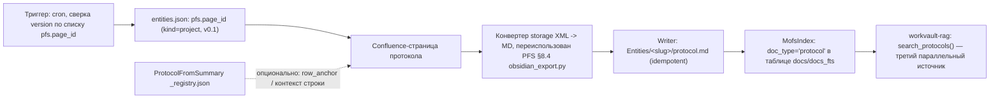

# ObsidianFromConfluence (OFC) — доставка подтверждённого протокола Confluence обратно в Obsidian

## Контракты экосистемы

### Источник истины
- Первичные протоколы Confluence: `api_confluence` (Confluence REST API `https://conf.tutu.ru`)
- Реестр сущностей и привязок страниц: EntityRegistry (`WorkVault/Registries/entities.json`, блок `pfs.page_id`)
- Локальные протоколы сущностей: ObsidianFromConfluence (`WorkVault/Entities/<slug>/protocol.md`)

### Входные контракты
| Поле | Тип | Обязательность | Источник (кто отдаёт) | Формат/enum |
|---|---|---|---|---|
| slug | str | required | EntityRegistry (`entities.json`) | идентификатор сущности (`kind: project`) |
| pfs.page_id | str | required | EntityRegistry (`entities.json`) | ID страницы Confluence-протокола |
| version.number | int | required | api_confluence | номер версии страницы в Confluence (`confluence_version`) |
| body.storage.value | str | required | api_confluence | содержимое страницы в формате Confluence Storage XHTML |

### Выходные контракты
| Поле | Тип | Потребитель (кто получает) | Формат/enum |
|---|---|---|---|
| source | str | MofsIndex, workvault-rag | константа "confluence" |
| confluence_page_id | str | MofsIndex, workvault-rag | ID страницы Confluence |
| confluence_version | int | MofsIndex, workvault-rag | номер версии страницы в Confluence |
| synced_at | datetime(iso8601) | MofsIndex, workvault-rag | дата и время синхронизации (ISO-8601 UTC) |
| entity_slug | str | MofsIndex, workvault-rag | slug сущности из entities.json |
| body | str | MofsIndex, workvault-rag | Markdown-содержимое протокола (конвертировано из Storage XML) |
| job_id | str | ErrorBus | константа "bf52e6985523" при отправке через `report_error.sh` |

### Зависимости
- Получает от: [api_confluence, EntityRegistry]
- Отдаёт: [MofsIndex, workvault-rag, ErrorBus]

### Breaking changes policy
- Версионирование frontmatter `protocol.md`: сверка изменений выполняется по `confluence_version`.
- При изменениях структуры `entities.json` (блока `pfs`) или REST API Confluence — адаптация `ofc_sync.sh` и скриптов конвертации.

### Границы («что НЕ трогать»)
- Не писать в Confluence и не модифицировать исходные страницы протокола (только чтение).
- Не изменять файлы FF в `Meetings/NewMeetings/` и legacy `Meetings/PreparedProtocols/`.
- Не модифицировать файлы в `Entities/<slug>/` кроме `protocol.md`.
- v0.1 обрабатывает только сущности с `kind: project` из `entities.json` с непустым `pfs.page_id`.

## 1. Обзор / Назначение

OFC — самодостаточный инструмент, доставляющий **подтверждённый** (после ревью участниками) протокол проекта из Confluence обратно в Obsidian (`WorkVault`), как чистый эталонный документ рядом с уставом проекта.

OFC явно **не зависит** от AFM (`AggregateFromMeetings`) — AFM представляет старое видение, которое может быть полностью пересмотрено, и OFC не подгоняется под его module D / `Projects/<slug>/card.md`. OFC строится только на уже реально существующей на диске структуре `Entities/<slug>/` (`EntitiesMigration`) и на реестре `entities.json`.

OFC дополняет **обратное** направление уже существующего прямого пайплайна:

```
FireFlies → MOFS → PFS → Confluence          (прямое направление, уже работает)
Confluence → OFC → Entities/<slug>/protocol.md  (обратное направление, этот инструмент)
```

Прямой пайплайн не меняется. OFC не пишет в Confluence, не читает/не изменяет реестры MOFS/PFS для их прямого назначения — только читает `entities.json` (список сущностей + `pfs.page_id`) и Confluence API для получения текста страницы.

## 2. Scope / Non-goals

### In scope (v0.1)

- Экспорт актуального содержимого Confluence-страницы протокола сущности в `Entities/<slug>/protocol.md`.
- v0.1 — только сущности с `kind: project` из `entities.json`, у которых непустой блок `pfs.page_id`.
- Периодическая (не событийная) проверка изменений на странице (сверка `version`).
- Расширение `MofsIndex` новым `doc_type='protocol'` в существующей таблице `docs`/`docs_fts`.
- Новая функция поиска в скилле `workvault-rag` (`search_protocols()` или `search_docs(doc_type='protocol')`), выдающая результат с явной подписью слоя.

### Non-goals

- **Не строит карточку проекта, риски, задачи, блокеры.** Это будущее развитие (централизованная работа с рисками — отдельная задача Саши, вне текущего скоупа).
- **Не трогает существующий ручной Механизм Б PFS** (`export-to-obsidian`, папка `Meetings/PreparedProtocols/`) — остаётся как есть, для edge-case встреч без привязки к сущности с `pfs.page_id`.
- **Не мигрирует существующие файлы** сущностей (например, `Entities/trisigma/Pages/trisigma_charter.md`, лежащий сейчас в `Pages/`, а не в корне по новой концепции) — миграция вне скоупа OFC, отдельный точечный тикет при необходимости.
- **Не трогает файлы FF** (`Meetings/NewMeetings/*-summary.md`, `*-transcript.md`) — ни физически, ни через изменение frontmatter/статусов.
- **Не дедуплицирует между слоями FF и Confluence.** Оба слоя факта признаны легитимными и равноправными (что обсуждали на встрече ≠ что согласовано по проекту); разделение решается только на выдаче поиска (см. §7), не на записи.
- **`kind` кроме `project`** (`multisync`, `one_on_one`, `person_1on1`, `sync_aid`) — v0.2, вне текущего скоупа.

## 3. Архитектура (компоненты)



- **Экспортёр** — генерализация `protocolfromsummary/obsidian_export.py` (PFS §8, МЕХАНИЗМ Б): вместо выгрузки одной строки одной встречи по явной команде — выгрузка всей страницы/актуального содержимого протокола сущности, по периодическому триггеру.
- **Конвертер** — переиспользуется §8.4 PFS (таблица storage XML → Markdown: `<ac:task>` → чекбокс, `<ac:link><ri:user>` mention → ФИО через `contacts.enc`, `<ac:structured-macro ac:name="anchor">` и HTML-комментарии выбрасываются). Канонический конвертер для протоколов. `ConfluenceSync.html_to_md()` остаётся отдельным каноническим конвертером для устава/brief/произвольных страниц в `Pages/`.
- **Writer** — idempotent-запись в `Entities/<slug>/protocol.md`; создаёт папку `Entities/<slug>/`, если её нет (симметрично паттерну MOFS «создать заглушку карточки при первом матче»).
- **Триггер** — периодический (крон), для каждой сущности из списка (`kind=project`, `pfs.page_id` не пусто) сверяет `version` Confluence-страницы с сохранённым в frontmatter `protocol.md` значением; при расхождении — конвертация и перезапись.
- **Индексация** — расширение уже существующей (не новой) таблицы `docs`/`docs_fts` `MofsIndex` (прецедент — `doc_type='tz'` для ТЗ, `MofsIndex_TZ.md` §Ц) новым значением `doc_type='protocol'`, glob-скоуп `Entities/*/protocol.md`.
- **Поиск** — `workvault-rag` получает протоколы как параллельный источник рядом с `search_meetings()`/`search_docs('tz')`.

## 4. Схема файлов/каталогов

```
Entities/<slug>/
├── charter.md          # устав (существующие файлы в Pages/ — миграция вне скоупа OFC)
├── protocol.md         # ← пишет OFC (этот инструмент)
├── card.md              # существующая карточка (не трогаем)
├── ...будущее: risks.md / tasks.md / snapshot.md (вне скоупа OFC)
└── Pages/
    ├── <slug>_brief.md  # контекст, не трогаем
    └── ...              # эксперименты / приёмка / детали процессов — не трогаем
```

Роль каталогов (принцип Саши):

- **Корень `Entities/<slug>/`** — эталонные, «живые» документы сущности: устав, протокол (OFC), в будущем карточка/риски/задачи.
- **`Entities/<slug>/Pages/`** — вспомогательный описательный контекст: эксперименты, критерии приёмки, детали внедряемых процессов/систем. Не эталонные аггрегаты.

## 5. Сущность данных / frontmatter `protocol.md`

```yaml
---
source: confluence
confluence_page_id: "490170597"
confluence_version: 42          # для сверки изменений триггером
synced_at: 2026-08-25T18:00:00+03:00
entity_slug: trisigma
---
```

Тело файла — чистый Markdown, конвертированный из storage XML по таблице §8.4 (задачи как чекбоксы, ФИО вместо `userkey`, без служебных anchor-маркеров и HTML-комментариев).

## 6. Модель триггера / периодичность

- Периодический крон (частота — уточняется на этапе реализации; ориентир — раз в день, синхронно с существующими тактами MOFS/PFS).
- По каждой сущности из списка (`kind=project`, `pfs.page_id` не пусто из `entities.json`) — `GET` страницы, сравнение `confluence_version` из ответа API с сохранённым в frontmatter `protocol.md`; при расхождении — конвертация и перезапись файла.
- Не событийный (момент завершения ревью участниками неизвестен и непредсказуем), не ручной как основной путь (ручной остаётся только у legacy Механизма Б PFS, §2 Non-goals).

## 7. Поисковая выдача (подпись слоя)

Дубли между слоями FF и Confluence не устраняются и не скрываются — оба легитимны, разделение происходит только на выдаче:

- `search_meetings()` → «Найдено во встречах (FF, необработанный черновик)».
- `search_protocols()` / `search_docs(doc_type='protocol')` → «Найдено в протоколе проекта (Confluence, согласовано)».

Оба слоя показываются, если релевантны запросу, без приоритизации одного за счёт другого.

## 8. Риски / питфоллы

- **Большие страницы (>5 MB storage)** — тот же лимит, что уже отмечен в PFS §7.7 N-5; конвертер может упереться в те же ограничения, учесть при реализации.
- **404 / удалённая страница** — переиспользовать graceful degradation из PFS §1.2, а не изобретать новое поведение.
- **Дубли `pfs.page_id` в `entities.json`.** Обнаружено на диске: `trisigma` и `ab_platforma` оба указывают на один и тот же `page_id: "490170597"`. Требует явного решения при реализации (пишем ли одинаковый `protocol.md` для обоих slug, или это сигнал более широкой проблемы схлопывания сущностей). Зафиксировано как наблюдение, разрешение — вне скоупа OFC v0.1.
- **Сущности без папки `Entities/<slug>/`.** Writer должен создавать её idempotent-но при первом синке, не ломаясь на первом запуске.
- **Двойной конвертер в экосистеме** (PFS §8.4 vs `ConfluenceSync.html_to_md()`). Риск дрифта при параллельном развитии обоих. Зафиксировано: §8.4 — единственный канонический конвертер для протоколов; `ConfluenceSync` — для остальных типов страниц.

## 9. Шаги реализации (ориентир для исполнителя)

1. Обобщить `obsidian_export.py` — от «по одному `meeting_id`» до «по всей странице/сущности».
2. Реализовать Writer с idempotent-созданием `Entities/<slug>/` и записью `protocol.md`.
3. Реализовать триггер (крон + сверка `version` по `entities.json`, только `kind=project`).
4. Добавить `doc_type='protocol'` в `MofsIndex` (`docs`/`docs_fts`), glob по `Entities/*/protocol.md`.
5. Добавить `search_protocols()` / расширение `search_docs()` + подпись слоя в `workvault-rag`.
6. Тесты: idempotency Writer'а, graceful degradation (404, лимит размера), корректность frontmatter (сверка `confluence_version`), отсутствие побочных эффектов на `Meetings/NewMeetings/` и на legacy `Meetings/PreparedProtocols/`.

## История версий

- **v0.1.2** (2026-08-29) — добавлен раздел ## Контракты экосистемы (ретрофит §2c).
- **v0.1.1** (2026-08-26) — актуализация после реализации и аудита: статус `active`; 404 Confluence → `not_found` (graceful-warning, без fail-soft батча); мониторинг `storage_html` >5MB → warning без падения; регистрация в `EcosystemManifest.json`; крон `bf52e6985523` (`*/30 8-23 * * 1-5`) активен, `deliver=local` (ошибки только через ErrorBus `report_error.sh`).
- **v0.1.0** (2026-08-25) — первичное ТЗ по итогам архитектурной сессии (research-режим): решения зафиксированы — самодостаточность от AFM, целевой путь `Entities/<slug>/protocol.md` в корне сущности, канонический конвертер §8.4, модель «два равноправных слоя без дедупликации, разделение на выдаче поиска», v0.1 только `kind: project`. Ждёт «берём в работу».
