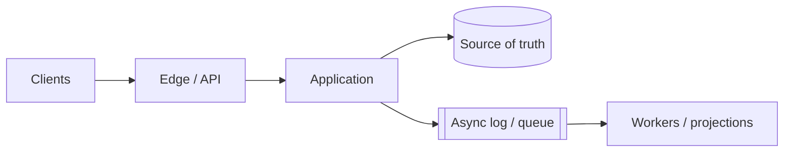

# Four-Stage System Design Framework

Используй этот файл как основной каркас построения System Design. Это оригинальная адаптация четырёхэтапного подхода Алекса Сюя: clarify → high-level design → deep dive → wrap-up. Каркас задаёт порядок инженерных решений и точек согласования.

## Этап 1. Понять задачу и зафиксировать границы

Начни с продуктовой цели: какое действие, результат или свойство система должна обеспечить и для кого. Уточняй только неизвестные, способные изменить архитектуру; остальные фиксируй как `Assumption`.

### Functional scope

- Кто основные actors и каков их главный job-to-be-done?
- Какие 1–3 critical flows входят в scope, а что явно не входит?
- Нужны ли create/read/update/delete, search, realtime, offline, analytics или moderation?
- Какой результат нельзя потерять, выполнить дважды или показать неавторизованному actor?

### Scale and workload

- Сколько active users/devices/tenants и действий на пользователя?
- Каковы average/peak load, peak factor, payload, retention и growth?
- Есть ли burstiness, hot keys, celebrity traffic или tenant skew?
- Какая география и какие network/client constraints важны?

### Quality attributes

- Какой latency target, percentile и измерительная граница у critical flow?
- Какие availability, durability, freshness, RPO/RTO нужны?
- Какой consistency invariant должен сохраняться?
- Какие privacy, security, abuse, compliance или residency ограничения есть?
- Какие budget, team capability и delivery constraints ограничивают сложность?

### Scope checkpoint

Зафиксируй:

```markdown
Goal: …
Actors / core flows: …
Out of scope: …
Scale: …
Critical guarantees: …
Assumptions: …
```

Если пользователь работает в режиме Architecture Drill, получи подтверждение checkpoint. При прямом запросе на дизайн продолжай с разумными явными assumptions.

## Этап 2. Построить high-level design

Иди от внешнего поведения внутрь:

1. Определи 2–4 основных API commands/queries или domain events.
2. Зафиксируй ключевые entities, lifecycle, source of truth и invariants.
3. Выполни только те back-of-the-envelope estimates, которые меняют решение.
4. Нарисуй минимальные system boundaries: actors → edge → compute → authoritative data → нужные async/projection paths.
5. Проследи один critical write flow и один critical read flow end-to-end.
6. Для каждого stateful или asynchronous компонента назови требование, которое оправдывает его существование.
7. Зафиксируй главные decisions и alternatives до углубления в детали.

### Минимальная схема



Не добавляй cache, queue, search, CDN, service mesh или отдельный microservice автоматически. Компонент нужен, только если можно закончить фразу: «Без него при driver X произойдёт Y».

## Этап 3. Углубиться в главный риск

Выбирай 1–3 deep dives по `risk × uncertainty × irreversibility`, а не по знакомству с технологией.

| Сигнал | Приоритетный deep dive |
|---|---|
| Read-heavy и skewed popularity | cache hierarchy, invalidation, hot keys, fanout |
| Write-heavy и growing dataset | partition key, indexes, write amplification, rebalancing |
| Realtime/chat/presence | connection ownership, ordering, delivery, reconnect |
| Money/inventory/booking | invariants, idempotency, concurrency, saga/outbox |
| Global users | placement, replication, consistency, routing, residency |
| Media/files | upload, object storage, metadata, CDN, processing pipeline |
| Search/feed | indexing/fanout, freshness, ranking, backfill |
| Multi-tenant platform | isolation, fairness, quotas, cells, noisy neighbor |
| Scheduler/queue | ownership/leases, dedupe, retry/DLQ, backlog |
| Existing production system | compatibility, migration, rollback, reconciliation |

Для каждого deep dive:

1. Назови invariant или измеримый target.
2. Покажи normal path.
3. Покажи concurrency, overload или partial-failure path.
4. Выбери механизм и минимум одну жизнеспособную альтернативу.
5. Назови цену: latency, staleness, amplification, cost, complexity или recovery burden.
6. Назови тест, метрику или rollout evidence, которые подтвердят решение.

## Этап 4. Проверить и завершить дизайн

Заверши архитектуру явным cross-check:

- critical flows сохраняют invariants;
- bottleneck, hotspot, single point of failure и blast radius понятны;
- slow dependency, overload, backlog, bad deploy и recovery имеют определённое поведение;
- SLI/SLO, observability, alerting и operational ownership согласованы;
- authn/authz, privacy, abuse и tenant isolation учтены в границах;
- rollout, rollback, schema/data migration и reconciliation выполнимы;
- cost guardrail и следующий scale/evolution trigger измеримы;
- open questions не скрыты и имеют владельца.

Итог должен содержать краткий recap, главные trade-offs, отклонённые альтернативы, assumptions/risks и validation plan. Не называй систему «полностью scalable» или «fault tolerant»: перечисли конкретные нагрузки и отказы, которые она выдерживает при заданных допущениях.

## Красные флаги процесса

- решение начинается со списка сервисов до требований;
- числа отсутствуют либо не влияют на дизайн;
- название продукта или класса БД заменяет reasoning;
- consistency описана глобально, а не по invariants/flows;
- retry предлагается без timeout, idempotency, limit и jitter;
- cache добавлен без freshness/invalidation/failure semantics;
- sharding выбран без access patterns, hotspots и rebalancing;
- happy path есть, а overload, recovery, migration и deploy отсутствуют;
- схема усложняется после каждого вопроса, но компоненты не удаляются;
- необратимое решение не имеет альтернативы и revisit signal.
