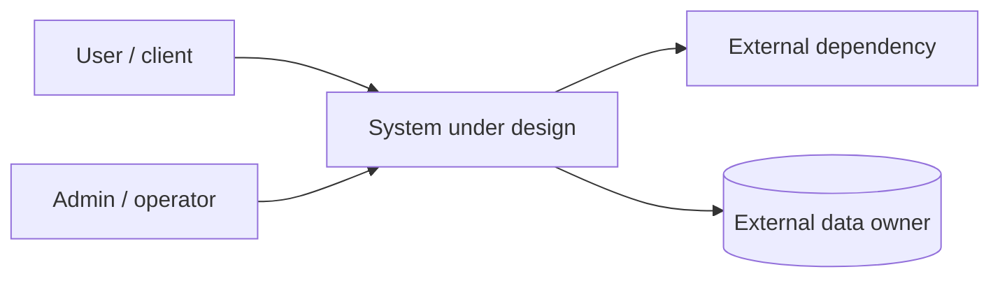
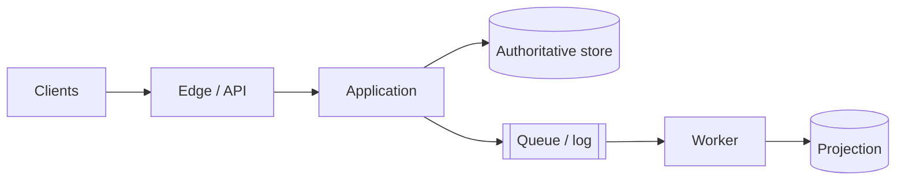
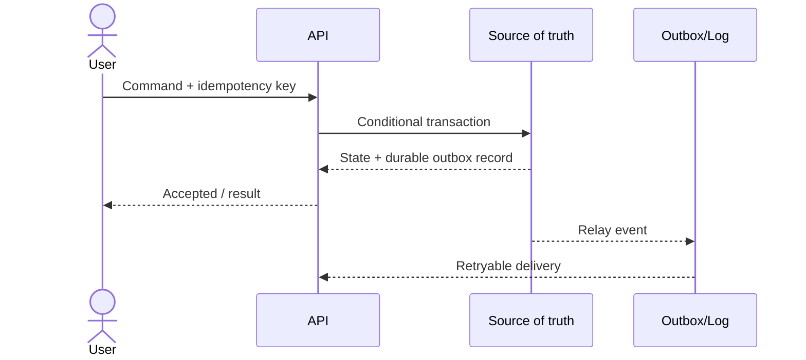
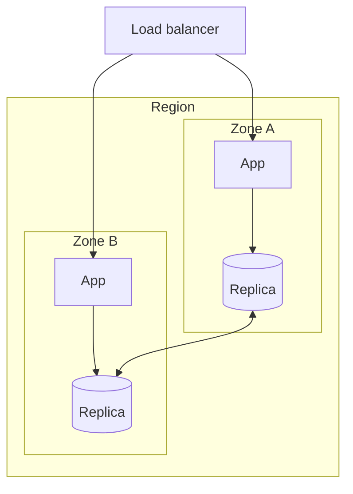

# Output and Diagram Templates

Выбери один минимально достаточный шаблон. Не выводи пустые разделы и не создавай все диаграммы сразу.

## System Design answer

```markdown
## 1. Scope
- Core use cases / out of scope
- Scale and NFR
- Assumptions

## 2. Estimates
- Formula → rounded result → consequence

## 3. Contracts and data
- APIs/events
- Entities/source of truth/invariants

## 4. High-level design
<one diagram>
- Write flow
- Read flow

## 5. Deep dives
- Risk → mechanism → alternative → trade-off → proof

## 6. Reliability, security and operations
- Failures/overload/degraded mode
- SLO/observability/deploy/DR
- Security/privacy/abuse

## 7. Wrap-up
- Decision recap
- Main trade-offs
- Bottleneck and next scale curve
```

## Architecture one-pager

```markdown
# <System> design
Status: draft | proposed | accepted

## Context and goal
## Drivers and constraints
## Scope / non-goals
## Current state (if any)
## Proposed design
## Critical flows and invariants
## Alternatives and decisions
## Reliability/security/operations/cost
## Rollout and migration
## Validation plan
## Risks, open questions, ownership
```

## Full RFC additions

Добавь к one-pager только нужные sections:

- detailed API/event/schema compatibility;
- ADRs;
- capacity model;
- data migration/backfill/reconciliation;
- threat/privacy model;
- failure-mode table;
- SLO and alert policy;
- adoption/deprecation plan;
- cost model.

## Review report

```markdown
## Outcome
<verdict and top risk>

## Evidence and limits
## Scorecard
## Critical / Major / Minor findings
## Good decisions to preserve
## Prioritized fix plan
## Questions and retest criteria
```

Для inline code review используй короткие actionable comments только на строки, где проблема проявляется; systemic finding оставь в summary.

## Architecture Drill checkpoint

```markdown
## Current design checkpoint
Known: …
Assumed: …
Decided: <decision → reason → price → revisit signal>
Open: <highest-impact first>
Risks: <risk → mitigation/validation>

Next question: …
```

Показывай checkpoint после смыслового этапа, при противоречии, по запросу или перед финальным синтезом. Не повторяй в нём всю историю разговора.

## Architecture Drill final synthesis

```markdown
## What changed
- Уточнённые требования, снятые противоречия и отброшенные допущения

## Architecture drivers
## Final design and critical flows
## Data ownership and invariants
## Reliability, security and operations
## Decisions, alternatives and trade-offs
## Assumptions, open questions and risks
## Validation and revisit signals
```

Если пользователь остановил Architecture Drill раньше done criteria, назови результат `current design`, а не `final design`, и выдели блокирующие неизвестные.

## Mermaid: system context



Используй для scope/trust boundaries, не для внутренних деталей.

## Mermaid: containers and data flow



Подписывай arrows глаголами или protocol/event. Выделяй authoritative store и async boundary.

## Mermaid: sequence with failure



Покажи success и один важный error/concurrency path, если он меняет semantics.

## Mermaid: deployment/failure boundaries



Не рисуй multi-zone/multi-region, пока не объяснены replication/failover semantics.

## Diagram quality rules

- Одна диаграмма — один вопрос: context, flow, data, deployment или sequence.
- 5–12 основных nodes предпочтительнее unreadable mega-diagram.
- Разделяй sync/async и read/write visual style/labels.
- Показывай ownership/source of truth/failure boundary, когда они важны.
- Не маскируй trade-off названием сервиса.
- Диаграмма должна сопровождаться narrative по critical flow.
